<!--
Tác giả: Vũ Quốc Hải + x6 Gehihi
VS Code Markdown Preview: Ctrl+Shift+V (Windows/Linux), Cmd+Shift+V (macOS)
-->

# CSD201: Tổng Hợp Đề Thi Thực Hành (PE), Lời Giải Và Tài Liệu Ôn Tập Toàn Diện

Chào mừng bạn đến với kho lưu trữ tổng hợp đề thi thực hành (Practical Exam - PE), lời giải chi tiết, mã nguồn kiểm chứng và tài liệu tra cứu môn **Cấu trúc dữ liệu và giải thuật (CSD201)** - Đại học FPT.

Tất cả **47 bộ tài liệu/đề thi** trong dự án đã được kiểm kê, bóc tách OCR nguyên văn, phân loại theo học kỳ từ năm 2022 đến 2026, cung cấp **hình ảnh cắt trực tiếp từ đề gốc**, **nguyên văn đề bài**, và **đáp án mã nguồn hoàn chỉnh** (chuẩn JDK 1.8, tuyệt đối sạch comment), hỗ trợ **Ctrl + F** tra cứu tức thì trong phòng thi.

## Mục lục

- [1. Hướng dẫn sử dụng](#1-hướng-dẫn-sử-dụng)
  - [1.1. Xem tài liệu Preview trên VS Code](#11-xem-tài-liệu-preview-trên-vs-code)
  - [1.2. Cấu trúc thư mục dự án](#12-cấu-trúc-thư-mục-dự-án)
  - [1.3. Hướng dẫn biên dịch và chạy bằng dòng lệnh (CLI)](#13-hướng-dẫn-biên-dịch-và-chạy-bằng-dòng-lệnh-cli)
  - [1.4. Hướng dẫn chạy trên Apache NetBeans IDE](#14-hướng-dẫn-chạy-trên-apache-netbeans-ide)
  - [1.5. Quy tắc kiểm tra file kết quả đầu ra (f1.txt, f2.txt...)](#15-quy-tắc-kiểm-tra-file-kết-quả-đầu-ra-f1txt-f2txt)
- [2. Tổng quan đề thi](#2-tổng-quan-đề-thi)
  - [2.1. Bảng kiểm kê toàn diện 47 bộ đề](#21-bảng-kiểm-kê-toàn-diện-47-bộ-đề)
  - [2.2. Phân loại cấu trúc đề thi theo thời gian và cơ sở](#22-phân-loại-cấu-trúc-đề-thi-theo-thời-gian-và-cơ-sở)
- [3. Hướng dẫn thi của từng đề](#3-hướng-dẫn-thi-của-từng-đề)
  - [3.1. Các quy định phòng thi chung (PE Instructions)](#31-các-quy-định-phòng-thi-chung-pe-instructions)
  - [3.2. Yêu cầu nộp bài và các bẫy 0 điểm](#32-yêu-cầu-nộp-bài-và-các-bẫy-0-điểm)
  - [3.3. Đối chiếu sự tuân thủ của bộ lời giải](#33-đối-chiếu-sự-tuân-thủ-của-bộ-lời-giải)
- [4. Code base & Nguồn tham chiếu](#4-code-base--nguồn-tham-chiếu)
- [5. Bảng câu hỏi tương tự và trùng lặp](#5-bảng-câu-hỏi-tương-tự-và-trùng-lặp)
  - [5.1. Nhóm câu hỏi Danh sách liên kết đơn (Singly Linked List - Q1)](#51-nhóm-câu-hỏi-danh-sách-liên-kết-đơn-singly-linked-list---q1)
  - [5.2. Nhóm câu hỏi Cây nhị phân tìm kiếm (Binary Search Tree - Q2)](#52-nhóm-câu-hỏi-cây-nhị-phân-tìm-kiếm-binary-search-tree---q2)
  - [5.3. Nhóm câu hỏi Đồ thị (Graph - Q3)](#53-nhóm-câu-hỏi-đồ-thị-graph---q3)
  - [5.4. Nhóm câu hỏi Cấu trúc dữ liệu nâng cao (Stack, Queue, AVL, Heap)](#54-nhóm-câu-hỏi-cấu-trúc-dữ-liệu-nâng-cao-stack-queue-avl-heap)
- [6. Lời giải chi tiết theo từng đề thi (Đầy đủ 47 đề tra cứu Ctrl+F kèm ảnh gốc)](#6-lời-giải-chi-tiết-theo-từng-đề-thi-đầy-đủ-47-đề-tra-cứu-ctrlf-kèm-ảnh-gốc)
  - [6.1. Nhóm đề năm 2024 (15 đề)](#61-nhóm-đề-năm-2024-15-đề)
  - [6.2. Nhóm đề năm 2025 (11 đề)](#62-nhóm-đề-năm-2025-11-đề)
  - [6.3. Nhóm đề năm 2026 (6 đề)](#63-nhóm-đề-năm-2026-6-đề)
  - [6.4. Nhóm đề năm 2023 (7 đề)](#64-nhóm-đề-năm-2023-7-đề)
  - [6.5. Nhóm đề năm 2022 (2 đề)](#65-nhóm-đề-năm-2022-2-đề)
  - [6.6. Nhóm đề cơ sở & Đề chuyên đề khác (6 đề)](#66-nhóm-đề-cơ-sở--đề-chuyên-đề-khác-6-đề)
- [7. Cẩm nang ôn thi và phân tích bài thi PE](#7-cẩm-nang-ôn-thi-và-phân-tích-bài-thi-pe)
  - [7.1. Kiến thức trọng tâm theo từng chủ đề](#71-kiến-thức-trọng-tâm-theo-từng-chủ-đề)
  - [7.2. Các lỗi sai thường gặp dẫn đến mất điểm đáng tiếc](#72-các-lỗi-sai-thường-gặp-dẫn-đến-mất-điểm-đáng-tiếc)
  - [7.3. Chiến lược phân bổ thời gian phòng thi (Chiến thuật 100 phút)](#73-chiến-lược-phân-bổ-thời-gian-phòng-thi-chiến-thuật-100-phút)
  - [7.4. Các dạng bài mở rộng cần chú ý](#74-các-dạng-bài-mở-rộng-cần-chú-ý)
- [8. Tham khảo nhanh (Cheat Sheet toàn diện)](#8-tham-khảo-nhanh-cheat-sheet-toàn-diện)
  - [8.1. Các thuật toán số học cơ bản](#81-các-thuật-toán-số-học-cơ-bản)
  - [8.2. Xử lý mảng và chuỗi](#82-xử-lý-mảng-và-chuỗi)
  - [8.3. Thao tác chuẩn trên Danh sách liên kết đơn (Singly Linked List)](#83-thao-tác-chuẩn-trên-danh-sách-liên-kết-đơn-singly-linked-list)
  - [8.4. Thao tác chuẩn trên Cây nhị phân tìm kiếm (Binary Search Tree)](#84-thao-tác-chuẩn-trên-cây-nhị-phân-tìm-kiếm-binary-search-tree)
  - [8.5. Thao tác chuẩn trên Đồ thị (Graph)](#85-thao-tác-chuẩn-trên-đồ-thị-graph)
  - [8.6. Hướng dẫn tái sử dụng mã nguồn và tránh xung đột khi làm bài](#86-hướng-dẫn-tái-sử-dụng-mã-nguồn-và-tránh-xung-đột-khi-làm-bài)

---

## 6. Lời giải chi tiết theo từng đề thi (Đầy đủ 47 đề tra cứu Ctrl+F kèm ảnh gốc)

### 6.1. Nhóm đề năm 2024 (15 đề)

#### 6.1.1. Đề thi: CSD201 - FA 2024 - Block 5 - PE
- **Thư mục lưu trữ mã nguồn:** [solutions/2024/fa24_b5_pe](./solutions/2024/fa24_b5_pe/)
- **Thư mục tài liệu gốc:** `CSD201 - FA 2024 - Block 5 - PE`

##### [Question 1] Danh sách liên kết đơn (MyList.java)
- **Mã nguồn giải:** [solutions/2024/fa24_b5_pe\Q1\src\MyList.java](./solutions/2024/fa24_b5_pe\Q1\src\MyList.java)

- **Hình ảnh trích xuất đề bài Question 1 từ đề gốc:**

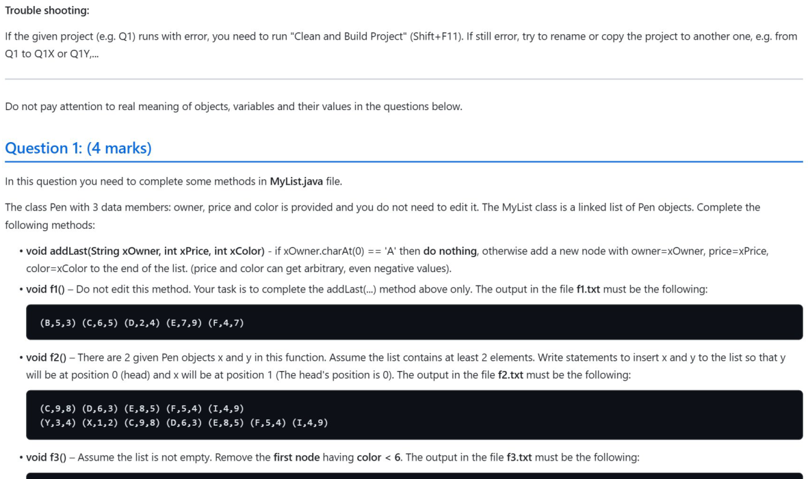

> **Nguyên văn đề bài (Question 1 - Tra cứu Ctrl+F):**
>
> Question 1: (4 marks)
> In this question you need to complete some methods in MyList.java file.
> The class Pen with 3 data members: owner, price and color is provided and you do not need to edit it. The MyList class is a linked list of Pen objects. Complete the
> following methods:
> > - void addLast(String xOwner, int xprice, int xColor) - if xOwner.charAt(0) == 'A' then do nothing, otherwise add a new node with owner=xOwner, price=xprice,
> color=xColor to the end of the list. (price and color can get arbitrary, even negative values).
> > - void fl() — Do not edit this method. Your task is to complete the addLast(...) method above only. The output in the file f1.txt must be the following:
> (E, 7,9) (F, 4.7)
> > - void f2() — There are 2 given Pen objects x and y in this function. Assume the list contains at least 2 elements. Write statements to insert x and y to the list so that y
> will be at position O (head) and x will be at position 1 (The head's position is O). The output in the file f2.txt must be the following:
> > - void f3() — Assume the list is not empty. Remove the first node having color < 6. The output in the file f3.txt must be the following:
> > - void f4() — Assume the list contains at least 5 elements. Sort the first 5 elements ascendingly by color. The content of the output file f4.txt must be the following:
> (C, 7,9) (K
> (C, 7,9) (E,6.16) (3,324) (K. 2,3)

- **Đáp án mã nguồn Java hoàn chỉnh (Giữ format và comment gốc của Given):**
```java
/* This program contains 2 parts: (1) and (2)
   YOUR TASK IS TO COMPLETE THE PART  (2)  ONLY
 */
//(1)==============================================================
import java.util.*;
import java.io.*;

public class MyList {
  Node head,tail;
  MyList() {head=tail=null;}
  boolean isEmpty() {
    return(head==null);
   }
  void clear() {head=tail=null;}

  void fvisit(Node p, RandomAccessFile f) throws Exception {
    if(p != null) f.writeBytes(p.info + " ");
   }

  void ftraverse(RandomAccessFile f) throws Exception {
    Node p = head;
    while(p!=null) {
       fvisit(p,f); // You will use this statement to write information of the node p to the file
       p=p.next;
      }
    f.writeBytes("\r\n");
   }

  void loadData(int k) { //do not edit this function
    String [] a = Lib.readLineToStrArray("data.txt", k);
    int [] b = Lib.readLineToIntArray("data.txt", k+1);
    int [] c = Lib.readLineToIntArray("data.txt", k+2);
    int n = a.length;
    for(int i=0;i<n;i++) addLast(a[i],b[i],c[i]);
   }

//===========================================================================
//(2)===YOU CAN EDIT OR EVEN ADD NEW FUNCTIONS IN THE FOLLOWING PART========
//===========================================================================
/* 
   Khong su dung tieng Viet co dau de viet ghi chu.
   Neu dung khi chay truc tiep se bao loi va nhan 0 diem
*/
  void addLast(String xOwner, int xPrice, int xColor) {
    //You should write here appropriate statements to complete this function.
    if(xOwner.charAt(0) == 'A') return;
    Pen x = new Pen(xOwner, xPrice, xColor);
    Node q = new Node(x);
    if(isEmpty()) {
      head = tail = q;
    } else {
      tail.next = q;
      tail = q;
    }
   }

  //You do not need to edit this function. Your task is to complete the addLast function above only.
  void f1() throws Exception {
     clear();
     loadData(1);
     String fname = "f1.txt";
     File g123 = new File(fname);
     if(g123.exists()) g123.delete();
     RandomAccessFile  f = new RandomAccessFile(fname, "rw");
     ftraverse(f);
     f.close();
    }

//==================================================================
  void f2() throws Exception {
     clear();
     loadData(5);
     String fname = "f2.txt";
     File g123 = new File(fname);
     if(g123.exists()) g123.delete();
     RandomAccessFile  f = new RandomAccessFile(fname, "rw");
     ftraverse(f);
     Pen x, y;
     x = new Pen("X",1,2);
     y = new Pen("Y",3,4);
     //------------------------------------------------------------------------------------
     /*You must keep statements pre-given in this function.
       Your task is to insert statements here, just after this comment,
       to complete the question in the exam paper.*/
     Node ny = new Node(y);
     Node nx = new Node(x);
     ny.next = nx;
     nx.next = head;
     head = ny;
    //------------------------------------------------------------------------------------
     ftraverse(f);
     f.close();
    }

//==================================================================
  void f3() throws Exception {
     clear();
     loadData(9);
     String fname = "f3.txt";
     File g123 = new File(fname);
     if(g123.exists()) g123.delete();
     RandomAccessFile  f = new RandomAccessFile(fname, "rw");
     ftraverse(f);
     //------------------------------------------------------------------------------------
     /*You must keep statements pre-given in this function.
       Your task is to insert statements here, just after this comment,
       to complete the question in the exam paper.*/
     Node p = head, prev = null;
     while(p != null) {
       if(p.info.color < 6) {
         if(prev == null) {
           head = head.next;
           if(head == null) tail = null;
         } else {
           prev.next = p.next;
           if(p == tail) tail = prev;
         }
         break;
       }
       prev = p;
       p = p.next;
     }
    //------------------------------------------------------------------------------------
     ftraverse(f);
     f.close();
    }

//==================================================================
  void f4() throws Exception {
     clear();
     loadData(13);
     String fname = "f4.txt";
     File g123 = new File(fname);
     if(g123.exists()) g123.delete();
     RandomAccessFile  f = new RandomAccessFile(fname, "rw");
     ftraverse(f);
     //------------------------------------------------------------------------------------
     /*You must keep statements pre-given in this function.
       Your task is to insert statements here, just after this comment,
       to complete the question in the exam paper.*/
     int count = 0;
     Node p = head;
     while(p != null && count < 5) {
       Node q = p.next;
       int inner = count + 1;
       while(q != null && inner < 5) {
         if(p.info.color > q.info.color) {
           Pen tmp = p.info;
           p.info = q.info;
           q.info = tmp;
         }
         q = q.next;
         inner++;
       }
       p = p.next;
       count++;
     }
    //------------------------------------------------------------------------------------
     ftraverse(f);
     f.close();
    }

}
```

- **Kết quả kiểm chứng thực tế:**
  - `f1.txt`: `(B,5,3) (C,6,5) (D,2,4) (E,7,9) (F,4,7)`
  - `f2.txt`: `(C,9,8) (D,6,3) (E,8,5) (F,5,4) (I,4,9)  | (Y,3,4) (X,1,2) (C,9,8) (D,6,3) (E,8,5) (F,5,4) (I,4,9)`
  - `f3.txt`: `(C,8,6) (D,6,7) (E,9,2) (F,5,8) (G,9,7) (H,6,8) (I,7,3)  | (C,8,6) (D,6,7) (F,5,8) (G,9,7) (H,6,8) (I,7,3)`
  - `f4.txt`: `(C,7,9) (D,16,7) (E,6,16) (F,5,6) (I,4,5) (J,3,4) (K,2,3)  | (I,4,5) (F,5,6) (D,16,7) (C,7,9) (E,6,16) (J,3,4) (K,2,3)`

##### [Question 2] Cây nhị phân tìm kiếm (BSTree.java)
- **Mã nguồn giải:** [solutions/2024/fa24_b5_pe\Q2\src\BSTree.java](./solutions/2024/fa24_b5_pe\Q2\src\BSTree.java)

- **Hình ảnh trích xuất đề bài Question 2 từ đề gốc:**

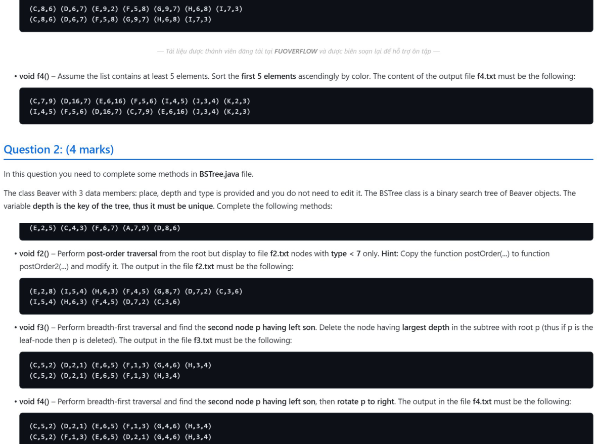

> **Nguyên văn đề bài (Question 2 - Tra cứu Ctrl+F):**
>
> Question 2: (4 marks)
> In this question you need to complete some methods in BSTree.java file.
> The class Beaver with 3 data members: place, depth and type is provided and you do not need to edit it. The BSTree class is a binary search tree of Beaver objects. The
> variable depth is the key of the tree, thus it must be unique. Complete the following methods:
> > - void insert(String xPlace, int xDepth, int xType) - if xPlace.charAt(0) 'B' then do nothing, otherwise insert a new Beaver object with place=xPlace, depth=xDepth,
> type=xType to the tree (depth and type can get arbitrary, even negative values).
> > - void fl() — Do not edit this method. Your task is to complete the insert(...) method above only. The output in the file f1.txt must be the following:
> (A, 7,9) (E, 2,5)
> (E, 2,5) (A, 7,9)
> > - void f2() — Perform post-order traversal from the root but display to file f2.txt nodes with type < 7 only. Hint: Copy the function to function
> postOrder2(...) and modify it. The output in the file f2.txt must be the following:
> (E, 2,8)
> > - void f3() — Perform breadth-first traversal and find the second node p having left son. Delete the node having largest depth in the subtree with root p (thus if p is the
> leaf-node then p is deleted). The output in the file f3.txt must be the following:
> (F, 1, 3) (H, 3,4)
> (CS, 2) (D, 2.1) (F, 1,3) (H,3.4)
> > - void f4() — Perform breadth-first traversal and find the second node p having left son, then rotate p to right. The output in the file f4.txt must be the following:
> (CS, 2) (D, 2.1) (F, 1,3) (G,4.6) (H, 3,4)
> (D, 2,1)

- **Đáp án mã nguồn Java hoàn chỉnh (Giữ format và comment gốc của Given):**
```java
/* This program contains 2 parts: (1) and (2)
   YOUR TASK IS TO COMPLETE THE PART  (2)  ONLY
 */
//(1)==============================================================
import java.io.*;
import java.util.*;
public class BSTree {
  Node root;
  BSTree() {root=null;}
  boolean isEmpty() {
    return(root==null);
  }
  void clear() {root=null;}
  void visit(Node p) {
    System.out.print(p.info + " ");
  }
  void fvisit(Node p, RandomAccessFile f) throws Exception {
    if(p != null) f.writeBytes(p.info + " ");
  }
  void breadth(Node p, RandomAccessFile f) throws Exception {
    if(p==null) return;
    Queue q = new Queue();
    q.enqueue(p);Node r;
    while(!q.isEmpty()) {
      r = q.dequeue();
      fvisit(r,f);
      if(r.left!=null) q.enqueue(r.left);
      if(r.right!=null) q.enqueue(r.right);
    }
  }
  void preOrder(Node p, RandomAccessFile f) throws Exception {
    if(p==null) return;
    fvisit(p,f);
    preOrder(p.left,f);
    preOrder(p.right,f);
  }
  void inOrder(Node p, RandomAccessFile f) throws Exception {
    if(p==null) return;
    inOrder(p.left,f);
    fvisit(p,f);
    inOrder(p.right,f);
  }
  void postOrder(Node p, RandomAccessFile f) throws Exception {
    if(p==null) return;
    postOrder(p.left,f);
    postOrder(p.right,f);
    fvisit(p,f);
  }
  void loadData(int k) {
    String [] a = Lib.readLineToStrArray("data.txt", k);
    int [] b = Lib.readLineToIntArray("data.txt", k+1);
    int [] c = Lib.readLineToIntArray("data.txt", k+2);
    int n = a.length;
    for(int i=0;i<n;i++) insert(a[i],b[i],c[i]);
  }
//===========================================================================
//(2)===YOU CAN EDIT OR EVEN ADD NEW FUNCTIONS IN THE FOLLOWING PART========
//===========================================================================
/* 
   Khong su dung tieng Viet co dau de viet ghi chu.
   Neu dung khi chay truc tiep se bao loi va nhan 0 diem
*/
  void insert(String xPlace, int xDepth, int xType) {
    //You should insert here statements to complete this function
    if(xPlace.charAt(0) == 'B') return;
    Beaver x = new Beaver(xPlace, xDepth, xType);
    Node q = new Node(x);
    if(isEmpty()) {
      root = q;
      return;
    }
    Node p = root, f = null;
    while(p != null) {
      if(p.info.depth == xDepth) return;
      f = p;
      if(xDepth < p.info.depth) p = p.left;
      else p = p.right;
    }
    if(xDepth < f.info.depth) f.left = q;
    else f.right = q;
  }
//Do not edit this function. Your task is to complete insert function above only.
  void f1() throws Exception {
    clear();
    loadData(1);
    String fname = "f1.txt";
    File g123 = new File(fname);
    if(g123.exists()) g123.delete();
    RandomAccessFile  f = new RandomAccessFile(fname, "rw");
    breadth(root,f);
    f.writeBytes("\r\n");
    inOrder(root,f);
    f.writeBytes("\r\n");
    f.close();
  }
  void postOrder2(Node p, RandomAccessFile f) throws Exception {
    if(p==null) return;
    postOrder2(p.left,f);
    postOrder2(p.right,f);
    if(p.info.type < 7) fvisit(p,f);
  }
  void f2() throws Exception {
    clear();
    loadData(5);
    String fname = "f2.txt";
    File g123 = new File(fname);
    if(g123.exists()) g123.delete();
    RandomAccessFile  f = new RandomAccessFile(fname, "rw");
    postOrder(root,f);
    f.writeBytes("\r\n");
    postOrder2(root,f);
    f.writeBytes("\r\n");
    f.close();
  }
  Node findSecondNodeWithLeftSon() {
    if(root == null) return null;
    Queue q = new Queue();
    q.enqueue(root);
    int count = 0;
    while(!q.isEmpty()) {
      Node r = q.dequeue();
      if(r.left != null) {
        count++;
        if(count == 2) return r;
      }
      if(r.left != null) q.enqueue(r.left);
      if(r.right != null) q.enqueue(r.right);
    }
    return null;
  }
  Node getParent(Node child) {
    if(root == null || child == null || root == child) return null;
    Node p = root, parent = null;
    while(p != null) {
      if(p == child) return parent;
      parent = p;
      if(child.info.depth < p.info.depth) p = p.left;
      else p = p.right;
    }
    return null;
  }
  void deleteLargestInSubtree(Node p) {
    if(p == null) return;
    Node maxNode = p;
    Node parent = getParent(p);
    Node pMax = parent;
    while(maxNode.right != null) {
      pMax = maxNode;
      maxNode = maxNode.right;
    }
    if(maxNode == p) {
      if(parent == null) {
        root = p.left;
      } else if(parent.left == p) {
        parent.left = p.left;
      } else {
        parent.right = p.left;
      }
    } else {
      pMax.right = maxNode.left;
    }
  }
  void rotateRight(Node p) {
    if(p == null || p.left == null) return;
    Node c = p.left;
    Node parent = getParent(p);
    p.left = c.right;
    c.right = p;
    if(parent == null) {
      root = c;
    } else if(parent.left == p) {
      parent.left = c;
    } else {
      parent.right = c;
    }
  }
  void f3() throws Exception {
    clear();
    loadData(9);
    String fname = "f3.txt";
    File g123 = new File(fname);
    if(g123.exists()) g123.delete();
    RandomAccessFile  f = new RandomAccessFile(fname, "rw");
    breadth(root,f);
    f.writeBytes("\r\n");
    Node p = findSecondNodeWithLeftSon();
    deleteLargestInSubtree(p);
    breadth(root,f);
    f.writeBytes("\r\n");
    f.close();
  }
  void f4() throws Exception {
    clear();
    loadData(13);
    String fname = "f4.txt";
    File g123 = new File(fname);
    if(g123.exists()) g123.delete();
    RandomAccessFile  f = new RandomAccessFile(fname, "rw");
    breadth(root,f);
    f.writeBytes("\r\n");
    Node p = findSecondNodeWithLeftSon();
    rotateRight(p);
    breadth(root,f);
    f.writeBytes("\r\n");
    f.close();
  }
}
```

- **Kết quả kiểm chứng thực tế:**
  - `f1.txt`: `(A,7,9) (C,4,3) (D,8,6) (E,2,5) (F,6,7)  | (E,2,5) (C,4,3) (F,6,7) (A,7,9) (D,8,6)`
  - `f2.txt`: `(E,2,8) (I,5,4) (H,6,3) (F,4,5) (G,8,7) (D,7,2) (C,3,6)  | (I,5,4) (H,6,3) (F,4,5) (D,7,2) (C,3,6)`
  - `f3.txt`: `(C,5,2) (D,2,1) (E,6,5) (F,1,3) (G,4,6) (H,3,4)  | (C,5,2) (D,2,1) (E,6,5) (F,1,3) (H,3,4)`
  - `f4.txt`: `(C,5,2) (D,2,1) (E,6,5) (F,1,3) (G,4,6) (H,3,4)  | (C,5,2) (F,1,3) (E,6,5) (D,2,1) (G,4,6) (H,3,4)`

##### [Question 3] Đồ thị (Graph.java)
- **Mã nguồn giải:** [solutions/2024/fa24_b5_pe\Q3\src\Graph.java](./solutions/2024/fa24_b5_pe\Q3\src\Graph.java)

- **Hình ảnh trích xuất đề bài Question 3 từ đề gốc:**

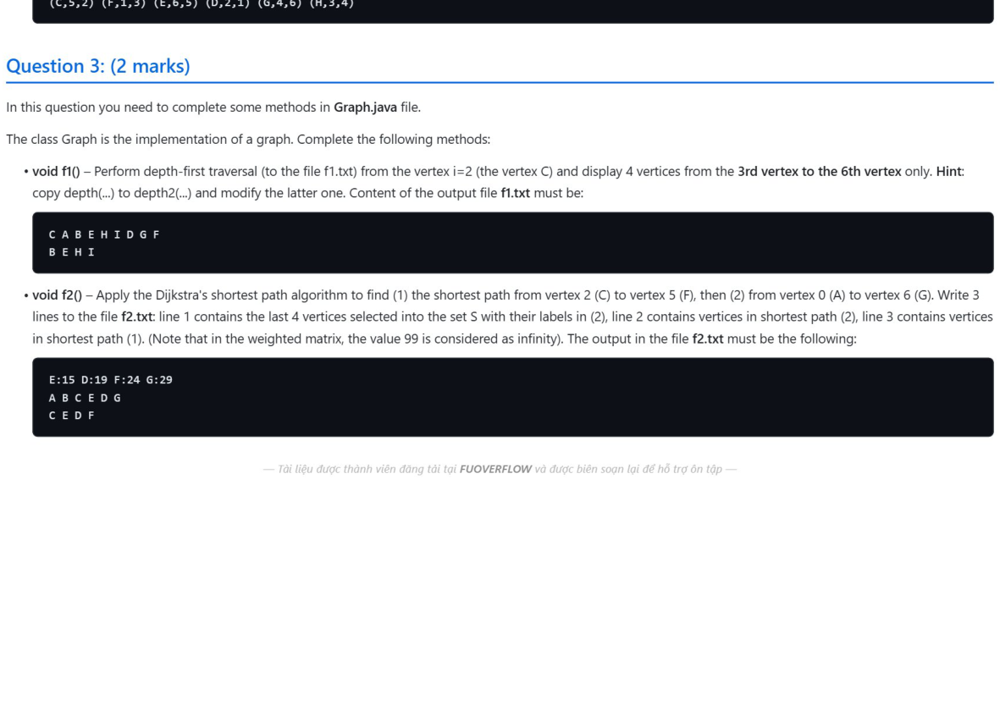

> **Nguyên văn đề bài (Question 3 - Tra cứu Ctrl+F):**
>
> Question 3: (2 marks)
> In this question you need to complete some methods in Graph.java file.
> The class Graph is the implementation of a graph. Complete the following methods:
> > - void fl() — Perform depth-first traversal (to the file f1 .txt) from the vertex i=2 (the vertex C) and display 4 vertices from the 3rd vertex to the 6th vertex only. Hint:
> copy depth(...) to depth2(...) and modify the latter one. Content of the output file f1.txt must be:
> CABEHIDGF
> BEHI
> > - void f2() — Apply the Dijkstra's shortest path algorithm to find (1) the shortest path from vertex 2 (C) to vertex 5 (F), then (2) from vertex O (A) to vertex 6 (G). Write 3
> lines to the file f2.txt: line 1 contains the last 4 vertices selected into the set S with their labels in (2), line 2 contains vertices in shortest path (2), line 3 contains vertices
> in shortest path (1). (Note that in the weighted matrix, the value 99 is considered as infinity). The output in the file f2.txt must be the following:
> E:15 D:19 F:24 6:29
> ABC EDG
> CED F

- **Đáp án mã nguồn Java hoàn chỉnh (Giữ format và comment gốc của Given):**
```java
/* This program contains 2 parts: (1) and (2)
   YOUR TASK IS TO COMPLETE THE PART  (2)  ONLY
 */
//(1)==============================================================
import java.io.*;
import java.util.*;
public class Graph {
  int [][] a;
  int n;
  char v[];
  int deg[];
  Graph() {
    v = "ABCDEFGHIJKLMNOP".toCharArray();
    deg = new int[20];
    a = new int[20][20];
    n = 0;
  }
  void loadData(int k) {
    RandomAccessFile f;
    int i,j,x;
    String s;
    StringTokenizer t;
    a = new int[20][20];
    try {
      f = new RandomAccessFile("data.txt","r");
      for(i=0;i<k;i++) f.readLine();
      s = f.readLine();s = s.trim();
      n = Integer.parseInt(s);
      for(i=0;i<n;i++) {
        s = f.readLine();s = s.trim();
        t = new StringTokenizer(s);
        for(j=0;j<n;j++) {
          x = Integer.parseInt(t.nextToken().trim());
          a[i][j] = x;
        }
      }
      f.close();
    }
    catch(Exception e) {}
  }
  void fvisit(int i, RandomAccessFile f) throws Exception {
    f.writeBytes("  " + v[i]);
  }
  void depth2(boolean [] visited, int k, RandomAccessFile f, ArrayList<Integer> order) throws Exception {
    fvisit(k, f);
    visited[k] = true;
    order.add(k);
    for(int j=0; j<n; j++) {
      if(!visited[j] && a[k][j]>0) depth2(visited, j, f, order);
    }
  }
//===========================================================================
//(2)===YOU CAN EDIT OR EVEN ADD NEW FUNCTIONS IN THE FOLLOWING PART========
//===========================================================================
/* 
   Khong su dung tieng Viet co dau de viet ghi chu.
   Neu dung khi chay truc tiep se bao loi va nhan 0 diem
*/
  void f1() throws Exception {
    loadData(1);
    String fname = "f1.txt";
    File g123 = new File(fname);
    if(g123.exists()) g123.delete();
    RandomAccessFile f = new RandomAccessFile(fname, "rw");
    boolean [] visited = new boolean[20];
    for(int i=0; i<n; i++) visited[i] = false;
    ArrayList<Integer> order = new ArrayList<Integer>();
    depth2(visited, 2, f, order);
    f.writeBytes("\r\n");
    for(int i=2; i<6 && i<order.size(); i++) {
      f.writeBytes("  " + v[order.get(i)]);
    }
    f.writeBytes("\r\n");
    f.close();
  }
  class DijkstraResult {
    int[] d;
    int[] p;
    int[] s;
    int count;
    DijkstraResult(int n) {
      d = new int[n];
      p = new int[n];
      s = new int[n];
      count = 0;
    }
  }
  DijkstraResult dijkstra(int from) {
    DijkstraResult res = new DijkstraResult(n);
    boolean[] visited = new boolean[n];
    for(int i=0; i<n; i++) {
      res.d[i] = 99;
      res.p[i] = from;
      visited[i] = false;
    }
    res.d[from] = 0;
    for(int i=0; i<n; i++) {
      int u = -1, min = 99;
      for(int j=0; j<n; j++) {
        if(!visited[j] && res.d[j] < min) {
          min = res.d[j];
          u = j;
        }
      }
      if(u == -1) break;
      visited[u] = true;
      res.s[res.count++] = u;
      for(int vIdx=0; vIdx<n; vIdx++) {
        if(!visited[vIdx] && a[u][vIdx] > 0 && a[u][vIdx] < 99) {
          if(res.d[u] + a[u][vIdx] < res.d[vIdx]) {
            res.d[vIdx] = res.d[u] + a[u][vIdx];
            res.p[vIdx] = u;
          }
        }
      }
    }
    return res;
  }
  ArrayList<Integer> getPath(int[] p, int from, int to) {
    ArrayList<Integer> path = new ArrayList<Integer>();
    int curr = to;
    while(curr != from) {
      path.add(curr);
      curr = p[curr];
    }
    path.add(from);
    Collections.reverse(path);
    return path;
  }
  void f2() throws Exception {
    loadData(12);
    String fname = "f2.txt";
    File g123 = new File(fname);
    if(g123.exists()) g123.delete();
    RandomAccessFile f = new RandomAccessFile(fname, "rw");
    DijkstraResult r1 = dijkstra(2);
    DijkstraResult r2 = dijkstra(0);
    int startIdx = Math.max(0, r2.count - 4);
    for(int i=startIdx; i<r2.count; i++) {
      int u = r2.s[i];
      f.writeBytes(v[u] + ":" + r2.d[u] + " ");
    }
    f.writeBytes("\r\n");
    ArrayList<Integer> path2 = getPath(r2.p, 0, 6);
    for(int node : path2) {
      f.writeBytes(v[node] + " ");
    }
    f.writeBytes("\r\n");
    ArrayList<Integer> path1 = getPath(r1.p, 2, 5);
    for(int node : path1) {
      f.writeBytes(v[node] + " ");
    }
    f.writeBytes("\r\n");
    f.close();
  }
}
```

- **Kết quả kiểm chứng thực tế:**
  - `f1.txt`: `C  A  B  E  H  I  D  G |   B  E  H  I`
  - `f2.txt`: `E:15 D:19 F:24 G:29  | A B C E D G `

---

#### 6.1.2. Đề thi: CSD201 - FA 2024 - PE - Đề số - 10
- **Thư mục lưu trữ mã nguồn:** [solutions/2024/fa24_pe_de10](./solutions/2024/fa24_pe_de10/)
- **Thư mục tài liệu gốc:** `CSD201 - FA 2024 - PE - Đề số - 10`

##### [Question 1] Danh sách liên kết đơn (MyList.java)
- **Mã nguồn giải:** [solutions/2024/fa24_pe_de10\Q1\src\MyList.java](./solutions/2024/fa24_pe_de10\Q1\src\MyList.java)

- **Hình ảnh trích xuất đề bài Question 1 từ đề gốc:**

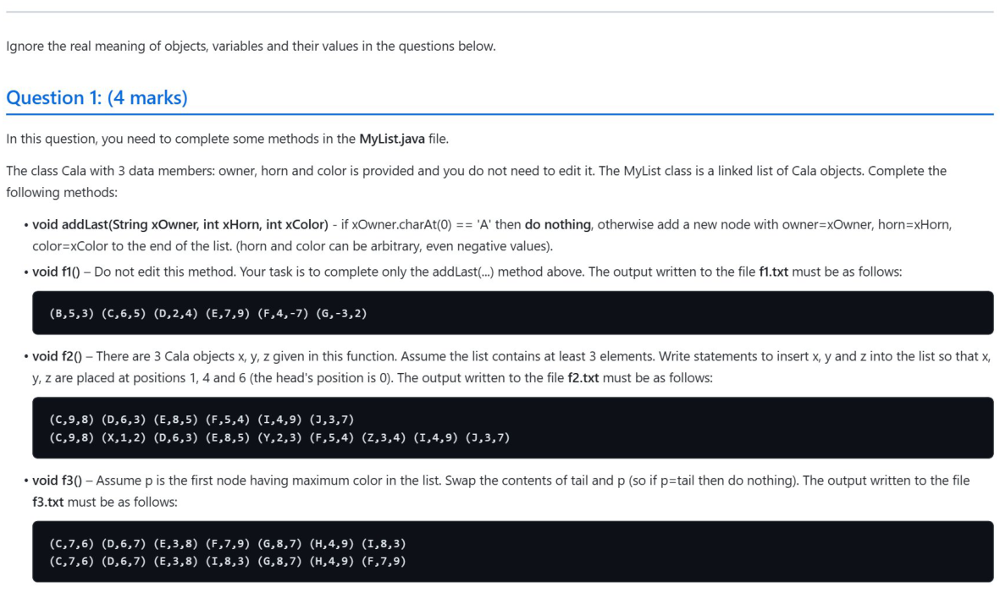

> **Nguyên văn đề bài (Question 1 - Tra cứu Ctrl+F):**
>
> Question 1: (4 marks)
> In this question, you need to complete some methods in the MyList.java file.
> The class Cala with 3 data members: owner, horn and color is provided and you do not need to edit it. The MyList class is a linked list of Cala objects. Complete the
> following methods:
> > - void addLast(String xOwner, int xHorn, int xColor) - if xOwner.charAt(0) 'A' then do nothing, otherwise add a new node with owner=xOwner, horn=xHom,
> color=xColor to the end of the list. (horn and color can be arbitrary, even negative values).
> > - void fl() — Do not edit this method. Your task is to complete only the addLast(...) method above. The output written to the file f1.txt must be as follows:
> (E, 7,9) (G, -3, 2)
> > - void f2() — There are 3 Cala objects x, y, z given in this function. Assume the list contains at least 3 elements. Write statements to insert x, y and z into the list so that x,
> y, z are placed at positions 1, 4 and 6 (the head's position is 0). The output written to the file f2.txt must be as follows:
> (Y, 2.3) (J, 3, 7)
> > - void f3() — Assume p is the first node having maximum color in the list. Swap the contents of tail and p (so if p=tail then do nothing). The output written to the file
> f3.txt must be as follows:
> (C, 7,6) (F, 7,9)
> (C, 7,6)
> > - void f4() — Assume there is only one node p with owner=D in the list, and there are at least 6 nodes after p. Sort the 6 elements following p in ascending order of
> color. The content of the output file f4.txt must be as follows:
> (L (M, 3.4)
> (K (L (M, 3.4)

- **Đáp án mã nguồn Java hoàn chỉnh (Giữ format và comment gốc của Given):**
```java
/* This program contains 2 parts: (1) and (2)
   YOUR TASK IS TO COMPLETE THE PART  (2)  ONLY
 */
//(1)==============================================================
import java.util.*;
import java.io.*;

public class MyList {
  Node head,tail;
  MyList() {head=tail=null;}
  boolean isEmpty() {
    return(head==null);
   }
  void clear() {head=tail=null;}

  void fvisit(Node p, RandomAccessFile f) throws Exception {
    if(p != null) f.writeBytes(p.info + " ");
   }

  void ftraverse(RandomAccessFile f) throws Exception {
    Node p = head;
    while(p!=null) {
       fvisit(p,f); // You will use this statement to write information of the node p to the file
       p=p.next;
      }
    f.writeBytes("\r\n");
   }

  void loadData(int k) { //do not edit this function
    String [] a = Lib.readLineToStrArray("data.txt", k);
    int [] b = Lib.readLineToIntArray("data.txt", k+1);
    int [] c = Lib.readLineToIntArray("data.txt", k+2);
    int n = a.length;
    for(int i=0;i<n;i++) addLast(a[i],b[i],c[i]);
   }

//===========================================================================
//(2)===YOU CAN EDIT OR EVEN ADD NEW FUNCTIONS IN THE FOLLOWING PART========
//===========================================================================
/* 
   Khong su dung tieng Viet co dau de viet ghi chu.
   Neu dung khi chay truc tiep se bao loi va nhan 0 diem
*/
  void addLast(String xOwner, int xHorn, int xColor) {
    //You should write here appropriate statements to complete this function.
    if(xOwner.charAt(0) == 'A') {
        return;
    }
    
    Cala cala = new Cala(xOwner, xHorn, xColor);
    Node node = new Node(cala);
    
    if(isEmpty()) {
        head = tail = node;
        return;
    }
    
    tail.next = node;
    tail = node;
}

  //You do not need to edit this function. Your task is to complete the addLast function above only.
  void f1() throws Exception {
     clear();
     loadData(1);
     String fname = "f1.txt";
     File g123 = new File(fname);
     if(g123.exists()) g123.delete();
     RandomAccessFile  f = new RandomAccessFile(fname, "rw"); 
     ftraverse(f);
     f.close();
    }  

//==================================================================
  void f2() throws Exception {
     clear();
     loadData(5);
     String fname = "f2.txt";
     File g123 = new File(fname);
     if(g123.exists()) g123.delete();
     RandomAccessFile  f = new RandomAccessFile(fname, "rw"); 
     ftraverse(f);
     Cala x, y, z;
     x = new Cala("X",1,2);
     y = new Cala("Y",2,3);
     z = new Cala("Z",3,4);
     //------------------------------------------------------------------------------------
     Node p = head;
     Node nx = new Node(x, p.next);
     p.next = nx;
     
     p = head;
     for(int i = 0; i < 3; i++) {
         p = p.next;
     }
     Node ny = new Node(y, p.next);
     p.next = ny;
     
     p = head;
     for(int i = 0; i < 5; i++) {
         p = p.next;
     }
     Node nz = new Node(z, p.next);
     p.next = nz;
     //------------------------------------------------------------------------------------
     ftraverse(f);
     f.close();
    }  

//==================================================================
  void f3() throws Exception {
    clear();
    loadData(9);
    String fname = "f3.txt";
    File g123 = new File(fname);
    if(g123.exists()) g123.delete();
    RandomAccessFile  f = new RandomAccessFile(fname, "rw"); 
    ftraverse(f);
    //------------------------------------------------------------------------------------
    Node p = head;
    Node maxNode = head;
    int maxColor = head.info.color;
    
    while(p != null) {
        if(p.info.color > maxColor) {
            maxColor = p.info.color;
            maxNode = p;
        }
        p = p.next;
    }
    
    if(maxNode != tail) {
        Cala temp = maxNode.info;
        maxNode.info = tail.info;
        tail.info = temp;
    }
    //------------------------------------------------------------------------------------
    ftraverse(f);
    f.close();
  }   

//==================================================================
  void f4() throws Exception {
    clear();
    loadData(13);
    String fname = "f4.txt";
    File g123 = new File(fname);
    if(g123.exists()) g123.delete();
    RandomAccessFile  f = new RandomAccessFile(fname, "rw"); 
    ftraverse(f);
    //------------------------------------------------------------------------------------
    Node p = head;
    while(p != null && !p.info.owner.equals("D")) {
        p = p.next;
    }
    
    if(p != null) {
        Node[] arr = new Node[6];
        Node current = p.next;
        for(int i = 0; i < 6 && current != null; i++) {
            arr[i] = current;
            current = current.next;
        }
        
        for(int i = 0; i < 5; i++) {
            for(int j = 0; j < 5-i; j++) {
                if(arr[j].info.color > arr[j+1].info.color) {
                    Cala temp = arr[j].info;
                    arr[j].info = arr[j+1].info;
                    arr[j+1].info = temp;
                }
            }
        }
    }
    //------------------------------------------------------------------------------------
    ftraverse(f);
    f.close();
   }

 }
```

- **Kết quả kiểm chứng thực tế:**
  - `f1.txt`: `(B,5,3) (C,6,5) (D,2,4) (E,7,9) (F,4,-7) (G,-3,2)`
  - `f2.txt`: `(C,9,8) (D,6,3) (E,8,5) (F,5,4) (I,4,9) (J,3,7)  | (C,9,8) (X,1,2) (D,6,3) (E,8,5) (Y,2,3) (F,5,4) (Z,3,4) (I,4,9) (J,3,7)`
  - `f3.txt`: `(C,7,6) (D,6,7) (E,3,8) (F,7,9) (G,8,7) (H,4,9) (I,8,3)  | (C,7,6) (D,6,7) (E,3,8) (I,8,3) (G,8,7) (H,4,9) (F,7,9)`
  - `f4.txt`: `(C,9,8) (D,11,12) (E,8,7) (F,1,2) (I,7,9) (J,6,8) (K,5,6) (L,9,8) (M,3,4)  | (C,9,8) (D,11,12) (F,1,2) (K,5,6) (E,8,7) (J,6,8) (L,9,8) (I,7,9) (M,3,4)`

##### [Question 2] Cây nhị phân tìm kiếm (BSTree.java)
- **Mã nguồn giải:** [solutions/2024/fa24_pe_de10\Q2\src\BSTree.java](./solutions/2024/fa24_pe_de10\Q2\src\BSTree.java)

- **Hình ảnh trích xuất đề bài Question 2 từ đề gốc:**

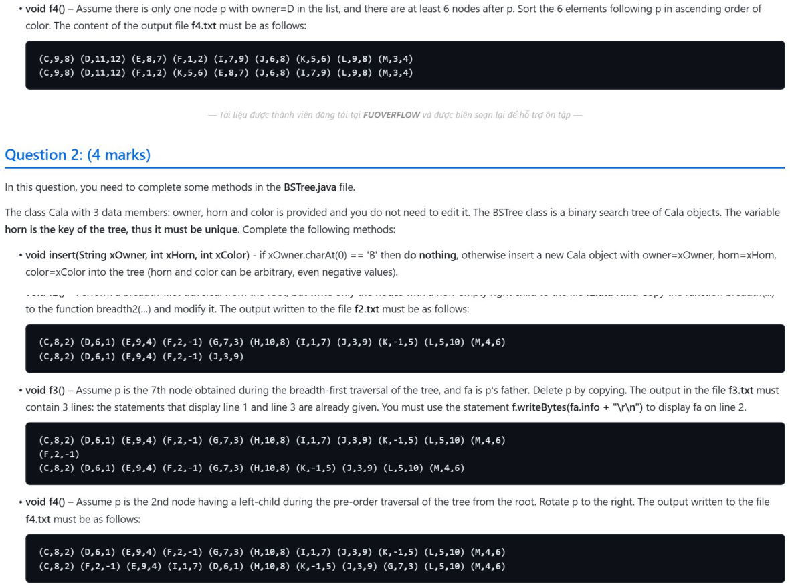

> **Nguyên văn đề bài (Question 2 - Tra cứu Ctrl+F):**
>
> Question 2: (4 marks)
> In this question, you need to complete some methods in the BSTree.java file.
> The class Cala with 3 data members: owner, horn and color is provided and you do not need to edit it. The BSTree class is a binary search tree of Cala objects. The variable
> horn is the key of the tree, thus it must be unique. Complete the following methods:
> > - void insert(String xOwner, int xHorn, int xCoIor) - if xOwner.charAt(0) 'B' then do nothing, otherwise insert a new Cala object with owner=xOwner, horn=xHorn,
> color=xColor into the tree (horn and color can be arbitrary, even negative values).
> > - void fl() — Do not edit this method. Your task is to complete only the insert(...) method above. The output written to the file f1.txt must be as follows:
> (A, 7,9) (E, 2,5) (F, -6.7)
> (F, -6,7)
> > - void f2() — Perform a breadth-first traversal from the root, but write only the nodes with a non-empty right child to the file f2.txt. Hint: Copy the function breadth(.„)
> to the function breadth2(...) and modify it. The output written to the file f2.txt must be as follows:
> (E,9,4) (F, 2, -1) (G, 7.3) (H,1e.8) (J, 3,9) (K, -1,5)
> > - void f3() — Assume p is the 7th node obtained during the breadth-first traversal of the tree, and fa is p's father. Delete p by copying. The output in the file f3.txt must
> contain 3 lines: the statements that display line 1 and line 3 are already given. You must use the statement f.writeBytes(fa.info + "\r\n") to display fa on line 2.
> (F, 2, -1) (G, 7.3) (K, -1,5)
> (CS, 2) (F. 2, -1) (G, 7.3) (H,1e.8) (K, -1.5) (M.4,6)
> > - void f4() — Assume p is the 2nd node having a left-child during the pre-order traversal of the tree from the root. Rotate p to the right. The output written to the file
> f4.txt must be as follows:
> (F, 2, -1) (K, -1,5)
> (1.1,7) (D,6.1) (H,1e.8) (K. -1.5) (G, 7,3)

- **Đáp án mã nguồn Java hoàn chỉnh (Giữ format và comment gốc của Given):**
```java
/* This program contains 2 parts: (1) and (2)
   YOUR TASK IS TO COMPLETE THE PART  (2)  ONLY
 */
//(1)==============================================================
import java.io.*;
import java.util.*;

public class BSTree {
   Node root;
   BSTree() {root=null;}
   boolean isEmpty() {
       return(root==null);
      }
   void clear() {
       root=null;
      }
   void visit(Node p) {
      System.out.print("p.info: ");
      if(p != null) System.out.println(p.info + " ");
     }
   void fvisit(Node p, RandomAccessFile f) throws Exception {
      if(p != null) f.writeBytes(p.info + " ");
     }
   void breadth(Node p, RandomAccessFile f) throws Exception {
     if(p==null) return;
     Queue q = new Queue();
     q.enqueue(p);Node r;
     while(!q.isEmpty()) {
        r = q.dequeue();
        fvisit(r,f);
        if(r.left!=null) q.enqueue(r.left);
        if(r.right!=null) q.enqueue(r.right);
       }
    }
   void preOrder(Node p, RandomAccessFile f) throws Exception {
      if(p==null) return;
      fvisit(p,f);
      preOrder(p.left,f);
      preOrder(p.right,f);
     }
   void inOrder(Node p, RandomAccessFile f) throws Exception {
      if(p==null) return;
      inOrder(p.left,f);
      fvisit(p,f);
      inOrder(p.right,f);
     }
   void postOrder(Node p, RandomAccessFile f) throws Exception {
      if(p==null) return;
      postOrder(p.left,f);
      postOrder(p.right,f);
      fvisit(p,f);
     }

   void loadData(int k) { //do not edit this function
      String [] a = Lib.readLineToStrArray("data.txt", k);
      int [] b = Lib.readLineToIntArray("data.txt", k+1);
      int [] c = Lib.readLineToIntArray("data.txt", k+2);
      int n = a.length;
      for(int i=0;i<n;i++) insert(a[i],b[i],c[i]);
     }

//===========================================================================
//(2)===YOU CAN EDIT OR EVEN ADD NEW FUNCTIONS IN THE FOLLOWING PART========
//===========================================================================
  void insert(String xOwner, int xHorn, int xColor) {
    //You should insert here statements to complete this function
    if(xOwner.charAt(0) == 'B') return;
    
    Node node = new Node(new Cala(xOwner, xHorn, xColor));
    
    if(root == null) {
        root = node;
        return;
    }
    
    Node p = root;
    Node parent = null;
    
    while(p != null) {
        parent = p;
        if(xHorn < p.info.horn) {
            p = p.left;
        } else if(xHorn > p.info.horn) {
            p = p.right;
        } else {
            return;
        }
    }
    
    if(xHorn < parent.info.horn) {
        parent.left = node;
    } else {
        parent.right = node;
    }
}

//Do not edit this function. Your task is to complete insert function above only.
  void f1() throws Exception {
    clear();
    loadData(1);
    String fname = "f1.txt";
    File g123 = new File(fname);
    if(g123.exists()) g123.delete();
    RandomAccessFile  f = new RandomAccessFile(fname, "rw"); 
    breadth(root,f);
    f.writeBytes("\r\n");
    inOrder(root,f);
    f.writeBytes("\r\n");
    f.close();
   }  
  
//=============================================================
 void f2() throws Exception {
    clear();
    loadData(5);
    String fname = "f2.txt";
    File g123 = new File(fname);
    if(g123.exists()) g123.delete();
    RandomAccessFile  f = new RandomAccessFile(fname, "rw"); 
    breadth(root,f);
    f.writeBytes("\r\n");
    
    breadth2(root,f);
    
    f.writeBytes("\r\n");
    f.close();
   }  

void breadth2(Node p, RandomAccessFile f) throws Exception {
    if(p == null) return;
    Queue q = new Queue();
    q.enqueue(p);
    Node r;
    while(!q.isEmpty()) {
        r = q.dequeue();
        if(r.right != null) {
            fvisit(r,f);
        }
        if(r.left != null) q.enqueue(r.left);
        if(r.right != null) q.enqueue(r.right);
    }
}

//=============================================================
  void f3() throws Exception {
    clear();
    loadData(9);
    String fname = "f3.txt";
    File g123 = new File(fname);
    if(g123.exists()) g123.delete();
    RandomAccessFile f = new RandomAccessFile(fname, "rw"); 
    breadth(root,f);
    f.writeBytes("\r\n");
    
    Node p = null, fa = null;
    Queue q = new Queue();
    q.enqueue(root);
    int count = 0;
    
    while(!q.isEmpty()) {
        Node r = q.dequeue();
        count++;
        
        if(count == 7) {
            p = r;
            break;
        }
        
        if(r.left != null) {
            q.enqueue(r.left);
        }
        if(r.right != null) {
            q.enqueue(r.right);
        }
    }
    
    if(p != null) {
        fa = getParent(root, p);
    }
    
    if(fa != null) {
        f.writeBytes(fa.info + "\r\n");
    }
    
    if(p != null) {
        deleteByCopy(p);
    }
    
    breadth(root,f);
    f.writeBytes("\r\n");
    f.close();
}

void deleteByCopy(Node p) {
    if(p == null) return;
    Node f = null, q = root;
    while(q != null) {
        if(q.info.horn == p.info.horn) break;
        f = q;
        if(p.info.horn < q.info.horn) q = q.left;
        else q = q.right;
    }
    if(q.left == null && q.right == null) {
        if(f == null) root = null;
        else if(f.left == q) f.left = null;
        else f.right = null;
    }
    else if(q.left == null) {
        if(f == null) root = q.right;
        else if(f.left == q) f.left = q.right;
        else f.right = q.right;
    }
    else if(q.right == null) {
        if(f == null) root = q.left;
        else if(f.left == q) f.left = q.left;
        else f.right = q.left;
    }
    else {
        Node rp = q.right;
        Node frp = q;
        while(rp.left != null) {
            frp = rp;
            rp = rp.left;
        }
        q.info = rp.info;
        if(frp == q) frp.right = rp.right;
        else frp.left = rp.right;
    }
}

//=============================================================
 void f4() throws Exception {
    clear();
    loadData(13);
    String fname = "f4.txt";
    File g123 = new File(fname);
    if(g123.exists()) g123.delete();
    RandomAccessFile f = new RandomAccessFile(fname, "rw"); 
    breadth(root,f);
    f.writeBytes("\r\n");
    
    Node p = findNode();
    
    rotateRight(p);
    
    breadth(root,f);
    f.writeBytes("\r\n");
    f.close();
}

Node findNode() {
    int count = 0;
    return preOrderFind(root, count);
}

Node preOrderFind(Node p, int count) {
    if(p == null) return null;
    if(p.left != null) count++;
    if(count == 2) return p;
    Node leftResult = preOrderFind(p.left, count);
    if(leftResult != null) return leftResult;
    return preOrderFind(p.right, count);
}

void rotateRight(Node p) {
    if(p == null || p.left == null) return;
    Node parent = getParent(root, p);
    Node q = p.left;
    p.left = q.right;
    q.right = p;
    if(parent == null) root = q;
    else if(parent.left == p) parent.left = q;
    else parent.right = q;
}

Node getParent(Node root, Node p) {
    if(root == null || p == root) return null;
    if(root.left == p || root.right == p) return root;
    Node left = getParent(root.left, p);
    if(left != null) return left;
    return getParent(root.right, p);
}

 }
```

- **Kết quả kiểm chứng thực tế:**
  - `f1.txt`: `(A,7,9) (C,4,3) (D,8,6) (E,2,5) (Y,6,-7) (F,-6,7)  | (F,-6,7) (E,2,5) (C,4,3) (Y,6,-7) (A,7,9) (D,8,6)`
  - `f2.txt`: `(C,8,2) (D,6,1) (E,9,4) (F,2,-1) (G,7,3) (H,10,8) (I,1,7) (J,3,9) (K,-1,5) (L,5,10) (M,4,6)  | (C,8,2) (D,6,1) (E,9,4) (F,2,-1) (J,3,9)`
  - `f3.txt`: `(C,8,2) (D,6,1) (E,9,4) (F,2,-1) (G,7,3) (H,10,8) (I,1,7) (J,3,9) (K,-1,5) (L,5,10) (M,4,6)  | (F,2,-1)`
  - `f4.txt`: `(C,8,2) (D,6,1) (E,9,4) (F,2,-1) (G,7,3) (H,10,8) (I,1,7) (J,3,9) (K,-1,5) (L,5,10) (M,4,6)  | (C,8,2) (F,2,-1) (E,9,4) (I,1,7) (D,6,1) (H,10,8) (K,-1,5) (J,3,9) (G,7,3) (L,5,10) (M,4,6)`

##### [Question 3] Đồ thị (Graph.java)
- **Mã nguồn giải:** [solutions/2024/fa24_pe_de10\Q3\src\Graph.java](./solutions/2024/fa24_pe_de10\Q3\src\Graph.java)

- **Hình ảnh trích xuất đề bài Question 3 từ đề gốc:**

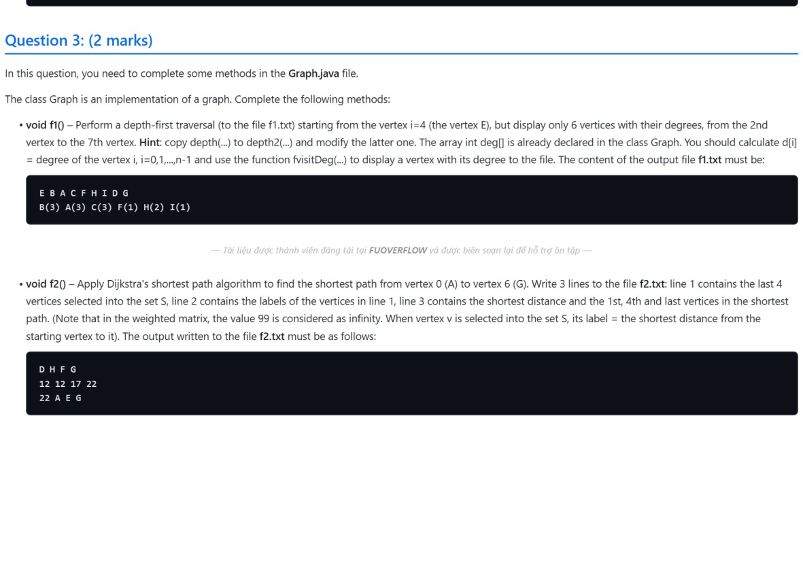

> **Nguyên văn đề bài (Question 3 - Tra cứu Ctrl+F):**
>
> Question 3: (2 marks)
> In this question, you need to complete some methods in the Graph.java file.
> The class Graph is an implementation of a graph. Complete the following methods:
> > - void fl() — Perform a depth-first traversal (to the file f1 .txt) starting from the vertex i=4 (the vertex E), but display only 6 vertices with their degrees, from the 2nd
> vertex to the 7th vertex. Hint: copy depth(...) to depth2(...) and modify the latter one. The array int dego is already declared in the class Graph. You should calculate d[i]
> = degree of the vertex i, and use the function fvisitDeg(...) to display a vertex with its degree to the file. The content of the output file f1.txt must be:
> EBACFHIDG
> B(3) A(3) C(3) F(l) H(2) 1(1)
> > - void f2() — Apply Dijkstra's shortest path algorithm to find the shortest path from vertex O (A) to vertex 6 (G). Write 3 lines to the file f2.txt: line 1 contains the last 4
> vertices selected into the set S, line 2 contains the labels of the vertices in line 1, line 3 contains the shortest distance and the 1st, 4th and last vertices in the shortest
> path. (Note that in the weighted matrix, the value 99 is considered as infinity. When vertex v is selected into the set S, its label = the shortest distance from the
> starting vertex to it). The output written to the file f2.txt must be as follows:
> 12 12 17 22
> 22 A E G

- **Đáp án mã nguồn Java hoàn chỉnh (Giữ format và comment gốc của Given):**
```java
/* This program contains 2 parts: (1) and (2)
   YOUR TASK IS TO COMPLETE THE PART  (2)  ONLY
 */
//(1)============================================
import java.io.*;
import java.util.*;
//-------------------------------------------------------------------------------
public class Graph {
  int [][] a; int n;
  char v[];
  int deg[];
  Graph() {
    v = "ABCDEFGHIJKLMNOP".toCharArray();
    deg = new int[20];
    a = new int[20][20];
    n = 0;
   }

  void loadData(int k) {  //do not edit this function
    RandomAccessFile f;int i,j,x;
    String s;StringTokenizer t;
    a = new int[20][20];
    try {
     f = new RandomAccessFile("data.txt","r");
     for(i=0;i<k;i++) f.readLine();
     s = f.readLine();s = s.trim();
     n = Integer.parseInt(s);
     for(i=0;i<n;i++) {
       s = f.readLine();s = s.trim();
       t = new StringTokenizer(s);
       for(j=0;j<n;j++) { 
         x = Integer.parseInt(t.nextToken().trim());
         a[i][j] = x;
        }
       }
     f.close();
     }
    catch(Exception e) {}

   }

  void dispAdj() {
    int i,j;
    for(i=0;i<n;i++) {
      System.out.println();
      for(j=0;j<n;j++)
        System.out.printf("%4d",a[i][j]);
     }
   }

  void fvisit(int i, RandomAccessFile f) throws Exception {
    f.writeBytes("  "+v[i]);
   }
  
  /* There is an array int deg[] already declared in the class Graph 
     You should write a funcion to calculate d[i] = degree of the vertex i
  */
  void fvisitDeg(int i, RandomAccessFile f) throws Exception {
    f.writeBytes("  "+v[i]+"("+deg[i]+")"); // d[i] = degree of the vertex i
   }
  
 void fdispAdj(RandomAccessFile f) throws Exception { 
    int i,j;
    f.writeBytes("n = "+n+"\r\n");
    for(i=0;i<n;i++) {
      f.writeBytes("\r\n");
      for(j=0;j<n;j++)  f.writeBytes("  " + a[i][j]);
     }
    f.writeBytes("\r\n");
   }

  void breadth(boolean [] en, int i, RandomAccessFile f) throws Exception {
    Queue q = new Queue();
    int r,j;
    q.enqueue(i); en[i]=true;
    while(!q.isEmpty()) {
      r = q.dequeue();
      fvisit(r,f);
      for(j=0;j<n;j++) {
        if(!en[j] && a[r][j]>0) {
         q.enqueue(j);en[j]=true;
        }
       }
     }
   }

  void breadth(int  k, RandomAccessFile f) throws Exception {
    boolean [] en = new boolean[20];
    int i;
    for(i=0;i<n;i++) en[i]=false;
    breadth(en,k,f);
    for(i=0;i<n;i++) 
      if(!en[i]) breadth(en,i,f);
   }

 void depth(boolean [] visited,int k, RandomAccessFile f) throws Exception {
    fvisit(k,f);visited[k]=true;
    for(int i=0;i<n;i++) {
      if(!visited[i] && a[k][i]>0) depth(visited,i,f);
     }
   }
  void depth(int k, RandomAccessFile f) throws Exception {
    boolean [] visited = new boolean[20];
    int i;
    for(i=0;i<n;i++) visited[i]=false;
    depth(visited,k,f);
    for(i=0;i<n;i++) 
       if(!visited[i]) depth(visited,i,f);
   }

//===========================================================================
//(2)===YOU CAN EDIT OR EVEN ADD NEW FUNCTIONS IN THE FOLLOWING PART========
//===========================================================================
  void f1() throws Exception {
    loadData(1);
    String fname = "f1.txt";
    File g123 = new File(fname);
    if(g123.exists()) g123.delete();
    RandomAccessFile f = new RandomAccessFile(fname, "rw"); 
    
    for(int i = 0; i < n; i++) {
        deg[i] = 0;
        for(int j = 0; j < n; j++)
            if(a[i][j] > 0) deg[i]++;
    }
    
    depth(4,f);
    f.writeBytes("\r\n");
    
    boolean [] visited = new boolean[20];
    for(int i = 0; i < n; i++) visited[i] = false;
    depth2(visited, 4, f);
    
    f.writeBytes("\r\n");
    f.close();
  }

  void depth2(boolean [] visited, int k, RandomAccessFile f) throws Exception {
    int count = 0;
    int[] path = new int[20];
    int psize = 0;
    Stack s = new Stack();
    s.push(k);
    
    while(!s.isEmpty()) {
        k = s.pop();
        if(!visited[k]) {
            path[psize++] = k;
            visited[k] = true;
        }
        for(int i = n-1; i >= 0; i--) {
            if(!visited[i] && a[k][i] > 0) {
                s.push(i);
            }
        }
    }
    
    for(int i = 1; i < 7 && i < psize; i++) {
        fvisitDeg(path[i], f);
    }
  }

//=================================================================================================
  void f2() throws Exception {
    loadData(12);
    String fname = "f2.txt";
    File g123 = new File(fname);
    if(g123.exists()) g123.delete();
    RandomAccessFile f = new RandomAccessFile(fname, "rw"); 
    
    int[] dist = new int[n];
    int[] path = new int[n];
    boolean[] visited = new boolean[n];
    int[] selected = new int[n];
    int sel = 0;
    
    for(int i = 0; i < n; i++) {
        dist[i] = 99999;
        path[i] = -1;
        visited[i] = false;
    }
    dist[0] = 0;
    
    for(int i = 0; i < n; i++) {
        int u = -1;
        int min = 99999;
        for(int j = 0; j < n; j++) {
            if(!visited[j] && dist[j] < min) {
                min = dist[j];
                u = j;
            }
        }
        if(u == -1) break;
        visited[u] = true;
        selected[sel++] = u;
        
        for(int v = 0; v < n; v++) {
            if(!visited[v] && a[u][v] != 99 && dist[u] + a[u][v] < dist[v]) {
                dist[v] = dist[u] + a[u][v];
                path[v] = u;
            }
        }
    }
    
    for(int i = sel-4; i < sel; i++) {
        f.writeBytes(v[selected[i]] + " ");
    }
    f.writeBytes("\r\n");
    
    for(int i = sel-4; i < sel; i++) {
        f.writeBytes(dist[selected[i]] + " ");
    }
    f.writeBytes("\r\n");
    
    f.writeBytes(dist[6] + " " + v[0] + " " + v[4] + " " + v[6]);
    
    f.writeBytes("\r\n");
    f.close();
  }

}
```

- **Kết quả kiểm chứng thực tế:**
  - `f1.txt`: `E  B  A  C  F  H  I  D  G |   B(3)  A(3)  C(3)  F(1)  H(2)  I(1)`
  - `f2.txt`: `D H F G  | 12 12 17 22 `

---

#### 6.1.3. Đề thi: CSD201 - FA 2024 - PE - Đề số - 3
- **Thư mục lưu trữ mã nguồn:** [solutions/2024/fa24_pe_de3](./solutions/2024/fa24_pe_de3/)
- **Thư mục tài liệu gốc:** `CSD201 - FA 2024 - PE - Đề số - 3`

##### [Question 1] Danh sách liên kết đơn (MyList.java)
- **Mã nguồn giải:** [solutions/2024/fa24_pe_de3\Q1\src\MyList.java](./solutions/2024/fa24_pe_de3\Q1\src\MyList.java)

- **Hình ảnh trích xuất đề bài Question 1 từ đề gốc:**

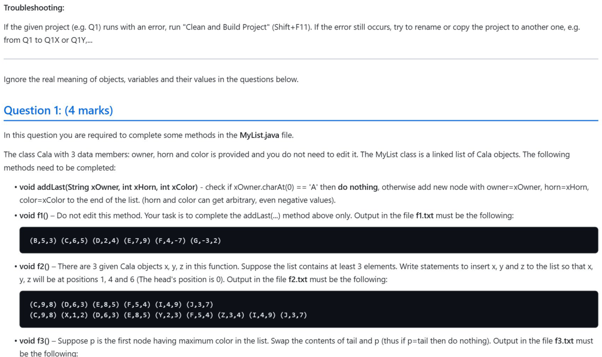

> **Nguyên văn đề bài (Question 1 - Tra cứu Ctrl+F):**
>
> Question 1: (4 marks)
> In this question you are required to complete some methods in the MyList.java file.
> The class Cala with 3 data members: owner, horn and color is provided and you do not need to edit it. The MyList class is a linked list of Cala objects. The following
> methods need to be completed:
> > - void addLast(String xOwner, int xHorn, int xColor) - check if xOwner.charAt(0) == 'A' then do nothing, otherwise add new node with owner=xOwner, horn=xHorn,
> color=xColor to the end of the list. (horn and color can get arbitrary, even negative values).
> > - void fl() — Do not edit this method. Your task is to complete the addLast(...) method above only. Output in the file f1.txt must be the following:
> (E, 7,9) (G, -3.2)
> > - void f2() — There are 3 given Cala objects x, y, z in this function. Suppose the list contains at least 3 elements. Write statements to insert x, y and z to the list so that x,
> y, z will be at positions 1, 4 and 6 (The head's position is O). Output in the file f2.txt must be the following:
> (Y, 2,3) (J, 3, 7)
> > - void f3() — Suppose p is the first node having maximum color in the list. Swap the contents of tail and p (thus if p=tail then do nothing). Output in the file f3.txt must
> be the following:
> (C, 7.6) (F. 7,9) (G,8.7) (1.8,3)
> (C, 7,6) (F, 7.9)
> > - void f4() — Suppose in the list there is only one node p having owner=D, and there are at least 6 nodes after p. Sort 6 elements after p ascendingly by color. The
> content of the output file f4.txt must be the following:
> (L (M, 3.4)
> (L (M, 3,4)

- **Đáp án mã nguồn Java hoàn chỉnh (Giữ format và comment gốc của Given):**
```java
/* This program contains 2 parts: (1) and (2)
   YOUR TASK IS TO COMPLETE THE PART  (2)  ONLY
 */
//(1)==============================================================
import java.util.*;
import java.io.*;

public class MyList {

    Node head, tail;

    MyList() {
        head = tail = null;
    }

    boolean isEmpty() {
        return (head == null);
    }

    void clear() {
        head = tail = null;
    }

    void fvisit(Node p, RandomAccessFile f) throws Exception {
        if (p != null) {
            f.writeBytes(p.info + " ");
        }
    }

    void ftraverse(RandomAccessFile f) throws Exception {
        Node p = head;
        while (p != null) {
            fvisit(p, f); // You will use this statement to write information of the node p to the file
            p = p.next;
        }
        f.writeBytes("\r\n");
    }

    void loadData(int k) { //do not edit this function
        String[] a = Lib.readLineToStrArray("data.txt", k);
        int[] b = Lib.readLineToIntArray("data.txt", k + 1);
        int[] c = Lib.readLineToIntArray("data.txt", k + 2);
        int n = a.length;
        for (int i = 0; i < n; i++) {
            addLast(a[i], b[i], c[i]);
        }
    }

//===========================================================================
//(2)===YOU CAN EDIT OR EVEN ADD NEW FUNCTIONS IN THE FOLLOWING PART========
//===========================================================================
/* 
   Khong su dung tieng Viet co dau de viet ghi chu.
   Neu dung khi chay truc tiep se bao loi va nhan 0 diem
     */
    void addLast(String xOwner, int xHorn, int xColor) {
        //You should write here appropriate statements to complete this function.
        if (xOwner.charAt(0) == 'A') {
            return;
        }
        Node newNode = new Node(new Cala(xOwner, xHorn, xColor));
        if (isEmpty()) {
            head = tail = newNode;
        } else {
            tail.next = newNode;
            tail = newNode;
        }

    }

    //You do not need to edit this function. Your task is to complete the addLast function above only.
    void f1() throws Exception {
        clear();
        loadData(1);
        String fname = "f1.txt";
        File g123 = new File(fname);
        if (g123.exists()) {
            g123.delete();
        }
        RandomAccessFile f = new RandomAccessFile(fname, "rw");
        ftraverse(f);
        f.close();
    }

//==================================================================
    void f2() throws Exception {
        clear();
        loadData(5);
        String fname = "f2.txt";
        File g123 = new File(fname);
        if (g123.exists()) {
            g123.delete();
        }
        RandomAccessFile f = new RandomAccessFile(fname, "rw");
        ftraverse(f);
        Cala x, y, z;
        x = new Cala("X", 1, 2);
        y = new Cala("Y", 2, 3);
        z = new Cala("Z", 3, 4);
        //------------------------------------------------------------------------------------
        /*You must keep statements pre-given in this function.
       Your task is to insert statements here, just after this comment,
       to complete the question in the exam paper.*/
        Node xNode = new Node(x);
        Node yNode = new Node(y);
        Node zNode = new Node(z);

        if (head == null || head.next == null || head.next.next == null) {
            return;
        }

        xNode.next = head.next;
        head.next = xNode;

        Node temp = head;
        for (int i = 0; i < 3 && temp.next != null; i++) {
            temp = temp.next;
        }
        yNode.next = temp.next;
        temp.next = yNode;

        temp = head;
        for (int i = 0; i < 5 && temp.next != null; i++) {
            temp = temp.next;
        }
        zNode.next = temp.next;
        temp.next = zNode;
        //------------------------------------------------------------------------------------
        ftraverse(f);
        f.close();
    }

//==================================================================
    void f3() throws Exception {
        clear();
        loadData(9);
        String fname = "f3.txt";
        File g123 = new File(fname);
        if (g123.exists()) {
            g123.delete();
        }
        RandomAccessFile f = new RandomAccessFile(fname, "rw");
        ftraverse(f);
        //------------------------------------------------------------------------------------
        /*You must keep statements pre-given in this function.
       Your task is to insert statements here, just after this comment,
       to complete the question in the exam paper.*/
        if (isEmpty() || head == tail) {
            return;
        }

        Node maxNode = head;
        Node current = head;
        while (current != null) {
            if (current.info.color > maxNode.info.color) {
                maxNode = current;
            }
            current = current.next;
        }

        if (maxNode != tail) {
            Cala temp = maxNode.info;
            maxNode.info = tail.info;
            tail.info = temp;
        }
        //------------------------------------------------------------------------------------
        ftraverse(f);
        f.close();
    }

//==================================================================
    void f4() throws Exception {
        clear();
        loadData(13);
        String fname = "f4.txt";
        File g123 = new File(fname);
        if (g123.exists()) {
            g123.delete();
        }
        RandomAccessFile f = new RandomAccessFile(fname, "rw");
        ftraverse(f);
        //------------------------------------------------------------------------------------
        /*You must keep statements pre-given in this function.
       Your task is to insert statements here, just after this comment,
       to complete the question in the exam paper.*/
        Node p = head;
    while (p != null && !p.info.owner.equals("D")) {
        p = p.next;
    }
    if (p == null) return;

    Cala[] infos = new Cala[6];
    Node current = p.next;
    int count = 0;
    while (count < 6 && current != null) {
        infos[count] = current.info;
        current = current.next;
        count++;
    }

    for (int i = 0; i < count - 1; i++) {
        for (int j = i + 1; j < count; j++) {
            if (infos[i].color > infos[j].color) {
                Cala temp = infos[i];
                infos[i] = infos[j];
                infos[j] = temp;
            }
        }
    }

    current = p.next;
    for (int i = 0; i < count; i++) {
        current.info = infos[i];
        current = current.next;
    }

        //------------------------------------------------------------------------------------
        ftraverse(f);
        f.close();
    }

}
```

- **Kết quả kiểm chứng thực tế:**
  - `f1.txt`: `(B,5,3) (C,6,5) (D,2,4) (E,7,9) (F,4,-7) (G,-3,2)`
  - `f2.txt`: `(C,9,8) (D,6,3) (E,8,5) (F,5,4) (I,4,9) (J,3,7)  | (C,9,8) (X,1,2) (D,6,3) (E,8,5) (Y,2,3) (F,5,4) (Z,3,4) (I,4,9) (J,3,7)`
  - `f3.txt`: `(C,7,6) (D,6,7) (E,3,8) (F,7,9) (G,8,7) (H,4,9) (I,8,3)  | (C,7,6) (D,6,7) (E,3,8) (I,8,3) (G,8,7) (H,4,9) (F,7,9)`
  - `f4.txt`: `(C,9,8) (D,11,12) (E,8,7) (F,1,2) (I,7,9) (J,6,8) (K,5,6) (L,9,8) (M,3,4)  | (C,9,8) (D,11,12) (F,1,2) (K,5,6) (E,8,7) (J,6,8) (L,9,8) (I,7,9) (M,3,4)`

##### [Question 2] Cây nhị phân tìm kiếm (BSTree.java)
- **Mã nguồn giải:** [solutions/2024/fa24_pe_de3\Q2\src\BSTree.java](./solutions/2024/fa24_pe_de3\Q2\src\BSTree.java)

- **Hình ảnh trích xuất đề bài Question 2 từ đề gốc:**

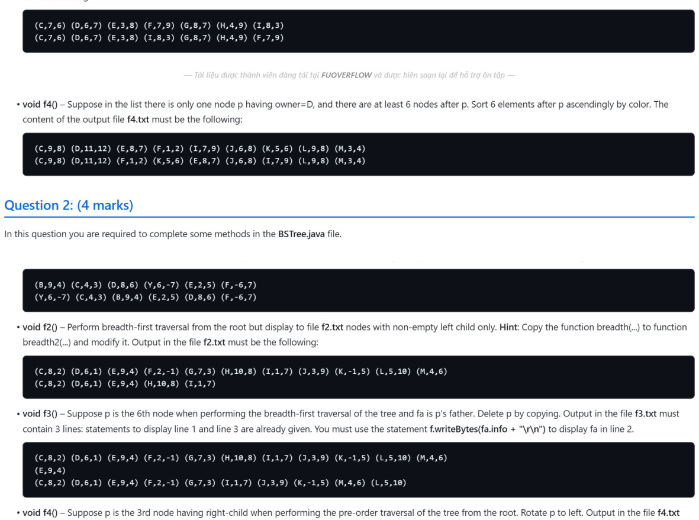

> **Nguyên văn đề bài (Question 2 - Tra cứu Ctrl+F):**
>
> Question 2: (4 marks)
> In this question you are required to complete some methods in the BSTree.java file.
> The class Cala with 3 data members: owner, horn and color is provided and you do not need to edit it. The BSTree class is a binary search tree of Cala objects. The variable
> color is the key of the tree, thus it must be unique. The following methods need to be completed:
> > - void insert(String xOwner, int xHorn, int xColor) - check if xOwner.charAt(0) 'A' then do nothing, otherwise insert new Cala object with owner=xOwner,
> > - void fl() — Do not edit this method. Your task is to complete the insert(...) method above only. Output in the file f1.txt must be the following:
> (C,4.3) (E, 2,5) (F, -6.7)
> > - void f2() — Perform breadth-first traversal from the root but display to file f2.txt nodes with non-empty left child only. Hint: Copy the function breadth(...) to function
> breadth2(...) and modify it. Output in the file f2.txt must be the following:
> (CS, 2) (F, 2, -1) (G, 7.3) (H,1e.8) (J. 3,9) (K, -1,5) (L,5.1Ø) (M,4.6)
> > - void f3() — Suppose p is the 6th node when performing the breadth-first traversal of the tree and fa is p's father. Delete p by copying. Output in the file f3.txt must
> contain 3 lines: statements to display line 1 and line 3 are already given. You must use the statement f.writeBytes(fa.info + "\r\n") to display fa in line 2.
> (F, 2, -1) (K, -1,5)
> (E.9,4)
> (F, 2, -1) (G, 7.3) (K, -1,5)
> > - void f4() — Suppose p is the 3rd node having right-child when performing the pre-order traversal of the tree from the root. Rotate p to left. Output in the file f4.txt
> must be the following:

- **Đáp án mã nguồn Java hoàn chỉnh (Giữ format và comment gốc của Given):**
```java
/* This program contains 2 parts: (1) and (2)
   YOUR TASK IS TO COMPLETE THE PART  (2)  ONLY
 */
//(1)==============================================================
import java.io.*;
import java.util.*;

public class BSTree {

    Node root;

    BSTree() {
        root = null;
    }

    boolean isEmpty() {
        return (root == null);
    }

    void clear() {
        root = null;
    }

    void visit(Node p) {
        System.out.print("p.info: ");
        if (p != null) {
            System.out.println(p.info + " ");
        }
    }

    void fvisit(Node p, RandomAccessFile f) throws Exception {
        if (p != null) {
            f.writeBytes(p.info + " ");
        }
    }

    void breadth(Node p, RandomAccessFile f) throws Exception {
        if (p == null) {
            return;
        }
        Queue q = new Queue();
        q.enqueue(p);
        Node r;
        while (!q.isEmpty()) {
            r = q.dequeue();
            fvisit(r, f);
            if (r.left != null) {
                q.enqueue(r.left);
            }
            if (r.right != null) {
                q.enqueue(r.right);
            }
        }
    }

    void preOrder(Node p, RandomAccessFile f) throws Exception {
        if (p == null) {
            return;
        }
        fvisit(p, f);
        preOrder(p.left, f);
        preOrder(p.right, f);
    }

    void inOrder(Node p, RandomAccessFile f) throws Exception {
        if (p == null) {
            return;
        }
        inOrder(p.left, f);
        fvisit(p, f);
        inOrder(p.right, f);
    }

    void postOrder(Node p, RandomAccessFile f) throws Exception {
        if (p == null) {
            return;
        }
        postOrder(p.left, f);
        postOrder(p.right, f);
        fvisit(p, f);
    }

    void loadData(int k) { //do not edit this function
        String[] a = Lib.readLineToStrArray("data.txt", k);
        int[] b = Lib.readLineToIntArray("data.txt", k + 1);
        int[] c = Lib.readLineToIntArray("data.txt", k + 2);
        int n = a.length;
        for (int i = 0; i < n; i++) {
            insert(a[i], b[i], c[i]);
        }
    }

//===========================================================================
//(2)===YOU CAN EDIT OR EVEN ADD NEW FUNCTIONS IN THE FOLLOWING PART========
//===========================================================================
    void insert(String xOwner, int xHorn, int xColor) {
        //You should insert here statements to complete this function
        if (xOwner.charAt(0) == 'A') {
            return;
        }
        Cala newCala = new Cala(xOwner, xHorn, xColor);
        Node newNode = new Node(newCala);
        if (root == null) {
            root = newNode;
            return;
        }
        Node parent = null, current = root;
        while (current != null) {
            parent = current;
            if (xOwner.compareTo(current.info.owner) < 0) {
                current = current.left;
            } else {
                current = current.right;
            }
        }
        if (xOwner.compareTo(parent.info.owner) < 0) {
            parent.left = newNode;
        } else {
            parent.right = newNode;
        }
    }

//Do not edit this function. Your task is to complete insert function above only.
    void f1() throws Exception {
        clear();
        loadData(1);
        String fname = "f1.txt";
        File g123 = new File(fname);
        if (g123.exists()) {
            g123.delete();
        }
        RandomAccessFile f = new RandomAccessFile(fname, "rw");
        breadth(root, f);
        f.writeBytes("\r\n");
        inOrder(root, f);
        f.writeBytes("\r\n");
        f.close();
    }

//=============================================================
    void f2() throws Exception {
        clear();
        loadData(5);
        String fname = "f2.txt";
        File g123 = new File(fname);
        if (g123.exists()) {
            g123.delete();
        }
        RandomAccessFile f = new RandomAccessFile(fname, "rw");
        breadth(root, f);
        f.writeBytes("\r\n");
        //------------------------------------------------------------------------------------
        /*You must keep statements pre-given in this function.
      Your task is to insert statements here, just after this comment,
      to complete the question in the exam paper.*/
        Queue queue = new Queue();
    if (root != null) {
        queue.enqueue(root);
    }


    while (!queue.isEmpty()) {
        Node node = queue.dequeue();
        if (node.left != null) { 
            f.writeBytes("(" + node.info.owner + "," + node.info.horn + "," + node.info.color + ") ");
        }
        if (node.left != null) {
            queue.enqueue(node.left);
        }
        if (node.right != null) {
            queue.enqueue(node.right);
        }
    }

        //------------------------------------------------------------------------------------
        f.writeBytes("\r\n");
        f.close();
    }

//=============================================================
    void f3() throws Exception {
        clear();
        loadData(9);
        String fname = "f3.txt";
        File g123 = new File(fname);
        if (g123.exists()) {
            g123.delete();
        }
        RandomAccessFile f = new RandomAccessFile(fname, "rw");
        breadth(root, f);
        f.writeBytes("\r\n");
        //------------------------------------------------------------------------------------
        /*You must keep statements pre-given in this function.
      Your task is to insert statements here, just after this comment,
      to complete the question in the exam paper.
      if the Node q!=null, you can use the statement:
      f.writeBytes(p.info + "\r\n ");
      to write p.info to the file f3.txt 
         */
        Queue queue = new Queue();
        if (root != null) {
            queue.enqueue(root);
        }
        Node toDelete = null, parent = null;
        int count = 0;

        while (!queue.isEmpty()) {
            Node node = queue.dequeue();
            count++;
            if (count == 6) {
                toDelete = node;
                break;
            }
            if (node.left != null) {
                parent = node;
                queue.enqueue(node.left);
            }
            if (node.right != null) {
                parent = node;
                queue.enqueue(node.right);
            }
        }

        if (parent != null) {
            f.writeBytes(parent.info + "\r\n");
        }

        if (toDelete != null && parent != null) {
            if (parent.left == toDelete) {
                parent.left = null;
            } else {
                parent.right = null;
            }
        }

        //------------------------------------------------------------------------------------
        breadth(root, f);
        f.writeBytes("\r\n");
        f.close();
    }

//=============================================================
    void f4() throws Exception {
        clear();
        loadData(13);;
        String fname = "f4.txt";
        File g123 = new File(fname);
        if (g123.exists()) {
            g123.delete();
        }
        RandomAccessFile f = new RandomAccessFile(fname, "rw");
        breadth(root, f);
        f.writeBytes("\r\n");
        //------------------------------------------------------------------------------------
        /*You must keep statements pre-given in this function.
      Your task is to insert statements here, just after this comment,
      to complete the question in the exam paper.*/
        Node target = findThirdNodeWithRightChild(root);
        if (target != null && target.right != null) {
            Node temp = target.right;
            target.right = temp.left;
            temp.left = target;

            if (root == target) {
                root = temp;
            } else {
                replaceParentChildLink(root, target, temp);
            }
        }

        //------------------------------------------------------------------------------------
        breadth(root, f);
        f.writeBytes("\r\n");
        f.close();
    }

    private Node findThirdNodeWithRightChild(Node node) {
        Stack<Node> stack = new Stack<>();
        stack.push(node);
        int count = 0;

        while (!stack.isEmpty()) {
            Node current = stack.pop();
            if (current.right != null) {
                count++;
                if (count == 3) {
                    return current;
                }
            }
            if (current.right != null) {
                stack.push(current.right);
            }
            if (current.left != null) {
                stack.push(current.left);
            }
        }
        return null;
    }

    private void replaceParentChildLink(Node root, Node oldChild, Node newChild) {
        Node parent = null, current = root;
        while (current != null && current != oldChild) {
            parent = current;
            if (oldChild.info.owner.compareTo(current.info.owner) < 0) {
                current = current.left;
            } else {
                current = current.right;
            }
        }
        if (parent != null) {
            if (parent.left == oldChild) {
                parent.left = newChild;
            } else if (parent.right == oldChild) {
                parent.right = newChild;
            }
        }
    }
}
```

- **Kết quả kiểm chứng thực tế:**
  - `f1.txt`: `(B,9,4) (C,4,3) (D,8,6) (E,2,5) (F,-6,7) (X,4,5) (Y,6,-7)  | (B,9,4) (C,4,3) (D,8,6) (E,2,5) (F,-6,7) (X,4,5) (Y,6,-7)`
  - `f2.txt`: `(C,8,2) (D,6,1) (E,9,4) (F,2,-1) (G,7,3) (H,10,8) (I,1,7) (J,3,9) (K,-1,5) (L,5,10) (M,4,6)`
  - `f3.txt`: `(C,8,2) (D,6,1) (E,9,4) (F,2,-1) (G,7,3) (H,10,8) (I,1,7) (J,3,9) (K,-1,5) (L,5,10) (M,4,6)  | (G,7,3)`
  - `f4.txt`: `(C,8,2) (D,6,1) (E,9,4) (F,2,-1) (G,7,3) (H,10,8) (I,1,7) (J,3,9) (K,-1,5) (L,5,10) (M,4,6)  | (C,8,2) (D,6,1) (F,2,-1) (E,9,4) (G,7,3) (H,10,8) (I,1,7) (J,3,9) (K,-1,5) (L,5,10) (M,4,6)`

##### [Question 3] Đồ thị (Graph.java)
- **Mã nguồn giải:** [solutions/2024/fa24_pe_de3\Q3\src\Graph.java](./solutions/2024/fa24_pe_de3\Q3\src\Graph.java)

- **Hình ảnh trích xuất đề bài Question 3 từ đề gốc:**


> **Nguyên văn đề bài (Question 3 - Tra cứu Ctrl+F):**
>
> Question 3: (2 marks)
> (F, 2, -1) (K, -1,5)
> (F, 2, -1) (G, 7.3) (K ,-1,5)
> In this question you are required to complete some methods in the Graph.java file.
> The class Graph is the implementation of a graph. The following methods need to be completed:
> > - void fl() — Perform depth-first traversal (to the file f1 .txt) from the vertex i=4 (the vertex E) but display 5 vertices with their degrees from the 2nd vertex to the 6th
> vertex only. Hint: copy depth(...) to depth2(...) and modify the latter one. The array int dego already declared in the class Graph. You should calculate d[i] = degree of
> the vertex i, and use the function fvisitDeg(...) to display a vertex with degree to file. Content of the output file f1.txt must be:
> EBACFHIDG
> B(3) A(3) C(3) F(l) H(2)
> > - void f2() — Apply the Dijkstra's shortest path algorithm to find the shortest path from vertex O (A) to vertex 6 (G). Write 3 lines to the file f2.txt: line 1 contains the last
> 3 vertices selected into the set S, line 2 contains labels of vertices in line 1, line 3 contains the 1st, 4th and last vertices in shortest path and shortest distance. (Note
> that in the weighted matrix, the value 99 is considered as infinity. When the vertex v is selected to the set S, its label-shortest distance from starting vertex to it).
> Output in the file f2.txt must be the following:
> 12 17
> AEG
> 22
> 22

- **Đáp án mã nguồn Java hoàn chỉnh (Giữ format và comment gốc của Given):**
```java
/* This program contains 2 parts: (1) and (2)
   YOUR TASK IS TO COMPLETE THE PART  (2)  ONLY
 */
//(1)============================================
import java.io.*;
import java.util.*;
//-------------------------------------------------------------------------------
public class Graph {
  int [][] a; int n;
  char v[];
  int deg[];
  Graph() {
    v = "ABCDEFGHIJKLMNOP".toCharArray();
    deg = new int[20];
    a = new int[20][20];
    n = 0;
   }

  void loadData(int k) {  //do not edit this function
    RandomAccessFile f;int i,j,x;
    String s;StringTokenizer t;
    a = new int[20][20];
    try {
     f = new RandomAccessFile("data.txt","r");
     for(i=0;i<k;i++) f.readLine();
     s = f.readLine();s = s.trim();
     n = Integer.parseInt(s);
     for(i=0;i<n;i++) {
       s = f.readLine();s = s.trim();
       t = new StringTokenizer(s);
       for(j=0;j<n;j++) { 
         x = Integer.parseInt(t.nextToken().trim());
         a[i][j] = x;
        }
       }
     f.close();
     }
    catch(Exception e) {}

   }

  void dispAdj() {
    int i,j;
    for(i=0;i<n;i++) {
      System.out.println();
      for(j=0;j<n;j++)
        System.out.printf("%4d",a[i][j]);
     }
   }

  void fvisit(int i, RandomAccessFile f) throws Exception {
    f.writeBytes("  "+v[i]);
   }
  
  /* There is an array int deg[] already declared in the class Graph 
     You should write a funcion to calculate d[i] = degree of the vertex i
  */
  void fvisitDeg(int i, RandomAccessFile f) throws Exception {
    f.writeBytes("  "+v[i]+"("+deg[i]+")"); // d[i] = degree of the vertex i
   }
  
 void fdispAdj(RandomAccessFile f) throws Exception { 
    int i,j;
    f.writeBytes("n = "+n+"\r\n");
    for(i=0;i<n;i++) {
      f.writeBytes("\r\n");
      for(j=0;j<n;j++)  f.writeBytes("  " + a[i][j]);
     }
    f.writeBytes("\r\n");
   }

  void breadth(boolean [] en, int i, RandomAccessFile f) throws Exception {
    Queue q = new Queue();
    int r,j;
    q.enqueue(i); en[i]=true;
    while(!q.isEmpty()) {
      r = q.dequeue();
      fvisit(r,f);
      for(j=0;j<n;j++) {
        if(!en[j] && a[r][j]>0) {
         q.enqueue(j);en[j]=true;
        }
       }
     }
   }

  void breadth(int  k, RandomAccessFile f) throws Exception {
    boolean [] en = new boolean[20];
    int i;
    for(i=0;i<n;i++) en[i]=false;
    breadth(en,k,f);
    for(i=0;i<n;i++) 
      if(!en[i]) breadth(en,i,f);
   }

 void depth(boolean [] visited,int k, RandomAccessFile f) throws Exception {
    fvisit(k,f);visited[k]=true;
    for(int i=0;i<n;i++) {
      if(!visited[i] && a[k][i]>0) depth(visited,i,f);
     }
   }
  void depth(int k, RandomAccessFile f) throws Exception {
    boolean [] visited = new boolean[20];
    int i;
    for(i=0;i<n;i++) visited[i]=false;
    depth(visited,k,f);
    for(i=0;i<n;i++) 
       if(!visited[i]) depth(visited,i,f);
   }

//===========================================================================
//(2)===YOU CAN EDIT OR EVEN ADD NEW FUNCTIONS IN THE FOLLOWING PART========
//===========================================================================
  void f1() throws Exception {
    loadData(1);
    String fname = "f1.txt";
    File g123 = new File(fname);
    if(g123.exists()) g123.delete();
    RandomAccessFile  f = new RandomAccessFile(fname, "rw"); 
    depth(4,f);
    f.writeBytes("\r\n");
    //-------------------------------------------------------------------------------------
     /*You must keep statements pre-given in this function.
       Your task is to insert statements here, just after this comment,
       to complete the question in the exam paper.*/


    //-------------------------------------------------------------------------------------
    f.writeBytes("\r\n");
    f.close();
   }

//=================================================================================================
  void f2() throws Exception {
    loadData(12);
    String fname = "f2.txt";
    File g123 = new File(fname);
    if(g123.exists()) g123.delete();
    RandomAccessFile  f = new RandomAccessFile(fname, "rw"); 
    //-------------------------------------------------------------------------------------
     /*You must keep statements pre-given in this function.
       Your task is to insert statements here, just after this comment,
       to complete the question in the exam paper.*/


    //-------------------------------------------------------------------------------------
    f.writeBytes("\r\n");
    f.close();
   }

}
```

---

#### 6.1.4. Đề thi: CSD201 - FA 2024 - PE - Đề số - 7
- **Thư mục lưu trữ mã nguồn:** [solutions/2024/fa24_pe_de7](./solutions/2024/fa24_pe_de7/)
- **Thư mục tài liệu gốc:** `CSD201 - FA 2024 - PE - Đề số - 7`

##### [Question 1] Danh sách liên kết đơn (MyList.java)
- **Mã nguồn giải:** [solutions/2024/fa24_pe_de7\Q1\src\MyList.java](./solutions/2024/fa24_pe_de7\Q1\src\MyList.java)

- **Hình ảnh trích xuất đề bài Question 1 từ đề gốc:**

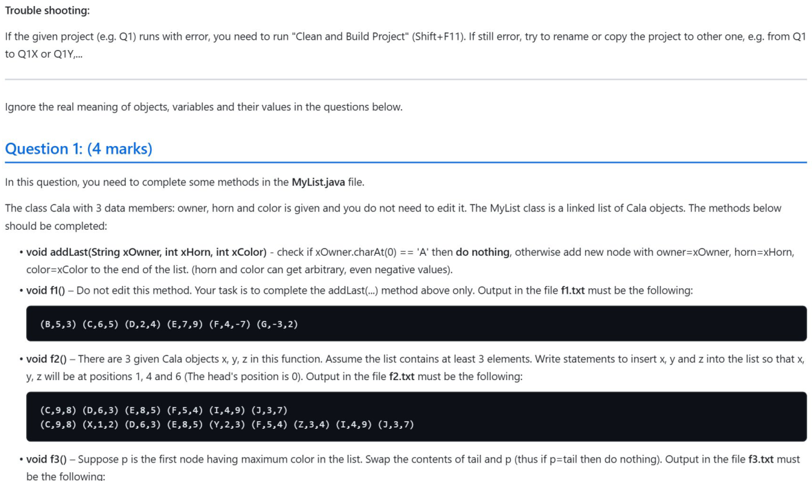

> **Nguyên văn đề bài (Question 1 - Tra cứu Ctrl+F):**
>
> Question 1: (4 marks)
> In this question, you need to complete some methods in the MyList.java file.
> The class Cala with 3 data members: owner, horn and color is given and you do not need to edit it. The MyList class is a linked list of Cala objects. The methods below
> should be completed:
> > - void addLast(String xOwner, int xHorn, int xColor) - check if xOwner.charAt(0) == 'A' then do nothing, otherwise add new node with owner=xOwner, horn=xHorn,
> color=xColor to the end of the list. (horn and color can get arbitrary, even negative values).
> > - void fl() — Do not edit this method. Your task is to complete the addLast(...) method above only. Output in the file f1.txt must be the following:
> (E, 7,9) (G, -3.2)
> > - void f2() — There are 3 given Cala objects x, y, z in this function. Assume the list contains at least 3 elements. Write statements to insert x, y and z into the list so that x,
> y, z will be at positions 1, 4 and 6 (The head's position is O). Output in the file f2.txt must be the following:
> (Y, 2,3) (J, 3, 7)
> > - void f3() — Suppose p is the first node having maximum color in the list. Swap the contents of tail and p (thus if p=tail then do nothing). Output in the file f3.txt must
> be the following:
> (C, 7.6) (F. 7,9) (G,8.7) (1.8,3)
> (C, 7,6) (F, 7.9)
> > - void f4() — Suppose in the list there is only one node p having owner=D, and there are at least 6 nodes after p. Sort 6 elements after p ascendingly by color. The
> content of the output file f4.txt must be the following:
> (L (M, 3.4)
> (L (M, 3,4)

- **Đáp án mã nguồn Java hoàn chỉnh (Giữ format và comment gốc của Given):**
```java
/* This program contains 2 parts: (1) and (2)
   YOUR TASK IS TO COMPLETE THE PART  (2)  ONLY
 */
//(1)==============================================================
import java.io.File;
import java.io.RandomAccessFile;

public class MyList {
  Node head, tail;

  MyList() {
    head = tail = null;
  }

  boolean isEmpty() {
    return (head == null);
  }

  void clear() {
    head = tail = null;
  }

  void fvisit(Node p, RandomAccessFile f) throws Exception {
    if (p != null)
      f.writeBytes(p.info + " ");
  }

  void ftraverse(RandomAccessFile f) throws Exception {
    Node p = head;
    while (p != null) {
      fvisit(p, f); // You will use this statement to write information of the node p to the file
      p = p.next;
    }
    f.writeBytes("\r\n");
  }

  void loadData(int k) { // do not edit this function
    String[] a = Lib.readLineToStrArray("data.txt", k);
    int[] b = Lib.readLineToIntArray("data.txt", k + 1);
    int[] c = Lib.readLineToIntArray("data.txt", k + 2);
    int n = a.length;
    for (int i = 0; i < n; i++)
      addLast(a[i], b[i], c[i]);
  }

  // (2)===YOU CAN EDIT OR EVEN ADD NEW FUNCTIONS IN THE FOLLOWING PART========
  /*
   * Khong su dung tieng Viet co dau de viet ghi chu.
   * Neu dung khi chay truc tiep se bao loi va nhan 0 diem
   */
//===========================================================================
//(2)===YOU CAN EDIT OR EVEN ADD NEW FUNCTIONS IN THE FOLLOWING PART========
//===========================================================================
/* 
   Khong su dung tieng Viet co dau de viet ghi chu.
   Neu dung khi chay truc tiep se bao loi va nhan 0 diem
*/
  void addLast(String xOwner, int xHorn, int xColor) {
    //You should write here appropriate statements to complete this function.
    if (xOwner != null && xOwner.charAt(0) == 'A') {
      return;
    }

    Node node = new Node(new Cala(xOwner, xHorn, xColor));

    if (isEmpty()) {
      head = tail = node;
      return;
    }

    tail.next = node;
    tail = node;
  }

  // You do not need to edit this function. Your task is to complete the addLast
  //You do not need to edit this function. Your task is to complete the addLast function above only.
  void f1() throws Exception {
    clear();
    loadData(1);
    String fname = "f1.txt";
    File g123 = new File(fname);
    if (g123.exists())
      g123.delete();
    RandomAccessFile f = new RandomAccessFile(fname, "rw");
    ftraverse(f);
    f.close();
  }

  void f2() throws Exception {
    clear();
    loadData(5);
    String fname = "f2.txt";
    File g123 = new File(fname);
    if (g123.exists())
      g123.delete();
    RandomAccessFile f = new RandomAccessFile(fname, "rw");
    ftraverse(f);
    Cala x, y, z;
    x = new Cala("X", 1, 2);
    y = new Cala("Y", 2, 3);
    z = new Cala("Z", 3, 4);
    /*
     * You must keep statements pre-given in this function.
     * Your task is to insert statements here, just after this comment,
     * to complete the question in the exam paper.
     */

    Node p = head;
    Node prev = null;
    int i = 0;

    while (p != null && i < 1) {
      prev = p;
      p = p.next;
      i++;
    }
    if (prev != null) {
      Node temp = prev.next;
      prev.next = new Node(x);
      prev.next.next = temp;
    }

    p = head;
    prev = null;
    i = 0;
    while (p != null && i < 4) {
      prev = p;
      p = p.next;
      i++;
    }
    if (prev != null) {
      Node temp = prev.next;
      prev.next = new Node(y);
      prev.next.next = temp;
    }

    p = head;
    prev = null;
    i = 0;
    while (p != null && i < 6) {
      prev = p;
      p = p.next;
      i++;
    }
    if (prev != null) {
      Node temp = prev.next;
      prev.next = new Node(z);
      prev.next.next = temp;
    }

    ftraverse(f);
    f.close();
  }

  void f3() throws Exception {
    clear();
    loadData(9);
    String fname = "f3.txt";
    File g123 = new File(fname);
    if (g123.exists())
      g123.delete();
    RandomAccessFile f = new RandomAccessFile(fname, "rw");
    ftraverse(f);
    /*
     * You must keep statements pre-given in this function.
     * Your task is to insert statements here, just after this comment,
     * to complete the question in the exam paper.
     */

    Node p = head;
    Node maxNode = head;
    while (p != null) {
      if (p.info.color > maxNode.info.color) {
        maxNode = p;
      }
      p = p.next;
    }

    if (maxNode != tail) {
      Cala temp = maxNode.info;
      maxNode.info = tail.info;
      tail.info = temp;
    }

    ftraverse(f);
    f.close();
  }

  void f4() throws Exception {
    clear();
    loadData(13);
    String fname = "f4.txt";
    File g123 = new File(fname);
    if (g123.exists())
      g123.delete();
    RandomAccessFile f = new RandomAccessFile(fname, "rw");
    ftraverse(f);
    /*
     * You must keep statements pre-given in this function.
     * Your task is to insert statements here, just after this comment,
     * to complete the question in the exam paper.
     */

    ftraverse(f);
    f.close();
  }

}
```

- **Kết quả kiểm chứng thực tế:**
  - `f1.txt`: `(B,5,3) (C,6,5) (D,2,4) (E,7,9) (F,4,-7) (G,-3,2)`
  - `f2.txt`: `(C,9,8) (D,6,3) (E,8,5) (F,5,4) (I,4,9) (J,3,7)  | (C,9,8) (X,1,2) (D,6,3) (E,8,5) (Y,2,3) (F,5,4) (Z,3,4) (I,4,9) (J,3,7)`
  - `f3.txt`: `(C,7,6) (D,6,7) (E,3,8) (F,7,9) (G,8,7) (H,4,9) (I,8,3)  | (C,7,6) (D,6,7) (E,3,8) (I,8,3) (G,8,7) (H,4,9) (F,7,9)`

##### [Question 2] Cây nhị phân tìm kiếm (BSTree.java)
- **Mã nguồn giải:** [solutions/2024/fa24_pe_de7\Q2\src\BSTree.java](./solutions/2024/fa24_pe_de7\Q2\src\BSTree.java)

- **Hình ảnh trích xuất đề bài Question 2 từ đề gốc:**


> **Nguyên văn đề bài (Question 2 - Tra cứu Ctrl+F):**
>
> Question 2: (4 marks)
> In this question, you need to complete some methods in the BSTree.java file.
> The class Cala with 3 data members: owner, horn and color is given and you do not need to edit it. The BSTree class is a binary search tree of Cala objects. The variable
> color is the key of the tree, thus it must be unique. The methods below should be completed:
> > - void insert(String xOwner, int xHorn, int xColor) - check if xOwner.charAt(0) 'A' then do nothing, otherwise insert new Cala object with owner=xOwner,
> > - void fl() — Do not edit this method. Your task is to complete the insert(...) method above only. Output in the file f1.txt must be the following:
> (C,4.3) (E, 2,5) (F, -6.7)
> > - void f2() — Perform breadth-first traversal from the root but display to file f2.txt only nodes with non-empty left child. Hint: Copy the function breadth(...) to function
> breadth2(...) and modify it. Output in the file f2.txt must be the following:
> (CS, 2) (F, 2, -1) (G, 7.3) (H,1e.8) (J. 3,9) (K, -1,5) (L,5.1Ø) (M,4.6)
> > - void f3() — Suppose p is the 6th node when performing the breadth-first traversal of the tree and fa is p's father. Delete p by copying. Output in the file f3.txt must
> contain 3 lines: statements to display line 1 and line 3 are already given. You must use the statement f.writeBytes(fa.info + "\r\n") to display fa in line 2.
> (F, 2, -1) (K, -1,5)
> (E.9,4)
> (F, 2, -1) (G, 7.3) (K, -1,5)
> > - void f4() — Suppose p is the 3rd node having right-child when performing the pre-order traversal of the tree from the root. Rotate p to left. Output in the file f4.txt
> must be the following:

- **Đáp án mã nguồn Java hoàn chỉnh (Giữ format và comment gốc của Given):**
```java
/* This program contains 2 parts: (1) and (2)
   YOUR TASK IS TO COMPLETE THE PART  (2)  ONLY
 */
//(1)==============================================================
import java.io.File;
import java.io.RandomAccessFile;
import java.util.Stack;

public class BSTree {
  Node root;

  BSTree() {
    root = null;
  }

  boolean isEmpty() {
    return (root == null);
  }

  void clear() {
    root = null;
  }

  void visit(Node p) {
    System.out.print("p.info: ");
    if (p != null)
      System.out.println(p.info + " ");
  }

  void fvisit(Node p, RandomAccessFile f) throws Exception {
    if (p != null)
      f.writeBytes(p.info + " ");
  }

  void breadth(Node p, RandomAccessFile f) throws Exception {
    if (p == null)
      return;
    Queue q = new Queue();
    q.enqueue(p);
    Node r;
    while (!q.isEmpty()) {
      r = q.dequeue();
      fvisit(r, f);
      if (r.left != null)
        q.enqueue(r.left);
      if (r.right != null)
        q.enqueue(r.right);
    }
  }

  void preOrder(Node p, RandomAccessFile f) throws Exception {
    if (p == null)
      return;
    fvisit(p, f);
    preOrder(p.left, f);
    preOrder(p.right, f);
  }

  void inOrder(Node p, RandomAccessFile f) throws Exception {
    if (p == null)
      return;
    inOrder(p.left, f);
    fvisit(p, f);
    inOrder(p.right, f);
  }

  void postOrder(Node p, RandomAccessFile f) throws Exception {
    if (p == null)
      return;
    postOrder(p.left, f);
    postOrder(p.right, f);
    fvisit(p, f);
  }

  void loadData(int k) { // do not edit this function
    String[] a = Lib.readLineToStrArray("data.txt", k);
    int[] b = Lib.readLineToIntArray("data.txt", k + 1);
    int[] c = Lib.readLineToIntArray("data.txt", k + 2);
    int n = a.length;
    for (int i = 0; i < n; i++)
      insert(a[i], b[i], c[i]);
  }

  // (2)===YOU CAN EDIT OR EVEN ADD NEW FUNCTIONS IN THE FOLLOWING PART========
//===========================================================================
//(2)===YOU CAN EDIT OR EVEN ADD NEW FUNCTIONS IN THE FOLLOWING PART========
//===========================================================================
/* 
   Khong su dung tieng Viet co dau de viet ghi chu.
   Neu dung khi chay truc tiep se bao loi va nhan 0 diem
*/
  void insert(String xOwner, int xHorn, int xColor) {
    //You should insert here statements to complete this function
    if (xOwner.charAt(0) == 'A')
      return;
    Node node = new Node(new Cala(xOwner, xHorn, xColor));
    if (root == null) {
      root = node;
      return;
    }
    Node curr = root;
    Node parent = null;
    while (curr != null) {
      parent = curr;
      if (xColor < curr.info.color) {
        curr = curr.left;
      } else {
        curr = curr.right;
      }
    }
    if (xColor < parent.info.color) {
      parent.left = node;
    } else {
      parent.right = node;
    }
  }

  // Do not edit this function. Your task is to complete insert function above
//Do not edit this function. Your task is to complete insert function above only.
  void f1() throws Exception {
    clear();
    loadData(1);
    String fname = "f1.txt";
    File g123 = new File(fname);
    if (g123.exists())
      g123.delete();
    RandomAccessFile f = new RandomAccessFile(fname, "rw");
    breadth(root, f);
    f.writeBytes("\r\n");
    inOrder(root, f);
    f.writeBytes("\r\n");
    f.close();
  }

  void f2() throws Exception {
    clear();
    loadData(5);
    String fname = "f2.txt";
    File g123 = new File(fname);
    if (g123.exists())
      g123.delete();
    RandomAccessFile f = new RandomAccessFile(fname, "rw");
    breadth(root, f);
    f.writeBytes("\r\n");
    /*
     * You must keep statements pre-given in this function.
     * Your task is to insert statements here, just after this comment,
     * to complete the question in the exam paper.
     */

    Queue q = new Queue();
    q.enqueue(root);
    Node r;
    while (!q.isEmpty()) {
      r = q.dequeue();
      if (r.left != null) {
        fvisit(r, f);
      }
      if (r.left != null)
        q.enqueue(r.left);
      if (r.right != null)
        q.enqueue(r.right);
    }

    f.writeBytes("\r\n");
    f.close();
  }

  void f3() throws Exception {
    clear();
    loadData(9);
    String fname = "f3.txt";
    File g123 = new File(fname);
    if (g123.exists())
      g123.delete();
    RandomAccessFile f = new RandomAccessFile(fname, "rw");
    breadth(root, f);
    f.writeBytes("\r\n");
    /*
     * You must keep statements pre-given in this function.
     * Your task is to insert statements here, just after this comment,
     * to complete the question in the exam paper.
     * if the Node q!=null, you can use the statement:
     * f.writeBytes(p.info + "\r\n ");
     * to write p.info to the file f3.txt
     */
    Queue q = new Queue();
    q.enqueue(root);
    Node p = null;
    Node fa = null;
    int count = 0;

    while (!q.isEmpty()) {
      Node r = q.dequeue();
      count++;
      if (count == 6) {
        p = r;
        break;
      }
      if (r.left != null) {
        q.enqueue(r.left);
        if (count == 5 && r.left == p)
          fa = r;
      }
      if (r.right != null) {
        q.enqueue(r.right);
        if (count == 5 && r.right == p)
          fa = r;
      }
    }

    if (fa != null) {
      f.writeBytes(fa.info + "\r\n");
    }

    if (fa != null) {
      if (fa.left == p) {
        if (p.left != null)
          fa.left = p.left;
        else
          fa.left = p.right;
      } else if (fa.right == p) {
        if (p.left != null)
          fa.right = p.left;
        else
          fa.right = p.right;
      }
    }

    breadth(root, f);
    f.writeBytes("\r\n");
    f.close();
  }

  void f4() throws Exception {
    clear();
    loadData(13);
    ;
    String fname = "f4.txt";
    File g123 = new File(fname);
    if (g123.exists())
      g123.delete();
    RandomAccessFile f = new RandomAccessFile(fname, "rw");
    breadth(root, f);
    f.writeBytes("\r\n");
    /*
     * You must keep statements pre-given in this function.
     * Your task is to insert statements here, just after this comment,
     * to complete the question in the exam paper.
     */

    Node p = findThirdNodeHavingRightChild(root);
    if (p != null)
      rotateLeft(p);

    breadth(root, f);
    f.writeBytes("\r\n");
    f.close();
  }

  Node findThirdNodeHavingRightChild(Node root) {
    if (root == null)
      return null;
    Stack<Node> stack = new Stack<>();
    stack.push(root);
    int count = 0;

    while (!stack.isEmpty()) {
      Node node = stack.pop();
      if (node.right != null) {
        count++;
        if (count == 3)
          return node;
      }

      if (node.right != null)
        stack.push(node.right);
      if (node.left != null)
        stack.push(node.left);
    }
    return null;
  }

  void rotateLeft(Node p) {
    if (p == null || p.right == null)
      return;
    Node parent = getParent(root, p);
    Node q = p.right;
    p.right = q.left;
    q.left = p;

    if (parent == null) {
      root = q;
    } else {
      if (parent.left == p)
        parent.left = q;
      else
        parent.right = q;
    }
  }

  Node getParent(Node root, Node node) {
    if (root == null || root == node)
      return null;
    if (root.left == node || root.right == node)
      return root;

    Node left = getParent(root.left, node);
    if (left != null)
      return left;
    return getParent(root.right, node);
  }

}
```

- **Kết quả kiểm chứng thực tế:**
  - `f1.txt`: `(B,9,4) (C,4,3) (D,8,6) (Y,6,-7) (E,2,5) (F,-6,7) (X,4,5)  | (Y,6,-7) (C,4,3) (B,9,4) (E,2,5) (X,4,5) (D,8,6) (F,-6,7)`
  - `f2.txt`: `(C,8,2) (D,6,1) (E,9,4) (F,2,-1) (G,7,3) (H,10,8) (I,1,7) (J,3,9) (K,-1,5) (L,5,10) (M,4,6)  | (C,8,2) (D,6,1) (E,9,4) (H,10,8) (I,1,7)`
  - `f3.txt`: `(C,8,2) (D,6,1) (E,9,4) (F,2,-1) (G,7,3) (H,10,8) (I,1,7) (J,3,9) (K,-1,5) (L,5,10) (M,4,6)  | (C,8,2) (D,6,1) (E,9,4) (F,2,-1) (G,7,3) (H,10,8) (I,1,7) (J,3,9) (K,-1,5) (L,5,10) (M,4,6)`
  - `f4.txt`: `(C,8,2) (D,6,1) (E,9,4) (F,2,-1) (G,7,3) (H,10,8) (I,1,7) (J,3,9) (K,-1,5) (L,5,10) (M,4,6)  | (C,8,2) (D,6,1) (E,9,4) (F,2,-1) (G,7,3) (J,3,9) (H,10,8) (L,5,10) (I,1,7) (K,-1,5) (M,4,6)`

##### [Question 3] Đồ thị (Graph.java)
- **Mã nguồn giải:** [solutions/2024/fa24_pe_de7\Q3\src\Graph.java](./solutions/2024/fa24_pe_de7\Q3\src\Graph.java)

- **Hình ảnh trích xuất đề bài Question 3 từ đề gốc:**

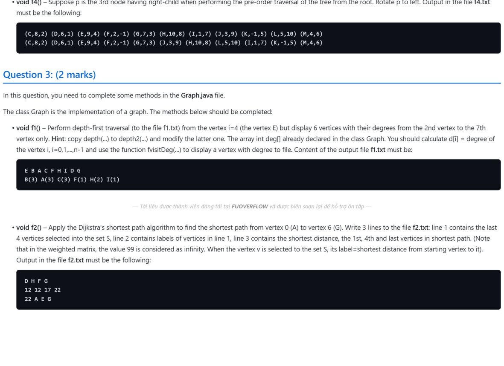

> **Nguyên văn đề bài (Question 3 - Tra cứu Ctrl+F):**
>
> Question 3: (2 marks)
> (F, 2, -1) (K, -1,5)
> (F, 2, -1) (G, 7.3) (K ,-1,5)
> In this question, you need to complete some methods in the Graph.java file.
> The class Graph is the implementation of a graph. The methods below should be completed:
> > - void fl() — Perform depth-first traversal (to the file f1 .txt) from the vertex i=4 (the vertex E) but display 6 vertices with their degrees from the 2nd vertex to the 7th
> vertex only. Hint: copy depth(...) to depth2(...) and modify the latter one. The array int dego already declared in the class Graph. You should calculate d[i] = degree of
> the vertex i, and use the function fvisitDeg(...) to display a vertex with degree to file. Content of the output file f1.txt must be:
> EBACFHIDG
> B(3) A(3) C(3) F(l) H(2) 1(1)
> > - void f2() — Apply the Dijkstra's shortest path algorithm to find the shortest path from vertex O (A) to vertex 6 (G). Write 3 lines to the file f2.txt: line 1 contains the last
> 4 vertices selected into the set S, line 2 contains labels of vertices in line 1, line 3 contains the shortest distance, the 1st, 4th and last vertices in shortest path. (Note
> that in the weighted matrix, the value 99 is considered as infinity. When the vertex v is selected to the set S, its label-shortest distance from starting vertex to it).
> Output in the file f2.txt must be the following:
> 12 12 17 22
> 22 A E G

- **Đáp án mã nguồn Java hoàn chỉnh (Giữ format và comment gốc của Given):**
```java
/* This program contains 2 parts: (1) and (2)
   YOUR TASK IS TO COMPLETE THE PART  (2)  ONLY
 */
//(1)============================================
import java.io.File;
import java.io.RandomAccessFile;
import java.util.StringTokenizer;

//-------------------------------------------------------------------------------
public class Graph {
  int[][] a;
  int n;
  char v[];
  int deg[];

  Graph() {
    v = "ABCDEFGHIJKLMNOP".toCharArray();
    deg = new int[20];
    a = new int[20][20];
    n = 0;
  }

  void loadData(int k) { // do not edit this function
    RandomAccessFile f;
    int i, j, x;
    String s;
    StringTokenizer t;
    a = new int[20][20];
    try {
      f = new RandomAccessFile("data.txt", "r");
      for (i = 0; i < k; i++)
        f.readLine();
      s = f.readLine();
      s = s.trim();
      n = Integer.parseInt(s);
      for (i = 0; i < n; i++) {
        s = f.readLine();
        s = s.trim();
        t = new StringTokenizer(s);
        for (j = 0; j < n; j++) {
          x = Integer.parseInt(t.nextToken().trim());
          a[i][j] = x;
        }
      }
      f.close();
    } catch (Exception e) {
    }

  }

  void dispAdj() {
    int i, j;
    for (i = 0; i < n; i++) {
      System.out.println();
      for (j = 0; j < n; j++)
        System.out.printf("%4d", a[i][j]);
    }
  }

  void fvisit(int i, RandomAccessFile f) throws Exception {
    f.writeBytes("  " + v[i]);
  }

  /*
   * There is an array int deg[] already declared in the class Graph
   * You should write a funcion to calculate d[i] = degree of the vertex i
   */
  void fvisitDeg(int i, RandomAccessFile f) throws Exception {
    f.writeBytes("  " + v[i] + "(" + deg[i] + ")"); // d[i] = degree of the vertex i
  }

  void fdispAdj(RandomAccessFile f) throws Exception {
    int i, j;
    f.writeBytes("n = " + n + "\r\n");
    for (i = 0; i < n; i++) {
      f.writeBytes("\r\n");
      for (j = 0; j < n; j++)
        f.writeBytes("  " + a[i][j]);
    }
    f.writeBytes("\r\n");
  }

  void breadth(boolean[] en, int i, RandomAccessFile f) throws Exception {
    Queue q = new Queue();
    int r, j;
    q.enqueue(i);
    en[i] = true;
    while (!q.isEmpty()) {
      r = q.dequeue();
      fvisit(r, f);
      for (j = 0; j < n; j++) {
        if (!en[j] && a[r][j] > 0) {
          q.enqueue(j);
          en[j] = true;
        }
      }
    }
  }

  void breadth(int k, RandomAccessFile f) throws Exception {
    boolean[] en = new boolean[20];
    int i;
    for (i = 0; i < n; i++)
      en[i] = false;
    breadth(en, k, f);
    for (i = 0; i < n; i++)
      if (!en[i])
        breadth(en, i, f);
  }

  void depth(boolean[] visited, int k, RandomAccessFile f) throws Exception {
    fvisit(k, f);
    visited[k] = true;
    for (int i = 0; i < n; i++) {
      if (!visited[i] && a[k][i] > 0)
        depth(visited, i, f);
    }
  }

  void depth(int k, RandomAccessFile f) throws Exception {
    boolean[] visited = new boolean[20];
    int i;
    for (i = 0; i < n; i++)
      visited[i] = false;
    depth(visited, k, f);
    for (i = 0; i < n; i++)
      if (!visited[i])
        depth(visited, i, f);
  }

  // (2)===YOU CAN EDIT OR EVEN ADD NEW FUNCTIONS IN THE FOLLOWING PART========
//===========================================================================
//(2)===YOU CAN EDIT OR EVEN ADD NEW FUNCTIONS IN THE FOLLOWING PART========
//===========================================================================
/* 
   Khong su dung tieng Viet co dau de viet ghi chu.
   Neu dung khi chay truc tiep se bao loi va nhan 0 diem
*/
  void f1() throws Exception {
    loadData(1);
    String fname = "f1.txt";
    File g123 = new File(fname);
    if (g123.exists())
      g123.delete();
    RandomAccessFile f = new RandomAccessFile(fname, "rw");
    depth(4, f);
    f.writeBytes("\r\n");
    /*
     * You must keep statements pre-given in this function.
     * Your task is to insert statements here, just after this comment,
     * to complete the question in the exam paper.
     */

    f.writeBytes("\r\n");
    f.close();
  }

  void f2() throws Exception {
    loadData(12);
    String fname = "f2.txt";
    File g123 = new File(fname);
    if (g123.exists())
      g123.delete();
    RandomAccessFile f = new RandomAccessFile(fname, "rw");
    /*
     * You must keep statements pre-given in this function.
     * Your task is to insert statements here, just after this comment,
     * to complete the question in the exam paper.
     */

    f.writeBytes("\r\n");
    f.close();
  }

}
```

- **Kết quả kiểm chứng thực tế:**
  - `f1.txt`: `E  B  A  C  F  H  I  D  G |   B(3)  C(3)  D(3)  E(2)  F(1)  G(1)`
  - `f2.txt`: `A I C E  | A I C E D G`

---

#### 6.1.5. Đề thi: CSD201 - PE - SP 2024 ( Đề số 1)
- **Thư mục lưu trữ mã nguồn:** [solutions/2024/sp24_de1](./solutions/2024/sp24_de1/)
- **Thư mục tài liệu gốc:** `CSD201 - PE - SP 2024 ( Đề số 1)`

##### [Question 1] Danh sách liên kết đơn (MyList.java)
- **Mã nguồn giải:** [solutions/2024/sp24_de1\Q1\src\MyList.java](./solutions/2024/sp24_de1\Q1\src\MyList.java)

- **Hình ảnh trích xuất đề bài Question 1 từ đề gốc:**

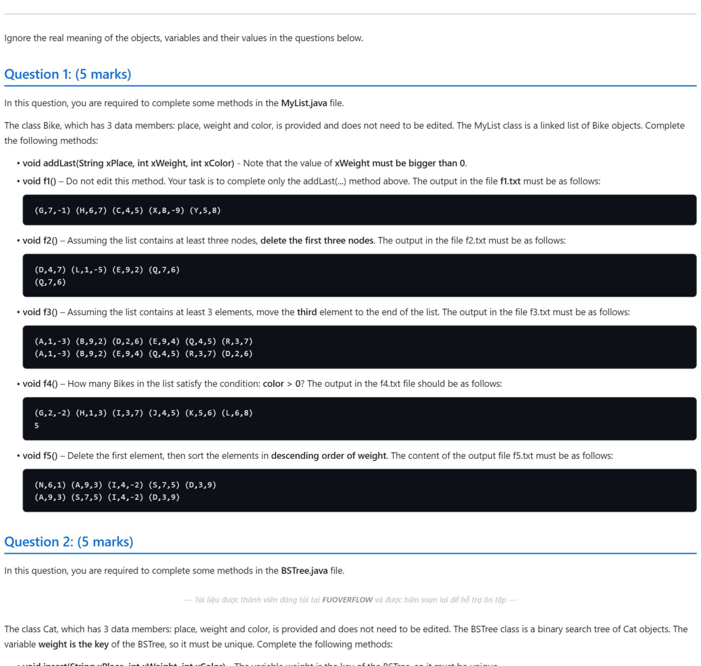

> **Nguyên văn đề bài (Question 1 - Tra cứu Ctrl+F):**
>
> Question 1: (5 marks)
> In this question, you are required to complete some methods in the MyList.java file.
> The class Bike, which has 3 data members: place, weight and color, is provided and does not need to be edited. The MyList class is a linked list of Bike objects. Complete
> the following methods:
> > - void addLast(String xPlace, int xWeight, int xColor) - Note that the value of xWeight must be bigger than O.
> > - void fl() — Do not edit this method. Your task is to complete only the addLast(...) method above. The output in the file f1.txt must be as follows:
> > - void f2() — Assuming the list contains at least three nodes, delete the first three nodes. The output in the file f2.txt must be as follows:
> (L (Q, 7,6)
> > - void f3() — Assuming the list contains at least 3 elements, move the third element to the end of the list. The output in the file f3.txt must be as follows:
> (A, 1, -3) (D, 2,6) (R, 3, 7)
> (A, 1, -3) (B,9.2) (Q. 4,5) (R, 3.7) (D, 2.6)
> > - void f4() — How many Bikes in the list satisfy the condition: color > O? The output in the f4.txt file should be as follows:
> > - void f5() — Delete the first element, then sort the elements in descending order of weight. The content of the output file f5.txt must be as follows:
> (S, 7,5)
> (D, 3,9)

- **Đáp án mã nguồn Java hoàn chỉnh (Giữ format và comment gốc của Given):**
```java
/* This program contains 2 parts: (1) and (2)
   YOUR TASK IS TO COMPLETE THE PART  (2)  ONLY
 */
//(1)==============================================================
import java.util.*;
import java.io.*;

public class MyList {

    Node head, tail;

    MyList() {
        head = tail = null;
    }

    boolean isEmpty() {
        return (head == null);
    }

    void clear() {
        head = tail = null;
    }

    void fvisit(Node p, RandomAccessFile f) throws Exception {
        if (p != null) {
            f.writeBytes(p.info + " ");
        }
    }

    void ftraverse(RandomAccessFile f) throws Exception {
        Node p = head;
        while (p != null) {
            fvisit(p, f); // You will use this statement to write information of the node p to the file
            p = p.next;
        }
        f.writeBytes("\r\n");
    }

    void loadData(int k) { //do not edit this function
        String[] a = Lib.readLineToStrArray("data.txt", k);
        int[] b = Lib.readLineToIntArray("data.txt", k + 1);
        int[] c = Lib.readLineToIntArray("data.txt", k + 2);
        int n = a.length;
        for (int i = 0; i < n; i++) {
            addLast(a[i], b[i], c[i]);
        }
    }

//===========================================================================
//(2)===YOU CAN EDIT OR EVEN ADD NEW FUNCTIONS IN THE FOLLOWING PART========
//===========================================================================
/* 
   Khong su dung tieng Viet co dau de viet ghi chu.
   Neu dung khi chay truc tiep se bao loi va nhan 0 diem
     */
    void addLast(String xPlace, int xWeight, int xColor) {
        //You should write here appropriate statements to complete this function.
        //--------------------------------------------------------
        Bike info = new Bike(xPlace, xWeight, xColor);
        if (xWeight < 0) {
            return;
        }
        if (isEmpty()) {
            head = tail = new Node(info);
        } else {
            Node node = new Node(info);
            tail.next = node;
            tail = node;
        }

        //---------------------------------------------------------
    }
    //==================================================================
    //You do not need to edit this function. Your task is to complete 
    void f1() throws Exception {
        clear();
        loadData(1);
        String fname = "f1.txt";
        File g123 = new File(fname);
        if (g123.exists()) {
            g123.delete();
        }
        RandomAccessFile f = new RandomAccessFile(fname, "rw");
        ftraverse(f);
        f.close();
    }

//==================================================================
    void f2() throws Exception {
        clear();
        loadData(5);
        String fname = "f2.txt";
        File g123 = new File(fname);
        if (g123.exists()) {
            g123.delete();
        }
        RandomAccessFile f = new RandomAccessFile(fname, "rw");
        ftraverse(f);
        //------------------------------------------------------------------------------------
        /*You must keep statements pre-given in this function.
        Your task is to insert statements here, just after this comment,
        to complete the question in the exam paper.*/
        delFirst();
        delFirst();
        delFirst();

        //------------------------------------------------------------------------------------
        ftraverse(f);
        f.close();
    }

    void delFirst() {
        head = head.next;
    }
//==================================================================

    void f3() throws Exception {
        clear();
        loadData(9);
        String fname = "f3.txt";
        File g123 = new File(fname);
        if (g123.exists()) {
            g123.delete();
        }
        RandomAccessFile f = new RandomAccessFile(fname, "rw");
        ftraverse(f);
        //------------------------------------------------------------------------------------
        /*You must keep statements pre-given in this function.
        Your task is to insert statements here, just after this comment,
        to complete the question in the exam paper.*/
        moveNodeToEnd(head);

        //------------------------------------------------------------------------------------
        ftraverse(f);
        f.close();
    }

    public static void moveNodeToEnd(Node head) {
        if (head == null || head.next == null || head.next.next == null) {
            System.out.println("Không đủ node để di chuyển!");
            return;
        }

        Node prev = head;
        Node current = head.next;

        for (int i = 1; i < 2; i++) {
            prev = current;
            current = current.next;
        }

        prev.next = current.next;

        Node temp = current;
        while (temp.next != null) {
            temp = temp.next;
        }

        temp.next = current;
        current.next = null;
    }
//==================================================================

    void f4() throws Exception {
        clear();
        loadData(13);
        String fname = "f4.txt";
        File g123 = new File(fname);
        if (g123.exists()) {
            g123.delete();
        }
        RandomAccessFile f = new RandomAccessFile(fname, "rw");
        ftraverse(f);
        //------------------------------------------------------------------------------------
        /*You must keep statements pre-given in this function.
        Your task is to insert statements here, just after this comment,
        to complete the question in the exam paper.*/
        int num = countNodesGreaterThan(0);
        System.out.println(num);
        //------------------------------------------------------------------------------------
        f.close();
        
    }
public int countNodesGreaterThan(int value) {
    int count = 0;
    Node current = head;
    while (current != null) {
        if (current.info.color > value) {
            count++;
        }
        current = current.next;
    }
    return count;
}
//==================================================================
    void f5() throws Exception {
        clear();
        loadData(17);
        String fname = "f5.txt";
        File g123 = new File(fname);
        if (g123.exists()) {
            g123.delete();
        }
        RandomAccessFile f = new RandomAccessFile(fname, "rw");
        ftraverse(f);
        //------------------------------------------------------------------------------------
        /*You must keep statements pre-given in this function.
        Your task is to insert statements here, just after this comment,
        to complete the question in the exam paper.*/
        delFirst();
        sort();
        //------------------------------------------------------------------------------------
        ftraverse(f);
        f.close();
    }
public void deleteFirstNode() {
        if (head == null) {
            return;
        }
        head = head.next;
    }

    void sort() {
        if (isEmpty()) return;
        Node pi = head, pj;
        while (pi != null) {
            pj = pi.next;
            while (pj != null) {
                if (pi.info.weight < pj.info.weight) {
                    Bike temp = pi.info;
                    pi.info = pj.info;
                    pj.info= temp;
                }

                pj = pj.next;
            }

            pi = pi.next;
        }
    }
    

}
```

- **Kết quả kiểm chứng thực tế:**
  - `f1.txt`: `(G,7,-1) (H,6,7) (C,4,5) (X,8,-9) (Y,5,8)`
  - `f2.txt`: `(D,4,7) (L,1,-5) (E,9,2) (Q,7,6)  | (Q,7,6)`
  - `f3.txt`: `(A,1,-3) (B,9,2) (D,2,6) (E,9,4) (Q,4,5) (R,3,7)  | (A,1,-3) (B,9,2) (E,9,4) (Q,4,5) (R,3,7) (D,2,6)`
  - `f4.txt`: `(G,2,-2) (H,1,3) (I,3,7) (J,4,5) (K,5,6) (L,6,8)`
  - `f5.txt`: `(N,6,1) (A,9,3) (I,4,-2) (S,7,5) (D,3,9)  | (A,9,3) (S,7,5) (I,4,-2) (D,3,9)`

##### [Question 2] Cây nhị phân tìm kiếm (BSTree.java)
- **Mã nguồn giải:** [solutions/2024/sp24_de1\Q2\src\BSTree.java](./solutions/2024/sp24_de1\Q2\src\BSTree.java)

- **Hình ảnh trích xuất đề bài Question 2 từ đề gốc:**


> **Nguyên văn đề bài (Question 2 - Tra cứu Ctrl+F):**
>
> Question 2: (5 marks)
> In this question, you are required to complete some methods in the BSTree.java file.
> The class Cat, which has 3 data members: place, weight and color, is provided and does not need to be edited. The BSTree class is a binary search tree of Cat objects. The
> variable weight is the key of the BSTree, so it must be unique. Complete the following methods:
> > - void insert(String xPlace, int xWeight, int xColor) - The variable weight is the key of the BSTree, so it must be unique.
> > - void fl() — Add statements to the insert(...) method so that any node whose xPlace.charAt(0) 'X' is not inserted into the tree. The output in file f1 .txt should be as
> follows (line 1: Breadth first traversal, line 2: In-order traversal):
> (P, 1, 3) (N, 3.6) (F, 7,4)
> > - void f2() — Perform a pre-order traversal of the left branch of the BST, but write only nodes with color>4 to file f2.txt. Hint: Copy the preOrder(...) function into a new
> function preOrder2(...) and modify it. The output in the file f2.txt must be as follows (line 1: Breadth first traversal, line 2: pre-order traversal):
> (P, 7,9) (H, 2,5) (L
> (H, 2,5) (L
> > - void f3() — Implement a new traversal to visit all nodes in the BST under the constraint: visit the nodes in the descending order of weight. The output in the file f3.txt
> must be as follows:
> (R, 5,9) (L (Y, 1,6)
> > - void f4() — Print the internal nodes of the tree. The output in the file f4.txt must be as follows (line 1: pre-order traversal, line 2: internal nodes (by pre-order
> traversal)):
> (C, 3, -8) (F,4.2) (D, 5, -3)
> (B, 2.7) (C,3, -8) (F.4,2) (E,8.3)
> > - void f5() — (content not fully captured in images)

- **Đáp án mã nguồn Java hoàn chỉnh (Giữ format và comment gốc của Given):**
```java
/* This program contains 2 parts: (1) and (2)
   YOUR TASK IS TO COMPLETE THE PART  (2)  ONLY
 */
//(1)==============================================================
import java.io.*;
import java.util.*;

public class BSTree {

    Node root;

    BSTree() {
        root = null;
    }

    boolean isEmpty() {
        return (root == null);
    }

    void clear() {
        root = null;
    }

    void visit(Node p) {
        System.out.print("p.info: ");
        if (p != null) {
            System.out.println(p.info + " ");
        }
    }

    void fvisit(Node p, RandomAccessFile f) throws Exception {
        if (p != null) {
            f.writeBytes(p.info + " ");
        }
    }

    void breadth(Node p, RandomAccessFile f) throws Exception {
        if (p == null) {
            return;
        }
        Queue q = new Queue();
        q.enqueue(p);
        Node r;
        while (!q.isEmpty()) {
            r = q.dequeue();
            fvisit(r, f);
            if (r.left != null) {
                q.enqueue(r.left);
            }
            if (r.right != null) {
                q.enqueue(r.right);
            }
        }
    }

    void preOrder(Node p, RandomAccessFile f) throws Exception {
        if (p == null) {
            return;
        }
        fvisit(p, f);
        preOrder(p.left, f);
        preOrder(p.right, f);
    }

    void inOrder(Node p, RandomAccessFile f) throws Exception {
        if (p == null) {
            return;
        }
        inOrder(p.left, f);
        fvisit(p, f);
        inOrder(p.right, f);
    }

    void postOrder(Node p, RandomAccessFile f) throws Exception {
        if (p == null) {
            return;
        }
        postOrder(p.left, f);
        postOrder(p.right, f);
        fvisit(p, f);
    }

    void loadData(int k) { //do not edit this function
        String[] a = Lib.readLineToStrArray("data.txt", k);
        int[] b = Lib.readLineToIntArray("data.txt", k + 1);
        int[] c = Lib.readLineToIntArray("data.txt", k + 2);
        int n = a.length;
        for (int i = 0; i < n; i++) {
            insert(a[i], b[i], c[i]);
        }
    }

//===========================================================================
//(2)===YOU CAN EDIT OR EVEN ADD NEW FUNCTIONS IN THE FOLLOWING PART========
//===========================================================================
    void insert(String xPlace, int xWeight, int xColor) {
        //You should insert here statements to complete this function
        Bird x = new Bird(xPlace, xWeight, xColor);
        Node q = new Node(x);
        if (xPlace.charAt(0) == 'X') {
            return;
        }
        if (isEmpty()) {
            root = q;
            return;
        }
        Node p = root, f = null;
        while (p != null) {
            if (p.info.weight == x.weight) {
                return;
            }

            f = p;
            if (p.info.weight > x.weight) {
                p = p.left;
            } else {
                p = p.right;
            }
        }

        if (f.info.weight > x.weight) {
            f.left = q;
        } else {
            f.right = q;
        }

    }

//Do not edit this function. 
//Your task is to complete the insert function above only.
    void f1() throws Exception {
        clear();
        loadData(1);
        String fname = "f1.txt";
        File g123 = new File(fname);
        if (g123.exists()) {
            g123.delete();
        }
        RandomAccessFile f = new RandomAccessFile(fname, "rw");
        breadth(root, f);
        f.writeBytes("\r\n");
        inOrder(root, f);
        f.writeBytes("\r\n");
        f.close();
    }

//=============================================================
    void f2() throws Exception {
        clear();
        loadData(5);
        String fname = "f2.txt";
        File g123 = new File(fname);
        if (g123.exists()) {
            g123.delete();
        }
        RandomAccessFile f = new RandomAccessFile(fname, "rw");
        breadth(root, f);
        f.writeBytes("\r\n");
        //------------------------------------------------------------------------------------
        /*You must keep statements pre-given in this function.
        Your task is to insert statements here, just after this comment,
        to complete the question in the exam paper.*/
        deleteByCopying(root);
        preOrder2(root, f);

        //------------------------------------------------------------------------------------
        f.writeBytes("\r\n");
        f.close();
    }

    void deleteByCopying(Node p) {
        Node rightMost = p.left, f = null;
        while (rightMost.right != null) {
            f = rightMost;
            rightMost = rightMost.right;
        }
        p.info = rightMost.info;
        if (f == null) {
            p.left = rightMost.left;
        } else {
            f.right = rightMost.left;
        }
    }

    void preOrder2(Node p, RandomAccessFile f) throws Exception {
        if (p == null) {
            return;
        }
        if (p.info.color > 4) {
            fvisit(p, f);
        }
        preOrder2(p.left, f);
    }
//=============================================================

    void f3() throws Exception {
        clear();
        loadData(9);
        String fname = "f3.txt";
        File g123 = new File(fname);
        if (g123.exists()) {
            g123.delete();
        }
        RandomAccessFile f = new RandomAccessFile(fname, "rw");
        //------------------------------------------------------------------------------------
        /*You must keep statements pre-given in this function.
        Your task is to insert statements here, just after this comment,
        to complete the question in the exam paper.*/
        //------------------------------------------------------------------------------------
        f.writeBytes("\r\n");
        f.close();
    }
    
    


//=============================================================
    void f4() throws Exception {
        clear();
        loadData(13);
        String fname = "f4.txt";
        File g123 = new File(fname);
        if (g123.exists()) {
            g123.delete();
        }
        RandomAccessFile f = new RandomAccessFile(fname, "rw");
        preOrder(root, f);
        f.writeBytes("\r\n");
        //------------------------------------------------------------------------------------
        /*You must keep statements pre-given in this function.
        Your task is to insert statements here, just after this comment,
        to complete the question in the exam paper.*/
        preOrder3(root, f);
        //------------------------------------------------------------------------------------
        f.writeBytes("\r\n");
        f.close();
    }
    void preOrder3(Node p, RandomAccessFile f) throws Exception {
        if (p == null) {
            return;
        }
        if (p.left != null || p.right != null){
        fvisit(p, f);
        }
        preOrder3(p.left, f);
        preOrder3(p.right, f);
    }

   
//=============================================================

    void f5() throws Exception {
        clear();
        loadData(17);
        String fname = "f5.txt";
        File g123 = new File(fname);
        if (g123.exists()) {
            g123.delete();
        }
        RandomAccessFile f = new RandomAccessFile(fname, "rw");
        inOrder(root, f);
        f.writeBytes("\r\n");
        //------------------------------------------------------------------------------------
        /*You must keep statements pre-given in this function.
        Your task is to insert statements here, just after this comment,
        to complete the question in the exam paper.*/

        //------------------------------------------------------------------------------------
        f.close();
    }
}
```

- **Kết quả kiểm chứng thực tế:**
  - `f1.txt`: `(M,9,5) (F,7,4) (N,3,6) (Q,8,7) (P,1,3) (R,4,8)  | (P,1,3) (N,3,6) (R,4,8) (F,7,4) (Q,8,7) (M,9,5)`
  - `f2.txt`: `(P,7,9) (D,4,3) (G,9,6) (H,2,5) (B,6,4) (L,1,8) (N,3,1)  | (H,2,5) (L,1,8)`
  - `f3.txt`: `(M,7,2) (M,7,2) (M,7,2) (M,7,2) (M,7,2) (M,7,2) (M,7,2)`
  - `f4.txt`: `(A,6,5) (B,2,7) (P,1,9) (C,3,-8) (F,4,2) (D,5,-3) (E,8,3) (G,7,4) (Q,9,1)  | (A,6,5) (B,2,7) (C,3,-8) (F,4,2) (E,8,3)`

---

#### 6.1.6. Đề thi: CSD201 - PE - SP 2024 - Đề số - 10
- **Thư mục lưu trữ mã nguồn:** [solutions/2024/sp24_de10](./solutions/2024/sp24_de10/)
- **Thư mục tài liệu gốc:** `CSD201 - PE - SP 2024 - Đề số - 10`

##### [Question 1] Danh sách liên kết đơn (MyList.java)
- **Mã nguồn giải:** [solutions/2024/sp24_de10\Q1\src\MyList.java](./solutions/2024/sp24_de10\Q1\src\MyList.java)

- **Hình ảnh trích xuất đề bài Question 1 từ đề gốc:**


> **Nguyên văn đề bài (Question 1 - Tra cứu Ctrl+F):**
>
> Question 1: (4 marks)
> In this question, you need to complete some methods in the MyList.java file.
> The class Bottle with 3 data members: maker, volume and color is given, and you do not need to edit it. The MyList class is a linked list of Bottle objects. Complete the
> following methods:
> > - void addLast(String xMaker, int xVolume, int xColor) - check if xMaker.charAt(0) 'A' then do nothing, otherwise add new node with maker=xMaker,
> volume=xVolume, color=xColor to the end of the list. (volume and color can get arbitrary, even negative values).
> > - void fl() — Do not edit this method. You only need to complete the addLast(...) method above. Output in the file f1.txt must be the following:
> (E, 7,9) (G, -3.2)
> > - void f2() — There are 3 given Bottle objects x, y, z in this function. Assume the list contains at least 3 elements. Write statements to insert x, y and z into the list so that
> x, y and z will be at positions 1, 2 and 4 (the head's position is O). Output in the file f2.txt must be the following:
> > - void f3() — Assume the list contains at least 3 elements. Remove the first node having the maximum color and insert it at position 1. (The head's position is O). Output
> in the file f3.txt must be the following:
> (C, 7.6) (F. 7,9) (G,8.7) (1.8,3)
> (C, 7,6)
> > - void f4() — Assume the list contains at least 6 elements and p is the 6th element in the list. Change the color of p to 88, then sort all elements before p in ascending
> order of color. The content of the output file f4.txt must be the following:
> (L (M, 3.4)
> (F, 1,2)

- **Đáp án mã nguồn Java hoàn chỉnh (Giữ format và comment gốc của Given):**
```java
/* This program contains 2 parts: (1) and (2)
   YOUR TASK IS TO COMPLETE THE PART  (2)  ONLY
 */
//(1)==============================================================
import java.io.File;
import java.io.RandomAccessFile;

public class MyList {
  Node head,tail;
  MyList() {head=tail=null;}
  boolean isEmpty() {
    return(head==null);
   }
  void clear() {head=tail=null;}
  

  void fvisit(Node p, RandomAccessFile f) throws Exception {
    if(p != null) f.writeBytes(p.info + " ");
   }

  void ftraverse(RandomAccessFile f) throws Exception {
    Node p = head;
    while(p!=null) {
       fvisit(p,f); // You will use this statement to write information of the node p to the file
       p=p.next;
      }
    f.writeBytes("\r\n");
   }

  void loadData(int k) { //do not edit this function
    String [] a = Lib.readLineToStrArray("data.txt", k);
    int [] b = Lib.readLineToIntArray("data.txt", k+1);
    int [] c = Lib.readLineToIntArray("data.txt", k+2);
    int n = a.length;
    for(int i=0;i<n;i++) addLast(a[i],b[i],c[i]);
   }

//===========================================================================
//(2)===YOU CAN EDIT OR EVEN ADD NEW FUNCTIONS IN THE FOLLOWING PART========
//===========================================================================
//==================================================================
/* 
   Khong su dung tieng Viet co dau de viet ghi chu.
   Neu dung khi chay truc tiep se bao loi va nhan 0 diem
*/
  void addLast(String xMaker, int xVolume, int xColor) {
    //You should write here appropriate statements to complete this function.
        if(xMaker.charAt(0) == 'A') {
        return;
      }

      Bottle newBottle = new Bottle(xMaker, xVolume, xColor);
      Node newNode = new Node(newBottle);

      if (isEmpty()) {
        head = tail = newNode;
      } else {
        tail.next = newNode;
        tail = newNode;
      }
   }

  //You do not need to edit this function. Your task is to complete the addLast function above only.
  void f1() throws Exception {
     clear();
     loadData(1);
     String fname = "f1.txt";
     File g123 = new File(fname);
     if(g123.exists()) g123.delete();
     RandomAccessFile  f = new RandomAccessFile(fname, "rw"); 
     ftraverse(f);
     f.close();
    }  

//==================================================================
  void f2() throws Exception {
     clear();
     loadData(5);
     String fname = "f2.txt";
     File g123 = new File(fname);
     if(g123.exists()) g123.delete();
     RandomAccessFile  f = new RandomAccessFile(fname, "rw"); 
     ftraverse(f);
     Bottle x, y, z;
     x = new Bottle("X",1,2);
     y = new Bottle("Y",2,3);
     z = new Bottle("Z",3,4);
     //------------------------------------------------------------------------------------
     /*You must keep statements pre-given in this function.
       Your task is to insert statements here, just after this comment,
       to complete the question in the exam paper.*/
      addLast(x.maker, x.volume, x.color);
      addLast(y.maker, y.volume, y.color);
      addLast(z.maker, z.volume, z.color);


    //------------------------------------------------------------------------------------
     ftraverse(f);
     f.close();
    }  

//==================================================================
  void f3() throws Exception {
    clear();
    loadData(9);
    String fname = "f3.txt";
    File g123 = new File(fname);
    if(g123.exists()) g123.delete();
    RandomAccessFile  f = new RandomAccessFile(fname, "rw"); 
    ftraverse(f);
    //------------------------------------------------------------------------------------
     /*You must keep statements pre-given in this function.
       Your task is to insert statements here, just after this comment,
       to complete the question in the exam paper.*/
      Node p = head;
      while(p != null) {
        if(p.info.color == 3) {
          addLast(p.info.maker, p.info.volume, p.info.color);
        }
        p = p.next;
      }

 
    //------------------------------------------------------------------------------------
    ftraverse(f);
    f.close();
  }   

//==================================================================
  void f4() throws Exception {
    clear();
    loadData(13);
    String fname = "f4.txt";
    File g123 = new File(fname);
    if(g123.exists()) g123.delete();
    RandomAccessFile  f = new RandomAccessFile(fname, "rw"); 
    ftraverse(f);
    //------------------------------------------------------------------------------------
     /*You must keep statements pre-given in this function.
       Your task is to insert statements here, just after this comment,
       to complete the question in the exam paper.*/

      Node p = head;
      while(p != null) {
        if(p.info.maker.charAt(0) == 'A') {
          addLast(p.info.maker, p.info.volume, p.info.color);
        }
        p = p.next;
      }
    //------------------------------------------------------------------------------------
    ftraverse(f);
    f.close();
   }

 }
```

##### [Question 2] Cây nhị phân tìm kiếm (BSTree.java)
- **Thư mục giải:** [solutions/2024/sp24_de10](./solutions/2024/sp24_de10)

- **Hình ảnh trích xuất đề bài Question 2 từ đề gốc:**

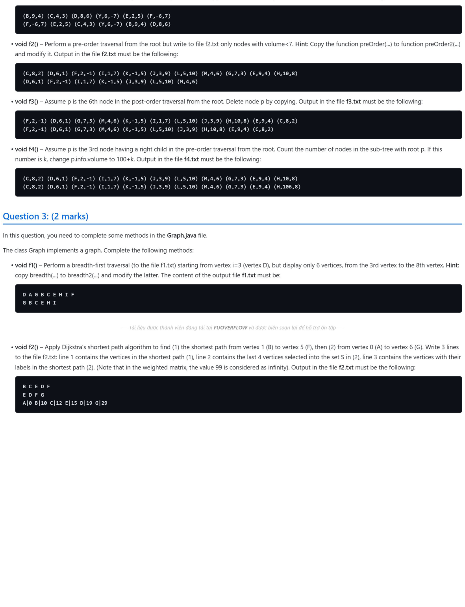

> **Nguyên văn đề bài (Question 2 - Tra cứu Ctrl+F):**
>
> Question 2: (4 marks)
> In this question, you need to complete some methods in the BSTree.java file.
> The class Bottle with 3 data members: maker, volume and color is given, and you do not need to edit it. The BSTree class is a binary search tree of Bottle objects. The
> variable volume is the key of the tree, thus it must be unique. Complete the following methods:
> > - void insert(String xMaker, int xVolume, int xColor) - check if xMaker.charAt(0) A' then do nothing, othemise insert new Bottle object with maker=xMaker,
> > - void fl() — Do not edit this method. You only need to complete the insert(...) method above. Output in the file f1.txt must be the following:
> (F, -6.7)
> (F, -6,7)
> > - void f2() — Perform a pre-order traversal from the root but write to file f2.txt only nodes with volume<7. Hint: Copy the function preOrder(...) to function preOrder2(...)
> and modify it. Output in the file f2.txt must be the following:
> (G, 7,3)
> (K, -1,5)
> > - void f3() — Assume p is the 6th node in the post-order traversal from the root. Delete node p by copying. Output in the file f3.txt must be the following:
> (F, 2, -1) (D,6.1) (K,-I.S) (L,5.1Ø)
> > - void f4() — Assume p is the 3rd node having a right child in the pre-order traversal from the root. Count the number of nodes in the sub-tree with root p. If this
> number is k, change p.info.volume to 100+k. Output in the file f4.txt must be the following:
> (G, 7,3)
> (F,2,-1) (G, 7,3)


---

#### 6.1.7. Đề thi: CSD201 - PE - SP 2024
- **Thư mục lưu trữ mã nguồn:** [solutions/2024/sp24_de1](./solutions/2024/sp24_de1/)
- **Thư mục tài liệu gốc:** `CSD201 - PE - SP 2024`

##### [Question 1] Danh sách liên kết đơn (MyList.java)
- **Mã nguồn giải:** [solutions/2024/sp24_de1\Q1\src\MyList.java](./solutions/2024/sp24_de1\Q1\src\MyList.java)

- **Hình ảnh trích xuất đề bài Question 1 từ đề gốc:**

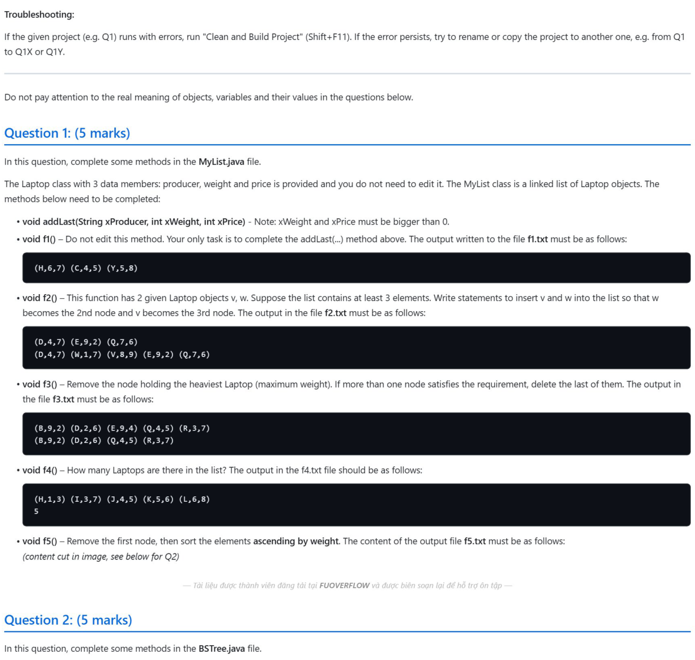

> **Nguyên văn đề bài (Question 1 - Tra cứu Ctrl+F):**
>
> Question 1: (5 marks)
> In this question, complete some methods in the MyList.java file.
> The Laptop class with 3 data members: producer, weight and price is provided and you do not need to edit it. The MyList class is a linked list of Laptop objects. The
> methods below need to be completed:
> > - void addLast(String xProducer, int xWeight, int xPrice) - Note: xWeight and xPrice must be bigger than O.
> > - void fl() — Do not edit this method. Your only task is to complete the method above. The output written to the file f1.txt must be as follows:
> > - void f2() — This function has 2 given Laptop objects v, w. Suppose the list contains at least 3 elements. Write statements to insert v and w into the list so that w
> becomes the 2nd node and v becomes the 3rd node. The output in the file f2.txt must be as follows:
> (Q, 7,6)
> (Q, 7,6)
> > - void f3() — Remove the node holding the heaviest Laptop (maximum weight). If more than one node satisfies the requirement, delete the last of them. The output in
> the file f3.txt must be as follows:
> (D, 2,6)
> > - void f4() — How many Laptops are there in the list? The output in the f4.txt file should be as follows:
> > - void f5() — Remove the first node, then sort the elements ascending by weight. The content of the output file f5.txt must be as follows:
> (content cut in image, see below for Q2)

- **Đáp án mã nguồn Java hoàn chỉnh (Giữ format và comment gốc của Given):**
```java
/* This program contains 2 parts: (1) and (2)
   YOUR TASK IS TO COMPLETE THE PART  (2)  ONLY
 */
//(1)==============================================================
import java.util.*;
import java.io.*;

public class MyList {

    Node head, tail;

    MyList() {
        head = tail = null;
    }

    boolean isEmpty() {
        return (head == null);
    }

    void clear() {
        head = tail = null;
    }

    void fvisit(Node p, RandomAccessFile f) throws Exception {
        if (p != null) {
            f.writeBytes(p.info + " ");
        }
    }

    void ftraverse(RandomAccessFile f) throws Exception {
        Node p = head;
        while (p != null) {
            fvisit(p, f); // You will use this statement to write information of the node p to the file
            p = p.next;
        }
        f.writeBytes("\r\n");
    }

    void loadData(int k) { //do not edit this function
        String[] a = Lib.readLineToStrArray("data.txt", k);
        int[] b = Lib.readLineToIntArray("data.txt", k + 1);
        int[] c = Lib.readLineToIntArray("data.txt", k + 2);
        int n = a.length;
        for (int i = 0; i < n; i++) {
            addLast(a[i], b[i], c[i]);
        }
    }

//===========================================================================
//(2)===YOU CAN EDIT OR EVEN ADD NEW FUNCTIONS IN THE FOLLOWING PART========
//===========================================================================
/* 
   Khong su dung tieng Viet co dau de viet ghi chu.
   Neu dung khi chay truc tiep se bao loi va nhan 0 diem
     */
    void addLast(String xPlace, int xWeight, int xColor) {
        //You should write here appropriate statements to complete this function.
        //--------------------------------------------------------
        Bike info = new Bike(xPlace, xWeight, xColor);
        if (xWeight < 0) {
            return;
        }
        if (isEmpty()) {
            head = tail = new Node(info);
        } else {
            Node node = new Node(info);
            tail.next = node;
            tail = node;
        }

        //---------------------------------------------------------
    }
    //==================================================================
    //You do not need to edit this function. Your task is to complete 
    void f1() throws Exception {
        clear();
        loadData(1);
        String fname = "f1.txt";
        File g123 = new File(fname);
        if (g123.exists()) {
            g123.delete();
        }
        RandomAccessFile f = new RandomAccessFile(fname, "rw");
        ftraverse(f);
        f.close();
    }

//==================================================================
    void f2() throws Exception {
        clear();
        loadData(5);
        String fname = "f2.txt";
        File g123 = new File(fname);
        if (g123.exists()) {
            g123.delete();
        }
        RandomAccessFile f = new RandomAccessFile(fname, "rw");
        ftraverse(f);
        //------------------------------------------------------------------------------------
        /*You must keep statements pre-given in this function.
        Your task is to insert statements here, just after this comment,
        to complete the question in the exam paper.*/
        delFirst();
        delFirst();
        delFirst();

        //------------------------------------------------------------------------------------
        ftraverse(f);
        f.close();
    }

    void delFirst() {
        head = head.next;
    }
//==================================================================

    void f3() throws Exception {
        clear();
        loadData(9);
        String fname = "f3.txt";
        File g123 = new File(fname);
        if (g123.exists()) {
            g123.delete();
        }
        RandomAccessFile f = new RandomAccessFile(fname, "rw");
        ftraverse(f);
        //------------------------------------------------------------------------------------
        /*You must keep statements pre-given in this function.
        Your task is to insert statements here, just after this comment,
        to complete the question in the exam paper.*/
        moveNodeToEnd(head);

        //------------------------------------------------------------------------------------
        ftraverse(f);
        f.close();
    }

    public static void moveNodeToEnd(Node head) {
        if (head == null || head.next == null || head.next.next == null) {
            System.out.println("Không đủ node để di chuyển!");
            return;
        }

        Node prev = head;
        Node current = head.next;

        for (int i = 1; i < 2; i++) {
            prev = current;
            current = current.next;
        }

        prev.next = current.next;

        Node temp = current;
        while (temp.next != null) {
            temp = temp.next;
        }

        temp.next = current;
        current.next = null;
    }
//==================================================================

    void f4() throws Exception {
        clear();
        loadData(13);
        String fname = "f4.txt";
        File g123 = new File(fname);
        if (g123.exists()) {
            g123.delete();
        }
        RandomAccessFile f = new RandomAccessFile(fname, "rw");
        ftraverse(f);
        //------------------------------------------------------------------------------------
        /*You must keep statements pre-given in this function.
        Your task is to insert statements here, just after this comment,
        to complete the question in the exam paper.*/
        int num = countNodesGreaterThan(0);
        System.out.println(num);
        //------------------------------------------------------------------------------------
        f.close();
        
    }
public int countNodesGreaterThan(int value) {
    int count = 0;
    Node current = head;
    while (current != null) {
        if (current.info.color > value) {
            count++;
        }
        current = current.next;
    }
    return count;
}
//==================================================================
    void f5() throws Exception {
        clear();
        loadData(17);
        String fname = "f5.txt";
        File g123 = new File(fname);
        if (g123.exists()) {
            g123.delete();
        }
        RandomAccessFile f = new RandomAccessFile(fname, "rw");
        ftraverse(f);
        //------------------------------------------------------------------------------------
        /*You must keep statements pre-given in this function.
        Your task is to insert statements here, just after this comment,
        to complete the question in the exam paper.*/
        delFirst();
        sort();
        //------------------------------------------------------------------------------------
        ftraverse(f);
        f.close();
    }
public void deleteFirstNode() {
        if (head == null) {
            return;
        }
        head = head.next;
    }

    void sort() {
        if (isEmpty()) return;
        Node pi = head, pj;
        while (pi != null) {
            pj = pi.next;
            while (pj != null) {
                if (pi.info.weight < pj.info.weight) {
                    Bike temp = pi.info;
                    pi.info = pj.info;
                    pj.info= temp;
                }

                pj = pj.next;
            }

            pi = pi.next;
        }
    }
    

}
```

- **Kết quả kiểm chứng thực tế:**
  - `f1.txt`: `(G,7,-1) (H,6,7) (C,4,5) (X,8,-9) (Y,5,8)`
  - `f2.txt`: `(D,4,7) (L,1,-5) (E,9,2) (Q,7,6)  | (Q,7,6)`
  - `f3.txt`: `(A,1,-3) (B,9,2) (D,2,6) (E,9,4) (Q,4,5) (R,3,7)  | (A,1,-3) (B,9,2) (E,9,4) (Q,4,5) (R,3,7) (D,2,6)`
  - `f4.txt`: `(G,2,-2) (H,1,3) (I,3,7) (J,4,5) (K,5,6) (L,6,8)`
  - `f5.txt`: `(N,6,1) (A,9,3) (I,4,-2) (S,7,5) (D,3,9)  | (A,9,3) (S,7,5) (I,4,-2) (D,3,9)`

##### [Question 2] Cây nhị phân tìm kiếm (BSTree.java)
- **Mã nguồn giải:** [solutions/2024/sp24_de1\Q2\src\BSTree.java](./solutions/2024/sp24_de1\Q2\src\BSTree.java)

- **Hình ảnh trích xuất đề bài Question 2 từ đề gốc:**


> **Nguyên văn đề bài (Question 2 - Tra cứu Ctrl+F):**
>
> Question 2: (5 marks)
> In this question, complete some methods in the BSTree.java file.
> The Cat class with 3 data members: place, weight and color is provided and you do not need to edit it. The BSTree class is a binary search tree of Cat objects. The variable
> weight is the key of the BSTree, thus it must be unique. The methods below need to be completed:
> > - void insert(String xPIace, int xWeight, int xCoIor) - The variable weight is the key of the BSTree, thus it must be unique.
> > - void fl() — Add statements in the insert(„.) method so that any node with xPlace.charAt(0) 'F' is not inserted to the tree. The output in file f1.txt should be as
> (N, 3.6) (P, 1,3)
> (P, 1,3)
> > - void f2() — Perform pre-order traversal for the right branch of the BST, but display only the nodes with color<8 to file f2.txt. Hint: Copy the function preOrder(...) to
> function preOrder2(...) and modify it. The output in the file f2.txt must be as follows (line 1: Breadth first traversal, line 2: pre-order traversal):
> (P, 7,9) (H, 2, 5) (L, 1.8) (N, 3.1)
> (GS, 6)
> > - void f3() — Implement a new traversal method that visits all nodes in the BST with the constraint: visit the nodes in the descending order of weight. The output in the
> file f3.txt must be as follows:
> (R, 5,9) (L (Y, 1,6)
> > - void f4() — Print out the leaf nodes of the tree. The output in the file f4.txt must be as follows (line 1: pre-order traversal, line 2: leaf nodes (by pre-order traversal)):
> (D,5.-3) (E,8.3) (G, 7.4)
> (P, 1,9) (D, 5,-3) (G, 7,4) (Q, 9,1)
> > - void f5() — How many internal nodes are there in the BST? The output in the file f5.txt must be as follows (line 1: in-order traversal, line 2: the amount of internal
> nodes):
> (L, 1,5) -6)
> 4

- **Đáp án mã nguồn Java hoàn chỉnh (Giữ format và comment gốc của Given):**
```java
/* This program contains 2 parts: (1) and (2)
   YOUR TASK IS TO COMPLETE THE PART  (2)  ONLY
 */
//(1)==============================================================
import java.io.*;
import java.util.*;

public class BSTree {

    Node root;

    BSTree() {
        root = null;
    }

    boolean isEmpty() {
        return (root == null);
    }

    void clear() {
        root = null;
    }

    void visit(Node p) {
        System.out.print("p.info: ");
        if (p != null) {
            System.out.println(p.info + " ");
        }
    }

    void fvisit(Node p, RandomAccessFile f) throws Exception {
        if (p != null) {
            f.writeBytes(p.info + " ");
        }
    }

    void breadth(Node p, RandomAccessFile f) throws Exception {
        if (p == null) {
            return;
        }
        Queue q = new Queue();
        q.enqueue(p);
        Node r;
        while (!q.isEmpty()) {
            r = q.dequeue();
            fvisit(r, f);
            if (r.left != null) {
                q.enqueue(r.left);
            }
            if (r.right != null) {
                q.enqueue(r.right);
            }
        }
    }

    void preOrder(Node p, RandomAccessFile f) throws Exception {
        if (p == null) {
            return;
        }
        fvisit(p, f);
        preOrder(p.left, f);
        preOrder(p.right, f);
    }

    void inOrder(Node p, RandomAccessFile f) throws Exception {
        if (p == null) {
            return;
        }
        inOrder(p.left, f);
        fvisit(p, f);
        inOrder(p.right, f);
    }

    void postOrder(Node p, RandomAccessFile f) throws Exception {
        if (p == null) {
            return;
        }
        postOrder(p.left, f);
        postOrder(p.right, f);
        fvisit(p, f);
    }

    void loadData(int k) { //do not edit this function
        String[] a = Lib.readLineToStrArray("data.txt", k);
        int[] b = Lib.readLineToIntArray("data.txt", k + 1);
        int[] c = Lib.readLineToIntArray("data.txt", k + 2);
        int n = a.length;
        for (int i = 0; i < n; i++) {
            insert(a[i], b[i], c[i]);
        }
    }

//===========================================================================
//(2)===YOU CAN EDIT OR EVEN ADD NEW FUNCTIONS IN THE FOLLOWING PART========
//===========================================================================
    void insert(String xPlace, int xWeight, int xColor) {
        //You should insert here statements to complete this function
        Bird x = new Bird(xPlace, xWeight, xColor);
        Node q = new Node(x);
        if (xPlace.charAt(0) == 'X') {
            return;
        }
        if (isEmpty()) {
            root = q;
            return;
        }
        Node p = root, f = null;
        while (p != null) {
            if (p.info.weight == x.weight) {
                return;
            }

            f = p;
            if (p.info.weight > x.weight) {
                p = p.left;
            } else {
                p = p.right;
            }
        }

        if (f.info.weight > x.weight) {
            f.left = q;
        } else {
            f.right = q;
        }

    }

//Do not edit this function. 
//Your task is to complete the insert function above only.
    void f1() throws Exception {
        clear();
        loadData(1);
        String fname = "f1.txt";
        File g123 = new File(fname);
        if (g123.exists()) {
            g123.delete();
        }
        RandomAccessFile f = new RandomAccessFile(fname, "rw");
        breadth(root, f);
        f.writeBytes("\r\n");
        inOrder(root, f);
        f.writeBytes("\r\n");
        f.close();
    }

//=============================================================
    void f2() throws Exception {
        clear();
        loadData(5);
        String fname = "f2.txt";
        File g123 = new File(fname);
        if (g123.exists()) {
            g123.delete();
        }
        RandomAccessFile f = new RandomAccessFile(fname, "rw");
        breadth(root, f);
        f.writeBytes("\r\n");
        //------------------------------------------------------------------------------------
        /*You must keep statements pre-given in this function.
        Your task is to insert statements here, just after this comment,
        to complete the question in the exam paper.*/
        deleteByCopying(root);
        preOrder2(root, f);

        //------------------------------------------------------------------------------------
        f.writeBytes("\r\n");
        f.close();
    }

    void deleteByCopying(Node p) {
        Node rightMost = p.left, f = null;
        while (rightMost.right != null) {
            f = rightMost;
            rightMost = rightMost.right;
        }
        p.info = rightMost.info;
        if (f == null) {
            p.left = rightMost.left;
        } else {
            f.right = rightMost.left;
        }
    }

    void preOrder2(Node p, RandomAccessFile f) throws Exception {
        if (p == null) {
            return;
        }
        if (p.info.color > 4) {
            fvisit(p, f);
        }
        preOrder2(p.left, f);
    }
//=============================================================

    void f3() throws Exception {
        clear();
        loadData(9);
        String fname = "f3.txt";
        File g123 = new File(fname);
        if (g123.exists()) {
            g123.delete();
        }
        RandomAccessFile f = new RandomAccessFile(fname, "rw");
        //------------------------------------------------------------------------------------
        /*You must keep statements pre-given in this function.
        Your task is to insert statements here, just after this comment,
        to complete the question in the exam paper.*/
        //------------------------------------------------------------------------------------
        f.writeBytes("\r\n");
        f.close();
    }
    
    


//=============================================================
    void f4() throws Exception {
        clear();
        loadData(13);
        String fname = "f4.txt";
        File g123 = new File(fname);
        if (g123.exists()) {
            g123.delete();
        }
        RandomAccessFile f = new RandomAccessFile(fname, "rw");
        preOrder(root, f);
        f.writeBytes("\r\n");
        //------------------------------------------------------------------------------------
        /*You must keep statements pre-given in this function.
        Your task is to insert statements here, just after this comment,
        to complete the question in the exam paper.*/
        preOrder3(root, f);
        //------------------------------------------------------------------------------------
        f.writeBytes("\r\n");
        f.close();
    }
    void preOrder3(Node p, RandomAccessFile f) throws Exception {
        if (p == null) {
            return;
        }
        if (p.left != null || p.right != null){
        fvisit(p, f);
        }
        preOrder3(p.left, f);
        preOrder3(p.right, f);
    }

   
//=============================================================

    void f5() throws Exception {
        clear();
        loadData(17);
        String fname = "f5.txt";
        File g123 = new File(fname);
        if (g123.exists()) {
            g123.delete();
        }
        RandomAccessFile f = new RandomAccessFile(fname, "rw");
        inOrder(root, f);
        f.writeBytes("\r\n");
        //------------------------------------------------------------------------------------
        /*You must keep statements pre-given in this function.
        Your task is to insert statements here, just after this comment,
        to complete the question in the exam paper.*/

        //------------------------------------------------------------------------------------
        f.close();
    }
}
```

- **Kết quả kiểm chứng thực tế:**
  - `f1.txt`: `(M,9,5) (F,7,4) (N,3,6) (Q,8,7) (P,1,3) (R,4,8)  | (P,1,3) (N,3,6) (R,4,8) (F,7,4) (Q,8,7) (M,9,5)`
  - `f2.txt`: `(P,7,9) (D,4,3) (G,9,6) (H,2,5) (B,6,4) (L,1,8) (N,3,1)  | (H,2,5) (L,1,8)`
  - `f3.txt`: `(M,7,2) (M,7,2) (M,7,2) (M,7,2) (M,7,2) (M,7,2) (M,7,2)`
  - `f4.txt`: `(A,6,5) (B,2,7) (P,1,9) (C,3,-8) (F,4,2) (D,5,-3) (E,8,3) (G,7,4) (Q,9,1)  | (A,6,5) (B,2,7) (C,3,-8) (F,4,2) (E,8,3)`

---

#### 6.1.8. Đề thi: CSD201 - PEQN - SU 2024 - L1
- **Thư mục lưu trữ mã nguồn:** [solutions/2024/peqn_su24_l1](./solutions/2024/peqn_su24_l1/)
- **Thư mục tài liệu gốc:** `CSD201 - PEQN - SU 2024 - L1`

##### [Question 1] Danh sách liên kết đơn (MyList.java)
- **Mã nguồn giải:** [solutions/2024/peqn_su24_l1\Q1\src\MyList.java](./solutions/2024/peqn_su24_l1\Q1\src\MyList.java)

- **Hình ảnh trích xuất đề bài Question 1 từ đề gốc:**

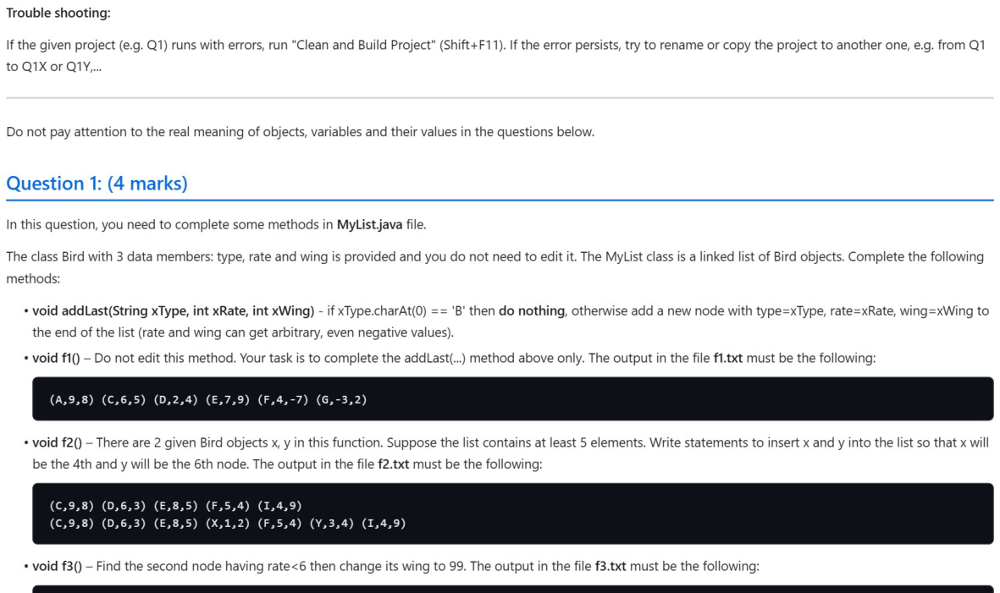

> **Nguyên văn đề bài (Question 1 - Tra cứu Ctrl+F):**
>
> Question 1: (4 marks)
> In this question, you need to complete some methods in MyList.java file.
> The class Bird with 3 data members: type, rate and wing is provided and you do not need to edit it. The MyList class is a linked list of Bird objects. Complete the following
> methods:
> > - void addLast(String xType, int xRate, int xWing) - if xType.charAt(0) 'B' then do nothing, otherwise add a new node with type=xType, rate=xRate, wing=xWing to
> the end of the list (rate and wing can get arbitrary, even negative values).
> > - void fl() — Do not edit this method. Your task is to complete the addLast(...) method above only. The output in the file f1.txt must be the following:
> (E, 7,9) (G, -3.2)
> > - void f2() — There are 2 given Bird objects x, y in this function. Suppose the list contains at least 5 elements. Write statements to insert x and y into the list so that x will
> be the 4th and y will be the 6th node. The output in the file f2.txt must be the following:
> > - void f3() — Find the second node having rate<6 then change its wing to 99. The output in the file f3.txt must be the following:
> (D, 3,5)
> > - void f4() — Sort from the beginning to the first max rate node ascendingly by rate. The content of the output file f4.txt must be the following:
> (E, 2, 15)
> (J. 11,15) (K

- **Đáp án mã nguồn Java hoàn chỉnh (Giữ format và comment gốc của Given):**
```java
/* This program contains 2 parts: (1) and (2)
   YOUR TASK IS TO COMPLETE THE PART  (2)  ONLY
 */
//(1)==============================================================
import java.util.*;
import java.io.*;

public class MyList {

    Node head, tail;

    MyList() {
        head = tail = null;
    }

    boolean isEmpty() {
        return (head == null);
    }

    void clear() {
        head = tail = null;
    }

    void fvisit(Node p, RandomAccessFile f) throws Exception {
        if (p != null) {
            f.writeBytes(p.info + " ");
        }
    }

    void ftraverse(RandomAccessFile f) throws Exception {
        Node p = head;
        while (p != null) {
            fvisit(p, f); // You will use this statement to write information of the node p to the file
            p = p.next;
        }
        f.writeBytes("\r\n");
    }

    void loadData(int k) { //do not edit this function
        String[] a = Lib.readLineToStrArray("data.txt", k);
        int[] b = Lib.readLineToIntArray("data.txt", k + 1);
        int[] c = Lib.readLineToIntArray("data.txt", k + 2);
        int n = a.length;
        for (int i = 0; i < n; i++) {
            addLast(a[i], b[i], c[i]);
        }
    }

//===========================================================================
//(2)===YOU CAN EDIT OR EVEN ADD NEW FUNCTIONS IN THE FOLLOWING PART========
//===========================================================================
/* 
   Khong su dung tieng Viet co dau de viet ghi chu.
   Neu dung khi chay truc tiep se bao loi va nhan 0 diem
     */
    void addLast(String xType, int xRate, int xWing) {
        //You should write here appropriate statements to complete this function.
        if (xType.charAt(0) == 'B') {
            return;
        }
        Bird bird = new Bird(xType, xRate, xWing);
        Node addBird = new Node(bird, null);
        if (head == null) {
            head = tail = addBird;
        }
        tail.next = addBird;
        tail = addBird;

    }

    //You do not need to edit this function. Your task is to complete the addLast function above only.
    void f1() throws Exception {
        clear();
        loadData(1);
        String fname = "f1.txt";
        File g123 = new File(fname);
        if (g123.exists()) {
            g123.delete();
        }
        RandomAccessFile f = new RandomAccessFile(fname, "rw");
        ftraverse(f);
        f.close();
    }

//==================================================================
    void f2() throws Exception {
        clear();
        loadData(5);
        String fname = "f2.txt";
        File g123 = new File(fname);
        if (g123.exists()) {
            g123.delete();
        }
        RandomAccessFile f = new RandomAccessFile(fname, "rw");
        ftraverse(f);
        Bird x, y;
        x = new Bird("X", 1, 2);
        y = new Bird("Y", 3, 4);
        //------------------------------------------------------------------------------------
        /*You must keep statements pre-given in this function.
       Your task is to insert statements here, just after this comment,
       to complete the question in the exam paper.*/
        Node insertX = new Node(x, null);
        Node insertY = new Node(y, null);
        insertPosition(4, insertX);
        insertPosition(6, insertY);

        //------------------------------------------------------------------------------------
        ftraverse(f);
        f.close();
    }

    void insertPosition(int k, Node insert) {
        Node curr = head;
        int count = 1;
        Node pre = null;
        while (curr != null && count != k) {
            count++;
            pre = curr;
            curr = curr.next;
        }
        insert.next = pre.next;
        pre.next = insert;
    }

//==================================================================
    void f3() throws Exception {
        clear();
        loadData(9);
        String fname = "f3.txt";
        File g123 = new File(fname);
        if (g123.exists()) {
            g123.delete();
        }
        RandomAccessFile f = new RandomAccessFile(fname, "rw");
        ftraverse(f);
        //------------------------------------------------------------------------------------
        /*You must keep statements pre-given in this function.
       Your task is to insert statements here, just after this comment,
       to complete the question in the exam paper.*/
        findSecondNode();
        //------------------------------------------------------------------------------------
        ftraverse(f);
        f.close();
    }
void findSecondNode(){
    Node second = null;
    int count = 0;
    Node p = head;
    while (p!=null) {        
        if(p.info.rate<6){
            count++;
            if(count ==2){
                p.info.wing = 99;
            }
        }
        p=p.next;
    }
    
}
//==================================================================
    void f4() throws Exception {
        clear();
        loadData(13);
        String fname = "f4.txt";
        File g123 = new File(fname);
        if (g123.exists()) {
            g123.delete();
        }
        RandomAccessFile f = new RandomAccessFile(fname, "rw");
        ftraverse(f);
        //------------------------------------------------------------------------------------
        /*You must keep statements pre-given in this function.
       Your task is to insert statements here, just after this comment,
       to complete the question in the exam paper.*/
sort();

        //------------------------------------------------------------------------------------
        ftraverse(f);
        f.close();
    }

    public void sort() {
        Node pi, pj;
        Bird x;
        pi = head;
        Node max = findNodemax();
        while (pi != null && pi.next!= max) {
            pj = pi.next;
            while (pj != null&& pj!= max) {
                if (pj.info.rate < pi.info.rate) {
                    x = pi.info;
                    pi.info = pj.info;
                    pj.info = x;
                }
                pj = pj.next;
            }
            pi = pi.next;
        }
    }

    Node findNodemax() {
        
        Node p = head;
        Node max = head;
        while (p != null) {
            if (p.info.rate > max.info.rate) {
                max = p;
            }
            p = p.next;
        }
        Node p1 = head;
        while (p1 != null) {
            if (p1.info.rate == max.info.rate) {
                max = p1;
                break;
            }
            p1 = p1.next;
        }
        return max;
    }

}
```

- **Kết quả kiểm chứng thực tế:**
  - `f1.txt`: `(A,9,8) (C,6,5) (D,2,4) (E,7,9) (F,4,-7) (G,-3,2)`
  - `f2.txt`: `(C,9,8) (D,6,3) (E,8,5) (F,5,4) (I,4,9)  | (C,9,8) (D,6,3) (E,8,5) (X,1,2) (F,5,4) (Y,3,4) (I,4,9)`
  - `f3.txt`: `(C,8,6) (D,3,5) (E,9,2) (F,5,8) (G,9,7) (H,6,8) (I,7,3)  | (C,8,6) (D,3,5) (E,9,2) (F,5,99) (G,9,7) (H,6,8) (I,7,3)`
  - `f4.txt`: `(C,1,2) (D,10,3) (E,2,15) (F,11,6) (I,6,14) (J,11,15) (K,7,9)  | (C,1,2) (E,2,15) (D,10,3) (F,11,6) (I,6,14) (J,11,15) (K,7,9)`

##### [Question 2] Cây nhị phân tìm kiếm (BSTree.java)
- **Mã nguồn giải:** [solutions/2024/peqn_su24_l1\Q2\src\BSTree.java](./solutions/2024/peqn_su24_l1\Q2\src\BSTree.java)

- **Hình ảnh trích xuất đề bài Question 2 từ đề gốc:**

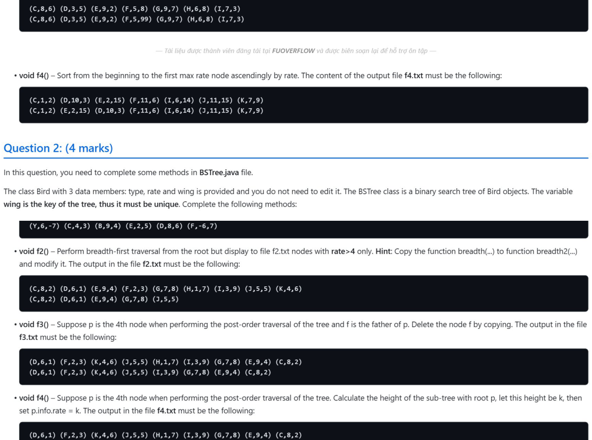

> **Nguyên văn đề bài (Question 2 - Tra cứu Ctrl+F):**
>
> Question 2: (4 marks)
> In this question, you need to complete some methods in BSTree.java file.
> The class Bird with 3 data members: type, rate and wing is provided and you do not need to edit it. The BSTree class is a binary search tree of Bird objects. The variable
> wing is the key of the tree, thus it must be unique. Complete the following methods:
> > - void insert(String xType, int xRate, int xWing) - if xType.charAt(0) 'B' then do nothing, othen,vise insert a new Bird object with type=xType, rate=xRate,
> wing=xWing into the tree (rate and wing can get arbitrary, even negative values).
> > - void fl() — Do not edit this method. Your task is to complete the insert(...) method above only. The output in the file f1.txt must be the following:
> (E, 2.5) (F, -6.7)
> (Y,6,-7) (C,4.3) (B,9,4) (E, 2,5) (D,8.6) (F, -6.7)
> > - void f2() — Perform breadth-first traversal from the root but display to file f2.txt nodes with rate>4 only. Hint: Copy the function breadth(...) to function breadth2(...)
> and modify it. The output in the file f2.txt must be the following:
> (F, 2,3) (K
> (G, 7,8)
> > - void f3() — Suppose p is the 4th node when performing the post-order traversal of the tree and f is the father of p. Delete the node f by copying. The output in the file
> f3.txt must be the following:
> (D.6,1) (H,1.7) (G.7,8) (E,9.4)
> > - void f4() — Suppose p is the 4th node when performing the post-order traversal of the tree. Calculate the height of the sub-tree with root p, let this height be k, then
> set p.info.rate = k. The output in the file f4.txt must be the following:
> (K (J, 2,5) (G, 7,8)

- **Đáp án mã nguồn Java hoàn chỉnh (Giữ format và comment gốc của Given):**
```java
/* This program contains 2 parts: (1) and (2)
   YOUR TASK IS TO COMPLETE THE PART  (2)  ONLY
 */
//(1)==============================================================
import java.io.*;
import java.util.*;

public class BSTree {
   Node root;
   BSTree() {root=null;}
   boolean isEmpty() {
       return(root==null);
      }
   void clear() {
       root=null;
      }
   void visit(Node p) {
      System.out.print("p.info: ");
      if(p != null) System.out.println(p.info + " ");
     }
   void fvisit(Node p, RandomAccessFile f) throws Exception {
      if(p != null) f.writeBytes(p.info + " ");
     }
   void breadth(Node p, RandomAccessFile f) throws Exception {
     if(p==null) return;
     Queue q = new Queue();
     q.enqueue(p);Node r;
     while(!q.isEmpty()) {
        r = q.dequeue();
        fvisit(r,f);
        if(r.left!=null) q.enqueue(r.left);
        if(r.right!=null) q.enqueue(r.right);
       }
    }
   void preOrder(Node p, RandomAccessFile f) throws Exception {
      if(p==null) return;
      fvisit(p,f);
      preOrder(p.left,f);
      preOrder(p.right,f);
     }
   void inOrder(Node p, RandomAccessFile f) throws Exception {
      if(p==null) return;
      inOrder(p.left,f);
      fvisit(p,f);
      inOrder(p.right,f);
     }
   void postOrder(Node p, RandomAccessFile f) throws Exception {
      if(p==null) return;
      postOrder(p.left,f);
      postOrder(p.right,f);
      fvisit(p,f);
     }

   void loadData(int k) { //do not edit this function
      String [] a = Lib.readLineToStrArray("data.txt", k);
      int [] b = Lib.readLineToIntArray("data.txt", k+1);
      int [] c = Lib.readLineToIntArray("data.txt", k+2);
      int n = a.length;
      for(int i=0;i<n;i++) insert(a[i],b[i],c[i]);
     }

//===========================================================================
//(2)===YOU CAN EDIT OR EVEN ADD NEW FUNCTIONS IN THE FOLLOWING PART========
//===========================================================================

  void insert(Bird x) {
    //You should insert here statements to complete this function
        Node q = new Node(x);
        if (root == null) {
            root = q;
            return;
        }
        Node f, p;
        p = root;
        f = null;
        while (p != null) {
            if (p.info.wing == x.wing) {
                return;
            }
            if (x.wing < p.info.wing) {
                f = p;
                p = p.left;
            } else {
                f = p;
                p = p.right;
            }
        }
        if (x.wing < f.info.wing) {
            f.left = q;
        } else {
            f.right = q;
        }
    }

    void insert(String xType, int xRate, int xWing) {
    //You should insert here statements to complete this function
        if (xType.charAt(0) == 'B') {
            return;
        }
        Bird x = new Bird(xType, xRate, xWing);
        insert(x);
    }
//Do not edit this function. Your task is to complete insert function above only.
  void f1() throws Exception {
    clear();
    loadData(1);
    String fname = "f1.txt";
    File g123 = new File(fname);
    if(g123.exists()) g123.delete();
    RandomAccessFile  f = new RandomAccessFile(fname, "rw"); 
    breadth(root,f);
    f.writeBytes("\r\n");
    inOrder(root,f);
    f.writeBytes("\r\n");
    f.close();
   }  
  
//=============================================================
  void f2() throws Exception {
    clear();
    loadData(5);
    String fname = "f2.txt";
    File g123 = new File(fname);
    if(g123.exists()) g123.delete();
    RandomAccessFile  f = new RandomAccessFile(fname, "rw"); 
    breadth(root,f);
    f.writeBytes("\r\n");
    //------------------------------------------------------------------------------------
    /*You must keep statements pre-given in this function.
      Your task is to insert statements here, just after this comment,
      to complete the question in the exam paper.*/
    breadth1(root,f);


    //------------------------------------------------------------------------------------
    f.writeBytes("\r\n");
    f.close();
   }  
   void breadth1(Node p, RandomAccessFile f) throws Exception {
     if(p==null) return;
     Queue q = new Queue();
     q.enqueue(p);Node r;
     while(!q.isEmpty()) {
        r = q.dequeue();
        if(r.info.rate > 4){
        fvisit(r,f);}
        if(r.left!=null) q.enqueue(r.left);
        if(r.right!=null) q.enqueue(r.right);
       }
    }

//=============================================================
  void f3() throws Exception {
    clear();
    loadData(9);
    String fname = "f3.txt";
    File g123 = new File(fname);
    if(g123.exists()) g123.delete();
    RandomAccessFile  f = new RandomAccessFile(fname, "rw"); 
    postOrder(root,f);
    f.writeBytes("\r\n");
    //------------------------------------------------------------------------------------
    /*You must keep statements pre-given in this function.
      Your task is to insert statements here, just after this comment,
      to complete the question in the exam paper.*/

    

    //------------------------------------------------------------------------------------
    postOrder2(root,f);
    f.writeBytes("\r\n");
    f.close();
   }  
	int count2 = 0;
        Node parent(Node x) {
        Node p = root;
        Node parent = null;
        while (p != null) {
            if (p.info.wing == x.info.wing) {
                break;
            }
            parent = p;
            if (p.info.wing > x.info.wing) {
                p = p.left;
            } else {
                p = p.right;
            }
        }
        return parent;
    }  
    


void postOrder2(Node p, RandomAccessFile f) throws Exception {
    if (p == null) return;
    postOrder2(p.left, f);
    postOrder2(p.right, f);

    count2++;
    if (count2 == 4) {
        Node nodeToDelete = parent(p);
        if (nodeToDelete != null) {
            deleByCopy(nodeToDelete);  
            postOrder(root, f);    
        }
    } 
}


void deleByCopy(Node p) {
    if (p == null) return;
    if (p.left == null && p.right == null) {
        deleteLeafNode(p);
    } else if (p.left == null || p.right == null) {
        deleteNodeWithOneChild(p);
    } else {
        Node rightmost = p.left;
        while (rightmost.right != null) {
            rightmost = rightmost.right;
        }
        p.info = rightmost.info;
        deleteLeafNode(rightmost);
    }
}

void deleteNodeWithOneChild(Node p) {
    if (p == null) return;
    Node child = (p.left != null) ? p.left : p.right;

    Node parent = parent(p);

    if (parent == null) {
        root = child; 
        return;
    }

    if (parent.left == p) {
        parent.left = child;
    } else {
        parent.right = child;
    }
}
void deleteLeafNode(Node p) {
    if (p == null) return;

    Node parent = parent(p);

    if (parent == null) {
        root = null;
        return;
    }

    if (parent.left == p) {
        parent.left = null;
    } else {
        parent.right = null;
    }
}

//=============================================================
  void f4() throws Exception {
    clear();
    loadData(13);;
    String fname = "f4.txt";
    File g123 = new File(fname);
    if(g123.exists()) g123.delete();
    RandomAccessFile  f = new RandomAccessFile(fname, "rw"); 
    postOrder(root,f);
    f.writeBytes("\r\n");
    //------------------------------------------------------------------------------------
    /*You must keep statements pre-given in this function.
      Your task is to insert statements here, just after this comment,
      to complete the question in the exam paper.*/
    
         int count4 = 0;

    //------------------------------------------------------------------------------------
    postOrder4(root,f);
     count4 = 0;
    f.writeBytes("\r\n");
    f.close();
   }  
 int count4 = 0;
void postOrder4(Node p, RandomAccessFile f) throws Exception {
    if(p==null) return;
    postOrder4(p.left,f);
    postOrder4(p.right,f);
    if(++count4 == 4){
        p.info.rate = calculateHeight(p);
    }
    fvisit(p,f);   
}
     int calculateHeight(Node node) {
    if (node == null) {
        return 0;
    }
    int leftHeight = calculateHeight(node.left);
    int rightHeight = calculateHeight(node.right);
    return Math.max(leftHeight, rightHeight) +1;
}

 }
```

- **Kết quả kiểm chứng thực tế:**
  - `f1.txt`: `(A,7,9) (C,4,3) (Y,6,-7) (D,8,6) (E,2,5) (F,-6,7)  | (Y,6,-7) (C,4,3) (E,2,5) (D,8,6) (F,-6,7) (A,7,9)`
  - `f2.txt`: `(C,8,2) (D,6,1) (E,9,4) (F,2,3) (G,7,8) (H,1,7) (I,3,9) (J,5,5) (K,4,6)  | (C,8,2) (D,6,1) (E,9,4) (G,7,8) (J,5,5)`
  - `f3.txt`: `(D,6,1) (F,2,3) (K,4,6) (J,5,5) (H,1,7) (I,3,9) (G,7,8) (E,9,4) (C,8,2)  | (D,6,1) (F,2,3) (K,4,6) (J,5,5) (I,3,9) (G,7,8) (E,9,4) (C,8,2)`
  - `f4.txt`: `(D,6,1) (F,2,3) (K,4,6) (J,5,5) (H,1,7) (I,3,9) (G,7,8) (E,9,4) (C,8,2)  | (D,6,1) (F,2,3) (K,4,6) (J,2,5) (H,1,7) (I,3,9) (G,7,8) (E,9,4) (C,8,2)`

##### [Question 3] Đồ thị (Graph.java)
- **Mã nguồn giải:** [solutions/2024/peqn_su24_l1\Q3\src\Graph.java](./solutions/2024/peqn_su24_l1\Q3\src\Graph.java)

- **Hình ảnh trích xuất đề bài Question 3 từ đề gốc:**

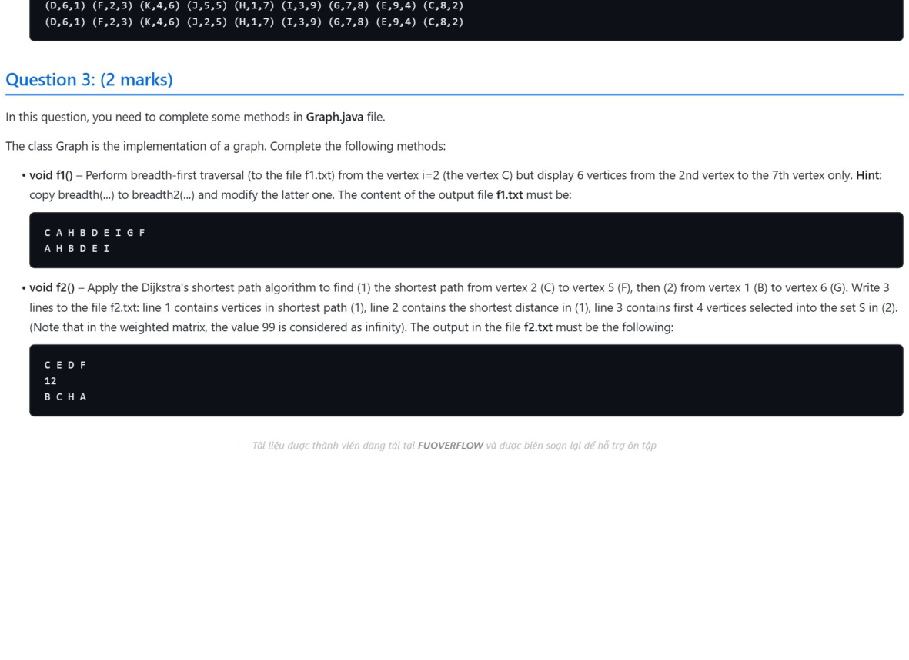

> **Nguyên văn đề bài (Question 3 - Tra cứu Ctrl+F):**
>
> Question 3: (2 marks)
> In this question, you need to complete some methods in Graph.java file.
> The class Graph is the implementation of a graph. Complete the following methods:
> > - void fl() — Perform breadth-first traversal (to the file f1 .txt) from the vertex i-2 (the vertex C) but display 6 vertices from the 2nd vertex to the 7th vertex only. Hint:
> copy breadth(...) to breadth2(...) and modify the latter one. The content of the output file f1.txt must be:
> CAHBDEIGF
> AHBDEI
> > - void f2() — Apply the Dijkstra's shortest path algorithm to find (1) the shortest path from vertex 2 (C) to vertex 5 (F), then (2) from vertex 1 (B) to vertex 6 (G). Write 3
> lines to the file f2.txt: line I contains vertices in shortest path (1), line 2 contains the shortest distance in (1), line 3 contains first 4 vertices selected into the set S in (2).
> (Note that in the weighted matrix, the value 99 is considered as infinity). The output in the file f2.txt must be the following:
> CED F
> 12
> B CHA

- **Đáp án mã nguồn Java hoàn chỉnh (Giữ format và comment gốc của Given):**
```java
/* This program contains 2 parts: (1) and (2)
   YOUR TASK IS TO COMPLETE THE PART  (2)  ONLY
 */
//(1)============================================
import java.io.*;
import java.util.*;
//-------------------------------------------------------------------------------
public class Graph {
  int [][] a; int n;
  char v[];
  int deg[];
  Graph() {
    v = "ABCDEFGHIJKLMNOP".toCharArray();
    deg = new int[20];
    a = new int[20][20];
    n = 0;
   }

  void loadData(int k) {  //do not edit this function
    RandomAccessFile f;int i,j,x;
    String s;StringTokenizer t;
    a = new int[20][20];
    try {
     f = new RandomAccessFile("data.txt","r");
     for(i=0;i<k;i++) f.readLine();
     s = f.readLine();s = s.trim();
     n = Integer.parseInt(s);
     for(i=0;i<n;i++) {
       s = f.readLine();s = s.trim();
       t = new StringTokenizer(s);
       for(j=0;j<n;j++) { 
         x = Integer.parseInt(t.nextToken().trim());
         a[i][j] = x;
        }
       }
     f.close();
     }
    catch(Exception e) {}

   }

  void dispAdj() {
    int i,j;
    for(i=0;i<n;i++) {
      System.out.println();
      for(j=0;j<n;j++)
        System.out.printf("%4d",a[i][j]);
     }
   }

  void fvisit(int i, RandomAccessFile f) throws Exception {
    f.writeBytes("  "+v[i]);
   }

 void fdispAdj(RandomAccessFile f) throws Exception { 
    int i,j;
    f.writeBytes("n = "+n+"\r\n");
    for(i=0;i<n;i++) {
      f.writeBytes("\r\n");
      for(j=0;j<n;j++)  f.writeBytes("  " + a[i][j]);
     }
    f.writeBytes("\r\n");
   }

  void breadth(boolean [] en, int i, RandomAccessFile f) throws Exception {
    Queue q = new Queue();
    int r,j;
    q.enqueue(i); en[i]=true;
    while(!q.isEmpty()) {
      r = q.dequeue();
      fvisit(r,f);
      for(j=0;j<n;j++) {
        if(!en[j] && a[r][j]>0) {
         q.enqueue(j);en[j]=true;
        }
       }
     }
   }

  void breadth(int  k, RandomAccessFile f) throws Exception {
    boolean [] en = new boolean[20];
    int i;
    for(i=0;i<n;i++) en[i]=false;
    breadth(en,k,f);
    for(i=0;i<n;i++) 
      if(!en[i]) breadth(en,i,f);
   }

 void depth(boolean [] visited,int k, RandomAccessFile f) throws Exception {
    fvisit(k,f);visited[k]=true;
    for(int i=0;i<n;i++) {
      if(!visited[i] && a[k][i]>0) depth(visited,i,f);
     }
   }
  void depth(int k, RandomAccessFile f) throws Exception {
    boolean [] visited = new boolean[20];
    int i;
    for(i=0;i<n;i++) visited[i]=false;
    depth(visited,k,f);
    for(i=0;i<n;i++) 
       if(!visited[i]) depth(visited,i,f);
   }

//===========================================================================
//(2)===YOU CAN EDIT OR EVEN ADD NEW FUNCTIONS IN THE FOLLOWING PART========
//===========================================================================
//====================================================================================
  void f1() throws Exception {
    loadData(1);
    String fname = "f1.txt";
    File g123 = new File(fname);
    if(g123.exists()) g123.delete();
    RandomAccessFile  f = new RandomAccessFile(fname, "rw"); 
    breadth(2,f);
    f.writeBytes("\r\n");
    //-------------------------------------------------------------------------------------
     /*You must keep statements pre-given in this function.
       Your task is to insert statements here, just after this comment,
       to complete the question in the exam paper.*/
      boolean[] en = new boolean[20];
    Queue q = new Queue();

    int r, j, count = 0; 
    q.enqueue(2); 
    en[2] = true;

    while (!q.isEmpty()) {
        r = q.dequeue();
        if (count >= 1 && count <= 6) {
            fvisit(r, f);
        }
        count++;
        for (j = 0; j < n; j++) {
            if (!en[j] && a[r][j] > 0) {
                q.enqueue(j);
                en[j] = true;
            }
        }
    }


    //-------------------------------------------------------------------------------------
    f.writeBytes("\r\n");
    f.close();
   }
    void breadth2(boolean [] visited, int k, RandomAccessFile f) throws Exception {
	 fvisit(k, f);
        visited[k] = true;
        for (int i = 1; i < 6; i++) {
            if (!visited[i] && a[k][i] > 0) {
                breadth2(visited, k, f);
            }
        }

   }

  void breadth2(int  k, RandomAccessFile f) throws Exception{
	 boolean[] visited = new boolean[20];
        int i;
        for (i = 1; i < 6; i++) {
            visited[i] = false;
        }
        breadth2(visited, k, f);
        for (i = 1; i < 6; i++) {
            if (!visited[i]) {
                depth(visited, i, f);
            }
        }

   }

//=================================================================================================
  void f2() throws Exception {
    loadData(12);
    String fname = "f2.txt";
    File g123 = new File(fname);
    if(g123.exists()) g123.delete();
    RandomAccessFile  f = new RandomAccessFile(fname, "rw"); 
    f.writeBytes("\r\n");
    //-------------------------------------------------------------------------------------
     /*You must keep statements pre-given in this function.
       Your task is to insert statements here, just after this comment,
       to complete the question in the exam paper.*/


    //-------------------------------------------------------------------------------------
    f.writeBytes("\r\n");
    f.close();
   }

}
```

- **Kết quả kiểm chứng thực tế:**
  - `f1.txt`: `C  A  H  B  D  E  I  G  F |   A  H  B  D  E  I`
  - `f2.txt`: `EMPTY`

---

#### 6.1.9. Đề thi: CSD201 - PE - SU 2024 - Block 5
- **Thư mục lưu trữ mã nguồn:** [solutions/2024/su24_b5](./solutions/2024/su24_b5/)
- **Thư mục tài liệu gốc:** `CSD201 - PE - SU 2024 - Block 5`

##### [Question 1] Danh sách liên kết đơn (MyList.java)
- **Mã nguồn giải:** [solutions/2024/su24_b5\Q1\src\MyList.java](./solutions/2024/su24_b5\Q1\src\MyList.java)

- **Hình ảnh trích xuất đề bài Question 1 từ đề gốc:**

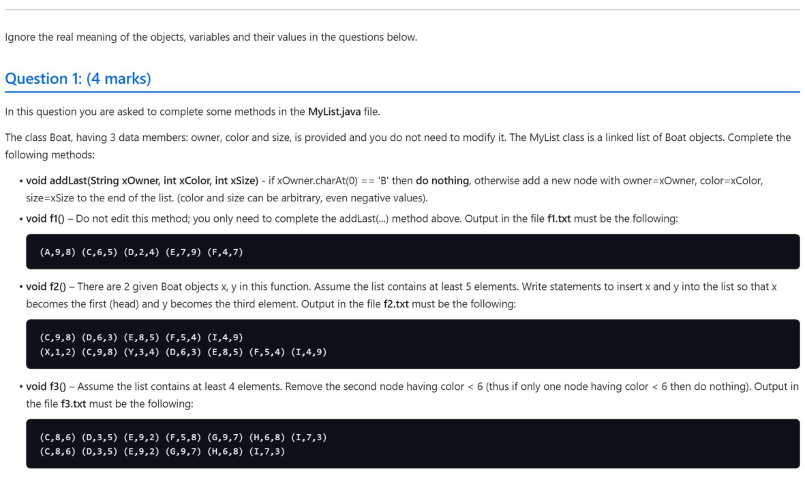

> **Nguyên văn đề bài (Question 1 - Tra cứu Ctrl+F):**
>
> Question 1: (4 marks)
> In this question you are asked to complete some methods in the MyList.java file.
> The class Boat, having 3 data members: owner, color and size, is provided and you do not need to modify it. The MyList class is a linked list of Boat objects. Complete the
> following methods:
> > - void addLast(String xOwner, int xColor, int xSize) - if xOwner.charAt(0) 'B' then do nothing, otherwise add a new node with owner=xOwner, color=xColor,
> size=xSize to the end of the list. (color and size can be arbitrary, even negative values).
> > - void fl() — Do not edit this method; you only need to complete the addLast(...) method above. Output in the file f1.txt must be the following:
> (E, 7,9)
> > - void f2() — There are 2 given Boat objects x, y in this function. Assume the list contains at least 5 elements. Write statements to insert x and y into the list so that x
> becomes the first (head) and y becomes the third element. Output in the file f2.txt must be the following:
> (F, 5.4)
> > - void f3() — Assume the list contains at least 4 elements. Remove the second node having color < 6 (thus if only one node having color < 6 then do nothing). Output in
> the file f3.txt must be the following:
> (1.7.3)
> (D, 3,5)
> > - void f4() — Assume the list contains at least 4 elements. Sort the last 4 elements ascendingly by color. The content of the output file f4.txt must be the following:
> (C, 7,9) (J, 3, 11)
> (C. 7.9) (K. 2.3) (J, 3.11) (1.1%4)

- **Đáp án mã nguồn Java hoàn chỉnh (Giữ format và comment gốc của Given):**
```java
/* This program contains 2 parts: (1) and (2)
   YOUR TASK IS TO COMPLETE THE PART  (2)  ONLY
 */
//(1)==============================================================
import java.util.*;
import java.io.*;
public class MyList {
  Node head,tail;
  MyList() {head=tail=null;}
  boolean isEmpty() {
    return(head==null);
   }
  void clear() {head=tail=null;}
  void fvisit(Node p, RandomAccessFile f) throws Exception {
    if(p != null) f.writeBytes(p.info + " ");
   }
  void ftraverse(RandomAccessFile f) throws Exception {
    Node p = head;
    while(p!=null) {
       fvisit(p,f);
       p=p.next;
      }
    f.writeBytes("\r\n");
   }
  void loadData(int k) {
    String [] a = Lib.readLineToStrArray("data.txt", k);
    int [] b = Lib.readLineToIntArray("data.txt", k+1);
    int [] c = Lib.readLineToIntArray("data.txt", k+2);
    int n = a.length;
    for(int i=0;i<n;i++) addLast(a[i],b[i],c[i]);
   }
//===========================================================================
//(2)===YOU CAN EDIT OR EVEN ADD NEW FUNCTIONS IN THE FOLLOWING PART========
//===========================================================================
/* 
   Khong su dung tieng Viet co dau de viet ghi chu.
   Neu dung khi chay truc tiep se bao loi va nhan 0 diem
*/
  void addLast(String xOwner, int xColor, int xSize) {
    //You should write here appropriate statements to complete this function.
   }
  //You do not need to edit this function. Your task is to complete the addLast function above only.
  void f1() throws Exception {
     clear();
     loadData(1);
     String fname = "f1.txt";
     File g123 = new File(fname);
     if(g123.exists()) g123.delete();
     RandomAccessFile  f = new RandomAccessFile(fname, "rw");
     ftraverse(f);
     f.close();
    }
  void f2() throws Exception {
     clear();
     loadData(5);
     String fname = "f2.txt";
     File g123 = new File(fname);
     if(g123.exists()) g123.delete();
     RandomAccessFile  f = new RandomAccessFile(fname, "rw");
     ftraverse(f);
     Boat x, y;
     x = new Boat("X",1,2);
     y = new Boat("Y",3,4);
     ftraverse(f);
     f.close();
    }
  void f3() throws Exception {
    clear();
    loadData(9);
    String fname = "f3.txt";
    File g123 = new File(fname);
    if(g123.exists()) g123.delete();
    RandomAccessFile  f = new RandomAccessFile(fname, "rw");
    ftraverse(f);
    ftraverse(f);
    f.close();
   }
  void f4() throws Exception {
    clear();
    loadData(13);
    String fname = "f4.txt";
    File g123 = new File(fname);
    if(g123.exists()) g123.delete();
    RandomAccessFile  f = new RandomAccessFile(fname, "rw");
    ftraverse(f);
    ftraverse(f);
    f.close();
   }
 }
```

- **Kết quả kiểm chứng thực tế:**
  - `f1.txt`: `EMPTY`

##### [Question 2] Cây nhị phân tìm kiếm (BSTree.java)
- **Mã nguồn giải:** [solutions/2024/su24_b5\Q2\src\BSTree.java](./solutions/2024/su24_b5\Q2\src\BSTree.java)

- **Hình ảnh trích xuất đề bài Question 2 từ đề gốc:**

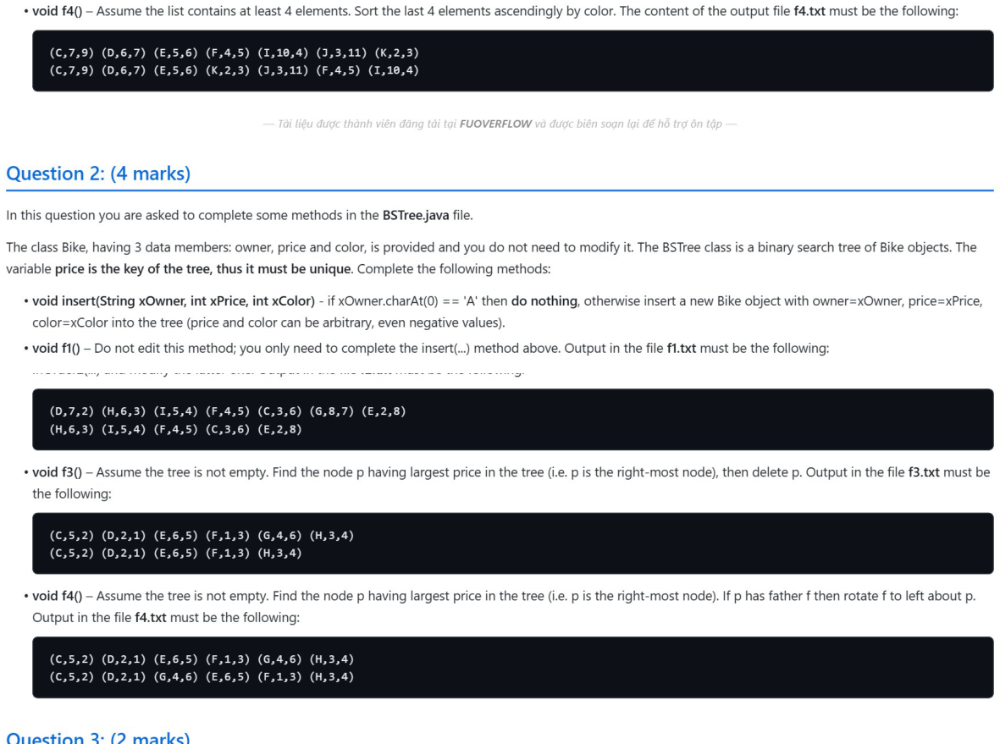

> **Nguyên văn đề bài (Question 2 - Tra cứu Ctrl+F):**
>
> Question 2: (4 marks)
> In this question you are asked to complete some methods in the BSTree.java file.
> The class Bike, having 3 data members: owner, price and color, is provided and you do not need to modify it. The BSTree class is a binary search tree of Bike objects. The
> variable price is the key of the tree, thus it must be unique. Complete the following methods:
> > - void insert(String xOwner, int xPrice, int xColor) - if xOwner.charAt(0) == 'A' then do nothing, otherwise insert a new Bike object with owner=xowner, price=xPrice,
> color=xCoIor into the tree (price and color can be arbitrary, even negative values).
> > - void fl() — Do not edit this method; you only need to complete the insert(...) method above. Output in the file f1.txt must be the following:
> (E, 2,5) (F, -6.7)
> (F. -6, 7) (E,2.5) (B.9,4) (D,8.6)
> > - VOId
> t2() — Perform In-order traversal trom the root but write to the tile t
> txt only the nodes Wlth price<7. Hint: copy the tunctlon Ino
> er Into a new tunctlon
> inOrder2(...) and modify the latter one. Output in the file f2.txt must be the following:
> (D, 7,2)
> (E, 2,8)
> (C, 3,6)
> > - void f3() — Assume the tree is not empty. Find the node p having largest price in the tree (i.e. p is the right-most node), then delete p. Output in the file f3.txt must be
> the following:
> (F, 1,3)
> > - void f4() — Assume the tree is not empty. Find the node p having largest price in the tree (i.e. p is the right-most node). If p has father f then rotate f to left about p.
> Output in the file f4.txt must be the following:
> (C.5,2) (D, 2.1) (F, 1,3) (H, 3,4)
> (D, 2, 1) (H, 3,4)

- **Đáp án mã nguồn Java hoàn chỉnh (Giữ format và comment gốc của Given):**
```java
/* This program contains 2 parts: (1) and (2)
   YOUR TASK IS TO COMPLETE THE PART  (2)  ONLY
 */
//(1)==============================================================
import java.io.*;
import java.util.*;
public class BSTree {
   Node root;
   BSTree() {root=null;}
   boolean isEmpty() {
       return(root==null);
      }
   void clear() {
       root=null;
      }
   void visit(Node p) {
      System.out.print("p.info: ");
      if(p != null) System.out.println(p.info + " ");
     }
   void fvisit(Node p, RandomAccessFile f) throws Exception {
      if(p != null) f.writeBytes(p.info + " ");
     }
   void breadth(Node p, RandomAccessFile f) throws Exception {
     if(p==null) return;
     Queue q = new Queue();
     q.enqueue(p);Node r;
     while(!q.isEmpty()) {
        r = q.dequeue();
        fvisit(r,f);
        if(r.left!=null) q.enqueue(r.left);
        if(r.right!=null) q.enqueue(r.right);
       }
    }
   void preOrder(Node p, RandomAccessFile f) throws Exception {
      if(p==null) return;
      fvisit(p,f);
      preOrder(p.left,f);
      preOrder(p.right,f);
     }
   void inOrder(Node p, RandomAccessFile f) throws Exception {
      if(p==null) return;
      inOrder(p.left,f);
      fvisit(p,f);
      inOrder(p.right,f);
     }
   void postOrder(Node p, RandomAccessFile f) throws Exception {
      if(p==null) return;
      postOrder(p.left,f);
      postOrder(p.right,f);
      fvisit(p,f);
     }
   void loadData(int k) {
      String [] a = Lib.readLineToStrArray("data.txt", k);
      int [] b = Lib.readLineToIntArray("data.txt", k+1);
      int [] c = Lib.readLineToIntArray("data.txt", k+2);
      int n = a.length;
      for(int i=0;i<n;i++) insert(a[i],b[i],c[i]);
     }
//===========================================================================
//(2)===YOU CAN EDIT OR EVEN ADD NEW FUNCTIONS IN THE FOLLOWING PART========
//===========================================================================
/* 
   Khong su dung tieng Viet co dau de viet ghi chu.
   Neu dung khi chay truc tiep se bao loi va nhan 0 diem
*/
  void insert(String xRiver, int xPrice, int xColor) {
    //You should insert here statements to complete this function
   }
//Do not edit this function. Your task is to complete insert function above only.
  void f1() throws Exception {
    clear();
    loadData(1);
    String fname = "f1.txt";
    File g123 = new File(fname);
    if(g123.exists()) g123.delete();
    RandomAccessFile  f = new RandomAccessFile(fname, "rw");
    breadth(root,f);
    f.writeBytes("\r\n");
    inOrder(root,f);
    f.writeBytes("\r\n");
    f.close();
   }
  void f2() throws Exception {
    clear();
    loadData(5);
    String fname = "f2.txt";
    File g123 = new File(fname);
    if(g123.exists()) g123.delete();
    RandomAccessFile  f = new RandomAccessFile(fname, "rw");
    inOrder(root,f);
    f.writeBytes("\r\n");
    f.writeBytes("\r\n");
    f.close();
   }
  void f3() throws Exception {
    clear();
    loadData(9);
    String fname = "f3.txt";
    File g123 = new File(fname);
    if(g123.exists()) g123.delete();
    RandomAccessFile  f = new RandomAccessFile(fname, "rw");
    breadth(root,f);
    f.writeBytes("\r\n");
    breadth(root,f);
    f.writeBytes("\r\n");
    f.close();
   }
  void f4() throws Exception {
    clear();
    loadData(13);;
    String fname = "f4.txt";
    File g123 = new File(fname);
    if(g123.exists()) g123.delete();
    RandomAccessFile  f = new RandomAccessFile(fname, "rw");
    breadth(root,f);
    f.writeBytes("\r\n");
    breadth(root,f);
    f.writeBytes("\r\n");
    f.close();
   }
 }
```

- **Kết quả kiểm chứng thực tế:**
  - `f1.txt`: `EMPTY`

##### [Question 3] Đồ thị (Graph.java)
- **Mã nguồn giải:** [solutions/2024/su24_b5\Q3\src\Graph.java](./solutions/2024/su24_b5\Q3\src\Graph.java)

- **Hình ảnh trích xuất đề bài Question 3 từ đề gốc:**

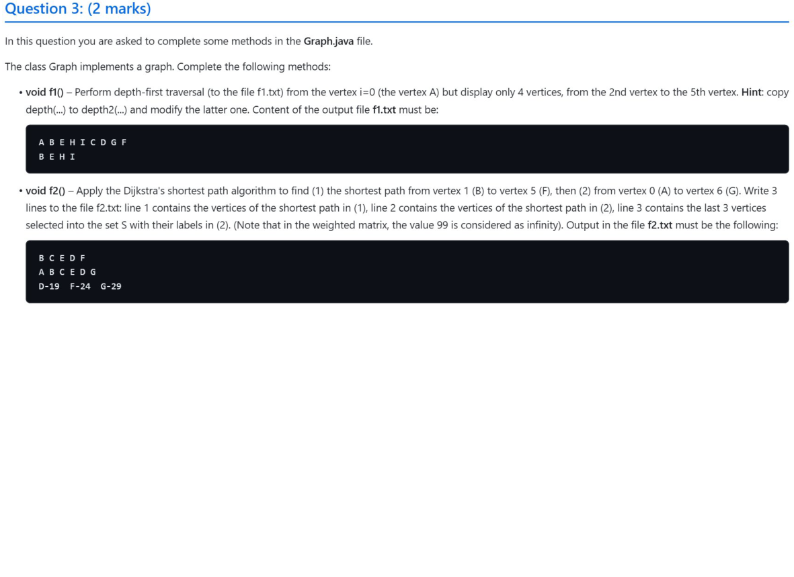

> **Nguyên văn đề bài (Question 3 - Tra cứu Ctrl+F):**
>
> Question 3: (2 marks)
> In this question you are asked to complete some methods in the Graph.java file.
> The class Graph implements a graph. Complete the following methods:
> > - void fl() — Perform depth-first traversal (to the file f1 .txt) from the vertex izo (the vertex A) but display only 4 vertices, from the 2nd vertex to the 5th vertex. Hint: copy
> depth(...) to depth2(...) and modify the latter one. Content of the output file f1.txt must be:
> ABE HI CDG F
> BEHI
> > - void f2() — Apply the Dijkstra's shortest path algorithm to find (1) the shortest path from vertex 1 (B) to vertex 5 (F), then (2) from vertex O (A) to vertex 6 (G). Write 3
> lines to the file f2.txt: line 1 contains the vertices of the shortest path in (1), line 2 contains the vertices of the shortest path in (2), line 3 contains the last 3 vertices
> selected into the set S with their labels in (2). (Note that in the weighted matrix, the value 99 is considered as infinity). Output in the file f2.txt must be the following:
> B
> A
> D
> BC
> — 19
> D
> F
> E
> F-24 G-29

- **Đáp án mã nguồn Java hoàn chỉnh (Giữ format và comment gốc của Given):**
```java
/* This program contains 2 parts: (1) and (2)
   YOUR TASK IS TO COMPLETE THE PART  (2)  ONLY
 */
//(1)==============================================================
import java.io.*;
import java.util.*;
public class Graph {
  int [][] a; int n;
  char v[];
  int deg[];
  Graph() {
    v = "ABCDEFGHIJKLMNOP".toCharArray();
    deg = new int[20];
    a = new int[20][20];
    n = 0;
   }
  void loadData(int k) {
    RandomAccessFile f;int i,j,x;
    String s;StringTokenizer t;
    a = new int[20][20];
    try {
     f = new RandomAccessFile("data.txt","r");
     for(i=0;i<k;i++) f.readLine();
     s = f.readLine();s = s.trim();
     n = Integer.parseInt(s);
     for(i=0;i<n;i++) {
       s = f.readLine();s = s.trim();
       t = new StringTokenizer(s);
       for(j=0;j<n;j++) {
         x = Integer.parseInt(t.nextToken().trim());
         a[i][j] = x;
        }
       }
     f.close();
     }
    catch(Exception e) {}
   }
  void dispAdj() {
    int i,j;
    for(i=0;i<n;i++) {
      System.out.println();
      for(j=0;j<n;j++)
        System.out.printf("%4d",a[i][j]);
     }
   }
  void fvisit(int i, RandomAccessFile f) throws Exception {
    f.writeBytes("  "+v[i]);
   }
 void fdispAdj(RandomAccessFile f) throws Exception {
    int i,j;
    f.writeBytes("n = "+n+"\r\n");
    for(i=0;i<n;i++) {
      f.writeBytes("\r\n");
      for(j=0;j<n;j++)  f.writeBytes("  " + a[i][j]);
     }
    f.writeBytes("\r\n");
   }
  void breadth(boolean [] en, int i, RandomAccessFile f) throws Exception {
    Queue q = new Queue();
    int r,j;
    q.enqueue(i); en[i]=true;
    while(!q.isEmpty()) {
      r = q.dequeue();
      fvisit(r,f);
      for(j=0;j<n;j++) {
        if(!en[j] && a[r][j]>0) {
         q.enqueue(j);en[j]=true;
        }
       }
     }
   }
  void breadth(int  k, RandomAccessFile f) throws Exception {
    boolean [] en = new boolean[20];
    int i;
    for(i=0;i<n;i++) en[i]=false;
    breadth(en,k,f);
    for(i=0;i<n;i++)
      if(!en[i]) breadth(en,i,f);
   }
 void depth(boolean [] visited,int k, RandomAccessFile f) throws Exception {
    fvisit(k,f);visited[k]=true;
    for(int i=0;i<n;i++) {
      if(!visited[i] && a[k][i]>0) depth(visited,i,f);
     }
   }
  void depth(int k, RandomAccessFile f) throws Exception {
    boolean [] visited = new boolean[20];
    int i;
    for(i=0;i<n;i++) visited[i]=false;
    depth(visited,k,f);
    for(i=0;i<n;i++)
       if(!visited[i]) depth(visited,i,f);
   }
//===========================================================================
//(2)===YOU CAN EDIT OR EVEN ADD NEW FUNCTIONS IN THE FOLLOWING PART========
//===========================================================================
/* 
   Khong su dung tieng Viet co dau de viet ghi chu.
   Neu dung khi chay truc tiep se bao loi va nhan 0 diem
*/
   void f1() throws Exception {
    loadData(1);
    String fname = "f1.txt";
    File g123 = new File(fname);
    if(g123.exists()) g123.delete();
    RandomAccessFile  f = new RandomAccessFile(fname, "rw");
    depth(0,f);
    f.writeBytes("\r\n");
    f.writeBytes("\r\n");
    f.close();
   }
  void f2() throws Exception {
    loadData(12);
    String fname = "f2.txt";
    File g123 = new File(fname);
    if(g123.exists()) g123.delete();
    RandomAccessFile  f = new RandomAccessFile(fname, "rw");
    f.writeBytes("\r\n");
    f.writeBytes("\r\n");
    f.close();
   }
}
```

- **Kết quả kiểm chứng thực tế:**
  - `f1.txt`: `A  B  E  H  I  C  D  G  F`

---

#### 6.1.10. Đề thi: CSD201 - PE - SU 2024
- **Thư mục lưu trữ mã nguồn:** [solutions/2024/pe_su24](./solutions/2024/pe_su24/)
- **Thư mục tài liệu gốc:** `CSD201 - PE - SU 2024`

##### [Question 1] Danh sách liên kết đơn (MyList.java)
- **Mã nguồn giải:** [solutions/2024/pe_su24\Q1\src\MyList.java](./solutions/2024/pe_su24\Q1\src\MyList.java)

- **Hình ảnh trích xuất đề bài Question 1 từ đề gốc:**

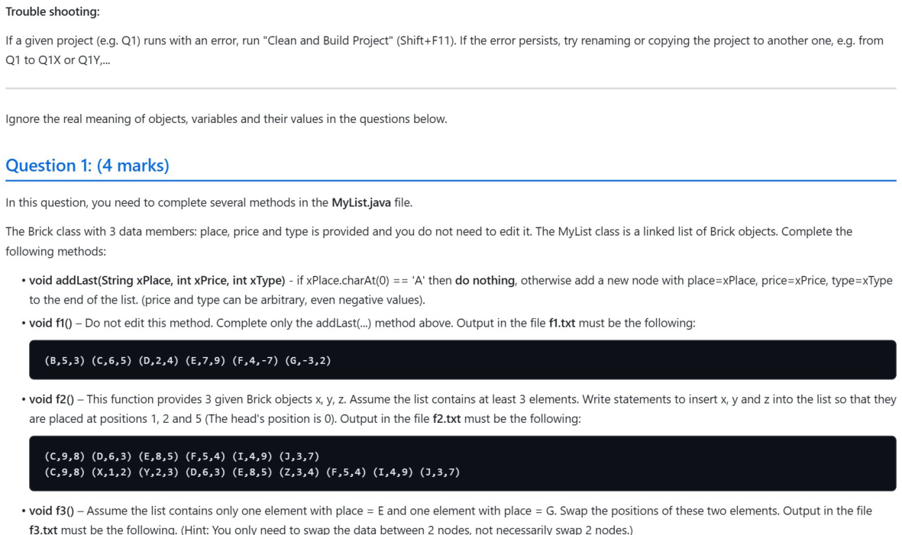

> **Nguyên văn đề bài (Question 1 - Tra cứu Ctrl+F):**
>
> Question 1: (4 marks)
> In this question, you need to complete several methods in the MyList.java file.
> The Brick class with 3 data members: place, price and type is provided and you do not need to edit it. The MyList class is a linked list of Brick objects. Complete the
> following methods:
> > - void addLast(String xPlace, int xprice, int xType) - if xPlace.charAt(0) 'A' then do nothing, otherwise add a new node with place=xPlace, price=xprice, type=xType
> to the end of the list. (price and type can be arbitrary, even negative values).
> > - void fl() — Do not edit this method. Complete only the addLast(...) method above. Output in the file f1.txt must be the following:
> (E, 7,9) (G, -3.2)
> > - void f2() — This function provides 3 given Brick objects x, y, z Assume the list contains at least 3 elements. Write statements to insert x, y and z into the list so that they
> are placed at positions 1, 2 and 5 (The head's position is O). Output in the file f2.txt must be the following:
> > - void f3() — Assume the list contains only one element with place E and one element with place G. Swap the positions of these two elements. Output in the file
> f3.txt must be the following. (Hint: You only need to swap the data between 2 nodes, not necessarily swap 2 nodes.)
> (C, 7.6) (F. 7,9) (G,8.7) (1.8,3)
> (C, 7,6) (F, 7,9)
> > - void f4() — Assume the list has only one element p with place = l. Sort all elements before p in ascending order of type. The content of the output file f4.txt must be
> the following:
> (L (M, 3.4)
> (F, 1,2) (D, 11,12) (K (L (M, 3,4)

- **Đáp án mã nguồn Java hoàn chỉnh (Giữ format và comment gốc của Given):**
```java
/* This program contains 2 parts: (1) and (2)
   YOUR TASK IS TO COMPLETE THE PART  (2)  ONLY
 */
//(1)==============================================================
import java.util.*;
import java.io.*;
public class MyList {
  Node head,tail;
  MyList() {head=tail=null;}
  boolean isEmpty() {
    return(head==null);
   }
  void clear() {head=tail=null;}
  void fvisit(Node p, RandomAccessFile f) throws Exception {
    if(p != null) f.writeBytes(p.info + " ");
   }
  void ftraverse(RandomAccessFile f) throws Exception {
    Node p = head;
    while(p!=null) {
       fvisit(p,f);
       p=p.next;
      }
    f.writeBytes("\r\n");
   }
  void loadData(int k) {
    String [] a = Lib.readLineToStrArray("data.txt", k);
    int [] b = Lib.readLineToIntArray("data.txt", k+1);
    int [] c = Lib.readLineToIntArray("data.txt", k+2);
    int n = a.length;
    for(int i=0;i<n;i++) addLast(a[i],b[i],c[i]);
   }
//===========================================================================
//(2)===YOU CAN EDIT OR EVEN ADD NEW FUNCTIONS IN THE FOLLOWING PART========
//===========================================================================
/* 
   Khong su dung tieng Viet co dau de viet ghi chu.
   Neu dung khi chay truc tiep se bao loi va nhan 0 diem
*/
  void addLast(String xPlace, int xPrice, int xType) {
    //You should write here appropriate statements to complete this function.
   }
  //You do not need to edit this function. Your task is to complete the addLast function above only.
  void f1() throws Exception {
     clear();
     loadData(1);
     String fname = "f1.txt";
     File g123 = new File(fname);
     if(g123.exists()) g123.delete();
     RandomAccessFile  f = new RandomAccessFile(fname, "rw");
     ftraverse(f);
     f.close();
    }
  void f2() throws Exception {
     clear();
     loadData(5);
     String fname = "f2.txt";
     File g123 = new File(fname);
     if(g123.exists()) g123.delete();
     RandomAccessFile  f = new RandomAccessFile(fname, "rw");
     ftraverse(f);
     Brick x, y, z;
     x = new Brick("X",1,2);
     y = new Brick("Y",2,3);
     z = new Brick("Z",3,4);
     ftraverse(f);
     f.close();
    }
  void f3() throws Exception {
    clear();
    loadData(9);
    String fname = "f3.txt";
    File g123 = new File(fname);
    if(g123.exists()) g123.delete();
    RandomAccessFile  f = new RandomAccessFile(fname, "rw");
    ftraverse(f);
    ftraverse(f);
    f.close();
  }
  void f4() throws Exception {
    clear();
    loadData(13);
    String fname = "f4.txt";
    File g123 = new File(fname);
    if(g123.exists()) g123.delete();
    RandomAccessFile  f = new RandomAccessFile(fname, "rw");
    ftraverse(f);
    ftraverse(f);
    f.close();
   }
 }
```

##### [Question 2] Cây nhị phân tìm kiếm (BSTree.java)
- **Mã nguồn giải:** [solutions/2024/pe_su24\Q2\src\BSTree.java](./solutions/2024/pe_su24\Q2\src\BSTree.java)

- **Hình ảnh trích xuất đề bài Question 2 từ đề gốc:**

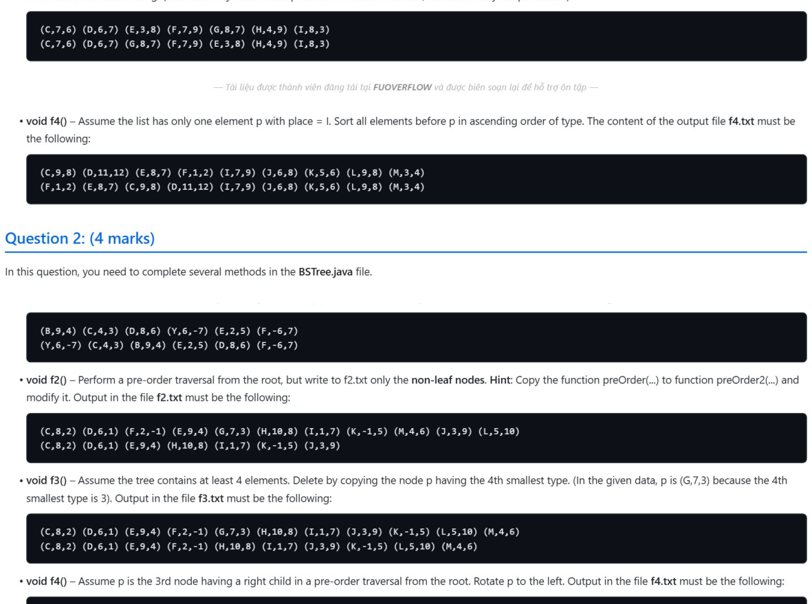

> **Nguyên văn đề bài (Question 2 - Tra cứu Ctrl+F):**
>
> Question 2: (4 marks)
> In this question, you need to complete several methods in the BSTree.java file.
> The Brick class with 3 data members: place, price and type is given and you do not need to edit it. The BSTree class is a binary search tree of Brick objects. The variable
> type is the key of the tree, thus it must be unique. Complete the following methods:
> > - void insert(String xPlace, int xPrice, int xType) - if xPlace.charAt(0) 'A' then do nothing, otherwise insert a new Brick object with place=xPlace, price=xPrice,
> > - void fl() — Do not edit this method. Complete only the insert(...) method above. Output in the file f1.txt must be the following:
> (F, -6.7)
> (E, 2,5) (F, -6.7)
> > - void f2() — Perform a pre-order traversal from the root, but write to f2.txt only the non-leaf nodes. Hint: Copy the function preOrder(...) to function preOrder2(...) and
> modify it. Output in the file f2.txt must be the following:
> (G, 7.3) (K, -1,5)
> (K, -1,5)
> > - void f3() — Assume the tree contains at least 4 elements. Delete by copying the node p having the 4th smallest type. (In the given data, p is (G,7,3) because the 4th
> smallest type is 3). Output in the file f3.txt must be the following:
> (F, 2, -1) (G, 7.3) (H,1Ø.8) (J, 3,9) (K, -1,5)
> (F, 2, -1) (K, -1,5)
> > - void f4() — Assume p is the 3rd node having a right child in a pre-order traversal from the root. Rotate p to the left. Output in the file f4.txt must be the following:
> (F, 2, -1) (K, -1,5)

- **Đáp án mã nguồn Java hoàn chỉnh (Giữ format và comment gốc của Given):**
```java
/* This program contains 2 parts: (1) and (2)
   YOUR TASK IS TO COMPLETE THE PART  (2)  ONLY
 */
//(1)==============================================================
import java.io.*;
import java.util.*;
public class BSTree {
   Node root;
   BSTree() {root=null;}
   boolean isEmpty() {
       return(root==null);
      }
   void clear() {
       root=null;
      }
   void visit(Node p) {
      System.out.print("p.info: ");
      if(p != null) System.out.println(p.info + " ");
     }
   void fvisit(Node p, RandomAccessFile f) throws Exception {
      if(p != null) f.writeBytes(p.info + " ");
     }
   void breadth(Node p, RandomAccessFile f) throws Exception {
     if(p==null) return;
     Queue q = new Queue();
     q.enqueue(p);Node r;
     while(!q.isEmpty()) {
        r = q.dequeue();
        fvisit(r,f);
        if(r.left!=null) q.enqueue(r.left);
        if(r.right!=null) q.enqueue(r.right);
       }
    }
   void preOrder(Node p, RandomAccessFile f) throws Exception {
      if(p==null) return;
      fvisit(p,f);
      preOrder(p.left,f);
      preOrder(p.right,f);
     }
   void inOrder(Node p, RandomAccessFile f) throws Exception {
      if(p==null) return;
      inOrder(p.left,f);
      fvisit(p,f);
      inOrder(p.right,f);
     }
   void postOrder(Node p, RandomAccessFile f) throws Exception {
      if(p==null) return;
      postOrder(p.left,f);
      postOrder(p.right,f);
      fvisit(p,f);
     }
   void loadData(int k) {
      String [] a = Lib.readLineToStrArray("data.txt", k);
      int [] b = Lib.readLineToIntArray("data.txt", k+1);
      int [] c = Lib.readLineToIntArray("data.txt", k+2);
      int n = a.length;
      for(int i=0;i<n;i++) insert(a[i],b[i],c[i]);
     }
//===========================================================================
//(2)===YOU CAN EDIT OR EVEN ADD NEW FUNCTIONS IN THE FOLLOWING PART========
//===========================================================================
/* 
   Khong su dung tieng Viet co dau de viet ghi chu.
   Neu dung khi chay truc tiep se bao loi va nhan 0 diem
*/
  void insert(String xPlace, int xPrice, int xType) {
    //You should insert here statements to complete this function
   }
//Do not edit this function. Your task is to complete insert function above only.
  void f1() throws Exception {
    clear();
    loadData(1);
    String fname = "f1.txt";
    File g123 = new File(fname);
    if(g123.exists()) g123.delete();
    RandomAccessFile  f = new RandomAccessFile(fname, "rw");
    breadth(root,f);
    f.writeBytes("\r\n");
    inOrder(root,f);
    f.writeBytes("\r\n");
    f.close();
   }
 void f2() throws Exception {
    clear();
    loadData(5);
    String fname = "f2.txt";
    File g123 = new File(fname);
    if(g123.exists()) g123.delete();
    RandomAccessFile  f = new RandomAccessFile(fname, "rw");
    preOrder(root,f);
    f.writeBytes("\r\n");
    f.writeBytes("\r\n");
    f.close();
   }
  void f3() throws Exception {
    clear();
    loadData(9);
    String fname = "f3.txt";
    File g123 = new File(fname);
    if(g123.exists()) g123.delete();
    RandomAccessFile  f = new RandomAccessFile(fname, "rw");
    breadth(root,f);
    f.writeBytes("\r\n");
    breadth(root,f);
    f.writeBytes("\r\n");
    f.close();
   }
 void f4() throws Exception {
    clear();
    loadData(13);;
    String fname = "f4.txt";
    File g123 = new File(fname);
    if(g123.exists()) g123.delete();
    RandomAccessFile  f = new RandomAccessFile(fname, "rw");
    breadth(root,f);
    f.writeBytes("\r\n");
    breadth(root,f);
    f.writeBytes("\r\n");
    f.close();
   }
 }
```

- **Kết quả kiểm chứng thực tế:**
  - `f1.txt`: `EMPTY`

##### [Question 3] Đồ thị (Graph.java)
- **Mã nguồn giải:** [solutions/2024/pe_su24\Q3\src\Graph.java](./solutions/2024/pe_su24\Q3\src\Graph.java)

- **Hình ảnh trích xuất đề bài Question 3 từ đề gốc:**

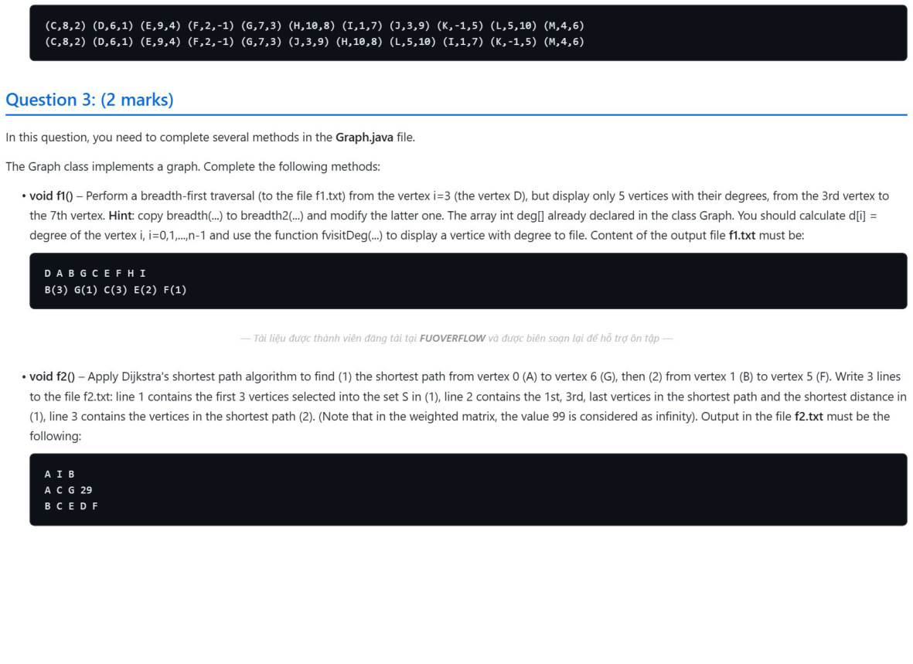

> **Nguyên văn đề bài (Question 3 - Tra cứu Ctrl+F):**
>
> Question 3: (2 marks)
> In this question, you need to complete several methods in the Graph.java file.
> The Graph class implements a graph. Complete the following methods:
> > - void fl() — Perform a breadth-first traversal (to the file f1.txt) from the vertex (the vertex D), but display only 5 vertices with their degrees, from the 3rd vertex to
> the 7th vertex. Hint: copy breadth(...) to breadth2(...) and modify the latter one. The array int deg[] already declared in the class Graph. You should calculate d[il =
> degree of the vertex i, and use the function fvisitDeg(...) to display a vertice with degree to file. Content of the output file f1.txt must be:
> DABGCEFHI
> B(3) G(l) C(3) E(2) F(l)
> > - void f2() — Apply Dijkstra's shortest path algorithm to find (1) the shortest path from vertex 0 (A) to vertex 6 (G), then (2) from vertex 1 (B) to vertex 5 (F). Write 3 lines
> to the file f2.txt: line 1 contains the first 3 vertices selected into the set S in (1), line 2 contains the 1st, 3rd, last vertices in the shortest path and the shortest distance in
> (1), line 3 contains the vertices in the shortest path (2). (Note that in the weighted matrix, the value 99 is considered as infinity). Output in the file f2.txt must be the
> following:
> ACG
> c
> 29
> B
> E

- **Đáp án mã nguồn Java hoàn chỉnh (Giữ format và comment gốc của Given):**
```java
/* This program contains 2 parts: (1) and (2)
   YOUR TASK IS TO COMPLETE THE PART  (2)  ONLY
 */
//(1)==============================================================
import java.io.*;
import java.util.*;
public class Graph {
  int [][] a; int n;
  char v[];
  int deg[];
  Graph() {
    v = "ABCDEFGHIJKLMNOP".toCharArray();
    deg = new int[20];
    a = new int[20][20];
    n = 0;
   }
  void loadData(int k) {
    RandomAccessFile f;int i,j,x;
    String s;StringTokenizer t;
    a = new int[20][20];
    try {
     f = new RandomAccessFile("data.txt","r");
     for(i=0;i<k;i++) f.readLine();
     s = f.readLine();s = s.trim();
     n = Integer.parseInt(s);
     for(i=0;i<n;i++) {
       s = f.readLine();s = s.trim();
       t = new StringTokenizer(s);
       for(j=0;j<n;j++) {
         x = Integer.parseInt(t.nextToken().trim());
         a[i][j] = x;
        }
       }
     f.close();
     }
    catch(Exception e) {}
   }
  void dispAdj() {
    int i,j;
    for(i=0;i<n;i++) {
      System.out.println();
      for(j=0;j<n;j++)
        System.out.printf("%4d",a[i][j]);
     }
   }
  void fvisit(int i, RandomAccessFile f) throws Exception {
    f.writeBytes("  "+v[i]);
   }
  void fvisitDeg(int i, RandomAccessFile f) throws Exception {
    f.writeBytes("  "+v[i]+"("+deg[i]+")");
   }
 void fdispAdj(RandomAccessFile f) throws Exception {
    int i,j;
    f.writeBytes("n = "+n+"\r\n");
    for(i=0;i<n;i++) {
      f.writeBytes("\r\n");
      for(j=0;j<n;j++)  f.writeBytes("  " + a[i][j]);
     }
    f.writeBytes("\r\n");
   }
  void breadth(boolean [] en, int i, RandomAccessFile f) throws Exception {
    Queue q = new Queue();
    int r,j;
    q.enqueue(i); en[i]=true;
    while(!q.isEmpty()) {
      r = q.dequeue();
      fvisit(r,f);
      for(j=0;j<n;j++) {
        if(!en[j] && a[r][j]>0) {
         q.enqueue(j);en[j]=true;
        }
       }
     }
   }
  void breadth(int  k, RandomAccessFile f) throws Exception {
    boolean [] en = new boolean[20];
    int i;
    for(i=0;i<n;i++) en[i]=false;
    breadth(en,k,f);
    for(i=0;i<n;i++)
      if(!en[i]) breadth(en,i,f);
   }
 void depth(boolean [] visited,int k, RandomAccessFile f) throws Exception {
    fvisit(k,f);visited[k]=true;
    for(int i=0;i<n;i++) {
      if(!visited[i] && a[k][i]>0) depth(visited,i,f);
     }
   }
  void depth(int k, RandomAccessFile f) throws Exception {
    boolean [] visited = new boolean[20];
    int i;
    for(i=0;i<n;i++) visited[i]=false;
    depth(visited,k,f);
    for(i=0;i<n;i++)
       if(!visited[i]) depth(visited,i,f);
   }
//===========================================================================
//(2)===YOU CAN EDIT OR EVEN ADD NEW FUNCTIONS IN THE FOLLOWING PART========
//===========================================================================
/* 
   Khong su dung tieng Viet co dau de viet ghi chu.
   Neu dung khi chay truc tiep se bao loi va nhan 0 diem
*/
  void f1() throws Exception {
    loadData(1);
    String fname = "f1.txt";
    File g123 = new File(fname);
    if(g123.exists()) g123.delete();
    RandomAccessFile  f = new RandomAccessFile(fname, "rw");
    breadth(3,f);
    f.writeBytes("\r\n");
    f.writeBytes("\r\n");
    f.close();
   }
  void f2() throws Exception {
    loadData(12);
    String fname = "f2.txt";
    File g123 = new File(fname);
    if(g123.exists()) g123.delete();
    RandomAccessFile  f = new RandomAccessFile(fname, "rw");
    f.writeBytes("\r\n");
    f.close();
   }
}
```

---

#### 6.1.11. Đề thi: CSD201 - SP 2024 - B3W - T5
- **Thư mục lưu trữ mã nguồn:** [solutions/2024/sp24_b3w_t5](./solutions/2024/sp24_b3w_t5/)
- **Thư mục tài liệu gốc:** `CSD201 - SP 2024 - B3W - T5`

##### [Question 1] Danh sách liên kết đơn (MyList.java)
- **Mã nguồn giải:** [solutions/2024/sp24_b3w_t5\Q1\src\MyList.java](./solutions/2024/sp24_b3w_t5\Q1\src\MyList.java)

- **Hình ảnh trích xuất đề bài Question 1 từ đề gốc:**


> **Nguyên văn đề bài (Question 1 - Tra cứu Ctrl+F):**
>
> Question 1: (5 marks)
> In this question you should complete several methods in the MyList.java file.
> The class Laptop with 3 data members: producer, weight and price is given and you do not need to edit it. The MyList class is a linked list of Laptop objects. Complete the
> following methods:
> > - void addLast(String xProducer, int xWeight, int xprice) - Note: xWeight>3 and xPrice>3.
> > - void fl() — Do not edit this method. Complete only the addLast(...) method described above. Output in the file f1.txt must be the following:
> > - void f2() — Two Laptop objects v, w are given in this function. Assume the list contains at least 2 elements. Write statements to insert v and w into the list so that v is
> the first and w is the last node. Output in the file f2.txt must be the following:
> (D, 4, 7) (Q, 7,6)
> (L (Q, 7.6)
> > - void f3() — Delete the node that holds the heaviest Laptop (maximum weight). If more than one node satisfies the requirement, delete the first of them. Output in the
> file f3.txt must be the following:
> (R,5.7)
> (A, 4.4)
> > - void f4() — How many Laptops does the list contain? The output in the f4.txt file should be as follows:
> (3.4, 5) (K, 5,6) (L
> > - void f5() — Delete the first two nodes, then sort the elements ascending by weight (assuming that there is no duplicated value for weight). The content of the output
> file f5.txt must be the following:
> (S, 7,5)

- **Đáp án mã nguồn Java hoàn chỉnh (Giữ format và comment gốc của Given):**
```java
/* This program contains 2 parts: (1) and (2)
   YOUR TASK IS TO COMPLETE THE PART  (2)  ONLY
 */
//(1)==============================================================
import java.util.*;
import java.io.*;

public class MyList {

    Node head, tail;

    MyList() {
        head = tail = null;
    }

    boolean isEmpty() {
        return (head == null);
    }

    void clear() {
        head = tail = null;
    }

    void fvisit(Node p, RandomAccessFile f) throws Exception {
        if (p != null) {
            f.writeBytes(p.info + " ");
        }
    }

    void ftraverse(RandomAccessFile f) throws Exception {
        Node p = head;
        while (p != null) {
            fvisit(p, f); // You will use this statement to write information of the node p to the file
            p = p.next;
        }
        f.writeBytes("\r\n");
    }

    void loadData(int k) { //do not edit this function
        String[] a = Lib.readLineToStrArray("data.txt", k);
        int[] b = Lib.readLineToIntArray("data.txt", k + 1);
        int[] c = Lib.readLineToIntArray("data.txt", k + 2);
        int n = a.length;
        for (int i = 0; i < n; i++) {
            addLast(a[i], b[i], c[i]);
        }
    }

//===========================================================================
//(2)===YOU CAN EDIT OR EVEN ADD NEW FUNCTIONS IN THE FOLLOWING PART========
//===========================================================================
/* 
   Khong su dung tieng Viet co dau de viet ghi chu.
   Neu dung khi chay truc tiep se bao loi va nhan 0 diem
     */
    void addLast(String xProducer, int xWeight, int xPrice) {
        //You should write here appropriate statements to complete this function.
        //--------------------------------------------------------
        if (xWeight > 3 && xPrice > 3) {
            Laptop newLaptop = new Laptop(xProducer, xWeight, xPrice);

            Node newNode = new Node(newLaptop);

            if (isEmpty()) {
                head = tail = newNode;
            } else {
                tail.next = newNode;
                tail = newNode;
            }

            //---------------------------------------------------------
        }
    }

    //==================================================================
    //You do not need to edit this function. Your task is to complete the addLast function above only.
    void f1() throws Exception {
        clear();
        loadData(1);
        String fname = "f1.txt";
        File g123 = new File(fname);
        if (g123.exists()) {
            g123.delete();
        }
        RandomAccessFile f = new RandomAccessFile(fname, "rw");
        ftraverse(f);
        f.close();
    }

//==================================================================
    void f2() throws Exception {
        clear();
        loadData(5);
        String fname = "f2.txt";
        File g123 = new File(fname);
        if (g123.exists()) {
            g123.delete();
        }
        RandomAccessFile f = new RandomAccessFile(fname, "rw");
        ftraverse(f);
        Node v = new Node(new Laptop("V", 8, 9));
        Node w = new Node(new Laptop("W", 6, 7));
        //------------------------------------------------------------------------------------
        /*You must keep statements pre-given in this function.
        Your task is to insert statements here, just after this comment,
        to complete the question in the exam paper.*/
        v.next = head;
        head = v;

        tail.next = w;
        tail = w;
        //------------------------------------------------------------------------------------
        ftraverse(f);
        f.close();
    }

//==================================================================
    void f3() throws Exception {
        clear();
        loadData(9);
        String fname = "f3.txt";
        File g123 = new File(fname);
        if (g123.exists()) {
            g123.delete();
        }
        RandomAccessFile f = new RandomAccessFile(fname, "rw");
        ftraverse(f);
        //------------------------------------------------------------------------------------
        /*You must keep statements pre-given in this function.
        Your task is to insert statements here, just after this comment,
        to complete the question in the exam paper.*/
        Node current = head;
        Node previous = null;
        Node maxWeightNode = null;
        Node maxWeightPrevNode = null;
        int maxWeight = Integer.MIN_VALUE;
        while (current != null) {
            Laptop currentLaptop = current.info;
            if (currentLaptop.weight > maxWeight) {
                maxWeight = currentLaptop.weight;
                maxWeightNode = current;
                maxWeightPrevNode = previous;
            }
            previous = current;
            current = current.next;
        }

        if (maxWeightNode != null) {
            if (maxWeightPrevNode == null) {
                head = maxWeightNode.next;
                if (head == null) {
                    tail = null;
                }
            } else {
                maxWeightPrevNode.next = maxWeightNode.next;
                if (maxWeightNode == tail) {
                    tail = maxWeightPrevNode;
                }
            }
        }
        //------------------------------------------------------------------------------------
        ftraverse(f);
        f.close();
    }

//==================================================================
    void f4() throws Exception {
        clear();
        loadData(13);
        String fname = "f4.txt";
        File g123 = new File(fname);
        if (g123.exists()) {
            g123.delete();
        }
        RandomAccessFile f = new RandomAccessFile(fname, "rw");
        ftraverse(f);
        int result = 0;
        //------------------------------------------------------------------------------------
        /*You must keep statements pre-given in this function.
        Your task is to insert statements here, just after this comment,
        to complete the question in the exam paper.*/
        int count = 0;
        Node current = head;
        while (current != null) {
            count++;
            current = current.next;
        }
        result = count;
        //------------------------------------------------------------------------------------
        f.writeBytes(result + "");
        f.close();
    }

//==================================================================
    void f5() throws Exception {
        clear();
        loadData(17);
        String fname = "f5.txt";
        File g123 = new File(fname);
        if (g123.exists()) {
            g123.delete();
        }
        RandomAccessFile f = new RandomAccessFile(fname, "rw");
        ftraverse(f);
        //------------------------------------------------------------------------------------
        /*You must keep statements pre-given in this function.
        Your task is to insert statements here, just after this comment,
        to complete the question in the exam paper.*/
        if (head != null) {
            head = head.next;
            if (head != null) {
                head = head.next;
            }
        }

        sortListByWeight();
        //------------------------------------------------------------------------------------
        ftraverse(f);
        f.close();
    }

    void sortListByWeight() {
        if (head == null) {
            return;
        }
        boolean sorted;
        do {
            sorted = true;
            Node current = head;
            Node nextNode = current.next;
            while (nextNode != null) {
                if (current.info.weight > nextNode.info.weight) {
                    Laptop temp = current.info;
                    current.info = nextNode.info;
                    nextNode.info = temp;
                    sorted = false;
                }
                current = nextNode;
                nextNode = current.next;
            }
        } while (!sorted);
    }
}
```

- **Kết quả kiểm chứng thực tế:**
  - `f1.txt`: `(H,6,7) (C,4,5) (X,8,9) (Y,5,8)`
  - `f2.txt`: `(D,4,7) (L,10,5) (E,9,7) (Q,7,6)  | (V,8,9) (D,4,7) (L,10,5) (E,9,7) (Q,7,6) (W,6,7)`
  - `f3.txt`: `(A,4,4) (D,10,6) (E,9,4) (F,5,8) (Q,10,5) (R,5,7)  | (A,4,4) (E,9,4) (F,5,8) (Q,10,5) (R,5,7)`
  - `f4.txt`: `(J,4,5) (K,5,6) (L,6,8)  | 3`
  - `f5.txt`: `(N,6,10) (A,9,13) (W,5,8) (I,4,6) (S,7,5) (D,8,9)  | (I,4,6) (W,5,8) (S,7,5) (D,8,9)`

##### [Question 2] Cây nhị phân tìm kiếm (BSTree.java)
- **Mã nguồn giải:** [solutions/2024/sp24_b3w_t5\Q2\src\BSTree.java](./solutions/2024/sp24_b3w_t5\Q2\src\BSTree.java)

- **Hình ảnh trích xuất đề bài Question 2 từ đề gốc:**


> **Nguyên văn đề bài (Question 2 - Tra cứu Ctrl+F):**
>
> Question 2: (5 marks)
> In this question you should complete several methods in the BSTree.java file.
> weight is the key of the BSTree, thus it must be unique. Complete the following methods:
> > - void insert(String xPlace, int xWeight, int xColor) - The variable weight is the key of the BSTree, so it must be unique.
> > - void fl() — Add statements in the method so that any node with xPlace.charAt(0) 'N' is not inserted to the tree. The output in file f1 .txt should be as
> follows (line 1: Breadth first traversal, line 2: In-order traversal):
> > - void f2() — Perform pre-order traversal for the left branch of the BST, but write to file f2.txt only the nodes with color!=4. Hint: Copy the function preOrder(...) to
> function preOrder2(...) and modify it. Output in the file f2.txt must be the following (line 1: Breadth first traversal for whole tree, line 2: pre-order traversal for f2
> requirement):
> (P, 7,9) (H, 2,5) (L
> > - void f3() — Perform a new traversal method to visit all nodes in the BST with the constraint: visit the nodes in the descending order of weight. Output in the file f3.txt
> must be the following:
> (R, 5,9) (L (Y, 1,6)
> > - void f4() — Print out leaf nodes with color<7 of the tree. Output in the file f4.txt must be the following (line 1: pre-order traversal for whole tree, line 2: leaf nodes for
> f4 (by pre-order traversal)):
> (DS, -3) (G,7.4)
> > - void f5() — How many internal nodes are there in the BST? Output in the file f5.txt must be the following (line 1: in-order traversal, line 2: the amount of internal
> nodes):

- **Đáp án mã nguồn Java hoàn chỉnh (Giữ format và comment gốc của Given):**
```java
/* This program contains 2 parts: (1) and (2)
   YOUR TASK IS TO COMPLETE THE PART  (2)  ONLY
 */
//(1)==============================================================
import java.io.*;
import java.util.*;

public class BSTree {

    Node root;

    BSTree() {
        root = null;
    }

    boolean isEmpty() {
        return (root == null);
    }

    void clear() {
        root = null;
    }

    void visit(Node p) {
        System.out.print("p.info: ");
        if (p != null) {
            System.out.println(p.info + " ");
        }
    }

    void fvisit(Node p, RandomAccessFile f) throws Exception {
        if (p != null) {
            f.writeBytes(p.info + " ");
        }
    }

    void breadth(Node p, RandomAccessFile f) throws Exception {
        if (p == null) {
            return;
        }
        Queue q = new Queue();
        q.enqueue(p);
        Node r;
        while (!q.isEmpty()) {
            r = q.dequeue();
            fvisit(r, f);
            if (r.left != null) {
                q.enqueue(r.left);
            }
            if (r.right != null) {
                q.enqueue(r.right);
            }
        }
    }

    void preOrder(Node p, RandomAccessFile f) throws Exception {
        if (p == null) {
            return;
        }
        fvisit(p, f);
        preOrder(p.left, f);
        preOrder(p.right, f);
    }

    void inOrder(Node p, RandomAccessFile f) throws Exception {
        if (p == null) {
            return;
        }
        inOrder(p.left, f);
        fvisit(p, f);
        inOrder(p.right, f);
    }

    void postOrder(Node p, RandomAccessFile f) throws Exception {
        if (p == null) {
            return;
        }
        postOrder(p.left, f);
        postOrder(p.right, f);
        fvisit(p, f);
    }

    void loadData(int k) { //do not edit this function
        String[] a = Lib.readLineToStrArray("data.txt", k);
        int[] b = Lib.readLineToIntArray("data.txt", k + 1);
        int[] c = Lib.readLineToIntArray("data.txt", k + 2);
        int n = a.length;
        for (int i = 0; i < n; i++) {
            insert(a[i], b[i], c[i]);
        }
    }

//===========================================================================
//(2)===YOU CAN EDIT OR EVEN ADD NEW FUNCTIONS IN THE FOLLOWING PART========
//===========================================================================
    void insert(String xPlace, int xWeight, int xColor) {
    //You should insert here statements to complete this function
        /*You must keep statements pre-given in this function.
        Your task is to insert statements here, just after this comment,
        to complete the question in the exam paper.*/
        if (xPlace.charAt(0) == 'N') {
            return;
        }
        Node newNode = new Node(new Cat(xPlace, xWeight, xColor));
        if (root == null) {
            root = newNode;
            return;
        }
        Node current = root;
        Node parent = null;

        while (current != null) {
            parent = current;
            if (xWeight < current.info.weight) {
                current = current.left;
            } else if (xWeight > current.info.weight) {
                current = current.right;
            } else {
                return;
            }
        }
        if (xWeight < parent.info.weight) {
            parent.left = newNode;
        } else {
            parent.right = newNode;
        }

    }

//Do not edit this function. Your task is to complete insert function above only.
    void f1() throws Exception {
        clear();
        loadData(1);
        String fname = "f1.txt";
        File g123 = new File(fname);
        if (g123.exists()) {
            g123.delete();
        }
        RandomAccessFile f = new RandomAccessFile(fname, "rw");
        breadth(root, f);
        f.writeBytes("\r\n");
        inOrder(root, f);
        f.writeBytes("\r\n");
        f.close();
    }

//=============================================================
    void f2() throws Exception {
        clear();
        loadData(5);
        String fname = "f2.txt";
        File g123 = new File(fname);
        if (g123.exists()) {
            g123.delete();
        }
        RandomAccessFile f = new RandomAccessFile(fname, "rw");
        breadth(root, f);
        f.writeBytes("\r\n");
        //------------------------------------------------------------------------------------
        /*You must keep statements pre-given in this function.
        Your task is to insert statements here, just after this comment,
        to complete the question in the exam paper.*/
        if (root != null) {
            preOrder2(root.left, f);
        }
        //------------------------------------------------------------------------------------
        f.writeBytes("\r\n");
        f.close();
    }

    void preOrder2(Node p, RandomAccessFile f) throws Exception {
        if (p == null) {
            return;
        }
        if (p.info.color != 4) {
            fvisit(p, f);
        }
        preOrder2(p.left, f);
        preOrder2(p.right, f);
    }
//=============================================================

    void f3() throws Exception {
        clear();
        loadData(9);
        String fname = "f3.txt";
        File g123 = new File(fname);
        if (g123.exists()) {
            g123.delete();
        }
        RandomAccessFile f = new RandomAccessFile(fname, "rw");
        //------------------------------------------------------------------------------------
        /*You must keep statements pre-given in this function.
        Your task is to insert statements here, just after this comment,
        to complete the question in the exam paper.*/
        descendingOrderTraversal(root, f);

        //------------------------------------------------------------------------------------
        f.writeBytes("\r\n");
        f.close();
    }

    void descendingOrderTraversal(Node p, RandomAccessFile f) throws Exception {
        if (p == null) {
            return;
        }
        descendingOrderTraversal(p.right, f);
        fvisit(p, f);
        descendingOrderTraversal(p.left, f);
    }
//=============================================================

    void f4() throws Exception {
        clear();
        loadData(13);
        String fname = "f4.txt";
        File g123 = new File(fname);
        if (g123.exists()) {
            g123.delete();
        }
        RandomAccessFile f = new RandomAccessFile(fname, "rw");
        preOrder(root, f);
        f.writeBytes("\r\n");
        //------------------------------------------------------------------------------------
        /*You must keep statements pre-given in this function.
        Your task is to insert statements here, just after this comment,
        to complete the question in the exam paper.*/
        leafNodesWithColorLessThan7(root, f);
        //------------------------------------------------------------------------------------
        f.writeBytes("\r\n");
        f.close();
    }

    void leafNodesWithColorLessThan7(Node p, RandomAccessFile f) throws Exception {
        if (p == null) {
            return;
        }
        if (p.left == null && p.right == null && p.info.color < 7) {
            fvisit(p, f);
        }
        leafNodesWithColorLessThan7(p.left, f);
        leafNodesWithColorLessThan7(p.right, f);
    }
//=============================================================

    void f5() throws Exception {
        clear();
        loadData(17);
        String fname = "f5.txt";
        File g123 = new File(fname);
        if (g123.exists()) {
            g123.delete();
        }
        RandomAccessFile f = new RandomAccessFile(fname, "rw");
        inOrder(root, f);
        f.writeBytes("\r\n");
        int result = 0;
        //------------------------------------------------------------------------------------
        /*You must keep statements pre-given in this function.
        Your task is to insert statements here, just after this comment,
        to complete the question in the exam paper.*/
        result = countInternalNodes(root);

        //------------------------------------------------------------------------------------
        f.writeBytes(result + "\r\n");
        f.close();
    }

    int countInternalNodes(Node p) {
        if (p == null) {
            return 0;
        }
        int count = 0;
        if (p.left != null || p.right != null) {
            count = 1;
        }
        count += countInternalNodes(p.left);
        count += countInternalNodes(p.right);
        return count;
    }
}
```

- **Kết quả kiểm chứng thực tế:**
  - `f1.txt`: `(X,5,2) (P,1,3) (M,9,5) (R,4,8) (F,7,4) (Q,8,7)  | (P,1,3) (R,4,8) (X,5,2) (F,7,4) (Q,8,7) (M,9,5)`
  - `f2.txt`: `(P,7,9) (D,4,3) (G,9,6) (H,2,5) (B,6,4) (X,8,9) (L,1,8)  | (D,4,3) (H,2,5) (L,1,8)`
  - `f3.txt`: `(T,8,-5) (M,7,2) (P,6,3) (R,5,9) (S,4,1) (L,2,5) (Y,1,6)`
  - `f4.txt`: `(A,6,5) (B,2,7) (P,1,9) (C,3,-8) (F,4,2) (D,5,-3) (E,8,3) (G,7,4) (Q,9,1)  | (D,5,-3) (G,7,4) (Q,9,1)`
  - `f5.txt`: `(L,1,5) (H,2,6) (Q,3,1) (D,4,3) (B,6,-4) (M,7,9) (X,8,7) (G,9,-6)  | 4`

---

#### 6.1.12. Đề thi: CSD201 - SP 2024 - PE - Fuda
- **Thư mục lưu trữ mã nguồn:** [solutions/2024/sp24_b3w_t5](./solutions/2024/sp24_b3w_t5/)
- **Thư mục tài liệu gốc:** `CSD201 - SP 2024 - PE - Fuda`

##### [Question 1] Danh sách liên kết đơn (MyList.java)
- **Mã nguồn giải:** [solutions/2024/sp24_b3w_t5\Q1\src\MyList.java](./solutions/2024/sp24_b3w_t5\Q1\src\MyList.java)

- **Hình ảnh trích xuất đề bài Question 1 từ đề gốc:**


> **Nguyên văn đề bài (Question 1 - Tra cứu Ctrl+F):**
>
> PRACTICAL EXAM - CSD201 - SPRING 2024
> Duration: 85 minutes
> This exam focuses on managing a task dataset inside an application framework. The dataset contains tasks, each identified by an ID, a description, and a numeric priority,
> as follows:
> Task ID
> 2
> 3
> 4
> 5
> 6
> 7
> 8
> 9
> 10
> Description
> Security patch for vulnerability
> Add login feature
> Update documentation
> Fix email notification bug
> Refactor user management module
> Implement data caching
> Optimize database queries
> Write unit tests for new features
> Upgrade third-party libraries
> Review and merge pull requests
> Priority
> 100
> 80
> 40
> 90
> 70
> 85
> 75
> 60
> 50
> 55
> 1. Implement a Task class holding ID, description, and priority attributes. Include a compareTo method to compare tasks based on their priority. [1 marks]
> 2. Write a main function that initialises an array Task[] tasks to store this dataset of tasks, then demonstrate it by printing out the tasks. [I marks]
> Discuss the advantages and disadvantages of using an array for task management, focusing on access, insertion, deletion, and search operations, by adding
> comments in the code. [1 marks]
> 3. Still in the main function, implement the MergeSort algorithm to sort this array of Task objects using the compareTo method for comparison (based on task priority)
> [2.5 marks]
> Why is MergeSort stable and why is Quicksort not stable? [0.5 marks]
> 4. Implement a max heap data structure class MaxHeap for efficient task prioritization, with a void insert(Task element) method that inserts tasks while maintaining the
> heap's property and a Task remove() method that removes and returns the maximum element from the heap. [2.5 marks]
> Which are the main advantages of the heap data structure? [0.5 marks]
> 5. Now in the main function, initialize a MaxHeap object, insert tasks into the heap one by one, then remove and display each of them using the heap's remove function.
> [l marks]
> Note: Submit 1 java file only!

- **Đáp án mã nguồn Java hoàn chỉnh (Giữ format và comment gốc của Given):**
```java
/* This program contains 2 parts: (1) and (2)
   YOUR TASK IS TO COMPLETE THE PART  (2)  ONLY
 */
//(1)==============================================================
import java.util.*;
import java.io.*;

public class MyList {

    Node head, tail;

    MyList() {
        head = tail = null;
    }

    boolean isEmpty() {
        return (head == null);
    }

    void clear() {
        head = tail = null;
    }

    void fvisit(Node p, RandomAccessFile f) throws Exception {
        if (p != null) {
            f.writeBytes(p.info + " ");
        }
    }

    void ftraverse(RandomAccessFile f) throws Exception {
        Node p = head;
        while (p != null) {
            fvisit(p, f); // You will use this statement to write information of the node p to the file
            p = p.next;
        }
        f.writeBytes("\r\n");
    }

    void loadData(int k) { //do not edit this function
        String[] a = Lib.readLineToStrArray("data.txt", k);
        int[] b = Lib.readLineToIntArray("data.txt", k + 1);
        int[] c = Lib.readLineToIntArray("data.txt", k + 2);
        int n = a.length;
        for (int i = 0; i < n; i++) {
            addLast(a[i], b[i], c[i]);
        }
    }

//===========================================================================
//(2)===YOU CAN EDIT OR EVEN ADD NEW FUNCTIONS IN THE FOLLOWING PART========
//===========================================================================
/* 
   Khong su dung tieng Viet co dau de viet ghi chu.
   Neu dung khi chay truc tiep se bao loi va nhan 0 diem
     */
    void addLast(String xProducer, int xWeight, int xPrice) {
        //You should write here appropriate statements to complete this function.
        //--------------------------------------------------------
        if (xWeight > 3 && xPrice > 3) {
            Laptop newLaptop = new Laptop(xProducer, xWeight, xPrice);

            Node newNode = new Node(newLaptop);

            if (isEmpty()) {
                head = tail = newNode;
            } else {
                tail.next = newNode;
                tail = newNode;
            }

            //---------------------------------------------------------
        }
    }

    //==================================================================
    //You do not need to edit this function. Your task is to complete the addLast function above only.
    void f1() throws Exception {
        clear();
        loadData(1);
        String fname = "f1.txt";
        File g123 = new File(fname);
        if (g123.exists()) {
            g123.delete();
        }
        RandomAccessFile f = new RandomAccessFile(fname, "rw");
        ftraverse(f);
        f.close();
    }

//==================================================================
    void f2() throws Exception {
        clear();
        loadData(5);
        String fname = "f2.txt";
        File g123 = new File(fname);
        if (g123.exists()) {
            g123.delete();
        }
        RandomAccessFile f = new RandomAccessFile(fname, "rw");
        ftraverse(f);
        Node v = new Node(new Laptop("V", 8, 9));
        Node w = new Node(new Laptop("W", 6, 7));
        //------------------------------------------------------------------------------------
        /*You must keep statements pre-given in this function.
        Your task is to insert statements here, just after this comment,
        to complete the question in the exam paper.*/
        v.next = head;
        head = v;

        tail.next = w;
        tail = w;
        //------------------------------------------------------------------------------------
        ftraverse(f);
        f.close();
    }

//==================================================================
    void f3() throws Exception {
        clear();
        loadData(9);
        String fname = "f3.txt";
        File g123 = new File(fname);
        if (g123.exists()) {
            g123.delete();
        }
        RandomAccessFile f = new RandomAccessFile(fname, "rw");
        ftraverse(f);
        //------------------------------------------------------------------------------------
        /*You must keep statements pre-given in this function.
        Your task is to insert statements here, just after this comment,
        to complete the question in the exam paper.*/
        Node current = head;
        Node previous = null;
        Node maxWeightNode = null;
        Node maxWeightPrevNode = null;
        int maxWeight = Integer.MIN_VALUE;
        while (current != null) {
            Laptop currentLaptop = current.info;
            if (currentLaptop.weight > maxWeight) {
                maxWeight = currentLaptop.weight;
                maxWeightNode = current;
                maxWeightPrevNode = previous;
            }
            previous = current;
            current = current.next;
        }

        if (maxWeightNode != null) {
            if (maxWeightPrevNode == null) {
                head = maxWeightNode.next;
                if (head == null) {
                    tail = null;
                }
            } else {
                maxWeightPrevNode.next = maxWeightNode.next;
                if (maxWeightNode == tail) {
                    tail = maxWeightPrevNode;
                }
            }
        }
        //------------------------------------------------------------------------------------
        ftraverse(f);
        f.close();
    }

//==================================================================
    void f4() throws Exception {
        clear();
        loadData(13);
        String fname = "f4.txt";
        File g123 = new File(fname);
        if (g123.exists()) {
            g123.delete();
        }
        RandomAccessFile f = new RandomAccessFile(fname, "rw");
        ftraverse(f);
        int result = 0;
        //------------------------------------------------------------------------------------
        /*You must keep statements pre-given in this function.
        Your task is to insert statements here, just after this comment,
        to complete the question in the exam paper.*/
        int count = 0;
        Node current = head;
        while (current != null) {
            count++;
            current = current.next;
        }
        result = count;
        //------------------------------------------------------------------------------------
        f.writeBytes(result + "");
        f.close();
    }

//==================================================================
    void f5() throws Exception {
        clear();
        loadData(17);
        String fname = "f5.txt";
        File g123 = new File(fname);
        if (g123.exists()) {
            g123.delete();
        }
        RandomAccessFile f = new RandomAccessFile(fname, "rw");
        ftraverse(f);
        //------------------------------------------------------------------------------------
        /*You must keep statements pre-given in this function.
        Your task is to insert statements here, just after this comment,
        to complete the question in the exam paper.*/
        if (head != null) {
            head = head.next;
            if (head != null) {
                head = head.next;
            }
        }

        sortListByWeight();
        //------------------------------------------------------------------------------------
        ftraverse(f);
        f.close();
    }

    void sortListByWeight() {
        if (head == null) {
            return;
        }
        boolean sorted;
        do {
            sorted = true;
            Node current = head;
            Node nextNode = current.next;
            while (nextNode != null) {
                if (current.info.weight > nextNode.info.weight) {
                    Laptop temp = current.info;
                    current.info = nextNode.info;
                    nextNode.info = temp;
                    sorted = false;
                }
                current = nextNode;
                nextNode = current.next;
            }
        } while (!sorted);
    }
}
```

- **Kết quả kiểm chứng thực tế:**
  - `f1.txt`: `(H,6,7) (C,4,5) (X,8,9) (Y,5,8)`
  - `f2.txt`: `(D,4,7) (L,10,5) (E,9,7) (Q,7,6)  | (V,8,9) (D,4,7) (L,10,5) (E,9,7) (Q,7,6) (W,6,7)`
  - `f3.txt`: `(A,4,4) (D,10,6) (E,9,4) (F,5,8) (Q,10,5) (R,5,7)  | (A,4,4) (E,9,4) (F,5,8) (Q,10,5) (R,5,7)`
  - `f4.txt`: `(J,4,5) (K,5,6) (L,6,8)  | 3`
  - `f5.txt`: `(N,6,10) (A,9,13) (W,5,8) (I,4,6) (S,7,5) (D,8,9)  | (I,4,6) (W,5,8) (S,7,5) (D,8,9)`

##### [Question 2] Cây nhị phân tìm kiếm (BSTree.java)
- **Mã nguồn giải:** [solutions/2024/sp24_b3w_t5\Q2\src\BSTree.java](./solutions/2024/sp24_b3w_t5\Q2\src\BSTree.java)
- **Đáp án mã nguồn Java hoàn chỉnh (Giữ format và comment gốc của Given):**
```java
/* This program contains 2 parts: (1) and (2)
   YOUR TASK IS TO COMPLETE THE PART  (2)  ONLY
 */
//(1)==============================================================
import java.io.*;
import java.util.*;

public class BSTree {

    Node root;

    BSTree() {
        root = null;
    }

    boolean isEmpty() {
        return (root == null);
    }

    void clear() {
        root = null;
    }

    void visit(Node p) {
        System.out.print("p.info: ");
        if (p != null) {
            System.out.println(p.info + " ");
        }
    }

    void fvisit(Node p, RandomAccessFile f) throws Exception {
        if (p != null) {
            f.writeBytes(p.info + " ");
        }
    }

    void breadth(Node p, RandomAccessFile f) throws Exception {
        if (p == null) {
            return;
        }
        Queue q = new Queue();
        q.enqueue(p);
        Node r;
        while (!q.isEmpty()) {
            r = q.dequeue();
            fvisit(r, f);
            if (r.left != null) {
                q.enqueue(r.left);
            }
            if (r.right != null) {
                q.enqueue(r.right);
            }
        }
    }

    void preOrder(Node p, RandomAccessFile f) throws Exception {
        if (p == null) {
            return;
        }
        fvisit(p, f);
        preOrder(p.left, f);
        preOrder(p.right, f);
    }

    void inOrder(Node p, RandomAccessFile f) throws Exception {
        if (p == null) {
            return;
        }
        inOrder(p.left, f);
        fvisit(p, f);
        inOrder(p.right, f);
    }

    void postOrder(Node p, RandomAccessFile f) throws Exception {
        if (p == null) {
            return;
        }
        postOrder(p.left, f);
        postOrder(p.right, f);
        fvisit(p, f);
    }

    void loadData(int k) { //do not edit this function
        String[] a = Lib.readLineToStrArray("data.txt", k);
        int[] b = Lib.readLineToIntArray("data.txt", k + 1);
        int[] c = Lib.readLineToIntArray("data.txt", k + 2);
        int n = a.length;
        for (int i = 0; i < n; i++) {
            insert(a[i], b[i], c[i]);
        }
    }

//===========================================================================
//(2)===YOU CAN EDIT OR EVEN ADD NEW FUNCTIONS IN THE FOLLOWING PART========
//===========================================================================
    void insert(String xPlace, int xWeight, int xColor) {
    //You should insert here statements to complete this function
        /*You must keep statements pre-given in this function.
        Your task is to insert statements here, just after this comment,
        to complete the question in the exam paper.*/
        if (xPlace.charAt(0) == 'N') {
            return;
        }
        Node newNode = new Node(new Cat(xPlace, xWeight, xColor));
        if (root == null) {
            root = newNode;
            return;
        }
        Node current = root;
        Node parent = null;

        while (current != null) {
            parent = current;
            if (xWeight < current.info.weight) {
                current = current.left;
            } else if (xWeight > current.info.weight) {
                current = current.right;
            } else {
                return;
            }
        }
        if (xWeight < parent.info.weight) {
            parent.left = newNode;
        } else {
            parent.right = newNode;
        }

    }

//Do not edit this function. Your task is to complete insert function above only.
    void f1() throws Exception {
        clear();
        loadData(1);
        String fname = "f1.txt";
        File g123 = new File(fname);
        if (g123.exists()) {
            g123.delete();
        }
        RandomAccessFile f = new RandomAccessFile(fname, "rw");
        breadth(root, f);
        f.writeBytes("\r\n");
        inOrder(root, f);
        f.writeBytes("\r\n");
        f.close();
    }

//=============================================================
    void f2() throws Exception {
        clear();
        loadData(5);
        String fname = "f2.txt";
        File g123 = new File(fname);
        if (g123.exists()) {
            g123.delete();
        }
        RandomAccessFile f = new RandomAccessFile(fname, "rw");
        breadth(root, f);
        f.writeBytes("\r\n");
        //------------------------------------------------------------------------------------
        /*You must keep statements pre-given in this function.
        Your task is to insert statements here, just after this comment,
        to complete the question in the exam paper.*/
        if (root != null) {
            preOrder2(root.left, f);
        }
        //------------------------------------------------------------------------------------
        f.writeBytes("\r\n");
        f.close();
    }

    void preOrder2(Node p, RandomAccessFile f) throws Exception {
        if (p == null) {
            return;
        }
        if (p.info.color != 4) {
            fvisit(p, f);
        }
        preOrder2(p.left, f);
        preOrder2(p.right, f);
    }
//=============================================================

    void f3() throws Exception {
        clear();
        loadData(9);
        String fname = "f3.txt";
        File g123 = new File(fname);
        if (g123.exists()) {
            g123.delete();
        }
        RandomAccessFile f = new RandomAccessFile(fname, "rw");
        //------------------------------------------------------------------------------------
        /*You must keep statements pre-given in this function.
        Your task is to insert statements here, just after this comment,
        to complete the question in the exam paper.*/
        descendingOrderTraversal(root, f);

        //------------------------------------------------------------------------------------
        f.writeBytes("\r\n");
        f.close();
    }

    void descendingOrderTraversal(Node p, RandomAccessFile f) throws Exception {
        if (p == null) {
            return;
        }
        descendingOrderTraversal(p.right, f);
        fvisit(p, f);
        descendingOrderTraversal(p.left, f);
    }
//=============================================================

    void f4() throws Exception {
        clear();
        loadData(13);
        String fname = "f4.txt";
        File g123 = new File(fname);
        if (g123.exists()) {
            g123.delete();
        }
        RandomAccessFile f = new RandomAccessFile(fname, "rw");
        preOrder(root, f);
        f.writeBytes("\r\n");
        //------------------------------------------------------------------------------------
        /*You must keep statements pre-given in this function.
        Your task is to insert statements here, just after this comment,
        to complete the question in the exam paper.*/
        leafNodesWithColorLessThan7(root, f);
        //------------------------------------------------------------------------------------
        f.writeBytes("\r\n");
        f.close();
    }

    void leafNodesWithColorLessThan7(Node p, RandomAccessFile f) throws Exception {
        if (p == null) {
            return;
        }
        if (p.left == null && p.right == null && p.info.color < 7) {
            fvisit(p, f);
        }
        leafNodesWithColorLessThan7(p.left, f);
        leafNodesWithColorLessThan7(p.right, f);
    }
//=============================================================

    void f5() throws Exception {
        clear();
        loadData(17);
        String fname = "f5.txt";
        File g123 = new File(fname);
        if (g123.exists()) {
            g123.delete();
        }
        RandomAccessFile f = new RandomAccessFile(fname, "rw");
        inOrder(root, f);
        f.writeBytes("\r\n");
        int result = 0;
        //------------------------------------------------------------------------------------
        /*You must keep statements pre-given in this function.
        Your task is to insert statements here, just after this comment,
        to complete the question in the exam paper.*/
        result = countInternalNodes(root);

        //------------------------------------------------------------------------------------
        f.writeBytes(result + "\r\n");
        f.close();
    }

    int countInternalNodes(Node p) {
        if (p == null) {
            return 0;
        }
        int count = 0;
        if (p.left != null || p.right != null) {
            count = 1;
        }
        count += countInternalNodes(p.left);
        count += countInternalNodes(p.right);
        return count;
    }
}
```

- **Kết quả kiểm chứng thực tế:**
  - `f1.txt`: `(X,5,2) (P,1,3) (M,9,5) (R,4,8) (F,7,4) (Q,8,7)  | (P,1,3) (R,4,8) (X,5,2) (F,7,4) (Q,8,7) (M,9,5)`
  - `f2.txt`: `(P,7,9) (D,4,3) (G,9,6) (H,2,5) (B,6,4) (X,8,9) (L,1,8)  | (D,4,3) (H,2,5) (L,1,8)`
  - `f3.txt`: `(T,8,-5) (M,7,2) (P,6,3) (R,5,9) (S,4,1) (L,2,5) (Y,1,6)`
  - `f4.txt`: `(A,6,5) (B,2,7) (P,1,9) (C,3,-8) (F,4,2) (D,5,-3) (E,8,3) (G,7,4) (Q,9,1)  | (D,5,-3) (G,7,4) (Q,9,1)`
  - `f5.txt`: `(L,1,5) (H,2,6) (Q,3,1) (D,4,3) (B,6,-4) (M,7,9) (X,8,7) (G,9,-6)  | 4`

---

#### 6.1.13. Đề thi: CSD201 - T1 - SU 2024
- **Thư mục lưu trữ mã nguồn:** [solutions/2024/su24_t1](./solutions/2024/su24_t1/)
- **Thư mục tài liệu gốc:** `CSD201 - T1 - SU 2024`

##### [Question 1] Danh sách liên kết đơn (MyList.java)
- **Mã nguồn giải:** [solutions/2024/su24_t1\Q1\src\MyList.java](./solutions/2024/su24_t1\Q1\src\MyList.java)

- **Hình ảnh trích xuất đề bài Question 1 từ đề gốc:**


> **Nguyên văn đề bài (Question 1 - Tra cứu Ctrl+F):**
>
> Question 1: (5 marks)
> In this question, you need to complete some methods in the MyList.java file.
> The class Phone with 3 data members: id, weight and price is given and you do not need to edit it. In this class, id must be unique (there is no duplicated id in the list),
> weight>O, and price>O. The MyList class is a linked list of Phone objects. The following methods must be completed:
> > - void addLast(String xld, int xWeight, int xPrice).
> > - void fl() — Do not edit this method. Your task is to complete only the method above. The expected output in the file f1.txt should be the following:
> > - void f2() — There is a given Phone object (named v) in this function. Suppose the list contains at least 3 elements. Write statements to insert v into the list so that v will
> be the 3rd node after insertion. The expected output in the file f2.txt should be the following:
> (Q, 7,6)
> > - void f3() — Delete the node holding the heaviest Phone (maximum weight). If there is more than one node satisfying the requirement, delete the first of them. The
> expected output in the file f3.txt should be the following:
> (R, 12,7)
> > - void f4() — How many Phones in the list satisfy price>5? The expected output in the file f4.txt should be as follows:
> > - void f5() — Delete the first node, then sort the elements descending by weight (assuming that all weights are different). The expected output in the file f5.txt should
> be the following:
> (S, 7,5)

- **Đáp án mã nguồn Java hoàn chỉnh (Giữ format và comment gốc của Given):**
```java
/* This program contains 2 parts: (1) and (2)
   YOUR TASK IS TO COMPLETE THE PART  (2)  ONLY
 */
//(1)==============================================================
import java.util.*;
import java.io.*;

public class MyList {

    Node head, tail;

    MyList() {
        head = tail = null;
    }

    boolean isEmpty() {
        return (head == null);
    }

    void clear() {
        head = tail = null;
    }

    void fvisit(Node p, RandomAccessFile f) throws Exception {
        if (p != null) {
            f.writeBytes(p.info + " ");
        }
    }

    void ftraverse(RandomAccessFile f) throws Exception {
        Node p = head;
        while (p != null) {
            fvisit(p, f); // You will use this statement to write information of the node p to the file
            p = p.next;
        }
        f.writeBytes("\r\n");
    }

    void loadData(int k) { //do not edit this function
        String[] a = Lib.readLineToStrArray("data.txt", k);
        int[] b = Lib.readLineToIntArray("data.txt", k + 1);
        int[] c = Lib.readLineToIntArray("data.txt", k + 2);
        int n = a.length;
        for (int i = 0; i < n; i++) {
            addLast(a[i], b[i], c[i]);
        }
    }

//===========================================================================
//(2)===YOU CAN EDIT OR EVEN ADD NEW FUNCTIONS IN THE FOLLOWING PART========
//===========================================================================
/* 
   Khong su dung tieng Viet co dau de viet ghi chu.
   Neu dung khi chay truc tiep se bao loi va nhan 0 diem
     */

    void addLast(String xId, int xWeight, int xPrice) {
        //You should write here appropriate statements to complete this function.
        //--------------------------------------------------------
    if (xWeight <= 0 || xPrice <= 0) {
        return;
    }

    Node current = head;
    while (current != null) {
        if (current.info.id.equals(xId)) {
            return;
        }
        current = current.next;
    }

    Phone newPhone = new Phone(xId, xWeight, xPrice);
    Node newNode = new Node(newPhone);

    if (head == null) {
        head = tail = newNode;
    } else {
        tail.next = newNode;
        tail = newNode;
    }
		
		
		
        //---------------------------------------------------------
    }

    //==================================================================
    //You do not need to edit this function. Your task is to complete the addLast function above only.
    void f1() throws Exception {
        clear();
        loadData(1);
        String fname = "f1.txt";
        File g123 = new File(fname);
        if (g123.exists()) {
            g123.delete();
        }
        RandomAccessFile f = new RandomAccessFile(fname, "rw");
        ftraverse(f);
        f.close();
    }

//==================================================================
    void f2() throws Exception {
        clear();
        loadData(5);
        String fname = "f2.txt";
        File g123 = new File(fname);
        if (g123.exists()) {
            g123.delete();
        }
        RandomAccessFile f = new RandomAccessFile(fname, "rw");
        ftraverse(f);
        Node v = new Node(new Phone("New", 8, 9));
        //You should write here appropriate statements to complete this function.
        //--------------------------------------------------------
        
		if (head != null && head.next != null && head.next.next != null) {
        Node current = head.next;
        v.next = current.next;
        current.next = v;
    }
		
		
        //---------------------------------------------------------
        ftraverse(f);
        f.close();
    }

//==================================================================
    void f3() throws Exception {
        clear();
        loadData(9);
        String fname = "f3.txt";
        File g123 = new File(fname);
        if (g123.exists()) {
            g123.delete();
        }
        RandomAccessFile f = new RandomAccessFile(fname, "rw");
        ftraverse(f);
        //You should write here appropriate statements to complete this function.
        //--------------------------------------------------------
         if (head == null) return;

    Node maxNode = head;
    Node current = head.next;

    while (current != null) {
        if (current.info.weight > maxNode.info.weight) {
            maxNode = current;
        }
        current = current.next;
    }

    if (head == maxNode) {
        head = head.next;
    } else {
        Node prev = head;
        while (prev.next != maxNode) {
            prev = prev.next;
        }
        prev.next = maxNode.next;
    }
		
		
		
        //---------------------------------------------------------
        ftraverse(f);
        f.close();
    }

//==================================================================
    void f4() throws Exception {
        clear();
        loadData(13);
        String fname = "f4.txt";
        File g123 = new File(fname);
        if (g123.exists()) {
            g123.delete();
        }
        RandomAccessFile f = new RandomAccessFile(fname, "rw");
        ftraverse(f);
        //You should write here appropriate statements to complete this function.
        //--------------------------------------------------------
        
        int count = 0;
    Node current = head;
    while (current != null) {
        if (current.info.price > 5) {
            count++;
        }
        current = current.next;
    }

    f.writeBytes(count + "\r\n");
        
		
		
		
        //---------------------------------------------------------
        f.close();
    }

//==================================================================
    void f5() throws Exception {
        clear();
        loadData(17);
        String fname = "f5.txt";
        File g123 = new File(fname);
        if (g123.exists()) {
            g123.delete();
        }
        RandomAccessFile f = new RandomAccessFile(fname, "rw");
        ftraverse(f);
        //You should write here appropriate statements to complete this function.
        //--------------------------------------------------------
    if (head != null) {
        head = head.next;
    }

    if (head != null) {
        List<Phone> phoneList = new ArrayList<>();
        Node current = head;
        while (current != null) {
            phoneList.add(current.info);
            current = current.next;
        }

        phoneList.sort((p1, p2) -> Integer.compare(p2.weight, p1.weight));

        clear();
        for (Phone phone : phoneList) {
            addLast(phone.id, phone.weight, phone.price);
        }
    }
		
		
		
        //---------------------------------------------------------
        ftraverse(f);
        f.close();
    }

}
```

- **Kết quả kiểm chứng thực tế:**
  - `f1.txt`: `(H,6,7) (C,4,5) (Y,5,8)`
  - `f2.txt`: `(D,4,7) (E,9,2) (Q,7,6)  | (D,4,7) (E,9,2) (New,8,9) (Q,7,6)`
  - `f3.txt`: `(B,9,2) (D,12,6) (E,9,4) (R,12,7)  | (B,9,2) (E,9,4) (R,12,7)`
  - `f4.txt`: `(H,1,3) (I,3,7) (J,4,5) (K,5,6)  | 2`
  - `f5.txt`: `(N,6,1) (A,9,3) (W,5,2) (S,7,5) (C,1,1)  | (A,9,3) (S,7,5) (W,5,2) (C,1,1)`

##### [Question 2] Cây nhị phân tìm kiếm (BSTree.java)
- **Mã nguồn giải:** [solutions/2024/su24_t1\Q2\src\BSTree.java](./solutions/2024/su24_t1\Q2\src\BSTree.java)

- **Hình ảnh trích xuất đề bài Question 2 từ đề gốc:**


> **Nguyên văn đề bài (Question 2 - Tra cứu Ctrl+F):**
>
> Question 2: (5 marks)
> In this question, you need to complete some methods in the BSTree.java file.
> The class Dog with 3 data members: place, weight and color is given and you do not need to edit it. The BSTree class is a binary search tree of Dog objects. The variable
> weight is the key of the BSTree. In this test, these values (weight) must be unique. The following methods must be completed:
> > - void insert(String xPlace, int xWeight, int xColor)
> > - void fl() — Your task is to add statements in the insert(...) method so that any node with xPlace.charAt(0) 'F' is not inserted to the tree. The expected output in file
> f1.txt should be as follows (line 1: Breadth first traversal, line 2: In-order traversal):
> (N, 3.6) (P, 1,3) (L
> (P, 1,3) (L
> > - void f2() — Perform pre-order traversal for the whole BST, but display only nodes with color<8 to file f2.txt. Hint: Copy the function preOrder(...) to function
> preOrder2(...) and modify it. The expected output in the file f2.txt should be the following (line 1: Breadth first traversal, line 2: pre-order traversal):
> (P, 7,9) (L
> (D.4,3) (B,6.4)
> > - void f3() — Perform a new traversal method to visit all nodes in the BST with the constraint: visit the nodes in the descending order of weight. The expected output in
> the file f3.txt must be the following:
> (R, 5,9) (L
> > - void f4() — Find the right most node of the tree. The expected output in the file f4.txt should be the following (line 1: pre-order traversal, line 2: the right most node):
> -3) (E,8.3) (G,7.4)
> > - void f5() — How many leaf nodes are there in the BST? The expected output in the file f5.txt should be the following (line 1: in-order traversal, line 2: the amount Of
> leaf nodes):
> (H, 2,6) (B,6, -4) (M, 7.9) (GS, -6)

- **Đáp án mã nguồn Java hoàn chỉnh (Giữ format và comment gốc của Given):**
```java
/* This program contains 2 parts: (1) and (2)
   YOUR TASK IS TO COMPLETE THE PART  (2)  ONLY
 */
//(1)==============================================================
import java.io.*;
import java.util.*;

public class BSTree {

    Node root;

    BSTree() {
        root = null;
    }

    boolean isEmpty() {
        return (root == null);
    }

    void clear() {
        root = null;
    }

    void visit(Node p) {
        System.out.print("p.info: ");
        if (p != null) {
            System.out.println(p.info + " ");
        }
    }

    void fvisit(Node p, RandomAccessFile f) throws Exception {
        if (p != null) {
            f.writeBytes(p.info + " ");
        }
    }

    void breadth(Node p, RandomAccessFile f) throws Exception {
        if (p == null) {
            return;
        }
        Queue q = new Queue();
        q.enqueue(p);
        Node r;
        while (!q.isEmpty()) {
            r = q.dequeue();
            fvisit(r, f);
            if (r.left != null) {
                q.enqueue(r.left);
            }
            if (r.right != null) {
                q.enqueue(r.right);
            }
        }
    }

    void preOrder(Node p, RandomAccessFile f) throws Exception {
        if (p == null) {
            return;
        }
        fvisit(p, f);
        preOrder(p.left, f);
        preOrder(p.right, f);
    }

    void inOrder(Node p, RandomAccessFile f) throws Exception {
        if (p == null) {
            return;
        }
        inOrder(p.left, f);
        fvisit(p, f);
        inOrder(p.right, f);
    }

    void postOrder(Node p, RandomAccessFile f) throws Exception {
        if (p == null) {
            return;
        }
        postOrder(p.left, f);
        postOrder(p.right, f);
        fvisit(p, f);
    }

    void loadData(int k) { //do not edit this function
        String[] a = Lib.readLineToStrArray("data.txt", k);
        int[] b = Lib.readLineToIntArray("data.txt", k + 1);
        int[] c = Lib.readLineToIntArray("data.txt", k + 2);
        int n = a.length;
        for (int i = 0; i < n; i++) {
            insert(a[i], b[i], c[i]);
        }
    }

//===========================================================================
//(2)===YOU CAN EDIT OR EVEN ADD NEW FUNCTIONS IN THE FOLLOWING PART========
//===========================================================================
    void insert(String xPlace, int xWeight, int xColor) {
        //You should insert here statements to complete this function
        if (xPlace.charAt(0) == 'F') {
            return;
        }
        Node newNode = new Node(new Dog(xPlace, xWeight, xColor));
        if (root == null) {
            root = newNode;
            return;
        }
        Node parent = null;
        Node current = root;
        while (current != null) {
            parent = current;
            if (xWeight < current.info.weight) {
                current = current.left;
            } else if (xWeight > current.info.weight) {
                current = current.right;
            } else {
                return;
            }
        }
        if (xWeight < parent.info.weight) {
            parent.left = newNode;
        } else {
            parent.right = newNode;
        }
		
		
    }

//Do not edit this function. Your task is to complete insert function above only.
    void f1() throws Exception {
        clear();
        loadData(1);
        String fname = "f1.txt";
        File g123 = new File(fname);
        if (g123.exists()) {
            g123.delete();
        }
        RandomAccessFile f = new RandomAccessFile(fname, "rw");
        breadth(root, f);
        f.writeBytes("\r\n");
        inOrder(root, f);
        f.writeBytes("\r\n");
        f.close();
    }

//=============================================================
    void f2() throws Exception {
        clear();
        loadData(5);
        String fname = "f2.txt";
        File g123 = new File(fname);
        if (g123.exists()) {
            g123.delete();
        }
        RandomAccessFile f = new RandomAccessFile(fname, "rw");
        breadth(root, f);
        f.writeBytes("\r\n");
        //You should insert here statements to complete this function
        preOrder2(root, f);
		
		
        f.writeBytes("\r\n");
        f.close();
    }
    void preOrder2(Node p, RandomAccessFile f) throws Exception {
        if (p == null) {
            return;
        }
        if (p.info.color < 8) {
            fvisit(p, f);
        }
        preOrder2(p.left, f);
        preOrder2(p.right, f);
    }
//=============================================================

    void f3() throws Exception {
        clear();
        loadData(9);
        String fname = "f3.txt";
        File g123 = new File(fname);
        if (g123.exists()) {
            g123.delete();
        }
        RandomAccessFile f = new RandomAccessFile(fname, "rw");
        //You should insert here statements to complete this function
        
		reverseInOrder(root, f);
		
        f.writeBytes("\r\n");
        f.close();
    }
    
    void reverseInOrder(Node p, RandomAccessFile f) throws Exception {
        if (p == null) {
            return;
        }
        reverseInOrder(p.right, f);
        fvisit(p, f);
        reverseInOrder(p.left, f);
    }
//=============================================================

    void f4() throws Exception {
        clear();
        loadData(13);
        String fname = "f4.txt";
        File g123 = new File(fname);
        if (g123.exists()) {
            g123.delete();
        }
        RandomAccessFile f = new RandomAccessFile(fname, "rw");
        preOrder(root, f);
        f.writeBytes("\r\n");
        //You should insert here statements to complete this function
        
		Node rightMost = findRightMost(root);
        if (rightMost != null) {
            fvisit(rightMost, f);
        }
		
        f.writeBytes("\r\n");
        f.close();
    }
    
    Node findRightMost(Node p) {
        if (p == null) {
            return null;
        }
        while (p.right != null) {
            p = p.right;
        }
        return p;
    }
//=============================================================

    void f5() throws Exception {
        clear();
        loadData(17);
        String fname = "f5.txt";
        File g123 = new File(fname);
        if (g123.exists()) {
            g123.delete();
        }
        RandomAccessFile f = new RandomAccessFile(fname, "rw");
        inOrder(root, f);
        f.writeBytes("\r\n");
       
        /*You must keep statements pre-given in this function.
        Your task is to insert statements here, just after this comment,
        to complete the question in the exam paper.*/
        
        
        int leafCount = countLeaf(root);
        f.writeBytes(leafCount + "\r\n");
		
        f.close();
    }
    int countLeaf(Node p) {
        if (p == null) {
            return 0;
        }
        if (p.left == null && p.right == null) {
            return 1;
        }
        return countLeaf(p.left) + countLeaf(p.right);
    }
}
```

- **Kết quả kiểm chứng thực tế:**
  - `f1.txt`: `(X,5,2) (N,3,6) (M,9,5) (P,1,3) (R,4,8) (Q,8,7) (L,7,6)  | (P,1,3) (N,3,6) (R,4,8) (X,5,2) (L,7,6) (Q,8,7) (M,9,5)`
  - `f2.txt`: `(P,7,9) (D,4,3) (G,9,6) (L,1,8) (B,6,4) (X,8,9)  | (D,4,3) (B,6,4) (G,9,6)`
  - `f3.txt`: `(T,8,-5) (M,7,2) (P,6,3) (R,5,9) (S,4,1) (L,2,5)`
  - `f4.txt`: `(A,6,5) (B,2,7) (C,3,-8) (D,5,-3) (E,8,3) (G,7,4) (Q,9,1)  | (Q,9,1)`
  - `f5.txt`: `(H,2,6) (Q,3,1) (D,4,3) (B,6,-4) (M,7,9) (X,8,7) (G,9,-6)  | 3`

---

#### 6.1.14. Đề thi: CSD201 - T2 - SU 2024
- **Thư mục lưu trữ mã nguồn:** [solutions/2024/su24_t2](./solutions/2024/su24_t2/)
- **Thư mục tài liệu gốc:** `CSD201 - T2 - SU 2024`

##### [Question 1] Danh sách liên kết đơn (MyList.java)
- **Mã nguồn giải:** [solutions/2024/su24_t2\Q1\src\MyList.java](./solutions/2024/su24_t2\Q1\src\MyList.java)

- **Hình ảnh trích xuất đề bài Question 1 từ đề gốc:**


> **Nguyên văn đề bài (Question 1 - Tra cứu Ctrl+F):**
>
> Question 1: (5 marks)
> In this question you need to complete some methods in the MyList.java file.
> The class (name not captured in images) with 3 data members (place, weight, color — inferred from the output-tuple format shared with Q2's Bird class) is given and you
> do not need to edit it. The MyList class is a singly linked list of those objects. The following methods should be completed:
> > - void addLast(„.) — append a node to the end (tail) of the list (exact signature not captured in images)
> > - void fl() — Do not edit this method. Your task is to complete the addLast(...) method above only. The expected output in the file f1.txt should be the following:
> > - void f2() — Assuming the list contains at least three nodes, delete the third node. The expected output in the file f2.txt should be the following:
> (Q, 7.6) (w,1e.9)
> > - void f3() — Assuming the list contains at least 3 elements, swap the first element and the last element of the list. The expected output in the file f3.txt should be the
> following:
> (D, 2,6) (R, 3, 7)
> (R, 3, 7) (D. 2,6)
> > - void f4() — Delete all nodes satisfying: weight < 4? The expected output in the file f4.txt should be as follows:
> (G, 2,5) (K (L (Y.7,7)
> (K, 5,6) (L (Y
> > - void f5() — Delete the first node, then sort the elements ascending by weight (assuming that all weights are different). The expected output in the file f5.txt should be
> the following:
> (S, 7,5)

- **Đáp án mã nguồn Java hoàn chỉnh (Giữ format và comment gốc của Given):**
```java
/* This program contains 2 parts: (1) and (2)
   YOUR TASK IS TO COMPLETE THE PART  (2)  ONLY
 */
//(1)==============================================================
import java.util.*;
import java.io.*;

public class MyList {

    Node head, tail;

    MyList() {
        head = tail = null;
    }

    boolean isEmpty() {
        return (head == null);
    }

    void clear() {
        head = tail = null;
    }

    void fvisit(Node p, RandomAccessFile f) throws Exception {
        if (p != null) {
            f.writeBytes(p.info + " ");
        }
    }

    void ftraverse(RandomAccessFile f) throws Exception {
        Node p = head;
        while (p != null) {
            fvisit(p, f); // You will use this statement to write information of the node p to the file
            p = p.next;
        }
        f.writeBytes("\r\n");
    }
    
    void loadData(int k) { //do not edit this function
        String[] a = Lib.readLineToStrArray("data.txt", k);
        int[] b = Lib.readLineToIntArray("data.txt", k + 1);
        int[] c = Lib.readLineToIntArray("data.txt", k + 2);
        int n = a.length;
        for (int i = 0; i < n; i++) {
            addLast(a[i], b[i], c[i]);
        }
    }

//===========================================================================
//(2)===YOU CAN EDIT OR EVEN ADD NEW FUNCTIONS IN THE FOLLOWING PART========
//===========================================================================
/* 
   Khong su dung tieng Viet co dau de viet ghi chu.
   Neu dung khi chay truc tiep se bao loi va nhan 0 diem
     */
    void addLast(String xPlace, int xWeight, int xColor) {
        //You should write here appropriate statements to complete this function.
        //--------------------------------------------------------
        Node newNode = new Node(new Car(xPlace, xWeight, xColor));

    if (isEmpty()) {
        head = tail = newNode;
    } else {
        tail.next = newNode;
        tail = newNode;
    }
		
		
        //---------------------------------------------------------
    }

    //==================================================================
    //You do not need to edit this function. Your task is to complete the addLast function above only.
    void f1() throws Exception {
        clear();
        loadData(1);
        String fname = "f1.txt";
        File g123 = new File(fname);
        if (g123.exists()) {
            g123.delete();
        }
        RandomAccessFile f = new RandomAccessFile(fname, "rw");
        ftraverse(f);
        f.close();
    }

//==================================================================
    void f2() throws Exception {
        clear();
        loadData(5);
        String fname = "f2.txt";
        File g123 = new File(fname);
        if (g123.exists()) {
            g123.delete();
        }
        RandomAccessFile f = new RandomAccessFile(fname, "rw");
        ftraverse(f);
        //You should write here appropriate statements to complete this function.
        //--------------------------------------------------------
        if (head != null && head.next != null && head.next.next != null) {
        Node second = head.next;
        Node third = second.next;
        second.next = third.next;
        if (third == tail) {
            tail = second;
        }
    }
		
		
        //---------------------------------------------------------
        ftraverse(f);
        f.close();
    }

//==================================================================
    void f3() throws Exception {
        clear();
        loadData(9);
        String fname = "f3.txt";
        File g123 = new File(fname);
        if (g123.exists()) {
            g123.delete();
        }
        RandomAccessFile f = new RandomAccessFile(fname, "rw");
        ftraverse(f);
        //You should write here appropriate statements to complete this function.
        //--------------------------------------------------------
        if (head != null && head != tail) {
        Node prev = null, current = head;
        while (current.next != null) {
            prev = current;
            current = current.next;
        }

        if (prev != null) {
            prev.next = head;
            current.next = head.next;
            head.next = null;
            head = current;
        }
    }
		
		
        //---------------------------------------------------------
        ftraverse(f);
        f.close();
    }

//==================================================================
    void f4() throws Exception {
        clear();
        loadData(13);
        String fname = "f4.txt";
        File g123 = new File(fname);
        if (g123.exists()) {
            g123.delete();
        }
        RandomAccessFile f = new RandomAccessFile(fname, "rw");
        ftraverse(f);
        //You should write here appropriate statements to complete this function.
        //--------------------------------------------------------
         Node current = head, prev = null;
    while (current != null) {
        if (current.info.weight < 4) {
            if (current == head) {
                head = head.next;
                current = head;
            } else {
                prev.next = current.next;
                current = prev.next;
            }
            if (current == tail) {
                tail = prev;
            }
        } else {
            prev = current;
            current = current.next;
        }
    }

		
		
        //---------------------------------------------------------
        f.close();
    }

//==================================================================
    void f5() throws Exception {
        clear();
        loadData(17);
        String fname = "f5.txt";
        File g123 = new File(fname);
        if (g123.exists()) {
            g123.delete();
        }
        RandomAccessFile f = new RandomAccessFile(fname, "rw");
        ftraverse(f);
        //You should write here appropriate statements to complete this function.
        //--------------------------------------------------------
        
		
		
        //---------------------------------------------------------
        ftraverse(f);
        f.close();
    }

}
```

- **Kết quả kiểm chứng thực tế:**
  - `f1.txt`: `(G,7,-1) (H,6,7) (C,4,5) (K,-2,4) (X,8,-9) (Y,5,8)`
  - `f2.txt`: `(D,4,7) (L,1,-5) (E,9,2) (F,-3,4) (Q,7,6) (A,5,7) (B,9,4) (W,10,9)  | (D,4,7) (L,1,-5) (F,-3,4) (Q,7,6) (A,5,7) (B,9,4) (W,10,9)`
  - `f3.txt`: `(A,1,-3) (B,9,2) (D,2,6) (E,9,4) (F,-5,8) (Q,4,5) (R,3,7)  | (R,3,7) (B,9,2) (D,2,6) (E,9,4) (F,-5,8) (Q,4,5) (A,1,-3)`
  - `f4.txt`: `(G,2,5) (H,1,3) (I,3,7) (J,4,5) (F,3,9) (K,5,6) (L,6,8) (X,9,4) (Y,7,7)`

##### [Question 2] Cây nhị phân tìm kiếm (BSTree.java)
- **Mã nguồn giải:** [solutions/2024/su24_t2\Q2\src\BSTree.java](./solutions/2024/su24_t2\Q2\src\BSTree.java)

- **Hình ảnh trích xuất đề bài Question 2 từ đề gốc:**


> **Nguyên văn đề bài (Question 2 - Tra cứu Ctrl+F):**
>
> Question 2: (5 marks)
> In this question you need to complete some methods in the BSTree.java file.
> The Bird class with 3 data members: place, weight and color is given and you do not need to edit it. The BSTree class is a binary search tree of Bird objects. The variable
> weight is the key of the BSTree, so it must be unique. The following methods need to be completed:
> > - void insert(String xPlace, int xWeight, int xColor) - The variable weight is the key of the BSTree, so it must be unique.
> > - void fl() — Add statements inside the insert(...) method so that any node with xPlace.charAt(0) 'X' is not inserted into the tree. The expected output in file f1.txt
> should be as follows (line 1: Breadth first traversal, line 2: In-order traversal):
> (P, 1,3) (F, 7,4)
> > - void f2() — Perform a pre-order traversal of the left branch of the BST, but write to file f2.txt only the nodes with color>4. Hint: Copy the function preorder(...) to
> function preOrder2(...) and modify it. The expected output in the file f2.txt should be the following (line I: Breadth first traversal, line 2: pre-order traversal):
> (P, 7,9) (H, 2,5) (L
> (H, 2,5) (L
> > - void f3() — Perform a new traversal method to visit all nodes in the BST with the constraint: visit the nodes in the descending order of weight. The expected output in
> the file f3.txt must be the following:
> (T (M, 7.2) (R.5,9) (S,4.1) (L (Y. 1,6)
> > - void f4() — Print out the internal nodes of the tree. The expected output in the file f4.txt should be the following (line 1: pre-order traversal, line 2: internal nodes (by
> pre-order traversal)):
> (D,5, -3) (G, 7.4)
> > - void f5() — How many leaf nodes are there in the BST? The expected output in the file f5.txt should be the following (line 1: in-order traversal, line 2: the number of
> leaf nodes):
> (L, 1,5) (GS, -6)

- **Đáp án mã nguồn Java hoàn chỉnh (Giữ format và comment gốc của Given):**
```java
/* This program contains 2 parts: (1) and (2)
   YOUR TASK IS TO COMPLETE THE PART  (2)  ONLY
 */
//(1)==============================================================
import java.io.*;
import java.util.*;

public class BSTree {

    Node root;

    BSTree() {
        root = null;
    }

    boolean isEmpty() {
        return (root == null);
    }

    void clear() {
        root = null;
    }

    void visit(Node p) {
        System.out.print("p.info: ");
        if (p != null) {
            System.out.println(p.info + " ");
        }
    }

    void fvisit(Node p, RandomAccessFile f) throws Exception {
        if (p != null) {
            f.writeBytes(p.info + " ");
        }
    }

    void breadth(Node p, RandomAccessFile f) throws Exception {
        if (p == null) {
            return;
        }
        Queue q = new Queue();
        q.enqueue(p);
        Node r;
        while (!q.isEmpty()) {
            r = q.dequeue();
            fvisit(r, f);
            if (r.left != null) {
                q.enqueue(r.left);
            }
            if (r.right != null) {
                q.enqueue(r.right);
            }
        }
    }

    void preOrder(Node p, RandomAccessFile f) throws Exception {
        if (p == null) {
            return;
        }
        fvisit(p, f);
        preOrder(p.left, f);
        preOrder(p.right, f);
    }

    void inOrder(Node p, RandomAccessFile f) throws Exception {
        if (p == null) {
            return;
        }
        inOrder(p.left, f);
        fvisit(p, f);
        inOrder(p.right, f);
    }

    void postOrder(Node p, RandomAccessFile f) throws Exception {
        if (p == null) {
            return;
        }
        postOrder(p.left, f);
        postOrder(p.right, f);
        fvisit(p, f);
    }

    void loadData(int k) { //do not edit this function
        String[] a = Lib.readLineToStrArray("data.txt", k);
        int[] b = Lib.readLineToIntArray("data.txt", k + 1);
        int[] c = Lib.readLineToIntArray("data.txt", k + 2);
        int n = a.length;
        for (int i = 0; i < n; i++) {
            insert(a[i], b[i], c[i]);
        }
    }

//===========================================================================
//(2)===YOU CAN EDIT OR EVEN ADD NEW FUNCTIONS IN THE FOLLOWING PART========
//===========================================================================
    void insert(String xPlace, int xWeight, int xColor) {
        //You should insert here statements to complete this function
		if (xPlace.charAt(0) == 'X') {
        return;
    }

    Bird newBird = new Bird(xPlace, xWeight, xColor);
    
    if (root == null) {
        root = new Node(newBird);
        return;
    }

    Node parent = null;
    Node current = root;
    while (current != null) {
        parent = current;
        if (xWeight < current.info.weight) {
            current = current.left;
        } else if (xWeight > current.info.weight) {
            current = current.right;
        } else {
            return;
        }
    }

    if (xWeight < parent.info.weight) {
        parent.left = new Node(newBird);
    } else {
        parent.right = new Node(newBird);
    }
		
		
    }

//Do not edit this function. Your task is to complete insert function above only.
    void f1() throws Exception {
        clear();
        loadData(1);
        String fname = "f1.txt";
        File g123 = new File(fname);
        if (g123.exists()) {
            g123.delete();
        }
        RandomAccessFile f = new RandomAccessFile(fname, "rw");
        breadth(root, f);
        f.writeBytes("\r\n");
        inOrder(root, f);
        f.writeBytes("\r\n");
        f.close();
    }

//=============================================================
    void f2() throws Exception {
        clear();
        loadData(5);
        String fname = "f2.txt";
        File g123 = new File(fname);
        if (g123.exists()) {
            g123.delete();
        }
        RandomAccessFile f = new RandomAccessFile(fname, "rw");
        breadth(root, f);
        f.writeBytes("\r\n");
        //You should insert here statements to complete this function
	if (root != null && root.left != null) {
        preOrder2(root.left, f);
    }	
		
		
        f.writeBytes("\r\n");
        f.close();
    }
    void preOrder2(Node p, RandomAccessFile f) throws Exception {
    if (p == null) {
        return;
    }
    if (p.info.color > 4) {
        f.writeBytes(p.info + " ");
    }
    preOrder2(p.left, f);
    preOrder2(p.right, f);
}
//=============================================================

    void f3() throws Exception {
        clear();
        loadData(9);
        String fname = "f3.txt";
        File g123 = new File(fname);
        if (g123.exists()) {
            g123.delete();
        }
        RandomAccessFile f = new RandomAccessFile(fname, "rw");
        //You should insert here statements to complete this function
		reverseInOrder(root, f);
		
		
        f.writeBytes("\r\n");
        f.close();
    }

    void reverseInOrder(Node p, RandomAccessFile f) throws Exception {
    if (p == null) return;
    reverseInOrder(p.right, f);
    f.writeBytes(p.info + " ");
    reverseInOrder(p.left, f);
}
//=============================================================

    void f4() throws Exception {
        clear();
        loadData(13);
        String fname = "f4.txt";
        File g123 = new File(fname);
        if (g123.exists()) {
            g123.delete();
        }
        RandomAccessFile f = new RandomAccessFile(fname, "rw");
        preOrder(root, f);
        f.writeBytes("\r\n");
        //You should insert here statements to complete this function
		preOrderInternal(root, f);
		
		
        f.writeBytes("\r\n");
        f.close();
    }
    void preOrderInternal(Node p, RandomAccessFile f) throws Exception {
    if (p == null) return;
    if (p.left != null || p.right != null) {
        f.writeBytes(p.info + " ");
    }
    preOrderInternal(p.left, f);
    preOrderInternal(p.right, f);
}
//=============================================================

    void f5() throws Exception {
        clear();
        loadData(17);
        String fname = "f5.txt";
        File g123 = new File(fname);
        if (g123.exists()) {
            g123.delete();
        }
        RandomAccessFile f = new RandomAccessFile(fname, "rw");
        inOrder(root, f);
        f.writeBytes("\r\n");
        
        /*You must keep statements pre-given in this function.
        Your task is to insert statements here, just after this comment,
        to complete the question in the exam paper.*/
        
        int leafCount = countLeafNodes(root);
    f.writeBytes(leafCount + "\r\n");
        
		
        f.close();
    }
    
    int countLeafNodes(Node p) {
    if (p == null) return 0;
    if (p.left == null && p.right == null) {
        return 1;
    }
    return countLeafNodes(p.left) + countLeafNodes(p.right);
}
}
```

- **Kết quả kiểm chứng thực tế:**
  - `f1.txt`: `(M,9,5) (F,7,4) (N,3,6) (Q,8,7) (P,1,3) (R,4,8)  | (P,1,3) (N,3,6) (R,4,8) (F,7,4) (Q,8,7) (M,9,5)`
  - `f2.txt`: `(P,7,9) (D,4,3) (G,9,6) (H,2,5) (B,6,4) (L,1,8) (N,3,1)  | (H,2,5) (L,1,8)`
  - `f3.txt`: `(T,8,-5) (M,7,2) (P,6,3) (R,5,9) (S,4,1) (L,2,5) (Y,1,6)`
  - `f4.txt`: `(A,6,5) (B,2,7) (P,1,9) (C,3,-8) (F,4,2) (D,5,-3) (E,8,3) (G,7,4) (Q,9,1)  | (A,6,5) (B,2,7) (C,3,-8) (F,4,2) (E,8,3)`
  - `f5.txt`: `(L,1,5) (H,2,6) (Q,3,1) (D,4,3) (B,6,-4) (M,7,9) (G,9,-6)  | 4`

---

#### 6.1.15. Đề thi: CSD201 - PE1 - FA2024
- **Thư mục lưu trữ mã nguồn:** [solutions/2025/pe1_fa25](./solutions/2025/pe1_fa25/)
- **Thư mục tài liệu gốc:** `CSD201 - PE1 - FA2024`

##### [Question 1] Danh sách liên kết đơn (MyList.java)
- **Thư mục giải:** [solutions/2025/pe1_fa25](./solutions/2025/pe1_fa25)

- **Hình ảnh trích xuất đề bài Question 1 từ đề gốc:**

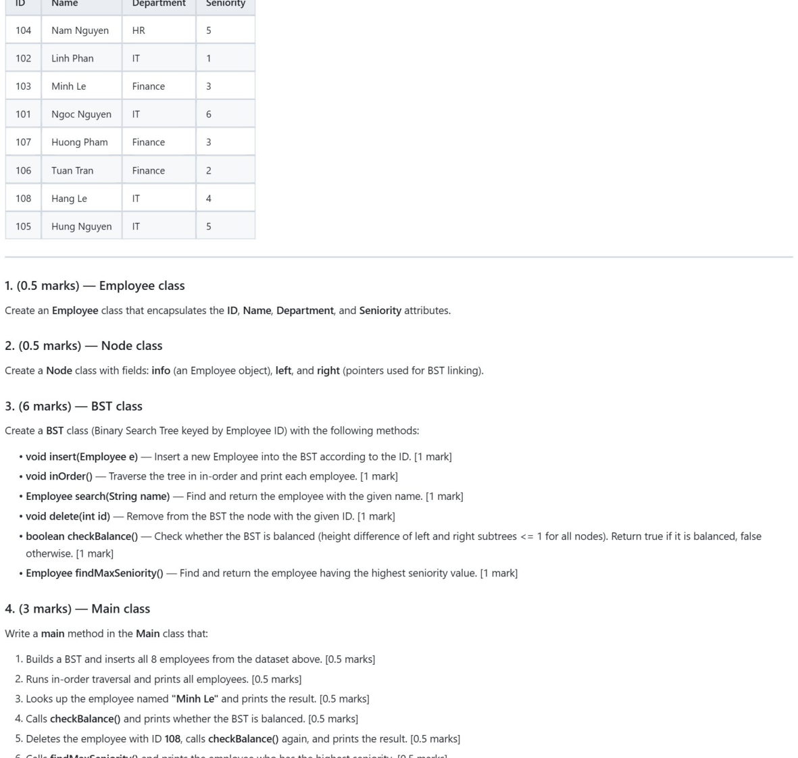

> **Nguyên văn đề bài (Question 1 - Tra cứu Ctrl+F):**
>
> CSD201 PE INSTRUCTIONS
> Read all the instructions carefully before you start coding.
> Note: Submit 1 Java file only (Main.java).
> Questions: (10 marks)
> Build a Binary Search Tree (BST) to manage employee records. Each employee has the following attributes:
> > - ID (integer, unique — used as BST key)
> > - Name (String)
> > - Department (String)
> > - Seniority (integer, in years)
> Dataset:
> 104
> 102
> 103
> 101
> 107
> 106
> 108
> 105
> Name
> Nam Nguyen
> Linh Phan
> Minh Le
> Ngoc Nguyen
> Huong Pham
> Tuan Tran
> Hang Le
> Hung Nguyen
> Department
> Finance
> Finance
> Finance
> Seniority
> 5
> 3
> 6
> 3
> 2
> 4
> 5
> I. (0.5 marks) — Employee class
> Create an Employee class that encapsulates the ID, Name, Department and Seniority attributes.
> 2. (0.5 marks) — Node class
> Create a Node class with fields: info (an Employee object), left, and right (pointers used for BST linking).
> 3. (6 marks) — BST class
> Create a BST class (Binary Search Tree keyed by Employee D) with the following methods:
> > - void insert(Employee e) — Insert a new Employee into the BST according to the ID. [1 mark]
> > - void inorder() — Traverse the tree in in-order and print each employee. [1 mark]
> > - Employee search(String name) — Find and return the employee with the given name. [I mark]
> > - void delete(int id) — Remove from the BST the node with the given ID. [1 mark]
> > - boolean checkBalance() — Check whether the BST is balanced (height difference of left and right subtrees 1 for all nodes). Return true if it is balanced, false
> otherwise. [1 mark]
> > - Employee findMaxSeniority() — Find and return the employee having the highest seniority value. [1 mark]
> 4. (3 marks) — Main class
> Write a main method in the Main class that:
> 1. Builds a BST and inserts all 8 employees from the dataset above. [0.5 marks]
> 2. Runs in-order traversal and prints all employees. [0.5 marks]
> 3. Looks up the employee named "Minh Le" and prints the result. [0.5 marks]
> 4. Calls checkBalance() and prints whether the BST is balanced. [0.5 marks]
> 5. Deletes the employee with ID 108, calls checkBalance() again, and prints the result. [0.5 marks]
> 6. Calls findMaxSeniority() and prints the employee who has the highest seniority. [0.5 marks]


##### [Chuyên đề / PE1] Đáp án mã nguồn hoàn chỉnh (Main.java)
- **Mã nguồn giải:** [solutions/2025/pe1_fa25\src\Main.java](./solutions/2025/pe1_fa25\src\Main.java)

- **Hình ảnh trích xuất đề bài từ đề gốc:**


> **Nguyên văn đề bài (Tra cứu Ctrl+F):**
>
> CSD201 PE INSTRUCTIONS
> Read all the instructions carefully before you start coding.
> Note: Submit 1 Java file only (Main.java).
> Questions: (10 marks)
> Build a Binary Search Tree (BST) to manage employee records. Each employee has the following attributes:
> > - ID (integer, unique — used as BST key)
> > - Name (String)
> > - Department (String)
> > - Seniority (integer, in years)
> Dataset:
> 104
> 102
> 103
> 101
> 107
> 106
> 108
> 105
> Name
> Nam Nguyen
> Linh Phan
> Minh Le
> Ngoc Nguyen
> Huong Pham
> Tuan Tran
> Hang Le
> Hung Nguyen
> Department
> Finance
> Finance
> Finance
> Seniority
> 5
> 3
> 6
> 3
> 2
> 4
> 5
> I. (0.5 marks) — Employee class
> Create an Employee class that encapsulates the ID, Name, Department and Seniority attributes.
> 2. (0.5 marks) — Node class
> Create a Node class with fields: info (an Employee object), left, and right (pointers used for BST linking).
> 3. (6 marks) — BST class
> Create a BST class (Binary Search Tree keyed by Employee D) with the following methods:
> > - void insert(Employee e) — Insert a new Employee into the BST according to the ID. [1 mark]
> > - void inorder() — Traverse the tree in in-order and print each employee. [1 mark]
> > - Employee search(String name) — Find and return the employee with the given name. [I mark]
> > - void delete(int id) — Remove from the BST the node with the given ID. [1 mark]
> > - boolean checkBalance() — Check whether the BST is balanced (height difference of left and right subtrees 1 for all nodes). Return true if it is balanced, false
> otherwise. [1 mark]
> > - Employee findMaxSeniority() — Find and return the employee having the highest seniority value. [1 mark]
> 4. (3 marks) — Main class
> Write a main method in the Main class that:
> 1. Builds a BST and inserts all 8 employees from the dataset above. [0.5 marks]
> 2. Runs in-order traversal and prints all employees. [0.5 marks]
> 3. Looks up the employee named "Minh Le" and prints the result. [0.5 marks]
> 4. Calls checkBalance() and prints whether the BST is balanced. [0.5 marks]
> 5. Deletes the employee with ID 108, calls checkBalance() again, and prints the result. [0.5 marks]
> 6. Calls findMaxSeniority() and prints the employee who has the highest seniority. [0.5 marks]

- **Đáp án mã nguồn Java hoàn chỉnh (Giữ format và comment gốc của Given):**
```java
import java.util.*;
public class Main {
    static class Employee {
        int id; String name; double salary;
        Employee(int id, String name, double salary) {
            this.id = id; this.name = name; this.salary = salary;
        }
        public String toString() { return "(" + id + "," + name + "," + salary + ")"; }
    }
    static class Node {
        Employee info; Node left, right;
        Node(Employee x) { info = x; left = right = null; }
    }
    static class BST {
        Node root;
        BST() { root = null; }
        void insert(Employee x) {
            Node q = new Node(x);
            if(root == null) { root = q; return; }
            Node p = root, f = null;
            while(p != null) {
                if(p.info.id == x.id) return;
                f = p;
                if(x.id < p.info.id) p = p.left;
                else p = p.right;
            }
            if(x.id < f.info.id) f.left = q;
            else f.right = q;
        }
        void inOrder(Node p) {
            if(p == null) return;
            inOrder(p.left); System.out.print(p.info + " "); inOrder(p.right);
        }
    }
    public static void main(String[] args) {
        BST tree = new BST();
        tree.insert(new Employee(3, "Alice", 1500));
        tree.insert(new Employee(1, "Bob", 1200));
        tree.insert(new Employee(5, "Charlie", 2000));
        tree.inOrder(tree.root);
        System.out.println();
    }
}
```

---

### 6.2. Nhóm đề năm 2025 (11 đề)

#### 6.2.1. Đề thi: CSD201 - FA25 - CT
- **Thư mục lưu trữ mã nguồn:** [solutions/2025/fa25_ct](./solutions/2025/fa25_ct/)
- **Thư mục tài liệu gốc:** `CSD201 - FA25 - CT`

##### [Question 1] Danh sách liên kết đơn (MyList.java)
- **Mã nguồn giải:** [solutions/2025/fa25_ct\Q1\src\MyList.java](./solutions/2025/fa25_ct\Q1\src\MyList.java)

- **Hình ảnh trích xuất đề bài Question 1 từ đề gốc:**

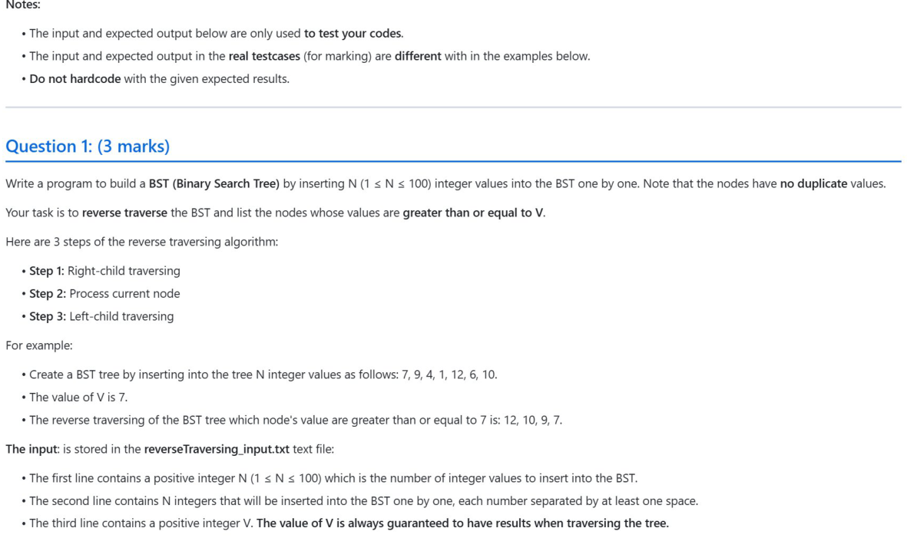

> **Nguyên văn đề bài (Question 1 - Tra cứu Ctrl+F):**
>
> Question 1: (3 marks)
> Write a program to build a BST (Binary Search Tree) by inserting N (1 s N s 100) integer values into the BST one by one. Note that the nodes have no duplicate values.
> Your task is to reverse traverse the BST and list the nodes whose values are greater than or equal to V.
> Here are 3 steps of the reverse traversing algorithm:
> > - Step 1: Right-child traversing
> > - Step 2: Process current node
> > - Step 3: Left-child traversing
> For example:
> > - Create a BST tree by inserting into the tree N integer values as follows: 7, 9, 4, I, 12, 6, IO.
> > - The value of V is 7.
> > - The reverse traversing of the BST tree which node's value are greater than or equal to 7 is: 12, IO, 9, 7.
> The input: is stored in the reverseTraversing_input.txt text file:
> > - The first line contains a positive integer N (1 s N s 100) which is the number of integer values to insert into the BST.
> > - The second line contains N integers that will be inserted into the BST one by one, each number separated by at least one space.
> > - The third line contains a positive integer V. The value of V is always guaranteed to have results when traversing the tree.
> The output: must be saved to the reverseTraversing_output.txt text file:
> > - One line contains the list of numbers representing the reverse traversing of the BST whose node values are greater than or equal to V. Each number separated by one
> comma.
> Sample Input 1
> 7
> 794112610
> 7
> Sample Input 2
> 10
> Sample Output 1
> Sample Output 2
> 78 21 36 18 3091 7455 98 100
> 90
> Question z: (4 marks)
> Write a program to build an undirected graph from a given edge list.
> Your task is to find the shortest path from startVertex to endVertex.
> The input: is stored in the dijkstra_input.txt text file:
> > - The first line contains 4 positive integers N, M, s and e separated by one space:
> o N (1 N 20) is the number of vertices of the undirected graph.
> o M (N-1 M 190) is the number of edges of the undirected graph.
> s (O s s N-1) is the start vertex.
> 0 e (O e s N-1, s e) is the end vertex.
> > - The next M lines, each containing 3 positive integers u, v and d separated by one space:
> o u (O s u < N) the start vertex of the edge (u, v).
> o v (O v < N, v u) the end vertex of the edge (u, v).
> d (O s d 109) the value of the edge (u, v).
> The output: must be saved to the dijkstra_output.txt text file:
> > - The first line contains the distance of the shortest path.
> > - The second line contains the list of vertices of the shortest path from s to e. Each vertex separated by one comma.
> Sample Input 1
> 81607
> 015
> 023
> 0511
> 125
> 167
> 1711
> 2311
> 241
> 257
> 3411
> 3611
> 451
> 465
> 477
> 5742
> 6742
> Sample Input 2
> 6714
> 017
> 025
> 051
> 232
> 243
> 347
> 359
> Sample Output 1
> 11
> Sample Output 2
> 15
> Question 3: (3 marks)
> Write a program to build an undirected graph from a given edge list.
> A happy vertex is a vertex with positive degree; that is, a vertex that is an endpoint of at least one edge.
> Your task is to show all happy vertices of the given graph in ascending format.
> The input: is stored in the happyVertices_input.txt text file:
> > - The first line contains 2 positive integers N and M separated by one space:
> 0 N (1 N 20) is the number of vertices of the undirected graph.
> 0 M (N-1 s M 190) is the number of edges of the undirected graph.
> > - The next M lines, each containing 2 positive integers u and v separated by one space:
> 0 u (O u < N) the start vertex of the edge (u, v).
> o v (O v < N, v u) the end vertex of the edge (u, v).
> The output: must be saved to the happyVertices_output.txt text file:
> > - One line contains the list of happy vertices of the undirected graph in ascending format, each number separated by one comma.
> > - If the undirected graph doesn't have any happy vertex, the result file will contain the message "All of the vertices are isolated vertices".
> Sample Input 1
> 01
> 02
> 05
> 17
> 23
> 24
> 47
> Sample Input 2
> 67
> 01
> 02
> 05
> 23
> 24
> 34
> Sample Output 1
> Sample Output 2

- **Đáp án mã nguồn Java hoàn chỉnh (Giữ format và comment gốc của Given):**
```java
/* This program contains 2 parts: (1) and (2)
   YOUR TASK IS TO COMPLETE THE PART  (2)  ONLY
 */
//(1)==============================================================
import java.util.*;
import java.io.*;
public class MyList {
  Node head,tail;
  MyList() {head=tail=null;}
  boolean isEmpty() {
    return(head==null);
   }
  void clear() {head=tail=null;}
  void fvisit(Node p, RandomAccessFile f) throws Exception {
    if(p != null) f.writeBytes(p.info + " ");
   }
  void ftraverse(RandomAccessFile f) throws Exception {
    Node p = head;
    while(p!=null) {
       fvisit(p,f);
       p=p.next;
      }
    f.writeBytes("\r\n");
   }
  void loadData(int k) {
    String [] a = Lib.readLineToStrArray("data.txt", k);
    int [] b = Lib.readLineToIntArray("data.txt", k+1);
    int [] c = Lib.readLineToIntArray("data.txt", k+2);
    int n = a.length;
    for(int i=0;i<n;i++) addLast(a[i],b[i],c[i]);
   }
//===========================================================================
//(2)===YOU CAN EDIT OR EVEN ADD NEW FUNCTIONS IN THE FOLLOWING PART========
//===========================================================================
/* 
   Khong su dung tieng Viet co dau de viet ghi chu.
   Neu dung khi chay truc tiep se bao loi va nhan 0 diem
*/
  void addLast(String xDriver, int xRate, int xColor) {
    //You should write here appropriate statements to complete this function.
   }
  //You do not need to edit this function. Your task is to complete the addLast function above only.
  void f1() throws Exception {
     clear();
     loadData(1);
     String fname = "f1.txt";
     File g123 = new File(fname);
     if(g123.exists()) g123.delete();
     RandomAccessFile  f = new RandomAccessFile(fname, "rw");
     ftraverse(f);
     f.close();
    }
  void f2() throws Exception {
     clear();
     loadData(5);
     String fname = "f2.txt";
     File g123 = new File(fname);
     if(g123.exists()) g123.delete();
     RandomAccessFile  f = new RandomAccessFile(fname, "rw");
     ftraverse(f);
     Canoe x, y, z;
     x = new Canoe("X",1,2);
     y = new Canoe("Y",2,3);
     z = new Canoe("Z",3,4);
     ftraverse(f);
     f.close();
    }
  void f3() throws Exception {
    clear();
    loadData(9);
    String fname = "f3.txt";
    File g123 = new File(fname);
    if(g123.exists()) g123.delete();
    RandomAccessFile  f = new RandomAccessFile(fname, "rw");
    ftraverse(f);
    ftraverse(f);
    f.close();
  }
  void f4() throws Exception {
    clear();
    loadData(13);
    String fname = "f4.txt";
    File g123 = new File(fname);
    if(g123.exists()) g123.delete();
    RandomAccessFile  f = new RandomAccessFile(fname, "rw");
    ftraverse(f);
    ftraverse(f);
    f.close();
   }
 }
```

- **Kết quả kiểm chứng thực tế:**
  - `f1.txt`: `EMPTY`

##### [Question 2] Cây nhị phân tìm kiếm (BSTree.java)
- **Mã nguồn giải:** [solutions/2025/fa25_ct\Q2\src\BSTree.java](./solutions/2025/fa25_ct\Q2\src\BSTree.java)

- **Hình ảnh trích xuất đề bài Question 2 từ đề gốc:**

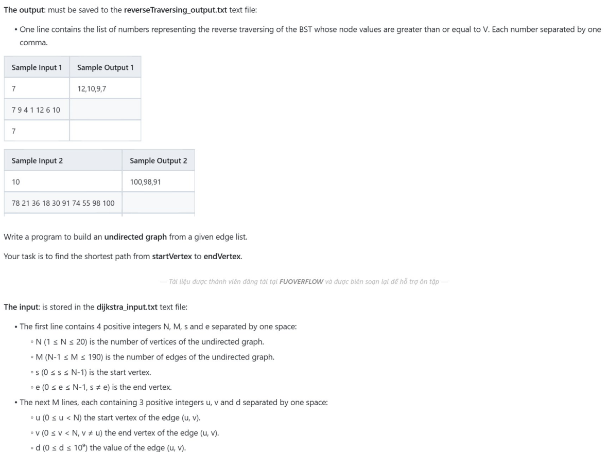

- **Đáp án mã nguồn Java hoàn chỉnh (Giữ format và comment gốc của Given):**
```java
/* This program contains 2 parts: (1) and (2)
   YOUR TASK IS TO COMPLETE THE PART  (2)  ONLY
 */
//(1)==============================================================
import java.io.*;
import java.util.*;
public class BSTree {
   Node root;
   BSTree() {root=null;}
   boolean isEmpty() {
       return(root==null);
      }
   void clear() {
       root=null;
      }
   void visit(Node p) {
      System.out.print("p.info: ");
      if(p != null) System.out.println(p.info + " ");
     }
   void fvisit(Node p, RandomAccessFile f) throws Exception {
      if(p != null) f.writeBytes(p.info + " ");
     }
   void breadth(Node p, RandomAccessFile f) throws Exception {
     if(p==null) return;
     Queue q = new Queue();
     q.enqueue(p);Node r;
     while(!q.isEmpty()) {
        r = q.dequeue();
        fvisit(r,f);
        if(r.left!=null) q.enqueue(r.left);
        if(r.right!=null) q.enqueue(r.right);
       }
    }
   void preOrder(Node p, RandomAccessFile f) throws Exception {
      if(p==null) return;
      fvisit(p,f);
      preOrder(p.left,f);
      preOrder(p.right,f);
     }
   void inOrder(Node p, RandomAccessFile f) throws Exception {
      if(p==null) return;
      inOrder(p.left,f);
      fvisit(p,f);
      inOrder(p.right,f);
     }
   void postOrder(Node p, RandomAccessFile f) throws Exception {
      if(p==null) return;
      postOrder(p.left,f);
      postOrder(p.right,f);
      fvisit(p,f);
     }
   void loadData(int k) {
      String [] a = Lib.readLineToStrArray("data.txt", k);
      int [] b = Lib.readLineToIntArray("data.txt", k+1);
      int [] c = Lib.readLineToIntArray("data.txt", k+2);
      int n = a.length;
      for(int i=0;i<n;i++) insert(a[i],b[i],c[i]);
     }
//===========================================================================
//(2)===YOU CAN EDIT OR EVEN ADD NEW FUNCTIONS IN THE FOLLOWING PART========
//===========================================================================
/* 
   Khong su dung tieng Viet co dau de viet ghi chu.
   Neu dung khi chay truc tiep se bao loi va nhan 0 diem
*/
  void insert(String xDriver, int xRate, int xColor) {
    //You should insert here statements to complete this function
   }
//Do not edit this function. Your task is to complete insert function above only.
  void f1() throws Exception {
    clear();
    loadData(1);
    String fname = "f1.txt";
    File g123 = new File(fname);
    if(g123.exists()) g123.delete();
    RandomAccessFile  f = new RandomAccessFile(fname, "rw");
    breadth(root,f);
    f.writeBytes("\r\n");
    inOrder(root,f);
    f.writeBytes("\r\n");
    f.close();
   }
 void f2() throws Exception {
    clear();
    loadData(5);
    String fname = "f2.txt";
    File g123 = new File(fname);
    if(g123.exists()) g123.delete();
    RandomAccessFile  f = new RandomAccessFile(fname, "rw");
    breadth(root,f);
    f.writeBytes("\r\n");
    f.writeBytes("\r\n");
    f.close();
   }
 void f3() throws Exception {
    clear();
    loadData(9);
    String fname = "f3.txt";
    File g123 = new File(fname);
    if(g123.exists()) g123.delete();
    RandomAccessFile  f = new RandomAccessFile(fname, "rw");
    breadth(root,f);
    f.writeBytes("\r\n");
    breadth(root,f);
    f.writeBytes("\r\n");
    f.close();
   }
 void f4() throws Exception {
    clear();
    loadData(13);;
    String fname = "f4.txt";
    File g123 = new File(fname);
    if(g123.exists()) g123.delete();
    RandomAccessFile  f = new RandomAccessFile(fname, "rw");
    breadth(root,f);
    f.writeBytes("\r\n");
    breadth(root,f);
    f.writeBytes("\r\n");
    f.close();
   }
 }
```

---

#### 6.2.2. Đề thi: CSD201 - FA25 - Practice Exam
- **Thư mục lưu trữ mã nguồn:** [solutions/2025/fa25_practice](./solutions/2025/fa25_practice/)
- **Thư mục tài liệu gốc:** `CSD201 - FA25 - Practice Exam`

##### [Question 1] Danh sách liên kết đơn (MyList.java)
- **Mã nguồn giải:** [solutions/2025/fa25_practice\Q1\src\MyList.java](./solutions/2025/fa25_practice\Q1\src\MyList.java)

- **Hình ảnh trích xuất đề bài Question 1 từ đề gốc:**

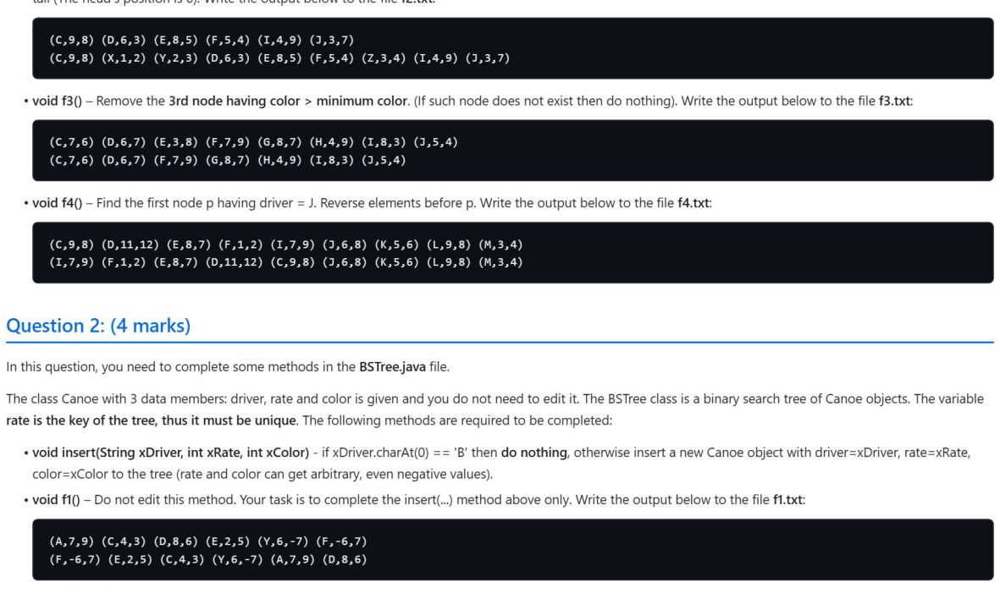

> **Nguyên văn đề bài (Question 1 - Tra cứu Ctrl+F):**
>
> Question 1: (4 marks)
> In this question, you need to complete some methods in the MyList.java file.
> The class Canoe with 3 data members: driver, rate and color is given and you do not need to edit it. The MyList class is a linked list Of Canoe Objects. The following
> methods are required to be completed:
> > - void addLast(String xDriver, int xRate, int xColor) - if xDriver.charAt(0) 'A' then do nothing, otherwise add a new node with driver=xDriver, rate=xRate,
> color=xCoIor to the end of the list. (rate and color can get arbitrary, even negative values).
> > - void fl() — Do not edit this method. Your task is to complete the addLast(...) method above only. Write the output below to the file f1.txt:
> (E, 7,9) (G, -3.2)
> > - void f2() — In this function, 3 Canoe objects x, y, z are already given. Write statements to insert x, y and z into the list so that x, y, z will be at positions 1, 2 and before
> tail (The head's position is O). Write the output below to the file f2.txt:
> (Z,3.4) 0.3, 7)
> > - void f3() — Remove the 3rd node having color > minimum color. (If such node does not exist then do nothing). Write the output below to the file f3.txt:
> (C, 7,6) (F, 7,9)
> (C, 7,6) (F, 7,9) (3,5.4)
> > - void f4() — Find the first node p having driver = J. Reverse elements before p. Write the output below to the file f4.txt:
> (E,8.7) (J,6.8) (L (M, 3.4)
> (D, 11,12) (L (M, 3.4)

- **Đáp án mã nguồn Java hoàn chỉnh (Giữ format và comment gốc của Given):**
```java
/* This program contains 2 parts: (1) and (2)
   YOUR TASK IS TO COMPLETE THE PART  (2)  ONLY
 */
//(1)==============================================================
import java.util.*;
import java.io.*;
public class MyList {
  Node head,tail;
  MyList() {head=tail=null;}
  boolean isEmpty() {
    return(head==null);
   }
  void clear() {head=tail=null;}
  void fvisit(Node p, RandomAccessFile f) throws Exception {
    if(p != null) f.writeBytes(p.info + " ");
   }
  void ftraverse(RandomAccessFile f) throws Exception {
    Node p = head;
    while(p!=null) {
       fvisit(p,f);
       p=p.next;
      }
    f.writeBytes("\r\n");
   }
  void loadData(int k) {
    String [] a = Lib.readLineToStrArray("data.txt", k);
    int [] b = Lib.readLineToIntArray("data.txt", k+1);
    int [] c = Lib.readLineToIntArray("data.txt", k+2);
    int n = a.length;
    for(int i=0;i<n;i++) addLast(a[i],b[i],c[i]);
   }
//===========================================================================
//(2)===YOU CAN EDIT OR EVEN ADD NEW FUNCTIONS IN THE FOLLOWING PART========
//===========================================================================
/* 
   Khong su dung tieng Viet co dau de viet ghi chu.
   Neu dung khi chay truc tiep se bao loi va nhan 0 diem
*/
  void addLast(String xDriver, int xRate, int xColor) {
    //You should write here appropriate statements to complete this function.
   }
  //You do not need to edit this function. Your task is to complete the addLast function above only.
  void f1() throws Exception {
     clear();
     loadData(1);
     String fname = "f1.txt";
     File g123 = new File(fname);
     if(g123.exists()) g123.delete();
     RandomAccessFile  f = new RandomAccessFile(fname, "rw");
     ftraverse(f);
     f.close();
    }
  void f2() throws Exception {
     clear();
     loadData(5);
     String fname = "f2.txt";
     File g123 = new File(fname);
     if(g123.exists()) g123.delete();
     RandomAccessFile  f = new RandomAccessFile(fname, "rw");
     ftraverse(f);
     Canoe x, y, z;
     x = new Canoe("X",1,2);
     y = new Canoe("Y",2,3);
     z = new Canoe("Z",3,4);
     ftraverse(f);
     f.close();
    }
  void f3() throws Exception {
    clear();
    loadData(9);
    String fname = "f3.txt";
    File g123 = new File(fname);
    if(g123.exists()) g123.delete();
    RandomAccessFile  f = new RandomAccessFile(fname, "rw");
    ftraverse(f);
    ftraverse(f);
    f.close();
  }
  void f4() throws Exception {
    clear();
    loadData(13);
    String fname = "f4.txt";
    File g123 = new File(fname);
    if(g123.exists()) g123.delete();
    RandomAccessFile  f = new RandomAccessFile(fname, "rw");
    ftraverse(f);
    ftraverse(f);
    f.close();
   }
 }
```

- **Kết quả kiểm chứng thực tế:**
  - `f1.txt`: `EMPTY`

##### [Question 2] Cây nhị phân tìm kiếm (BSTree.java)
- **Mã nguồn giải:** [solutions/2025/fa25_practice\Q2\src\BSTree.java](./solutions/2025/fa25_practice\Q2\src\BSTree.java)

- **Hình ảnh trích xuất đề bài Question 2 từ đề gốc:**

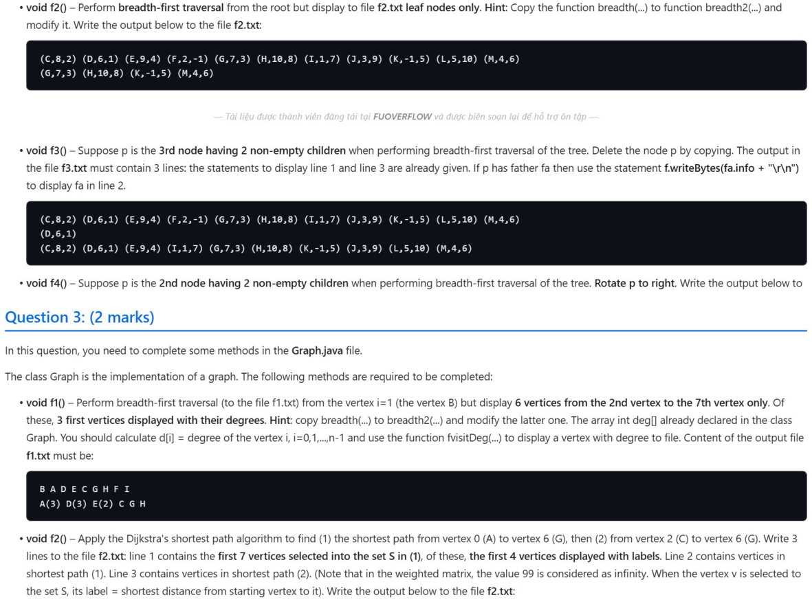

> **Nguyên văn đề bài (Question 2 - Tra cứu Ctrl+F):**
>
> Question 2: (4 marks)
> In this question, you need to complete some methods in the BSTree.java file.
> The class Canoe with 3 data members: driver, rate and color is given and you do not need to edit it. The BSTree class is a binary search tree of Canoe objects. The variable
> rate is the key of the tree, thus it must be unique. The following methods are required to be completed:
> > - void insert(String xDriver, int xRate, int xColor) - if xDriver.charAt(0) 'B' then do nothing, otherwise insert a new Canoe object with driver=xDriver, rate=xRate,
> color=xColor to the tree (rate and color can get arbitrary, even negative values).
> > - void fl() — Do not edit this method. Your task is to complete the insert(...) method above only. Write the output below to the file f1.txt:
> (A, 7,9) (E, 2,5) (F, -6.7)
> (F, -6,7)
> > - void f2() — Perform breadth-first traversal from the root but display to file f2.txt leaf nodes only. Hint: Copy the function breadth(...) to function breadth2(...) and
> modify it. Write the output below to the file f2.txt:
> (F, 2, -1) (G, 7.3) (K, -1,5)
> (G, 7, 3) (K, -1.5)
> > - void f3() — Suppose p is the 3rd node having 2 non-empty children when performing breadth-first traversal of the tree. Delete the node p by copying. The output in
> the file f3.txt must contain 3 lines: the statements to display line 1 and line 3 are already given. If p has father fa then use the statement f.writeBytes(fa.info + "\r\n")
> to display fa in line 2.
> (F, 2, -1) (K, -1,5)
> (G, 7.3) (K, -1,5) (J, 3,9) (L,5.1Ø)
> > - void f4() — Suppose p is the 2nd node having 2 non-empty children when performing breadth-first traversal of the tree. Rotate p to right. Write the output below to
> the file f4.txt:
> (F, 2, -1) (K, -1,5)
> (K, -1,5)

- **Đáp án mã nguồn Java hoàn chỉnh (Giữ format và comment gốc của Given):**
```java
/* This program contains 2 parts: (1) and (2)
   YOUR TASK IS TO COMPLETE THE PART  (2)  ONLY
 */
//(1)==============================================================
import java.io.*;
import java.util.*;
public class BSTree {
   Node root;
   BSTree() {root=null;}
   boolean isEmpty() {
       return(root==null);
      }
   void clear() {
       root=null;
      }
   void visit(Node p) {
      System.out.print("p.info: ");
      if(p != null) System.out.println(p.info + " ");
     }
   void fvisit(Node p, RandomAccessFile f) throws Exception {
      if(p != null) f.writeBytes(p.info + " ");
     }
   void breadth(Node p, RandomAccessFile f) throws Exception {
     if(p==null) return;
     Queue q = new Queue();
     q.enqueue(p);Node r;
     while(!q.isEmpty()) {
        r = q.dequeue();
        fvisit(r,f);
        if(r.left!=null) q.enqueue(r.left);
        if(r.right!=null) q.enqueue(r.right);
       }
    }
   void preOrder(Node p, RandomAccessFile f) throws Exception {
      if(p==null) return;
      fvisit(p,f);
      preOrder(p.left,f);
      preOrder(p.right,f);
     }
   void inOrder(Node p, RandomAccessFile f) throws Exception {
      if(p==null) return;
      inOrder(p.left,f);
      fvisit(p,f);
      inOrder(p.right,f);
     }
   void postOrder(Node p, RandomAccessFile f) throws Exception {
      if(p==null) return;
      postOrder(p.left,f);
      postOrder(p.right,f);
      fvisit(p,f);
     }
   void loadData(int k) {
      String [] a = Lib.readLineToStrArray("data.txt", k);
      int [] b = Lib.readLineToIntArray("data.txt", k+1);
      int [] c = Lib.readLineToIntArray("data.txt", k+2);
      int n = a.length;
      for(int i=0;i<n;i++) insert(a[i],b[i],c[i]);
     }
//===========================================================================
//(2)===YOU CAN EDIT OR EVEN ADD NEW FUNCTIONS IN THE FOLLOWING PART========
//===========================================================================
/* 
   Khong su dung tieng Viet co dau de viet ghi chu.
   Neu dung khi chay truc tiep se bao loi va nhan 0 diem
*/
  void insert(String xDriver, int xRate, int xColor) {
    //You should insert here statements to complete this function
   }
//Do not edit this function. Your task is to complete insert function above only.
  void f1() throws Exception {
    clear();
    loadData(1);
    String fname = "f1.txt";
    File g123 = new File(fname);
    if(g123.exists()) g123.delete();
    RandomAccessFile  f = new RandomAccessFile(fname, "rw");
    breadth(root,f);
    f.writeBytes("\r\n");
    inOrder(root,f);
    f.writeBytes("\r\n");
    f.close();
   }
 void f2() throws Exception {
    clear();
    loadData(5);
    String fname = "f2.txt";
    File g123 = new File(fname);
    if(g123.exists()) g123.delete();
    RandomAccessFile  f = new RandomAccessFile(fname, "rw");
    breadth(root,f);
    f.writeBytes("\r\n");
    f.writeBytes("\r\n");
    f.close();
   }
 void f3() throws Exception {
    clear();
    loadData(9);
    String fname = "f3.txt";
    File g123 = new File(fname);
    if(g123.exists()) g123.delete();
    RandomAccessFile  f = new RandomAccessFile(fname, "rw");
    breadth(root,f);
    f.writeBytes("\r\n");
    breadth(root,f);
    f.writeBytes("\r\n");
    f.close();
   }
 void f4() throws Exception {
    clear();
    loadData(13);;
    String fname = "f4.txt";
    File g123 = new File(fname);
    if(g123.exists()) g123.delete();
    RandomAccessFile  f = new RandomAccessFile(fname, "rw");
    breadth(root,f);
    f.writeBytes("\r\n");
    breadth(root,f);
    f.writeBytes("\r\n");
    f.close();
   }
 }
```

##### [Question 3] Đồ thị (Graph.java)
- **Mã nguồn giải:** [solutions/2025/fa25_practice\Q3\src\Graph.java](./solutions/2025/fa25_practice\Q3\src\Graph.java)

- **Hình ảnh trích xuất đề bài Question 3 từ đề gốc:**


> **Nguyên văn đề bài (Question 3 - Tra cứu Ctrl+F):**
>
> Question 3: (2 marks)
> In this question, you need to complete some methods in the Graph.java file.
> The class Graph is the implementation of a graph. The following methods are required to be completed:
> > - void fl() — Perform breadth-first traversal (to the file f1 .txt) from the vertex 1 (the vertex B) but display 6 vertices from the 2nd vertex to the 7th vertex only. Of
> these, 3 first vertices displayed with their degrees. Hint: copy breadth(...) to breadth2(...) and modify the latter one. The array int dego already declared in the class
> Graph. You should calculate d[i] = degree of the vertex i, i=O, l,...,n-l and use the function fvisitDeg(...) to display a vertex with degree to file. Content of the output file
> f1.txt must be:
> BADECGHFI
> A(3) D(3) E(2) C G H
> > - void f2() — Apply the Dijkstra's shortest path algorithm to find (1) the shortest path from vertex O (A) to vertex 6 (G), then (2) from vertex 2 (C) to vertex 6 (G). Write 3
> lines to the file f2.txt: line 1 contains the first 7 vertices selected into the set S in (1), of these, the first 4 vertices displayed with labels. Line 2 contains vertices in
> shortest path (1). Line 3 contains vertices in shortest path (2). (Note that in the weighted matrix, the value 99 is considered as infinity. When the vertex v is selected to
> the set S, its label = shortest distance from starting vertex to it). Write the output below to the file f2.txt:
> A(Ø) 1(2) C(5) E(8) B D H
> AICEDG
> CED G

- **Đáp án mã nguồn Java hoàn chỉnh (Giữ format và comment gốc của Given):**
```java
/* This program contains 2 parts: (1) and (2)
   YOUR TASK IS TO COMPLETE THE PART  (2)  ONLY
 */
//(1)==============================================================
import java.io.*;
import java.util.*;
public class Graph {
  int [][] a; int n;
  char v[];
  int deg[];
  Graph() {
    v = "ABCDEFGHIJKLMNOP".toCharArray();
    deg = new int[20];
    a = new int[20][20];
    n = 0;
   }
  void loadData(int k) {
    RandomAccessFile f;int i,j,x;
    String s;StringTokenizer t;
    a = new int[20][20];
    try {
     f = new RandomAccessFile("data.txt","r");
     for(i=0;i<k;i++) f.readLine();
     s = f.readLine();s = s.trim();
     n = Integer.parseInt(s);
     for(i=0;i<n;i++) {
       s = f.readLine();s = s.trim();
       t = new StringTokenizer(s);
       for(j=0;j<n;j++) {
         x = Integer.parseInt(t.nextToken().trim());
         a[i][j] = x;
        }
       }
     f.close();
     }
    catch(Exception e) {}
   }
  void dispAdj() {
    int i,j;
    for(i=0;i<n;i++) {
      System.out.println();
      for(j=0;j<n;j++)
        System.out.printf("%4d",a[i][j]);
     }
   }
  void fvisit(int i, RandomAccessFile f) throws Exception {
    f.writeBytes("  "+v[i]);
   }
  void fvisitDeg(int i, RandomAccessFile f) throws Exception {
    f.writeBytes("  "+v[i]+"("+deg[i]+")");
   }
 void fdispAdj(RandomAccessFile f) throws Exception {
    int i,j;
    f.writeBytes("n = "+n+"\r\n");
    for(i=0;i<n;i++) {
      f.writeBytes("\r\n");
      for(j=0;j<n;j++)  f.writeBytes("  " + a[i][j]);
     }
    f.writeBytes("\r\n");
   }
  void breadth(boolean [] en, int i, RandomAccessFile f) throws Exception {
    Queue q = new Queue();
    int r,j;
    q.enqueue(i); en[i]=true;
    while(!q.isEmpty()) {
      r = q.dequeue();
      fvisit(r,f);
      for(j=0;j<n;j++) {
        if(!en[j] && a[r][j]>0) {
         q.enqueue(j);en[j]=true;
        }
       }
     }
   }
  void breadth(int  k, RandomAccessFile f) throws Exception {
    boolean [] en = new boolean[20];
    int i;
    for(i=0;i<n;i++) en[i]=false;
    breadth(en,k,f);
    for(i=0;i<n;i++)
      if(!en[i]) breadth(en,i,f);
   }
 void depth(boolean [] visited,int k, RandomAccessFile f) throws Exception {
    fvisit(k,f);visited[k]=true;
    for(int i=0;i<n;i++) {
      if(!visited[i] && a[k][i]>0) depth(visited,i,f);
     }
   }
  void depth(int k, RandomAccessFile f) throws Exception {
    boolean [] visited = new boolean[20];
    int i;
    for(i=0;i<n;i++) visited[i]=false;
    depth(visited,k,f);
    for(i=0;i<n;i++)
       if(!visited[i]) depth(visited,i,f);
   }
//===========================================================================
//(2)===YOU CAN EDIT OR EVEN ADD NEW FUNCTIONS IN THE FOLLOWING PART========
//===========================================================================
/* 
   Khong su dung tieng Viet co dau de viet ghi chu.
   Neu dung khi chay truc tiep se bao loi va nhan 0 diem
*/
  void f1() throws Exception {
    loadData(1);
    String fname = "f1.txt";
    File g123 = new File(fname);
    if(g123.exists()) g123.delete();
    RandomAccessFile  f = new RandomAccessFile(fname, "rw");
    breadth(1,f);
    f.writeBytes("\r\n");
    f.writeBytes("\r\n");
    f.close();
   }
  void f2() throws Exception {
    loadData(12);
    String fname = "f2.txt";
    File g123 = new File(fname);
    if(g123.exists()) g123.delete();
    RandomAccessFile  f = new RandomAccessFile(fname, "rw");
    f.writeBytes("\r\n");
    f.close();
   }
}
```

- **Kết quả kiểm chứng thực tế:**
  - `f1.txt`: `B  A  D  E  C  G  H  F  I`
  - `f2.txt`: `EMPTY`

---

#### 6.2.3. Đề thi: CSD201 - PE - FA25 - B10W
- **Thư mục lưu trữ mã nguồn:** [solutions/2025/fa25_b3w](./solutions/2025/fa25_b3w/)
- **Thư mục tài liệu gốc:** `CSD201 - PE - FA25 - B10W`

##### [Question 1] Danh sách liên kết đơn (MyList.java)
- **Mã nguồn giải:** [solutions/2025/fa25_b3w\Q1\src\MyList.java](./solutions/2025/fa25_b3w\Q1\src\MyList.java)

- **Hình ảnh trích xuất đề bài Question 1 từ đề gốc:**

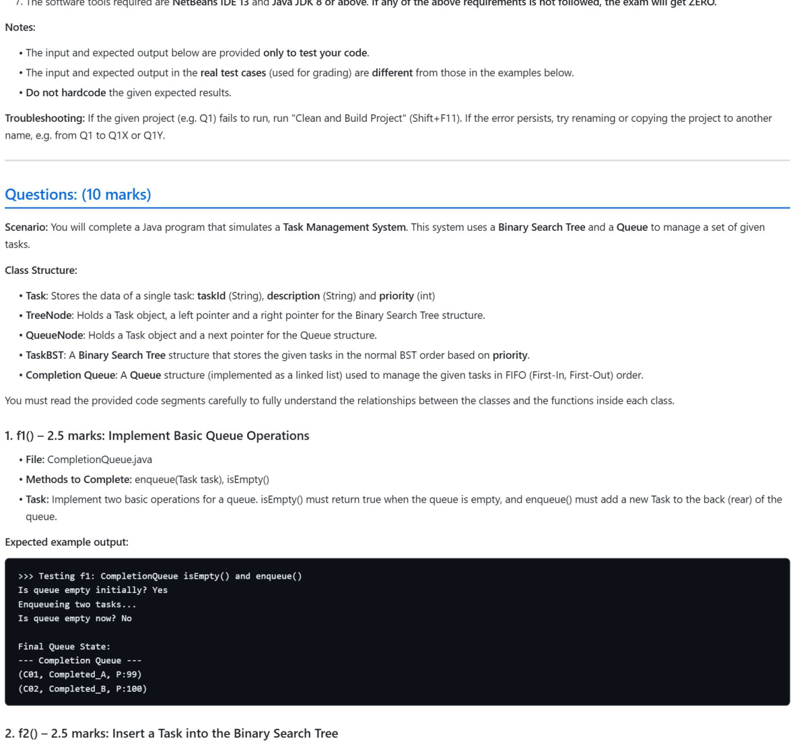

> **Nguyên văn đề bài (Question 1 - Tra cứu Ctrl+F):**
>
> CSD201 PE INSTRUCTIONS
> Read all the instructions below carefully before you start coding.
> Follow the steps below to complete PE:
> 1. Create a folder to store the given projects, e.g. CSD_given (1). Download the provided materials into (1).
> 2. Fulfill all the requirements of the test.
> 3. Before submitting:
> 0 Clean and Build Project (Shift+F11),
> o Then rename the dist folder to run. (If the run folder already exists, delete it before renaming).
> 4. Submitting your work:
> 0 To submit project Q1, first select the Question No: 1
> o Browse and pick the project folder (e.g. Q1, or QIA or Q2,
> 0 Then click the Submit button.
> 5. Avoid using accented Vietnamese when writing comments in your programs.
> 6. Your job is to complete only the method bodies. Do not alter method signatures or add new import statements.
> 7. The software tools required are NetBeans IDE 13 and Java JDK 8 or above. If any of the above requirements is not followed, the exam will get ZERO.
> Notes:
> > - The input and expected output below are provided only to test your code.
> > - The input and expected output in the real test cases (used for grading) are different from those in the examples below.
> > - Do not hardcode the given expected results.
> Troubleshooting: If the given project (e.g. Q1) fails to run, run "Clean and Build Project" (Shift+F11). If the error persists, try renaming or copying the project to another
> name, e.g. from Q1 to QIX or Q1 Y.
> Questions: (10 marks)
> Scenario: You will complete a Java program that simulates a Task Management System. This system uses a Binary Search Tree and a Queue to manage a set of given
> tasks.
> Class Structure:
> > - Task: Stores the data of a single task: taskld (String), description (String) and priority (int)
> > - TreeNode: Holds a Task object, a left pointer and a right pointer for the Binary Search Tree structure.
> > - QueueNode: Holds a Task object and a next pointer for the Queue structure.
> > - TaskBST: A Binary Search Tree structure that stores the given tasks in the normal BST order based on priority.
> > - Completion Queue: A Queue structure (implemented as a linked list) used to manage the given tasks in FIFO (First-ln, First-Out) order.
> You must read the provided code segments carefully to fully understand the relationships between the classes and the functions inside each class.
> 1. fl() — 2.5 marks: Implement Basic Queue Operations
> > - File: CompletionQueue.java
> > - Methods to Complete: enqueue(Task task), isEmpty()
> > - Task: Implement two basic operations for a queue. isEmpty() must return true when the queue is empty, and enqueue() must add a new Task to the back (rear) of the
> queue.
> Expected example output:
> Testing f1: CompletionQueue isEmpty() and enqueue()
> Is queue empty initially? Yes
> Enqueueing two tasks...
> Is queue empty now? No
> Final Queue State:
> Completion Queue
> (COI.
> Completed _ A, P :99)
> (C02,
> completed_B, p:løø)
> 2. f20
> — 2.5 marks: Insert a Task into the Binary Search Tree
> > - File: TaskBST.java
> > - Method to Complete: insert(Task task)
> > - Task: Write the logic to insert a new Task object into the Binay Search Tree. The tree must be ordered based on the priority of the task. If a task with the same priority
> already exists, the new task can be ignored. The output is printed in in-order traversal.
> Expected example output:
> Testing f2: Inserting tasks into BST...
> - Final State
> - Task BST
> Write_Documentation, p
> (T02.
> Update_UI. P: 5)
> (TB4,
> Test_New_Feature, P: 7)
> (T06,
> Refactor_Database, P:9)
> (TBI,
> Deploy_Server, P: 10)
> — 2.5 marks: Pre-Order Traversal of the BST
> > - File: TaskBST.java
> > - Method to Complete: preOrderTraversal()
> > - Task: Implement a method that traverses the BST in pre-order. This method should take no parameters and must return a java.util.List containing all the tasks from the
> tree. A private recursive helper method is a good approach for this task.
> Expected example output:
> Testing f3: Traversing the BST pre-order...
> - Final State
> Task BST
> (TO,
> (T05,
> Write_Documentation, P: 4)
> (T02,
> update_U1, p:5)
> (TBI.
> Deploy_Server, P: 10)
> (T06,
> Refactor_Database, P: 9)
> — 2.5 marks: Remove a Task from the BST
> > - File: TaskBST.java
> > - Method to Complete: remove(int priority)
> > - Task: Write the logic to remove a task from the BST based on its priority. You must correctly handle all three deletion cases: a node with no children, one child, or two
> children. You may use as many helper functions as you want.
> Expected example output:
> - Initial State
> Task BST
> (T04,
> (Tel,
> Write_Documentation, p
> Update_UI, P: 5)
> Test_New_Feature, P: 7)
> Refactor_Database, P: 9)
> Deploy_Server, P: 10)
> Testing f4: Removing task with priority 4.
> Final State
> - Task BST
> (T02,
> (TB3,
> (TB6,
> (TOI,
> update_U1. p:5)
> Refactor_Database, P: 9)
> Deploy_server, p: 10)

- **Đáp án mã nguồn Java hoàn chỉnh (Giữ format và comment gốc của Given):**
```java
/* This program contains 2 parts: (1) and (2)
   YOUR TASK IS TO COMPLETE THE PART  (2)  ONLY
 */
//(1)==============================================================
import java.util.*;
import java.io.*;
public class MyList {
    Node head, tail;
    MyList() {
        head = tail = null;
    }
    boolean isEmpty() {
        return (head == null);
    }
    void clear() {
        head = tail = null;
    }
    void fvisit(Node p, RandomAccessFile f) throws Exception {
        if (p != null) {
            f.writeBytes(p.info + " ");
        }
    }
    void ftraverse(RandomAccessFile f) throws Exception {
        Node p = head;
        while (p != null) {
            fvisit(p, f);
            p = p.next;
        }
        f.writeBytes("\r\n");
    }
    void loadData(int k) {
        String[] a = Lib.readLineToStrArray("data.txt", k);
        int[] b = Lib.readLineToIntArray("data.txt", k + 1);
        int[] c = Lib.readLineToIntArray("data.txt", k + 2);
        int n = a.length;
        for (int i = 0; i < n; i++) {
            addLast(a[i], b[i], c[i]);
        }
    }
//===========================================================================
//(2)===YOU CAN EDIT OR EVEN ADD NEW FUNCTIONS IN THE FOLLOWING PART========
//===========================================================================
/* 
   Khong su dung tieng Viet co dau de viet ghi chu.
   Neu dung khi chay truc tiep se bao loi va nhan 0 diem
*/
    void addLast(String xProducer, int xWeight, int xPrice) {
    //You should write here appropriate statements to complete this function.
        if (xWeight > 3 && xPrice > 3) {
            Laptop newLaptop = new Laptop(xProducer, xWeight, xPrice);
            Node newNode = new Node(newLaptop);
            if (isEmpty()) {
                head = tail = newNode;
            } else {
                tail.next = newNode;
                tail = newNode;
            }
        }
    }
  //You do not need to edit this function. Your task is to complete the addLast function above only.
    void f1() throws Exception {
        clear();
        loadData(1);
        String fname = "f1.txt";
        File g123 = new File(fname);
        if (g123.exists()) {
            g123.delete();
        }
        RandomAccessFile f = new RandomAccessFile(fname, "rw");
        ftraverse(f);
        f.close();
    }
    void f2() throws Exception {
        clear();
        loadData(5);
        String fname = "f2.txt";
        File g123 = new File(fname);
        if (g123.exists()) {
            g123.delete();
        }
        RandomAccessFile f = new RandomAccessFile(fname, "rw");
        ftraverse(f);
        Node v = new Node(new Laptop("V", 8, 9));
        Node w = new Node(new Laptop("W", 6, 7));
        v.next = head;
        head = v;
        tail.next = w;
        tail = w;
        ftraverse(f);
        f.close();
    }
    void f3() throws Exception {
        clear();
        loadData(9);
        String fname = "f3.txt";
        File g123 = new File(fname);
        if (g123.exists()) {
            g123.delete();
        }
        RandomAccessFile f = new RandomAccessFile(fname, "rw");
        ftraverse(f);
        Node current = head;
        Node previous = null;
        Node maxWeightNode = null;
        Node maxWeightPrevNode = null;
        int maxWeight = Integer.MIN_VALUE;
        while (current != null) {
            Laptop currentLaptop = current.info;
            if (currentLaptop.weight > maxWeight) {
                maxWeight = currentLaptop.weight;
                maxWeightNode = current;
                maxWeightPrevNode = previous;
            }
            previous = current;
            current = current.next;
        }
        if (maxWeightNode != null) {
            if (maxWeightPrevNode == null) {
                head = maxWeightNode.next;
                if (head == null) {
                    tail = null;
                }
            } else {
                maxWeightPrevNode.next = maxWeightNode.next;
                if (maxWeightNode == tail) {
                    tail = maxWeightPrevNode;
                }
            }
        }
        ftraverse(f);
        f.close();
    }
    void f4() throws Exception {
        clear();
        loadData(13);
        String fname = "f4.txt";
        File g123 = new File(fname);
        if (g123.exists()) {
            g123.delete();
        }
        RandomAccessFile f = new RandomAccessFile(fname, "rw");
        ftraverse(f);
        int result = 0;
        int count = 0;
        Node current = head;
        while (current != null) {
            count++;
            current = current.next;
        }
        result = count;
        f.writeBytes(result + "");
        f.close();
    }
    void f5() throws Exception {
        clear();
        loadData(17);
        String fname = "f5.txt";
        File g123 = new File(fname);
        if (g123.exists()) {
            g123.delete();
        }
        RandomAccessFile f = new RandomAccessFile(fname, "rw");
        ftraverse(f);
        if (head != null) {
            head = head.next;
            if (head != null) {
                head = head.next;
            }
        }
        sortListByWeight();
        ftraverse(f);
        f.close();
    }
    void sortListByWeight() {
        if (head == null) {
            return;
        }
        boolean sorted;
        do {
            sorted = true;
            Node current = head;
            Node nextNode = current.next;
            while (nextNode != null) {
                if (current.info.weight > nextNode.info.weight) {
                    Laptop temp = current.info;
                    current.info = nextNode.info;
                    nextNode.info = temp;
                    sorted = false;
                }
                current = nextNode;
                nextNode = current.next;
            }
        } while (!sorted);
    }
}
```

- **Kết quả kiểm chứng thực tế:**
  - `f1.txt`: `(H,6,7) (C,4,5) (X,8,9) (Y,5,8)`
  - `f2.txt`: `(D,4,7) (L,10,5) (E,9,7) (Q,7,6)  | (V,8,9) (D,4,7) (L,10,5) (E,9,7) (Q,7,6) (W,6,7)`
  - `f3.txt`: `(A,4,4) (D,10,6) (E,9,4) (F,5,8) (Q,10,5) (R,5,7)  | (A,4,4) (E,9,4) (F,5,8) (Q,10,5) (R,5,7)`
  - `f4.txt`: `(J,4,5) (K,5,6) (L,6,8)  | 3`
  - `f5.txt`: `(N,6,10) (A,9,13) (W,5,8) (I,4,6) (S,7,5) (D,8,9)  | (I,4,6) (W,5,8) (S,7,5) (D,8,9)`

##### [Question 2] Cây nhị phân tìm kiếm (BSTree.java)
- **Mã nguồn giải:** [solutions/2025/fa25_b3w\Q2\src\BSTree.java](./solutions/2025/fa25_b3w\Q2\src\BSTree.java)

- **Hình ảnh trích xuất đề bài Question 2 từ đề gốc:**

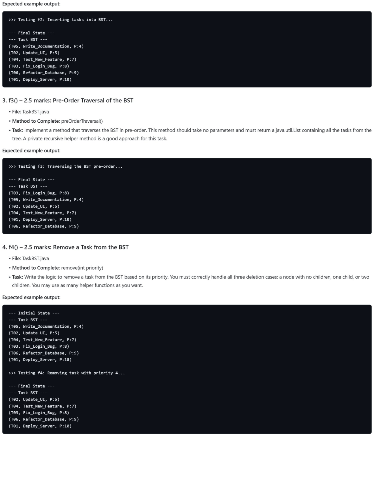

- **Đáp án mã nguồn Java hoàn chỉnh (Giữ format và comment gốc của Given):**
```java
/* This program contains 2 parts: (1) and (2)
   YOUR TASK IS TO COMPLETE THE PART  (2)  ONLY
 */
//(1)==============================================================
import java.io.*;
import java.util.*;
public class BSTree {
    Node root;
    BSTree() {
        root = null;
    }
    boolean isEmpty() {
        return (root == null);
    }
    void clear() {
        root = null;
    }
    void visit(Node p) {
        System.out.print("p.info: ");
        if (p != null) {
            System.out.println(p.info + " ");
        }
    }
    void fvisit(Node p, RandomAccessFile f) throws Exception {
        if (p != null) {
            f.writeBytes(p.info + " ");
        }
    }
    void breadth(Node p, RandomAccessFile f) throws Exception {
        if (p == null) {
            return;
        }
        Queue q = new Queue();
        q.enqueue(p);
        Node r;
        while (!q.isEmpty()) {
            r = q.dequeue();
            fvisit(r, f);
            if (r.left != null) {
                q.enqueue(r.left);
            }
            if (r.right != null) {
                q.enqueue(r.right);
            }
        }
    }
    void preOrder(Node p, RandomAccessFile f) throws Exception {
        if (p == null) {
            return;
        }
        fvisit(p, f);
        preOrder(p.left, f);
        preOrder(p.right, f);
    }
    void inOrder(Node p, RandomAccessFile f) throws Exception {
        if (p == null) {
            return;
        }
        inOrder(p.left, f);
        fvisit(p, f);
        inOrder(p.right, f);
    }
    void postOrder(Node p, RandomAccessFile f) throws Exception {
        if (p == null) {
            return;
        }
        postOrder(p.left, f);
        postOrder(p.right, f);
        fvisit(p, f);
    }
    void loadData(int k) {
        String[] a = Lib.readLineToStrArray("data.txt", k);
        int[] b = Lib.readLineToIntArray("data.txt", k + 1);
        int[] c = Lib.readLineToIntArray("data.txt", k + 2);
        int n = a.length;
        for (int i = 0; i < n; i++) {
            insert(a[i], b[i], c[i]);
        }
    }
//===========================================================================
//(2)===YOU CAN EDIT OR EVEN ADD NEW FUNCTIONS IN THE FOLLOWING PART========
//===========================================================================
/* 
   Khong su dung tieng Viet co dau de viet ghi chu.
   Neu dung khi chay truc tiep se bao loi va nhan 0 diem
*/
    void insert(String xPlace, int xWeight, int xColor) {
    //You should insert here statements to complete this function
        if (xPlace.charAt(0) == 'N') {
            return;
        }
        Node newNode = new Node(new Cat(xPlace, xWeight, xColor));
        if (root == null) {
            root = newNode;
            return;
        }
        Node current = root;
        Node parent = null;
        while (current != null) {
            parent = current;
            if (xWeight < current.info.weight) {
                current = current.left;
            } else if (xWeight > current.info.weight) {
                current = current.right;
            } else {
                return;
            }
        }
        if (xWeight < parent.info.weight) {
            parent.left = newNode;
        } else {
            parent.right = newNode;
        }
    }
//Do not edit this function. Your task is to complete insert function above only.
    void f1() throws Exception {
        clear();
        loadData(1);
        String fname = "f1.txt";
        File g123 = new File(fname);
        if (g123.exists()) {
            g123.delete();
        }
        RandomAccessFile f = new RandomAccessFile(fname, "rw");
        breadth(root, f);
        f.writeBytes("\r\n");
        inOrder(root, f);
        f.writeBytes("\r\n");
        f.close();
    }
    void f2() throws Exception {
        clear();
        loadData(5);
        String fname = "f2.txt";
        File g123 = new File(fname);
        if (g123.exists()) {
            g123.delete();
        }
        RandomAccessFile f = new RandomAccessFile(fname, "rw");
        breadth(root, f);
        f.writeBytes("\r\n");
        if (root != null) {
            preOrder2(root.left, f);
        }
        f.writeBytes("\r\n");
        f.close();
    }
    void preOrder2(Node p, RandomAccessFile f) throws Exception {
        if (p == null) {
            return;
        }
        if (p.info.color != 4) {
            fvisit(p, f);
        }
        preOrder2(p.left, f);
        preOrder2(p.right, f);
    }
    void f3() throws Exception {
        clear();
        loadData(9);
        String fname = "f3.txt";
        File g123 = new File(fname);
        if (g123.exists()) {
            g123.delete();
        }
        RandomAccessFile f = new RandomAccessFile(fname, "rw");
        descendingOrderTraversal(root, f);
        f.writeBytes("\r\n");
        f.close();
    }
    void descendingOrderTraversal(Node p, RandomAccessFile f) throws Exception {
        if (p == null) {
            return;
        }
        descendingOrderTraversal(p.right, f);
        fvisit(p, f);
        descendingOrderTraversal(p.left, f);
    }
    void f4() throws Exception {
        clear();
        loadData(13);
        String fname = "f4.txt";
        File g123 = new File(fname);
        if (g123.exists()) {
            g123.delete();
        }
        RandomAccessFile f = new RandomAccessFile(fname, "rw");
        preOrder(root, f);
        f.writeBytes("\r\n");
        leafNodesWithColorLessThan7(root, f);
        f.writeBytes("\r\n");
        f.close();
    }
    void leafNodesWithColorLessThan7(Node p, RandomAccessFile f) throws Exception {
        if (p == null) {
            return;
        }
        if (p.left == null && p.right == null && p.info.color < 7) {
            fvisit(p, f);
        }
        leafNodesWithColorLessThan7(p.left, f);
        leafNodesWithColorLessThan7(p.right, f);
    }
    void f5() throws Exception {
        clear();
        loadData(17);
        String fname = "f5.txt";
        File g123 = new File(fname);
        if (g123.exists()) {
            g123.delete();
        }
        RandomAccessFile f = new RandomAccessFile(fname, "rw");
        inOrder(root, f);
        f.writeBytes("\r\n");
        int result = 0;
        result = countInternalNodes(root);
        f.writeBytes(result + "\r\n");
        f.close();
    }
    int countInternalNodes(Node p) {
        if (p == null) {
            return 0;
        }
        int count = 0;
        if (p.left != null || p.right != null) {
            count = 1;
        }
        count += countInternalNodes(p.left);
        count += countInternalNodes(p.right);
        return count;
    }
}
```

- **Kết quả kiểm chứng thực tế:**
  - `f1.txt`: `(X,5,2) (P,1,3) (M,9,5) (R,4,8) (F,7,4) (Q,8,7)  | (P,1,3) (R,4,8) (X,5,2) (F,7,4) (Q,8,7) (M,9,5)`
  - `f2.txt`: `(P,7,9) (D,4,3) (G,9,6) (H,2,5) (B,6,4) (X,8,9) (L,1,8)  | (D,4,3) (H,2,5) (L,1,8)`
  - `f3.txt`: `(T,8,-5) (M,7,2) (P,6,3) (R,5,9) (S,4,1) (L,2,5) (Y,1,6)`
  - `f4.txt`: `(A,6,5) (B,2,7) (P,1,9) (C,3,-8) (F,4,2) (D,5,-3) (E,8,3) (G,7,4) (Q,9,1)  | (D,5,-3) (G,7,4) (Q,9,1)`
  - `f5.txt`: `(L,1,5) (H,2,6) (Q,3,1) (D,4,3) (B,6,-4) (M,7,9) (X,8,7) (G,9,-6)  | 4`

---

#### 6.2.4. Đề thi: CSD201 - PE - SP 2025
- **Thư mục lưu trữ mã nguồn:** [solutions/2025/pe_sp25](./solutions/2025/pe_sp25/)
- **Thư mục tài liệu gốc:** `CSD201 - PE - SP 2025`

##### [Question 1] Danh sách liên kết đơn (MyList.java)
- **Mã nguồn giải:** [solutions/2025/pe_sp25\Q1\src\MyList.java](./solutions/2025/pe_sp25\Q1\src\MyList.java)

- **Hình ảnh trích xuất đề bài Question 1 từ đề gốc:**

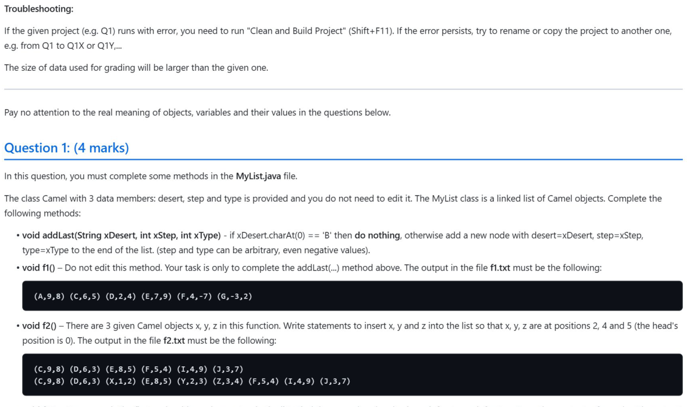

> **Nguyên văn đề bài (Question 1 - Tra cứu Ctrl+F):**
>
> Question 1: (4 marks)
> In this question, you must complete some methods in the MyList.java file.
> The class Camel with 3 data members: desert, step and type is provided and you do not need to edit it. The MyList class is a linked list of Camel objects. Complete the
> following methods:
> > - void addLast(String xDesert, int xStep, int xType) - if xDesert.charAt(0) 'B' then do nothing, otherwise add a new node with desert=xDesert, step=xStep,
> type=xType to the end of the list. (step and type can be arbitrary, even negative values).
> > - void fl() — Do not edit this method. Your task is only to complete the addLast(...) method above. The output in the file f1.txt must be the following:
> (E, 7,9) (G, -3, 2)
> > - void f2() — There are 3 given Camel objects x, y, z in this function. Write statements to insert x, y and z into the list so that x, y, z are at positions 2, 4 and 5 (the head's
> position is O). The output in the file f2.txt must be the following:
> (C.9,8) (Y, 2.3) (Z, 3,4) (F.5,4) (1,4.9) (3.3, 7)
> > - void f3() — Suppose p is the first node with maximum step in the list. Find the second node q having q.info.step<p.info.step. Swap the contents of p and q. The output
> in the file f3.txt must be the following:
> (C, 7,6) (F, 7,9)
> (C, 7,6) (F, 7,9)
> > - void f4() — Find the element p having desert = F. Reverse all elements after p. The content of the output file f4.txt must be the following:
> (L (M, 3,4)

- **Đáp án mã nguồn Java hoàn chỉnh (Giữ format và comment gốc của Given):**
```java
/* This program contains 2 parts: (1) and (2)
   YOUR TASK IS TO COMPLETE THE PART  (2)  ONLY
 */
//(1)==============================================================
import java.util.*;
import java.io.*;
public class MyList {
  Node head,tail;
  MyList() {head=tail=null;}
  boolean isEmpty() {
    return(head==null);
   }
  void clear() {head=tail=null;}
  void fvisit(Node p, RandomAccessFile f) throws Exception {
    if(p != null) f.writeBytes(p.info + " ");
   }
  void ftraverse(RandomAccessFile f) throws Exception {
    Node p = head;
    while(p!=null) {
       fvisit(p,f);
       p=p.next;
      }
    f.writeBytes("\r\n");
   }
  void loadData(int k) {
    String [] a = Lib.readLineToStrArray("data.txt", k);
    int [] b = Lib.readLineToIntArray("data.txt", k+1);
    int [] c = Lib.readLineToIntArray("data.txt", k+2);
    int n = a.length;
    for(int i=0;i<n;i++) addLast(a[i],b[i],c[i]);
   }
//===========================================================================
//(2)===YOU CAN EDIT OR EVEN ADD NEW FUNCTIONS IN THE FOLLOWING PART========
//===========================================================================
/* 
   Khong su dung tieng Viet co dau de viet ghi chu.
   Neu dung khi chay truc tiep se bao loi va nhan 0 diem
*/
  void addLast(String xDesert, int xStep, int xType) {
    //You should write here appropriate statements to complete this function.
   }
  //You do not need to edit this function. Your task is to complete the addLast function above only.
  void f1() throws Exception {
     clear();
     loadData(1);
     String fname = "f1.txt";
     File g123 = new File(fname);
     if(g123.exists()) g123.delete();
     RandomAccessFile  f = new RandomAccessFile(fname, "rw");
     ftraverse(f);
     f.close();
    }
  void f2() throws Exception {
     clear();
     loadData(5);
     String fname = "f2.txt";
     File g123 = new File(fname);
     if(g123.exists()) g123.delete();
     RandomAccessFile  f = new RandomAccessFile(fname, "rw");
     ftraverse(f);
     Camel x, y, z;
     x = new Camel("X",1,2);
     y = new Camel("Y",2,3);
     z = new Camel("Z",3,4);
     ftraverse(f);
     f.close();
    }
  void f3() throws Exception {
    clear();
    loadData(9);
    String fname = "f3.txt";
    File g123 = new File(fname);
    if(g123.exists()) g123.delete();
    RandomAccessFile  f = new RandomAccessFile(fname, "rw");
    ftraverse(f);
    ftraverse(f);
    f.close();
  }
  void f4() throws Exception {
    clear();
    loadData(13);
    String fname = "f4.txt";
    File g123 = new File(fname);
    if(g123.exists()) g123.delete();
    RandomAccessFile  f = new RandomAccessFile(fname, "rw");
    ftraverse(f);
    ftraverse(f);
    f.close();
   }
 }
```

##### [Question 2] Cây nhị phân tìm kiếm (BSTree.java)
- **Mã nguồn giải:** [solutions/2025/pe_sp25\Q2\src\BSTree.java](./solutions/2025/pe_sp25\Q2\src\BSTree.java)

- **Hình ảnh trích xuất đề bài Question 2 từ đề gốc:**

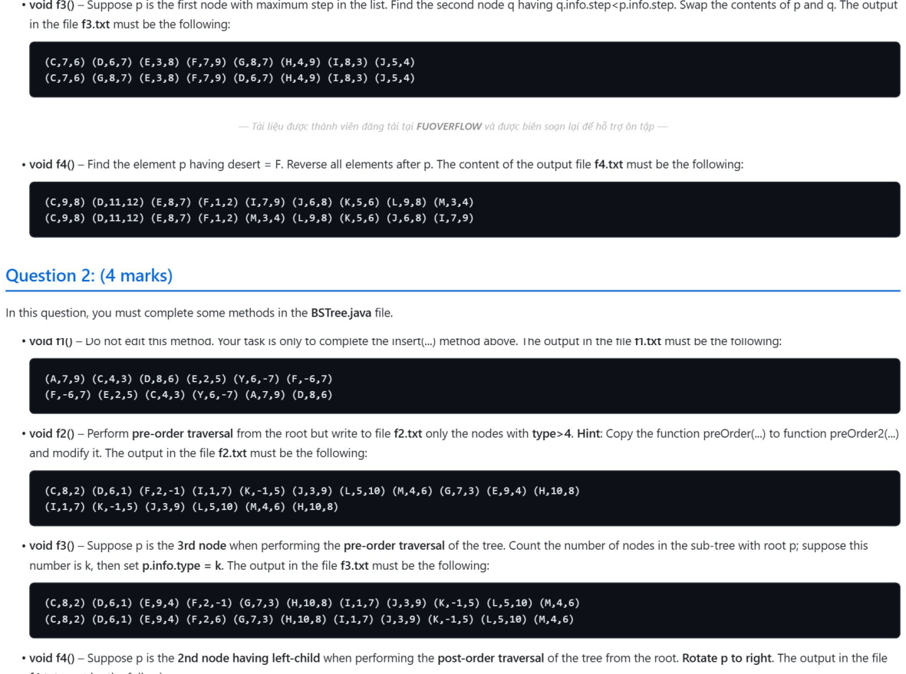

> **Nguyên văn đề bài (Question 2 - Tra cứu Ctrl+F):**
>
> Question 2: (4 marks)
> In this question, you must complete some methods in the BSTree.java file.
> The class Camel with 3 data members: desert, step and type is provided and you do not need to edit it. The BSTree class is a binary search tree of Camel objects. The
> variable step is the key of the tree, thus it must be unique. Complete the following methods:
> > - void insert(String xDesert, int xStep, int xType) - if xDesert.charAt(0) 'B' then do nothing, otherwise insert a new Camel object with desert=xDesert, step=xStep,
> type=xType into the tree (step and type can be arbitrary, even negative values).
> > - void fl() — Do not edit this method. Your task is only to complete the insert(...) method above. The output in the file f1.txt must be the following:
> (A, 7,9) (E, 2,5) (F, -6.7)
> (F, -6,7)
> > - void f2() — Perform pre-order traversal from the root but write to file f2.txt only the nodes with type>4. Hint: Copy the function preorder(...) to function preorder2(...)
> and modify it. The output in the file f2.txt must be the following:
> (G, 7,3)
> (K, -1.5)
> > - void f3() — Suppose p is the 3rd node when performing the pre-order traversal of the tree. Count the number of nodes in the sub-tree with root p; suppose this
> number is k, then set p.info.type = k. The output in the file f3.txt must be the following:
> (F, 2, -1) (G, 7.3) (J, 3,9) (K, -1,5)
> (F, 2,6) (J, 3.9) (K, -1,5)
> > - void f4() — Suppose p is the 2nd node having left-child when performing the post-order traversal of the tree from the root. Rotate p to right. The output in the file
> f4.txt must be the following:

- **Đáp án mã nguồn Java hoàn chỉnh (Giữ format và comment gốc của Given):**
```java
/* This program contains 2 parts: (1) and (2)
   YOUR TASK IS TO COMPLETE THE PART  (2)  ONLY
 */
//(1)==============================================================
import java.io.*;
import java.util.*;
public class BSTree {
   Node root;
   BSTree() {root=null;}
   boolean isEmpty() {
       return(root==null);
      }
   void clear() {
       root=null;
      }
   void visit(Node p) {
      System.out.print("p.info: ");
      if(p != null) System.out.println(p.info + " ");
     }
   void fvisit(Node p, RandomAccessFile f) throws Exception {
      if(p != null) f.writeBytes(p.info + " ");
     }
   void breadth(Node p, RandomAccessFile f) throws Exception {
     if(p==null) return;
     Queue q = new Queue();
     q.enqueue(p);Node r;
     while(!q.isEmpty()) {
        r = q.dequeue();
        fvisit(r,f);
        if(r.left!=null) q.enqueue(r.left);
        if(r.right!=null) q.enqueue(r.right);
       }
    }
   void preOrder(Node p, RandomAccessFile f) throws Exception {
      if(p==null) return;
      fvisit(p,f);
      preOrder(p.left,f);
      preOrder(p.right,f);
     }
   void inOrder(Node p, RandomAccessFile f) throws Exception {
      if(p==null) return;
      inOrder(p.left,f);
      fvisit(p,f);
      inOrder(p.right,f);
     }
   void postOrder(Node p, RandomAccessFile f) throws Exception {
      if(p==null) return;
      postOrder(p.left,f);
      postOrder(p.right,f);
      fvisit(p,f);
     }
   void loadData(int k) {
      String [] a = Lib.readLineToStrArray("data.txt", k);
      int [] b = Lib.readLineToIntArray("data.txt", k+1);
      int [] c = Lib.readLineToIntArray("data.txt", k+2);
      int n = a.length;
      for(int i=0;i<n;i++) insert(a[i],b[i],c[i]);
     }
//===========================================================================
//(2)===YOU CAN EDIT OR EVEN ADD NEW FUNCTIONS IN THE FOLLOWING PART========
//===========================================================================
/* 
   Khong su dung tieng Viet co dau de viet ghi chu.
   Neu dung khi chay truc tiep se bao loi va nhan 0 diem
*/
  void insert(String xDesert, int xStep, int xType) {
    //You should insert here statements to complete this function
   }
//Do not edit this function. Your task is to complete insert function above only.
  void f1() throws Exception {
    clear();
    loadData(1);
    String fname = "f1.txt";
    File g123 = new File(fname);
    if(g123.exists()) g123.delete();
    RandomAccessFile  f = new RandomAccessFile(fname, "rw");
    breadth(root,f);
    f.writeBytes("\r\n");
    inOrder(root,f);
    f.writeBytes("\r\n");
    f.close();
   }
 void f2() throws Exception {
    clear();
    loadData(5);
    String fname = "f2.txt";
    File g123 = new File(fname);
    if(g123.exists()) g123.delete();
    RandomAccessFile  f = new RandomAccessFile(fname, "rw");
    preOrder(root,f);
    f.writeBytes("\r\n");
    f.writeBytes("\r\n");
    f.close();
   }
 void f3() throws Exception {
    clear();
    loadData(9);
    String fname = "f3.txt";
    File g123 = new File(fname);
    if(g123.exists()) g123.delete();
    RandomAccessFile  f = new RandomAccessFile(fname, "rw");
    breadth(root,f);
    f.writeBytes("\r\n");
    breadth(root,f);
    f.writeBytes("\r\n");
    f.close();
   }
 void f4() throws Exception {
    clear();
    loadData(13);;
    String fname = "f4.txt";
    File g123 = new File(fname);
    if(g123.exists()) g123.delete();
    RandomAccessFile  f = new RandomAccessFile(fname, "rw");
    breadth(root,f);
    f.writeBytes("\r\n");
    breadth(root,f);
    f.writeBytes("\r\n");
    f.close();
   }
 }
```

##### [Question 3] Đồ thị (Graph.java)
- **Mã nguồn giải:** [solutions/2025/pe_sp25\Q3\src\Graph.java](./solutions/2025/pe_sp25\Q3\src\Graph.java)

- **Hình ảnh trích xuất đề bài Question 3 từ đề gốc:**

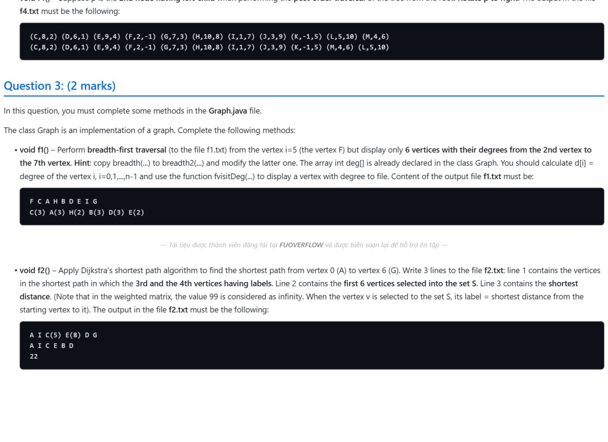

> **Nguyên văn đề bài (Question 3 - Tra cứu Ctrl+F):**
>
> Question 3: (2 marks)
> (F, 2, -1) (G, 7.3) (K, -1,5) (L
> (F, 2, -1) (G, 7.3) (J, 3,9) (K, -1,5) (L.5,1e)
> In this question, you must complete some methods in the Graph.java file.
> The class Graph is an implementation of a graph. Complete the following methods:
> > - void fl() — Perform breadth-first traversal (to the file f1 .txt) from the vertex (the vertex F) but display only 6 vertices with their degrees from the 2nd vertex to
> the 7th vertex. Hint: copy breadth(...) to breadth2(...) and modify the latter one. The array int dego is already declared in the class Graph. You should calculate d[i] =
> degree of the vertex i, and use the function fvisitDeg(...) to display a vertex with degree to file. Content of the output file f1.txt must be:
> FCAHBDEIG
> C(3) A(3) H(2) B(3) D(3) E(2)
> > - void f2() — Apply Dijkstra's shortest path algorithm to find the shortest path from vertex O (A) to vertex 6 (G). Write 3 lines to the file f2.txt: line I contains the vertices
> in the shortest path in which the 3rd and the 4th vertices having labels. Line 2 contains the first 6 vertices selected into the set S. Line 3 contains the shortest
> distance. (Note that in the weighted matrix, the value 99 is considered as infinity. When the vertex v is selected to the set S, its label = shortest distance from the
> starting vertex to it). The output in the file f2.txt must be the following:
> A 1 C(5) E(8) D G
> A ICE BD
> 22

- **Đáp án mã nguồn Java hoàn chỉnh (Giữ format và comment gốc của Given):**
```java
/* This program contains 2 parts: (1) and (2)
   YOUR TASK IS TO COMPLETE THE PART  (2)  ONLY
 */
//(1)==============================================================
import java.io.*;
import java.util.*;
public class Graph {
  int [][] a; int n;
  char v[];
  int deg[];
  Graph() {
    v = "ABCDEFGHIJKLMNOP".toCharArray();
    deg = new int[20];
    a = new int[20][20];
    n = 0;
   }
  void loadData(int k) {
    RandomAccessFile f;int i,j,x;
    String s;StringTokenizer t;
    a = new int[20][20];
    try {
     f = new RandomAccessFile("data.txt","r");
     for(i=0;i<k;i++) f.readLine();
     s = f.readLine();s = s.trim();
     n = Integer.parseInt(s);
     for(i=0;i<n;i++) {
       s = f.readLine();s = s.trim();
       t = new StringTokenizer(s);
       for(j=0;j<n;j++) {
         x = Integer.parseInt(t.nextToken().trim());
         a[i][j] = x;
        }
       }
     f.close();
     }
    catch(Exception e) {}
   }
  void dispAdj() {
    int i,j;
    for(i=0;i<n;i++) {
      System.out.println();
      for(j=0;j<n;j++)
        System.out.printf("%4d",a[i][j]);
     }
   }
  void fvisit(int i, RandomAccessFile f) throws Exception {
    f.writeBytes("  "+v[i]);
   }
  void fvisitDeg(int i, RandomAccessFile f) throws Exception {
    f.writeBytes("  "+v[i]+"("+deg[i]+")");
   }
 void fdispAdj(RandomAccessFile f) throws Exception {
    int i,j;
    f.writeBytes("n = "+n+"\r\n");
    for(i=0;i<n;i++) {
      f.writeBytes("\r\n");
      for(j=0;j<n;j++)  f.writeBytes("  " + a[i][j]);
     }
    f.writeBytes("\r\n");
   }
  void breadth(boolean [] en, int i, RandomAccessFile f) throws Exception {
    Queue q = new Queue();
    int r,j;
    q.enqueue(i); en[i]=true;
    while(!q.isEmpty()) {
      r = q.dequeue();
      fvisit(r,f);
      for(j=0;j<n;j++) {
        if(!en[j] && a[r][j]>0) {
         q.enqueue(j);en[j]=true;
        }
       }
     }
   }
  void breadth(int  k, RandomAccessFile f) throws Exception {
    boolean [] en = new boolean[20];
    int i;
    for(i=0;i<n;i++) en[i]=false;
    breadth(en,k,f);
    for(i=0;i<n;i++)
      if(!en[i]) breadth(en,i,f);
   }
 void depth(boolean [] visited,int k, RandomAccessFile f) throws Exception {
    fvisit(k,f);visited[k]=true;
    for(int i=0;i<n;i++) {
      if(!visited[i] && a[k][i]>0) depth(visited,i,f);
     }
   }
  void depth(int k, RandomAccessFile f) throws Exception {
    boolean [] visited = new boolean[20];
    int i;
    for(i=0;i<n;i++) visited[i]=false;
    depth(visited,k,f);
    for(i=0;i<n;i++)
       if(!visited[i]) depth(visited,i,f);
   }
//===========================================================================
//(2)===YOU CAN EDIT OR EVEN ADD NEW FUNCTIONS IN THE FOLLOWING PART========
//===========================================================================
/* 
   Khong su dung tieng Viet co dau de viet ghi chu.
   Neu dung khi chay truc tiep se bao loi va nhan 0 diem
*/
  void f1() throws Exception {
    loadData(1);
    String fname = "f1.txt";
    File g123 = new File(fname);
    if(g123.exists()) g123.delete();
    RandomAccessFile  f = new RandomAccessFile(fname, "rw");
    breadth(5,f);
    f.writeBytes("\r\n");
    f.writeBytes("\r\n");
    f.close();
   }
  void f2() throws Exception {
    loadData(12);
    String fname = "f2.txt";
    File g123 = new File(fname);
    if(g123.exists()) g123.delete();
    RandomAccessFile  f = new RandomAccessFile(fname, "rw");
    f.writeBytes("\r\n");
    f.close();
   }
}
```

- **Kết quả kiểm chứng thực tế:**
  - `f1.txt`: `F  C  A  H  B  D  E  I  G`
  - `f2.txt`: `EMPTY`

---

#### 6.2.5. Đề thi: CSD201 - PE - SP 2025 - Block 5
- **Thư mục lưu trữ mã nguồn:** [solutions/2025/pe_sp25_b5](./solutions/2025/pe_sp25_b5/)
- **Thư mục tài liệu gốc:** `CSD201 - PE - SP 2025 - Block 5`

##### [Question 1] Danh sách liên kết đơn (MyList.java)
- **Mã nguồn giải:** [solutions/2025/pe_sp25_b5\Q1\src\MyList.java](./solutions/2025/pe_sp25_b5\Q1\src\MyList.java)

- **Hình ảnh trích xuất đề bài Question 1 từ đề gốc:**

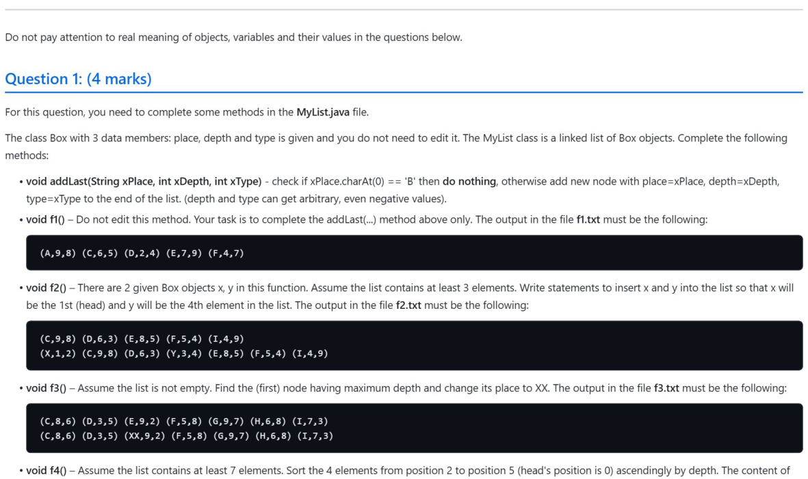

> **Nguyên văn đề bài (Question 1 - Tra cứu Ctrl+F):**
>
> Question 1: (4 marks)
> For this question, you need to complete some methods in the MyList.java file.
> The class Box with 3 data members: place, depth and type is given and you do not need to edit it. The MyList class is a linked list of Box objects. Complete the following
> methods:
> > - void addLast(String xPlace, int xDepth, int xType) - check if xPlace.charAt(0) 'B' then do nothing, otherwise add new node with place=xPlace, depth=xDepth,
> type=xType to the end of the list. (depth and type can get arbitrary, even negative values).
> > - void fl() — Do not edit this method. Your task is to complete the addLast(...) method above only. The output in the file f1.txt must be the following:
> (E, 7,9)
> > - void f2() — There are 2 given Box objects x, y in this function. Assume the list contains at least 3 elements. Write statements to insert x and y into the list so that x will
> be the 1st (head) and y will be the 4th element in the list. The output in the file f2.txt must be the following:
> (F, 5.4)
> > - void f3() — Assume the list is not empty. Find the (first) node having maximum depth and change its place to XX. The output in the file f3.txt must be the following:
> (C.8,6) (D, 3.5) (G,9.7) (1.7,3)
> (F, 5,8)
> > - void f4() — Assume the list contains at least 7 elements. Sort the 4 elements from position 2 to position 5 (head's position is O) ascendingly by depth. The content of
> the output file f4.txt must be the following:
> (C, 7,9) (J, 3.4)
> (C. 7.9) (E.5.6) (K,2.3)

- **Đáp án mã nguồn Java hoàn chỉnh (Giữ format và comment gốc của Given):**
```java
/* This program contains 2 parts: (1) and (2)
   YOUR TASK IS TO COMPLETE THE PART  (2)  ONLY
 */
//(1)==============================================================
import java.util.*;
import java.io.*;
public class MyList {
  Node head,tail;
  MyList() {head=tail=null;}
  boolean isEmpty() {
    return(head==null);
   }
  void clear() {head=tail=null;}
  void fvisit(Node p, RandomAccessFile f) throws Exception {
    if(p != null) f.writeBytes(p.info + " ");
   }
  void ftraverse(RandomAccessFile f) throws Exception {
    Node p = head;
    while(p!=null) {
       fvisit(p,f);
       p=p.next;
      }
    f.writeBytes("\r\n");
   }
  void loadData(int k) {
    String [] a = Lib.readLineToStrArray("data.txt", k);
    int [] b = Lib.readLineToIntArray("data.txt", k+1);
    int [] c = Lib.readLineToIntArray("data.txt", k+2);
    int n = a.length;
    for(int i=0;i<n;i++) addLast(a[i],b[i],c[i]);
   }
//===========================================================================
//(2)===YOU CAN EDIT OR EVEN ADD NEW FUNCTIONS IN THE FOLLOWING PART========
//===========================================================================
/* 
   Khong su dung tieng Viet co dau de viet ghi chu.
   Neu dung khi chay truc tiep se bao loi va nhan 0 diem
*/
  void addLast(String xPlace, int xDepth, int xType) {
    //You should write here appropriate statements to complete this function.
   }
  //You do not need to edit this function. Your task is to complete the addLast function above only.
  void f1() throws Exception {
     clear();
     loadData(1);
     String fname = "f1.txt";
     File g123 = new File(fname);
     if(g123.exists()) g123.delete();
     RandomAccessFile  f = new RandomAccessFile(fname, "rw");
     ftraverse(f);
     f.close();
    }
  void f2() throws Exception {
     clear();
     loadData(5);
     String fname = "f2.txt";
     File g123 = new File(fname);
     if(g123.exists()) g123.delete();
     RandomAccessFile  f = new RandomAccessFile(fname, "rw");
     ftraverse(f);
     Box x, y;
     x = new Box("X",1,2);
     y = new Box("Y",3,4);
     ftraverse(f);
     f.close();
    }
  void f3() throws Exception {
    clear();
    loadData(9);
    String fname = "f3.txt";
    File g123 = new File(fname);
    if(g123.exists()) g123.delete();
    RandomAccessFile  f = new RandomAccessFile(fname, "rw");
    ftraverse(f);
    ftraverse(f);
    f.close();
   }
  void f4() throws Exception {
    clear();
    loadData(13);
    String fname = "f4.txt";
    File g123 = new File(fname);
    if(g123.exists()) g123.delete();
    RandomAccessFile  f = new RandomAccessFile(fname, "rw");
    ftraverse(f);
    ftraverse(f);
    f.close();
   }
 }
```

- **Kết quả kiểm chứng thực tế:**
  - `f1.txt`: `EMPTY`

##### [Question 2] Cây nhị phân tìm kiếm (BSTree.java)
- **Mã nguồn giải:** [solutions/2025/pe_sp25_b5\Q2\src\BSTree.java](./solutions/2025/pe_sp25_b5\Q2\src\BSTree.java)

- **Hình ảnh trích xuất đề bài Question 2 từ đề gốc:**

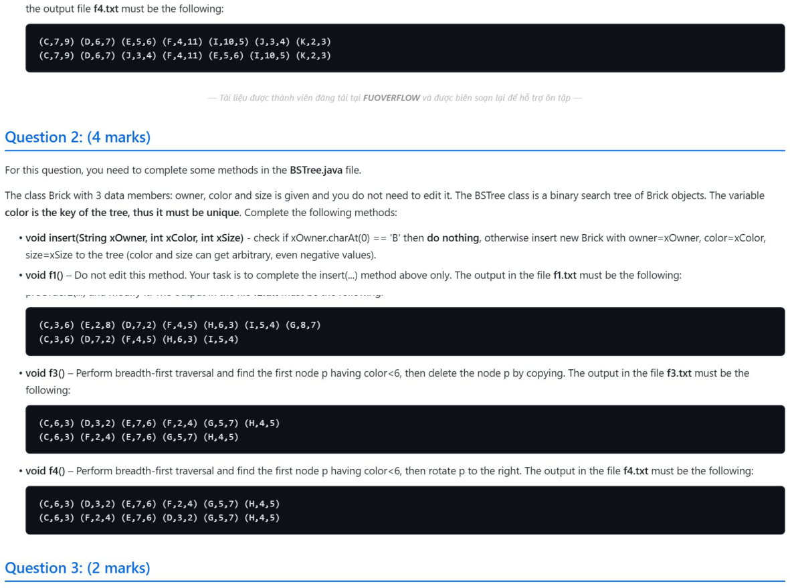

> **Nguyên văn đề bài (Question 2 - Tra cứu Ctrl+F):**
>
> Question 2: (4 marks)
> For this question, you need to complete some methods in the BSTree.java file.
> The class Brick with 3 data members: owner, color and size is given and you do not need to edit it. The BSTree class is a binary search tree of Brick objects. The variable
> color is the key of the tree, thus it must be unique. Complete the following methods:
> > - void insert(String xOwner, int xColor, int xSize) - check if xOwner.charAt(0) 'B' then do nothing, otherwise insert new Brick with owner=xowner, color=xColor,
> size=xSize to the tree (color and size can get arbitrary, even negative values).
> > - void fl() — Do not edit this method. Your task is to complete the insert(...) method above only. The output in the file f1.txt must be the following:
> (A, 7,9) (E, 2,5)
> (E. 2.5) (A. 7,9)
> > - VOId
> - t2() — Perform pre-order traversal trom the root but display to the tlle t
> txt nodes Wlth size<7 only. Hint:
> the tunctlon preorder(...) to tuncüon
> preOrder2(...) and modify it. The output in the file f2.txt must be the following:
> (C, 3,6)
> > - void f3() — Perform breadth-first traversal and find the first node p having color<6, then delete the node p by copying. The output in the file f3.txt must be the
> following:
> (F, 2,4)
> > - void f4() — Perform breadth-first traversal and find the first node p having color<6, then rotate p to the right. The output in the file f4.txt must be the following:
> (E, 7,6) (F, 2,4)
> (E, 7,6)

- **Đáp án mã nguồn Java hoàn chỉnh (Giữ format và comment gốc của Given):**
```java
/* This program contains 2 parts: (1) and (2)
   YOUR TASK IS TO COMPLETE THE PART  (2)  ONLY
 */
//(1)==============================================================
import java.io.*;
import java.util.*;
public class BSTree {
   Node root;
   BSTree() {root=null;}
   boolean isEmpty() {
       return(root==null);
      }
   void clear() {
       root=null;
      }
   void visit(Node p) {
      System.out.print("p.info: ");
      if(p != null) System.out.println(p.info + " ");
     }
   void fvisit(Node p, RandomAccessFile f) throws Exception {
      if(p != null) f.writeBytes(p.info + " ");
     }
   void breadth(Node p, RandomAccessFile f) throws Exception {
     if(p==null) return;
     Queue q = new Queue();
     q.enqueue(p);Node r;
     while(!q.isEmpty()) {
        r = q.dequeue();
        fvisit(r,f);
        if(r.left!=null) q.enqueue(r.left);
        if(r.right!=null) q.enqueue(r.right);
       }
    }
   void preOrder(Node p, RandomAccessFile f) throws Exception {
      if(p==null) return;
      fvisit(p,f);
      preOrder(p.left,f);
      preOrder(p.right,f);
     }
   void inOrder(Node p, RandomAccessFile f) throws Exception {
      if(p==null) return;
      inOrder(p.left,f);
      fvisit(p,f);
      inOrder(p.right,f);
     }
   void postOrder(Node p, RandomAccessFile f) throws Exception {
      if(p==null) return;
      postOrder(p.left,f);
      postOrder(p.right,f);
      fvisit(p,f);
     }
   void loadData(int k) {
      String [] a = Lib.readLineToStrArray("data.txt", k);
      int [] b = Lib.readLineToIntArray("data.txt", k+1);
      int [] c = Lib.readLineToIntArray("data.txt", k+2);
      int n = a.length;
      for(int i=0;i<n;i++) insert(a[i],b[i],c[i]);
     }
//===========================================================================
//(2)===YOU CAN EDIT OR EVEN ADD NEW FUNCTIONS IN THE FOLLOWING PART========
//===========================================================================
/* 
   Khong su dung tieng Viet co dau de viet ghi chu.
   Neu dung khi chay truc tiep se bao loi va nhan 0 diem
*/
  void insert(String xOwner, int xColor, int xSize) {
    //You should insert here statements to complete this function
   }
//Do not edit this function. Your task is to complete insert function above only.
  void f1() throws Exception {
    clear();
    loadData(1);
    String fname = "f1.txt";
    File g123 = new File(fname);
    if(g123.exists()) g123.delete();
    RandomAccessFile  f = new RandomAccessFile(fname, "rw");
    breadth(root,f);
    f.writeBytes("\r\n");
    inOrder(root,f);
    f.writeBytes("\r\n");
    f.close();
   }
  void f2() throws Exception {
    clear();
    loadData(5);
    String fname = "f2.txt";
    File g123 = new File(fname);
    if(g123.exists()) g123.delete();
    RandomAccessFile  f = new RandomAccessFile(fname, "rw");
    preOrder(root,f);
    f.writeBytes("\r\n");
    f.writeBytes("\r\n");
    f.close();
   }
  void f3() throws Exception {
    clear();
    loadData(9);
    String fname = "f3.txt";
    File g123 = new File(fname);
    if(g123.exists()) g123.delete();
    RandomAccessFile  f = new RandomAccessFile(fname, "rw");
    breadth(root,f);
    f.writeBytes("\r\n");
    breadth(root,f);
    f.writeBytes("\r\n");
    f.close();
   }
  void f4() throws Exception {
    clear();
    loadData(13);;
    String fname = "f4.txt";
    File g123 = new File(fname);
    if(g123.exists()) g123.delete();
    RandomAccessFile  f = new RandomAccessFile(fname, "rw");
    breadth(root,f);
    f.writeBytes("\r\n");
    breadth(root,f);
    f.writeBytes("\r\n");
    f.close();
   }
 }
```

- **Kết quả kiểm chứng thực tế:**
  - `f1.txt`: `EMPTY`

##### [Question 3] Đồ thị (Graph.java)
- **Mã nguồn giải:** [solutions/2025/pe_sp25_b5\Q3\src\Graph.java](./solutions/2025/pe_sp25_b5\Q3\src\Graph.java)

- **Hình ảnh trích xuất đề bài Question 3 từ đề gốc:**

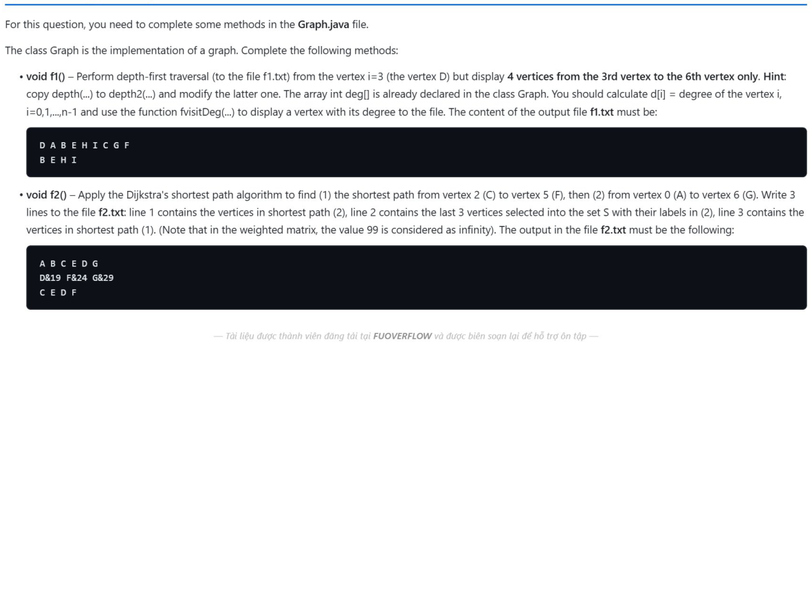

> **Nguyên văn đề bài (Question 3 - Tra cứu Ctrl+F):**
>
> Question 3: (2 marks)
> For this question, you need to complete some methods in the Graph.java file.
> The class Graph is the implementation of a graph. Complete the following methods:
> > - void fl() — Perform depth-first traversal (to the file f1 .txt) from the vertex (the vertex D) but display 4 vertices from the 3rd vertex to the 6th vertex only. Hint:
> copy depth(...) to depth2(...) and modify the latter one. The array int dego is already declared in the class Graph. You should calculate d[i] = degree of the vertex i,
> i=01
> , -1 and use the function fvisitDeg(...) to display a vertex with its degree to the file. The content of the output file f1.txt must be:
> DAB
> EHICGF
> BEH
> 1
> > - void f2() — Apply the Dijkstra's shortest path algorithm to find (1) the shortest path from vertex 2 (C) to vertex 5 (F), then (2) from vertex O (A) to vertex 6 (G). Write 3
> lines to the file f2.txt: line 1 contains the vertices in shortest path (2), line 2 contains the last 3 vertices selected into the set S with their labels in (2), line 3 contains the
> vertices in shortest path (1). (Note that in the weighted matrix, the value 99 is considered as infinity). The output in the file f2.txt must be the following:
> ABC EDG
> D&19 F&24 G&29
> CED F

- **Đáp án mã nguồn Java hoàn chỉnh (Giữ format và comment gốc của Given):**
```java
/* This program contains 2 parts: (1) and (2)
   YOUR TASK IS TO COMPLETE THE PART  (2)  ONLY
 */
//(1)==============================================================
import java.io.*;
import java.util.*;
public class Graph {
  int [][] a; int n;
  char v[];
  int deg[];
  Graph() {
    v = "ABCDEFGHIJKLMNOP".toCharArray();
    deg = new int[20];
    a = new int[20][20];
    n = 0;
   }
  void loadData(int k) {
    RandomAccessFile f;int i,j,x;
    String s;StringTokenizer t;
    a = new int[20][20];
    try {
     f = new RandomAccessFile("data.txt","r");
     for(i=0;i<k;i++) f.readLine();
     s = f.readLine();s = s.trim();
     n = Integer.parseInt(s);
     for(i=0;i<n;i++) {
       s = f.readLine();s = s.trim();
       t = new StringTokenizer(s);
       for(j=0;j<n;j++) {
         x = Integer.parseInt(t.nextToken().trim());
         a[i][j] = x;
        }
       }
     f.close();
     }
    catch(Exception e) {}
   }
  void dispAdj() {
    int i,j;
    for(i=0;i<n;i++) {
      System.out.println();
      for(j=0;j<n;j++)
        System.out.printf("%4d",a[i][j]);
     }
   }
  void fvisit(int i, RandomAccessFile f) throws Exception {
    f.writeBytes("  "+v[i]);
   }
 void fdispAdj(RandomAccessFile f) throws Exception {
    int i,j;
    f.writeBytes("n = "+n+"\r\n");
    for(i=0;i<n;i++) {
      f.writeBytes("\r\n");
      for(j=0;j<n;j++)  f.writeBytes("  " + a[i][j]);
     }
    f.writeBytes("\r\n");
   }
  void breadth(boolean [] en, int i, RandomAccessFile f) throws Exception {
    Queue q = new Queue();
    int r,j;
    q.enqueue(i); en[i]=true;
    while(!q.isEmpty()) {
      r = q.dequeue();
      fvisit(r,f);
      for(j=0;j<n;j++) {
        if(!en[j] && a[r][j]>0) {
         q.enqueue(j);en[j]=true;
        }
       }
     }
   }
  void breadth(int  k, RandomAccessFile f) throws Exception {
    boolean [] en = new boolean[20];
    int i;
    for(i=0;i<n;i++) en[i]=false;
    breadth(en,k,f);
    for(i=0;i<n;i++)
      if(!en[i]) breadth(en,i,f);
   }
 void depth(boolean [] visited,int k, RandomAccessFile f) throws Exception {
    fvisit(k,f);visited[k]=true;
    for(int i=0;i<n;i++) {
      if(!visited[i] && a[k][i]>0) depth(visited,i,f);
     }
   }
  void depth(int k, RandomAccessFile f) throws Exception {
    boolean [] visited = new boolean[20];
    int i;
    for(i=0;i<n;i++) visited[i]=false;
    depth(visited,k,f);
    for(i=0;i<n;i++)
       if(!visited[i]) depth(visited,i,f);
   }
//===========================================================================
//(2)===YOU CAN EDIT OR EVEN ADD NEW FUNCTIONS IN THE FOLLOWING PART========
//===========================================================================
/* 
   Khong su dung tieng Viet co dau de viet ghi chu.
   Neu dung khi chay truc tiep se bao loi va nhan 0 diem
*/
  void f1() throws Exception {
    loadData(1);
    String fname = "f1.txt";
    File g123 = new File(fname);
    if(g123.exists()) g123.delete();
    RandomAccessFile  f = new RandomAccessFile(fname, "rw");
    depth(3,f);
    f.writeBytes("\r\n");
    f.writeBytes("\r\n");
    f.close();
   }
  void f2() throws Exception {
    loadData(12);
    String fname = "f2.txt";
    File g123 = new File(fname);
    if(g123.exists()) g123.delete();
    RandomAccessFile  f = new RandomAccessFile(fname, "rw");
    f.writeBytes("\r\n");
    f.writeBytes("\r\n");
    f.close();
   }
}
```

- **Kết quả kiểm chứng thực tế:**
  - `f1.txt`: `D  A  B  E  H  I  C  G  F`
  - `f2.txt`: `EMPTY`

---

#### 6.2.6. Đề thi: CSD201 - PE - SU 2025 - Block 1
- **Thư mục lưu trữ mã nguồn:** [solutions/2025/pe_su25_b1](./solutions/2025/pe_su25_b1/)
- **Thư mục tài liệu gốc:** `CSD201 - PE - SU 2025 - Block 1`

##### [Question 1] Danh sách liên kết đơn (MyList.java)
- **Mã nguồn giải:** [solutions/2025/pe_su25_b1\Q1\src\MyList.java](./solutions/2025/pe_su25_b1\Q1\src\MyList.java)

- **Hình ảnh trích xuất đề bài Question 1 từ đề gốc:**

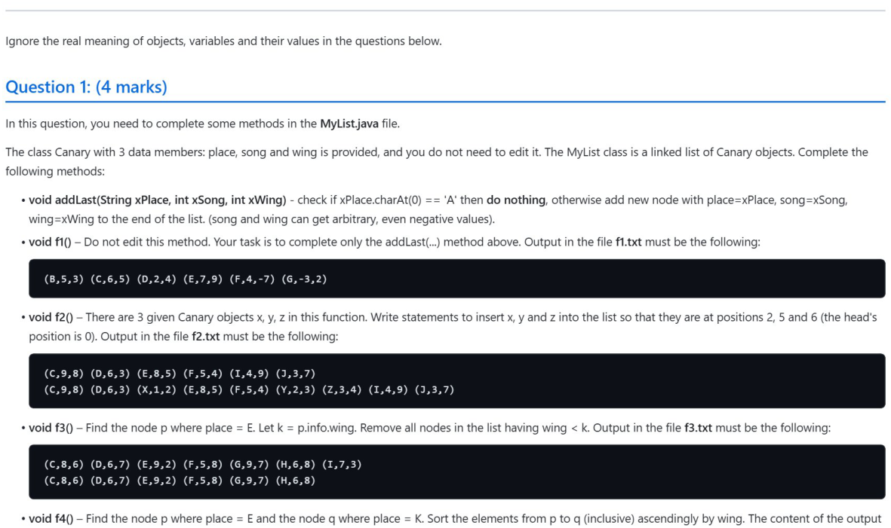

> **Nguyên văn đề bài (Question 1 - Tra cứu Ctrl+F):**
>
> Question 1: (4 marks)
> In this question, you need to complete some methods in the MyList.java file.
> The class Canary with 3 data members: place, song and wing is provided, and you do not need to edit it. The MyList class is a linked list of Canary objects. Complete the
> following methods:
> > - void addLast(String xPlace, int xSong, int xWing) - check if xPlace.charAt(0) 'A' then do nothing, otherwise add new node with place=xPlace, song=xSong,
> wing=xWing to the end of the list. (song and wing can get arbitrary, even negative values).
> > - void fl() — Do not edit this method. Your task is to complete only the addLast(...) method above. Output in the file f1.txt must be the following:
> (E, 7,9) (G, -3, 2)
> > - void f2() — There are 3 given Canary objects x, y, z in this function. Write statements to insert x, y and z into the list so that they are at positions 2, 5 and 6 (the head's
> position is 0). Output in the file f2.txt must be the following:
> > - void f3() — Find the node p where place = E. Let k = p.info.wing. Remove all nodes in the list having wing < k. Output in the file f3.txt must be the following:
> (C.8,6) (G,9.7) (1.7,3)
> > - void f4() — Find the node p where place = E and the node q where place = K. Sort the elements from p to q (inclusive) ascendingly by wing. The content of the output
> file f4.txt must be the following:
> (C, 7,9) (F, 5,6) (J, 3.4)
> (C. 7.9) (K, 2, 3) (3.3,4) (1.4.5) (E.6,16)

- **Đáp án mã nguồn Java hoàn chỉnh (Giữ format và comment gốc của Given):**
```java
/* This program contains 2 parts: (1) and (2)
   YOUR TASK IS TO COMPLETE THE PART  (2)  ONLY
 */
//(1)==============================================================
import java.util.*;
import java.io.*;
public class MyList {
  Node head,tail;
  MyList() {head=tail=null;}
  boolean isEmpty() {
    return(head==null);
   }
  void clear() {head=tail=null;}
  void fvisit(Node p, RandomAccessFile f) throws Exception {
    if(p != null) f.writeBytes(p.info + " ");
   }
  void ftraverse(RandomAccessFile f) throws Exception {
    Node p = head;
    while(p!=null) {
       fvisit(p,f);
       p=p.next;
      }
    f.writeBytes("\r\n");
   }
  void loadData(int k) {
    String [] a = Lib.readLineToStrArray("data.txt", k);
    int [] b = Lib.readLineToIntArray("data.txt", k+1);
    int [] c = Lib.readLineToIntArray("data.txt", k+2);
    int n = a.length;
    for(int i=0;i<n;i++) addLast(a[i],b[i],c[i]);
   }
//===========================================================================
//(2)===YOU CAN EDIT OR EVEN ADD NEW FUNCTIONS IN THE FOLLOWING PART========
//===========================================================================
/* 
   Khong su dung tieng Viet co dau de viet ghi chu.
   Neu dung khi chay truc tiep se bao loi va nhan 0 diem
*/
  void addLast(String xPlace, int xSong, int xWing) {
    //You should write here appropriate statements to complete this function.
   }
  //You do not need to edit this function. Your task is to complete the addLast function above only.
  void f1() throws Exception {
     clear();
     loadData(1);
     String fname = "f1.txt";
     File g123 = new File(fname);
     if(g123.exists()) g123.delete();
     RandomAccessFile  f = new RandomAccessFile(fname, "rw");
     ftraverse(f);
     f.close();
    }
  void f2() throws Exception {
     clear();
     loadData(5);
     String fname = "f2.txt";
     File g123 = new File(fname);
     if(g123.exists()) g123.delete();
     RandomAccessFile  f = new RandomAccessFile(fname, "rw");
     ftraverse(f);
     Canary x, y, z;
     x = new Canary("X",1,2);
     y = new Canary("Y",2,3);
     z = new Canary("Z",3,4);
     ftraverse(f);
     f.close();
    }
  void f3() throws Exception {
    clear();
    loadData(9);
    String fname = "f3.txt";
    File g123 = new File(fname);
    if(g123.exists()) g123.delete();
    RandomAccessFile  f = new RandomAccessFile(fname, "rw");
    ftraverse(f);
    ftraverse(f);
    f.close();
  }
  void f4() throws Exception {
    clear();
    loadData(13);
    String fname = "f4.txt";
    File g123 = new File(fname);
    if(g123.exists()) g123.delete();
    RandomAccessFile  f = new RandomAccessFile(fname, "rw");
    ftraverse(f);
    ftraverse(f);
    f.close();
   }
 }
```

##### [Question 2] Cây nhị phân tìm kiếm (BSTree.java)
- **Mã nguồn giải:** [solutions/2025/pe_su25_b1\Q2\src\BSTree.java](./solutions/2025/pe_su25_b1\Q2\src\BSTree.java)

- **Hình ảnh trích xuất đề bài Question 2 từ đề gốc:**

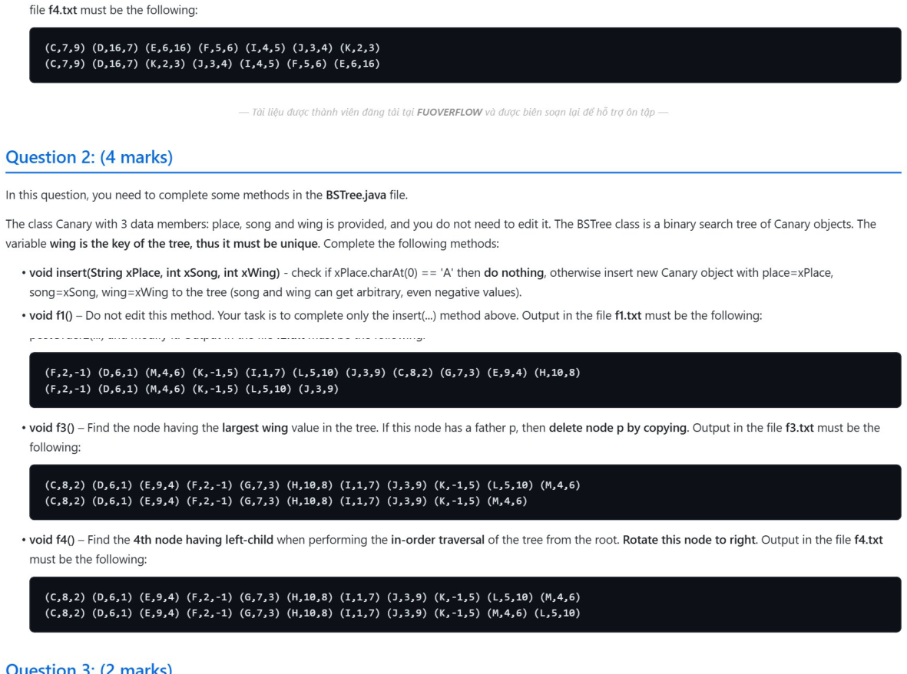

> **Nguyên văn đề bài (Question 2 - Tra cứu Ctrl+F):**
>
> Question 2: (4 marks)
> In this question, you need to complete some methods in the BSTree.java file.
> The class Canary with 3 data members: place, song and wing is provided, and you do not need to edit it. The BSTree class is a binary search tree of Canary objects. The
> variable wing is the key of the tree, thus it must be unique. Complete the following methods:
> > - void insert(String xPlace, int xSong, int xWing) - check if xPlace.charAt(0) 'A' then do nothing, otherwise insert new Canary object with place=xPlace,
> song=xSong, wing=xWing to the tree (song and wing can get arbitrary, even negative values).
> > - void fl() — Do not edit this method. Your task is to complete only the insert(...) method above. Output in the file f1.txt must be the following:
> (E, 2.5) (F, -6.7)
> (Y.6,-7) (C,4.3) (E. 2,5) (D,8.6) (F, -6.7)
> > - VOId
> t2() — Perform post-order traversal trom the root but dlsplay to tile t
> txt nodes With song < 7 on y. Hint: Copy the tuncüon postorder(...) to tunctlon
> postOrder2(...) and modify it. Output in the file f2.txt must be the following:
> (F, 2, -1) (K, -1,5) (G, 7,3)
> (F, 2, -1) (K, -1,5) (L (J, 3.9)
> > - void f3() — Find the node having the largest wing value in the tree. If this node has a father p, then delete node p by copying. Output in the file f3.txt must be the
> following:
> (F, 2, -1) (G, 7.3) (K, -1,5)
> (F, 2, -1) (K, -1,5)
> > - void f4() — Find the 4th node having left-child when performing the in-order traversal of the tree from the root. Rotate this node to right. Output in the file f4.txt
> must be the following:
> (F, 2, -1) (G, 7.3) (J, 3,9) (K, -1,5) (M, 4,6)
> (CS, 2) (F. 2, -1) (G, 7.3) (H,1e.8) (J. 3,9) (K, -1,5) (M,4.6) (L.5,1e)

- **Đáp án mã nguồn Java hoàn chỉnh (Giữ format và comment gốc của Given):**
```java
/* This program contains 2 parts: (1) and (2)
   YOUR TASK IS TO COMPLETE THE PART  (2)  ONLY
 */
//(1)==============================================================
import java.io.*;
import java.util.*;
public class BSTree {
   Node root;
   BSTree() {root=null;}
   boolean isEmpty() {
       return(root==null);
      }
   void clear() {
       root=null;
      }
   void visit(Node p) {
      System.out.print("p.info: ");
      if(p != null) System.out.println(p.info + " ");
     }
   void fvisit(Node p, RandomAccessFile f) throws Exception {
      if(p != null) f.writeBytes(p.info + " ");
     }
   void breadth(Node p, RandomAccessFile f) throws Exception {
     if(p==null) return;
     Queue q = new Queue();
     q.enqueue(p);Node r;
     while(!q.isEmpty()) {
        r = q.dequeue();
        fvisit(r,f);
        if(r.left!=null) q.enqueue(r.left);
        if(r.right!=null) q.enqueue(r.right);
       }
    }
   void preOrder(Node p, RandomAccessFile f) throws Exception {
      if(p==null) return;
      fvisit(p,f);
      preOrder(p.left,f);
      preOrder(p.right,f);
     }
   void inOrder(Node p, RandomAccessFile f) throws Exception {
      if(p==null) return;
      inOrder(p.left,f);
      fvisit(p,f);
      inOrder(p.right,f);
     }
   void postOrder(Node p, RandomAccessFile f) throws Exception {
      if(p==null) return;
      postOrder(p.left,f);
      postOrder(p.right,f);
      fvisit(p,f);
     }
   void loadData(int k) {
      String [] a = Lib.readLineToStrArray("data.txt", k);
      int [] b = Lib.readLineToIntArray("data.txt", k+1);
      int [] c = Lib.readLineToIntArray("data.txt", k+2);
      int n = a.length;
      for(int i=0;i<n;i++) insert(a[i],b[i],c[i]);
     }
//===========================================================================
//(2)===YOU CAN EDIT OR EVEN ADD NEW FUNCTIONS IN THE FOLLOWING PART========
//===========================================================================
/* 
   Khong su dung tieng Viet co dau de viet ghi chu.
   Neu dung khi chay truc tiep se bao loi va nhan 0 diem
*/
  void insert(String xPlace, int xSong, int xWing) {
    //You should insert here statements to complete this function
  }
//Do not edit this function. Your task is to complete insert function above only.
  void f1() throws Exception {
    clear();
    loadData(1);
    String fname = "f1.txt";
    File g123 = new File(fname);
    if(g123.exists()) g123.delete();
    RandomAccessFile  f = new RandomAccessFile(fname, "rw");
    breadth(root,f);
    f.writeBytes("\r\n");
    inOrder(root,f);
    f.writeBytes("\r\n");
    f.close();
   }
 void f2() throws Exception {
    clear();
    loadData(5);
    String fname = "f2.txt";
    File g123 = new File(fname);
    if(g123.exists()) g123.delete();
    RandomAccessFile  f = new RandomAccessFile(fname, "rw");
    postOrder(root,f);
    f.writeBytes("\r\n");
    f.writeBytes("\r\n");
    f.close();
   }
 void f3() throws Exception {
    clear();
    loadData(9);
    String fname = "f3.txt";
    File g123 = new File(fname);
    if(g123.exists()) g123.delete();
    RandomAccessFile  f = new RandomAccessFile(fname, "rw");
    breadth(root,f);
    f.writeBytes("\r\n");
    breadth(root,f);
    f.writeBytes("\r\n");
    f.close();
   }
 void f4() throws Exception {
    clear();
    loadData(13);;
    String fname = "f4.txt";
    File g123 = new File(fname);
    if(g123.exists()) g123.delete();
    RandomAccessFile  f = new RandomAccessFile(fname, "rw");
    breadth(root,f);
    f.writeBytes("\r\n");
    breadth(root,f);
    f.writeBytes("\r\n");
    f.close();
   }
 }
```

- **Kết quả kiểm chứng thực tế:**
  - `f1.txt`: `EMPTY`
  - `f2.txt`: `EMPTY`

##### [Question 3] Đồ thị (Graph.java)
- **Mã nguồn giải:** [solutions/2025/pe_su25_b1\Q3\src\Graph.java](./solutions/2025/pe_su25_b1\Q3\src\Graph.java)

- **Hình ảnh trích xuất đề bài Question 3 từ đề gốc:**


> **Nguyên văn đề bài (Question 3 - Tra cứu Ctrl+F):**
>
> Question 3: (2 marks)
> In this question, you need to complete some methods in the Graph.java file.
> The Graph class is the implementation of a graph. Complete the following methods:
> > - void fl() — Perform depth-first traversal (to the file f1.txt) from the vertex (the vertex A) but display 6 vertices with their degrees from the 2nd vertex to the 7th
> vertex only. Hint: copy depth(...) to depth2(...) and modify the latter one. The array int dego already declared in the class Graph. You should calculate d[i] = degree of
> the vertex i, i=O, l,...,n-l and use the function fvisitDeg(...) to display a vertex with degree to file. Content of the output file f1.txt must be:
> ABD GEHICF
> B(3) D(3) G(l) E(2) H(2) 1(1)
> > - void f2() — Apply the Dijkstra's shortest path algorithm. Write output to the file f2.txt: (1) shortest path from A to F: line 1 contains vertices in shortest path, line 2
> contains the last 5 vertices selected into the set S; (2) shortest path from B to G: line 3 contains vertices in shortest path. (Note that in the weighted matrix, the value
> 99 is considered as infinity). Output in the file f2.txt must be the following:
> A ICE D F(17)
> EBDHF
> BC EDG

- **Đáp án mã nguồn Java hoàn chỉnh (Giữ format và comment gốc của Given):**
```java
/* This program contains 2 parts: (1) and (2)
   YOUR TASK IS TO COMPLETE THE PART  (2)  ONLY
 */
//(1)==============================================================
import java.io.*;
import java.util.*;
public class Graph {
  int [][] a; int n;
  char v[];
  int deg[];
  Graph() {
    v = "ABCDEFGHIJKLMNOP".toCharArray();
    deg = new int[20];
    a = new int[20][20];
    n = 0;
   }
  void loadData(int k) {
    RandomAccessFile f;int i,j,x;
    String s;StringTokenizer t;
    a = new int[20][20];
    try {
     f = new RandomAccessFile("data.txt","r");
     for(i=0;i<k;i++) f.readLine();
     s = f.readLine();s = s.trim();
     n = Integer.parseInt(s);
     for(i=0;i<n;i++) {
       s = f.readLine();s = s.trim();
       t = new StringTokenizer(s);
       for(j=0;j<n;j++) {
         x = Integer.parseInt(t.nextToken().trim());
         a[i][j] = x;
        }
       }
     f.close();
     }
    catch(Exception e) {}
   }
  void dispAdj() {
    int i,j;
    for(i=0;i<n;i++) {
      System.out.println();
      for(j=0;j<n;j++)
        System.out.printf("%4d",a[i][j]);
     }
   }
  void fvisit(int i, RandomAccessFile f) throws Exception {
    f.writeBytes("  "+v[i]);
   }
  void fvisitDeg(int i, RandomAccessFile f) throws Exception {
    f.writeBytes("  "+v[i]+"("+deg[i]+")");
   }
 void fdispAdj(RandomAccessFile f) throws Exception {
    int i,j;
    f.writeBytes("n = "+n+"\r\n");
    for(i=0;i<n;i++) {
      f.writeBytes("\r\n");
      for(j=0;j<n;j++)  f.writeBytes("  " + a[i][j]);
     }
    f.writeBytes("\r\n");
   }
  void breadth(boolean [] en, int i, RandomAccessFile f) throws Exception {
    Queue q = new Queue();
    int r,j;
    q.enqueue(i); en[i]=true;
    while(!q.isEmpty()) {
      r = q.dequeue();
      fvisit(r,f);
      for(j=0;j<n;j++) {
        if(!en[j] && a[r][j]>0) {
         q.enqueue(j);en[j]=true;
        }
       }
     }
   }
  void breadth(int  k, RandomAccessFile f) throws Exception {
    boolean [] en = new boolean[20];
    int i;
    for(i=0;i<n;i++) en[i]=false;
    breadth(en,k,f);
    for(i=0;i<n;i++)
      if(!en[i]) breadth(en,i,f);
   }
 void depth(boolean [] visited,int k, RandomAccessFile f) throws Exception {
    fvisit(k,f);visited[k]=true;
    for(int i=0;i<n;i++) {
      if(!visited[i] && a[k][i]>0) depth(visited,i,f);
     }
   }
  void depth(int k, RandomAccessFile f) throws Exception {
    boolean [] visited = new boolean[20];
    int i;
    for(i=0;i<n;i++) visited[i]=false;
    depth(visited,k,f);
    for(i=0;i<n;i++)
       if(!visited[i]) depth(visited,i,f);
   }
//===========================================================================
//(2)===YOU CAN EDIT OR EVEN ADD NEW FUNCTIONS IN THE FOLLOWING PART========
//===========================================================================
/* 
   Khong su dung tieng Viet co dau de viet ghi chu.
   Neu dung khi chay truc tiep se bao loi va nhan 0 diem
*/
  void f1() throws Exception {
    loadData(1);
    String fname = "f1.txt";
    File g123 = new File(fname);
    if(g123.exists()) g123.delete();
    RandomAccessFile  f = new RandomAccessFile(fname, "rw");
    depth(0,f);
    f.writeBytes("\r\n");
    f.writeBytes("\r\n");
    f.close();
   }
  void f2() throws Exception {
    loadData(12);
    String fname = "f2.txt";
    File g123 = new File(fname);
    if(g123.exists()) g123.delete();
    RandomAccessFile  f = new RandomAccessFile(fname, "rw");
    f.writeBytes("\r\n");
    f.close();
   }
}
```

---

#### 6.2.7. Đề thi: CSD201 - PE1 - SP2025
- **Thư mục lưu trữ mã nguồn:** [solutions/2025/pe1_fa25](./solutions/2025/pe1_fa25/)
- **Thư mục tài liệu gốc:** `CSD201 - PE1 - SP2025`

##### [Question 1] Danh sách liên kết đơn (MyList.java)
- **Thư mục giải:** [solutions/2025/pe1_fa25](./solutions/2025/pe1_fa25)

- **Hình ảnh trích xuất đề bài Question 1 từ đề gốc:**


> **Nguyên văn đề bài (Question 1 - Tra cứu Ctrl+F):**
>
> PRACTICAL EXAM - CSD201 - SPRING 2025
> Duration: 85 minutes
> This exam focuses on managing a dataset of motorbikes. Each motorbike is identified by an D, a name, a model number, and an engine capacity, as listed in the table
> below.
> 2
> 3
> 4
> 5
> 6
> 7
> 8
> 9
> IO
> Name
> Honda CBR500R
> Yamaha YZF-R3
> Kawasaki Ninja 650
> Suzuki GSX-R750
> KTM Duke 390
> Ducati Panigale V4
> BMW SIOOORR
> Harley-Davidson Iron 883
> Triumph Street Triple RS
> Royal Enfield Interceptor 650
> Model Number
> CBR500R-2024
> YZF-R3-2023
> Ninja650-2024
> GSX-R750-2023
> Duke390-2024
> PanigaleV4-2024
> SIOOORR-2023
> Iron883-2024
> TripleRS-2023
> Interceptor650-2024
> Engine Capacity (cc)
> 321
> 649
> 750
> 373
> 1103
> 999
> 883
> 765
> 648
> Q1. Create a class named PE_SP25_Q1 (saved in PE_SP25_Q1 java) that uses a singly linked list to manage the data shown in the table above. The singly linked list consists
> Of:
> 1. [0.5 points] A Motorbike class that holds the ID (id — integer), name (name — string), model (model — string), and engine capacity (encap — integer) of a motorbike.
> 2. [I point] addFirst and removeLast methods: the former inserts a new node at the head of the list, while the latter removes the tail node.
> 3. [0.5 points] Provide a main method to test the implementation.
> Q2. Create a class named PE_SP25_Q2 (saved in containing:
> 1. [1 point] A Motorbike class that stores the following information:
> o Motorbike ID (id — integer)
> o Motorbike name (name — string)
> Motorbike model (model — string)
> 0 Motorbike engine capacity (enCap — integer)
> o A compareTo method used to compare the engine capacity with another motorbike.
> 2. A MaxHeap class, implemented with an array-based structure, stores and manages motorbikes according to their engine capacities. This class must support the
> following operations:
> 0 2.1 [0.5 points] Build the constructor together with the parameters needed to manage the array-based max heap.
> 0 2.2 [1.5 points] Implement an insert method that adds a motorbike to the MaxHeap. The compareTo method must be used to compare the motorbikes' engine
> capacities so that the max heap property is maintained after each insertion.
> 0 2.3 [0.5 point] Implement a preOrderTraverse method that traverses the max heap in pre-order.
> 0 2.4 [1.5 points] Implement a delete method that removes a motorbike by its model. The max heap property must be maintained after each deletion.
> 3. [1 point] Implement a heapSort method that uses the constructed MaxHeap class to sort the motorbike array in increasing order of engine capacities.
> 4. A main method to test the implementation by carrying out the following tasks:
> 4.1 [0.5 point] Instantiate the maxheap and add the motorbikes into it.
> 4.2 [0.5 points] Run a pre-order traversal and display the motorbikes on the screen.
> 4.3 [0.5 points] Delete the motorbike whose model is "S1000RR-2023", then run the pre-order traversal again.
> 4.4[0.5 points] Apply the heapSort method to the motorbikes stored in the maxHeap.
> Important:
> > - Submit your work in two files (PE_SP25_Q1.java and PE_SP25_Q2.java); a 1 -point penalty is applied if this requirement is not met.
> > - Only Apache NetBeans IDE software is permitted during examination.


##### [Chuyên đề / PE1] Đáp án mã nguồn hoàn chỉnh (Main.java)
- **Mã nguồn giải:** [solutions/2025/pe1_fa25\src\Main.java](./solutions/2025/pe1_fa25\src\Main.java)

- **Hình ảnh trích xuất đề bài từ đề gốc:**


> **Nguyên văn đề bài (Tra cứu Ctrl+F):**
>
> PRACTICAL EXAM - CSD201 - SPRING 2025
> Duration: 85 minutes
> This exam focuses on managing a dataset of motorbikes. Each motorbike is identified by an D, a name, a model number, and an engine capacity, as listed in the table
> below.
> 2
> 3
> 4
> 5
> 6
> 7
> 8
> 9
> IO
> Name
> Honda CBR500R
> Yamaha YZF-R3
> Kawasaki Ninja 650
> Suzuki GSX-R750
> KTM Duke 390
> Ducati Panigale V4
> BMW SIOOORR
> Harley-Davidson Iron 883
> Triumph Street Triple RS
> Royal Enfield Interceptor 650
> Model Number
> CBR500R-2024
> YZF-R3-2023
> Ninja650-2024
> GSX-R750-2023
> Duke390-2024
> PanigaleV4-2024
> SIOOORR-2023
> Iron883-2024
> TripleRS-2023
> Interceptor650-2024
> Engine Capacity (cc)
> 321
> 649
> 750
> 373
> 1103
> 999
> 883
> 765
> 648
> Q1. Create a class named PE_SP25_Q1 (saved in PE_SP25_Q1 java) that uses a singly linked list to manage the data shown in the table above. The singly linked list consists
> Of:
> 1. [0.5 points] A Motorbike class that holds the ID (id — integer), name (name — string), model (model — string), and engine capacity (encap — integer) of a motorbike.
> 2. [I point] addFirst and removeLast methods: the former inserts a new node at the head of the list, while the latter removes the tail node.
> 3. [0.5 points] Provide a main method to test the implementation.
> Q2. Create a class named PE_SP25_Q2 (saved in containing:
> 1. [1 point] A Motorbike class that stores the following information:
> o Motorbike ID (id — integer)
> o Motorbike name (name — string)
> Motorbike model (model — string)
> 0 Motorbike engine capacity (enCap — integer)
> o A compareTo method used to compare the engine capacity with another motorbike.
> 2. A MaxHeap class, implemented with an array-based structure, stores and manages motorbikes according to their engine capacities. This class must support the
> following operations:
> 0 2.1 [0.5 points] Build the constructor together with the parameters needed to manage the array-based max heap.
> 0 2.2 [1.5 points] Implement an insert method that adds a motorbike to the MaxHeap. The compareTo method must be used to compare the motorbikes' engine
> capacities so that the max heap property is maintained after each insertion.
> 0 2.3 [0.5 point] Implement a preOrderTraverse method that traverses the max heap in pre-order.
> 0 2.4 [1.5 points] Implement a delete method that removes a motorbike by its model. The max heap property must be maintained after each deletion.
> 3. [1 point] Implement a heapSort method that uses the constructed MaxHeap class to sort the motorbike array in increasing order of engine capacities.
> 4. A main method to test the implementation by carrying out the following tasks:
> 4.1 [0.5 point] Instantiate the maxheap and add the motorbikes into it.
> 4.2 [0.5 points] Run a pre-order traversal and display the motorbikes on the screen.
> 4.3 [0.5 points] Delete the motorbike whose model is "S1000RR-2023", then run the pre-order traversal again.
> 4.4[0.5 points] Apply the heapSort method to the motorbikes stored in the maxHeap.
> Important:
> > - Submit your work in two files (PE_SP25_Q1.java and PE_SP25_Q2.java); a 1 -point penalty is applied if this requirement is not met.
> > - Only Apache NetBeans IDE software is permitted during examination.

- **Đáp án mã nguồn Java hoàn chỉnh (Giữ format và comment gốc của Given):**
```java
import java.util.*;
public class Main {
    static class Employee {
        int id; String name; double salary;
        Employee(int id, String name, double salary) {
            this.id = id; this.name = name; this.salary = salary;
        }
        public String toString() { return "(" + id + "," + name + "," + salary + ")"; }
    }
    static class Node {
        Employee info; Node left, right;
        Node(Employee x) { info = x; left = right = null; }
    }
    static class BST {
        Node root;
        BST() { root = null; }
        void insert(Employee x) {
            Node q = new Node(x);
            if(root == null) { root = q; return; }
            Node p = root, f = null;
            while(p != null) {
                if(p.info.id == x.id) return;
                f = p;
                if(x.id < p.info.id) p = p.left;
                else p = p.right;
            }
            if(x.id < f.info.id) f.left = q;
            else f.right = q;
        }
        void inOrder(Node p) {
            if(p == null) return;
            inOrder(p.left); System.out.print(p.info + " "); inOrder(p.right);
        }
    }
    public static void main(String[] args) {
        BST tree = new BST();
        tree.insert(new Employee(3, "Alice", 1500));
        tree.insert(new Employee(1, "Bob", 1200));
        tree.insert(new Employee(5, "Charlie", 2000));
        tree.inOrder(tree.root);
        System.out.println();
    }
}
```

---

#### 6.2.8. Đề thi: CSD201 - SU25 - PE - De02
- **Thư mục lưu trữ mã nguồn:** [solutions/other/pe_de01](./solutions/other/pe_de01/)
- **Thư mục tài liệu gốc:** `CSD201 - SU25 - PE - De02`

##### [Question 1] Danh sách liên kết đơn (MyList.java)
- **Thư mục giải:** [solutions/other/pe_de01](./solutions/other/pe_de01)

- **Hình ảnh trích xuất đề bài Question 1 từ đề gốc:**


> **Nguyên văn đề bài (Question 1 - Tra cứu Ctrl+F):**
>
> CSD201 PE INSTRUCTIONS
> Please read the instructions below carefully before you start coding.
> Students may use ONLY:
> > - Materials available on their own computer (including JDK, NetBeans...).
> > - For distance learning: Google Meet or Hangout (for exam monitoring purposes).
> Carry out the steps below to complete the PE:
> 1. Create a folder to keep the given projects, e.g. CSD_given (1), and download the given materials into (1).
> 2. Complete all the requirements of the test.
> 3. Before submission:
> o Clean and Build the Project (Shift+F11),
> 0 Then rename the folder dist to run. (If the folder run already exists, delete it before renaming).
> 4. Submission:
> o To submit project Q1, first select the Question No: 1
> 0 Browse and select the project folder (e.g. Q1, or QIA, or Q2, ...)
> o Then click the Submit button.
> 5. Do not use accented Vietnamese characters when writing comments in programs.
> 6. Do not add new import statement(s) to the given files.
> 7. Software tools to be used: NetBeans IDE 13 and Java JDK 1.8. If at least one of the above requirements is not followed, the exam will get ZERO.
> Notes:
> > - The input and expected output below are used only to test your code.
> > - The input and expected output in the real testcases (for marking) are different from the examples below.
> > - Do not hardcode the given expected results.
> Questions: (10 marks)
> The provided files already contain the statements needed to implement a program that manages a Computer Store. The main classes are structured as follows:
> > - Class Order: holds the information of an Order object, including orderlD, customerName, and totalPrice.
> > - Class TreeNode: consists of an Order object plus left and right pointers for the tree structure.
> > - Class OrderBST: a Binary Search Tree structure whose nodes also contain complete Order data. This tree is used to store, search and sort data (alphabetically) in
> ascending order (inOrder traversal).
> > - Class StoreAction: stores information representing an administrative action performed in the store, including actionlD and actionType.
> > - Class ActionNode: contains a StoreAction object and a next pointer for the linked-list data structure.
> > - Class ActionLogStack: a stack structure (implemented as a linked list) whose nodes contain complete Order data. This stack manages all items in LIFO (Last In — First
> Out) rule.
> > - Class ComputerStore is the main class of the program, containing:
> 0 An ActionLogStack: manages the working history of the store, such as buy, ship, cancel, update price, etc.
> 0 An OrderBST: manages the order information, such as customer and price.
> fl(): 3 marks — Load data
> To complete fl(), students need to implement two specific tasks:
> 1. Implement the method push() in ActionLogStack
> 2. Implement the method insert() in OrderBST
> > - push() follows the principle of Stacks.
> > - insert() follows these rules:
> o Orders are inserted based on their orderlD (alphabetical comparison)
> o If an order is added with an existing ID, overwrite it with the new order.
> The expected output used to test your code is as follows:
> Action Log Stack: (Action7,Modified) (Actions, Placed) (Actions, Returned) (Action4,Cance1ed) (Action3.Shipped) (Action2,Updated) (Actionl,P1aced)
> Order BST:
> f2(): 2 marks — Search Order by ID
> > - Return the Order object if found.
> > - Return null if not found.
> Expected output:
> Case of found ID (Searching for Order ID: Order4):
> Action Log Stack: (Action7,Modified) (Action6,P1aced) (Action5.Returned) (Action4,Cance1ed) (Action3.Shipped) (Action2,Updated) (Actionl,P1aced)
> Order BST: (Orderl,D.3Øee.Ø) (Order2,B.2ØØ.Ø) (Order4,C.5ØØ.e) (Order6.A,1ØØØ.Ø)
> Found Order: (Order4,C, 5ØØ.Ø)
> Case of ID not found (Searching for Order ID: Order 7):
> Action Log Stack: (Action7,Modified) (Actions, Placed) (Actions, Returned) (Action4,Cance1ed) (Action3.Shipped) (Action2.Updated) (Actionl,P1aced)
> Order BST:
> Order not found in BST
> f3(): 2 marks — Find Minimum Order ID
> To complete f3(), students need to implement the findMin() method in OrderBST. This method will print out the Order with the lowest "alphabetical" orderlD, which is the
> first order in the inOrder traversal.
> Expected output:
> Action Log Stack: (Action7,Modified) (Actions, Placed) (Action5,Returned) (Action4,Cance1ed) (Action3,Shipped) (Action2.Updated) (Actionl.P1aced)
> Order BST:
> Lowest Alphabetical Order ID in BST: (Ordere, F,25ØØ.e)
> f4(): 3 marks — Pop Action and Remove Order
> To complete f4(), students need to be able to perform the following methods:
> > - The pop() method in ActionLogStack is used to pop the top action in ActionLogStack, then use the actionlD from the popped StoreAction to identify the order to
> remove (via the actionlD field).
> > - The remove() method in OrderBST will remove the Order in orderTree with the given orderlD.
> Example:
> > - Popped from Action Log Stack: Action7 (Modified)
> > - Attempting to remove Order ID from BST: Order3
> > - Attempting to remove Action ID from Stack: Action4
> Expected output:
> Action Log
> Stack: (Action7,Modified) (Actions, Placed) (Action5,Returned) (Action4,Cance1ed) (Action3,Shipped) (Action2,Updated) (Actionl,placed)
> Order BST: (Orderl,D.3ØØØ.Ø) (Order2,B.2ØØ.Ø) (Order4,C.5ØØ.e) (Order6.A,1ØØØ.Ø)
> Action Log
> Stack: (Action6,P1aced) (Actions, Returned) (Action3,Shipped) (Action2, updated) (Actionl, Placed)
> order BST:


##### [Chuyên đề / PE1] Đáp án mã nguồn hoàn chỉnh (Main.java)
- **Thư mục giải:** [solutions/other/pe_de01](./solutions/other/pe_de01)

- **Hình ảnh trích xuất đề bài từ đề gốc:**


> **Nguyên văn đề bài (Tra cứu Ctrl+F):**
>
> CSD201 PE INSTRUCTIONS
> Please read the instructions below carefully before you start coding.
> Students may use ONLY:
> > - Materials available on their own computer (including JDK, NetBeans...).
> > - For distance learning: Google Meet or Hangout (for exam monitoring purposes).
> Carry out the steps below to complete the PE:
> 1. Create a folder to keep the given projects, e.g. CSD_given (1), and download the given materials into (1).
> 2. Complete all the requirements of the test.
> 3. Before submission:
> o Clean and Build the Project (Shift+F11),
> 0 Then rename the folder dist to run. (If the folder run already exists, delete it before renaming).
> 4. Submission:
> o To submit project Q1, first select the Question No: 1
> 0 Browse and select the project folder (e.g. Q1, or QIA, or Q2, ...)
> o Then click the Submit button.
> 5. Do not use accented Vietnamese characters when writing comments in programs.
> 6. Do not add new import statement(s) to the given files.
> 7. Software tools to be used: NetBeans IDE 13 and Java JDK 1.8. If at least one of the above requirements is not followed, the exam will get ZERO.
> Notes:
> > - The input and expected output below are used only to test your code.
> > - The input and expected output in the real testcases (for marking) are different from the examples below.
> > - Do not hardcode the given expected results.
> Questions: (10 marks)
> The provided files already contain the statements needed to implement a program that manages a Computer Store. The main classes are structured as follows:
> > - Class Order: holds the information of an Order object, including orderlD, customerName, and totalPrice.
> > - Class TreeNode: consists of an Order object plus left and right pointers for the tree structure.
> > - Class OrderBST: a Binary Search Tree structure whose nodes also contain complete Order data. This tree is used to store, search and sort data (alphabetically) in
> ascending order (inOrder traversal).
> > - Class StoreAction: stores information representing an administrative action performed in the store, including actionlD and actionType.
> > - Class ActionNode: contains a StoreAction object and a next pointer for the linked-list data structure.
> > - Class ActionLogStack: a stack structure (implemented as a linked list) whose nodes contain complete Order data. This stack manages all items in LIFO (Last In — First
> Out) rule.
> > - Class ComputerStore is the main class of the program, containing:
> 0 An ActionLogStack: manages the working history of the store, such as buy, ship, cancel, update price, etc.
> 0 An OrderBST: manages the order information, such as customer and price.
> fl(): 3 marks — Load data
> To complete fl(), students need to implement two specific tasks:
> 1. Implement the method push() in ActionLogStack
> 2. Implement the method insert() in OrderBST
> > - push() follows the principle of Stacks.
> > - insert() follows these rules:
> o Orders are inserted based on their orderlD (alphabetical comparison)
> o If an order is added with an existing ID, overwrite it with the new order.
> The expected output used to test your code is as follows:
> Action Log Stack: (Action7,Modified) (Actions, Placed) (Actions, Returned) (Action4,Cance1ed) (Action3.Shipped) (Action2,Updated) (Actionl,P1aced)
> Order BST:
> f2(): 2 marks — Search Order by ID
> > - Return the Order object if found.
> > - Return null if not found.
> Expected output:
> Case of found ID (Searching for Order ID: Order4):
> Action Log Stack: (Action7,Modified) (Action6,P1aced) (Action5.Returned) (Action4,Cance1ed) (Action3.Shipped) (Action2,Updated) (Actionl,P1aced)
> Order BST: (Orderl,D.3Øee.Ø) (Order2,B.2ØØ.Ø) (Order4,C.5ØØ.e) (Order6.A,1ØØØ.Ø)
> Found Order: (Order4,C, 5ØØ.Ø)
> Case of ID not found (Searching for Order ID: Order 7):
> Action Log Stack: (Action7,Modified) (Actions, Placed) (Actions, Returned) (Action4,Cance1ed) (Action3.Shipped) (Action2.Updated) (Actionl,P1aced)
> Order BST:
> Order not found in BST
> f3(): 2 marks — Find Minimum Order ID
> To complete f3(), students need to implement the findMin() method in OrderBST. This method will print out the Order with the lowest "alphabetical" orderlD, which is the
> first order in the inOrder traversal.
> Expected output:
> Action Log Stack: (Action7,Modified) (Actions, Placed) (Action5,Returned) (Action4,Cance1ed) (Action3,Shipped) (Action2.Updated) (Actionl.P1aced)
> Order BST:
> Lowest Alphabetical Order ID in BST: (Ordere, F,25ØØ.e)
> f4(): 3 marks — Pop Action and Remove Order
> To complete f4(), students need to be able to perform the following methods:
> > - The pop() method in ActionLogStack is used to pop the top action in ActionLogStack, then use the actionlD from the popped StoreAction to identify the order to
> remove (via the actionlD field).
> > - The remove() method in OrderBST will remove the Order in orderTree with the given orderlD.
> Example:
> > - Popped from Action Log Stack: Action7 (Modified)
> > - Attempting to remove Order ID from BST: Order3
> > - Attempting to remove Action ID from Stack: Action4
> Expected output:
> Action Log
> Stack: (Action7,Modified) (Actions, Placed) (Action5,Returned) (Action4,Cance1ed) (Action3,Shipped) (Action2,Updated) (Actionl,placed)
> Order BST: (Orderl,D.3ØØØ.Ø) (Order2,B.2ØØ.Ø) (Order4,C.5ØØ.e) (Order6.A,1ØØØ.Ø)
> Action Log
> Stack: (Action6,P1aced) (Actions, Returned) (Action3,Shipped) (Action2, updated) (Actionl, Placed)
> order BST:


---

#### 6.2.9. Đề thi: CSD201- FA25 - B3W
- **Thư mục lưu trữ mã nguồn:** [solutions/2025/fa25_b3w](./solutions/2025/fa25_b3w/)
- **Thư mục tài liệu gốc:** `CSD201- FA25 - B3W`

##### [Question 1] Danh sách liên kết đơn (MyList.java)
- **Mã nguồn giải:** [solutions/2025/fa25_b3w\Q1\src\MyList.java](./solutions/2025/fa25_b3w\Q1\src\MyList.java)

- **Hình ảnh trích xuất đề bài Question 1 từ đề gốc:**

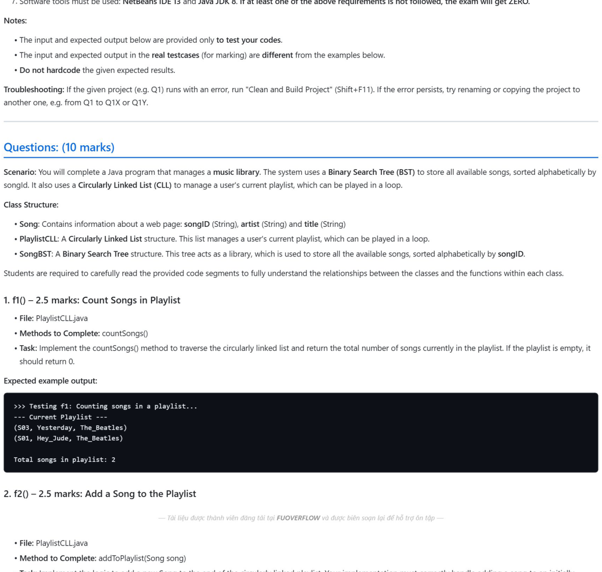

> **Nguyên văn đề bài (Question 1 - Tra cứu Ctrl+F):**
>
> CSD201 PE INSTRUCTIONS
> Read the instructions below carefully before you start coding.
> Follow the steps below to complete the PE:
> 1. Create a folder to hold the given projects, e.g. CSD_given (1), then download the given materials into (1).
> 2. Complete all the requirements of the test.
> 3. Before submitting:
> 0 Clean and Build the Project (Shift+F11),
> o Then rename the dist folder to run. (If a run folder already exists, delete it before renaming).
> 4. Submitting your work:
> 0 To submit project Q1, first you must select Question No: 1,
> o Browse and select the project folder (e.g. Q1, or QIA or Q,
> 0 Then click the Submit button.
> 5. Do not use accented Vietnamese when writing comments in your programs.
> 6. Your task is to complete the method bodies only. Do not change any method signature or add new import statements.
> 7. Software tools must be used: NetBeans IDE 13 and Java JDK 8. If at least one of the above requirements is not followed, the exam will get ZERO.
> Notes:
> > - The input and expected output below are provided only to test your codes.
> > - The input and expected output in the real testcases (for marking) are different from the examples below.
> > - Do not hardcode the given expected results.
> Troubleshooting: If the given project (e.g. Q1) runs with an error, run "Clean and Build Project" (Shift+F11). If the error persists, try renaming or copying the project to
> another one, e.g. from Q1 to QIX or Q1 Y.
> Questions: (10 marks)
> Scenario: You will complete a Java program that manages a music library. The system uses a Binary Search Tree (BST) to store all available songs, sorted alphabetically by
> songld. It also uses a Circularly Linked List (CLL) to manage a user's current playlist, which can be played in a loop.
> Class Structure:
> > - Song: Contains information about a web page: songlD (String), artist (String) and title (String)
> > - PlaylistCLL: A Circularly Linked List structure. This list manages a user's current playlist, which can be played in a loop.
> > - SongBST: A Binary Search Tree structure. This tree acts as a library, which is used to store all the available songs, sorted alphabetically by songlD.
> Students are required to carefully read the provided code segments to fully understand the relationships between the classes and the functions within each class.
> I. fl() — 2.5 marks: Count Songs in Playlist
> > - File: PlaylistCLL.java
> > - Methods to Complete: countSongs()
> > - Task: Implement the countSongs() method to traverse the circularly linked list and return the total number of songs currently in the playlist. If the playlist is empty, it
> should return O.
> Expected example output:
> Testing f1: Counting songs in a playlist.
> Current Playlist
> (SC, Yesterday. The_Beat1es)
> (SOI, Hey_Jude, The_Beat1es)
> Total songs in playlist: 2
> 2. f2() — 2.5 marks: Add a Song to the Playlist
> > - File: PlaylistCLL.java
> > - Method to Complete: addToPlaylist(Song song)
> > - Task: Implement the logic to add a new Song to the end of the circularly linked playlist. Your implementation must correctly handle adding a song to an initially
> empty playlist.
> Expected example output:
> Initial Playlist State - -
> Empty
> Testing f2: Adding a new song to the playlist.
> Final Playlist State
> Current Playlist
> (S99, New_Song, Test_Artist)
> 3. f3() — 2.5 marks: Insert a Song into the Library
> > - File: SongBST.java
> > - Method to Complete: insert(Song song)
> > - Task: Implement the logic to insert a new Song object into the Binary Search Tree. The tree must be ordered alphabetically based on the songld.
> Expected example output:
> Testing f3: Inserting songs into the library.
> Final State of Library -
> Song Library (In-order)
> (SOI,
> Hey_Jude, The_Beat1es)
> (SB2,
> Eleanor_Rigby, The_Beat1es)
> (S03,
> Yesterday, The_Beat1es )
> (S04,
> Come_Together, The_Beat1es)
> (ses,
> The_Beat1es )
> — 2.5 marks: Count Songs within an ID Range
> > - File: SongBST.java
> > - Method to Complete: countlnRange(String minld, String maxld)
> > - Task: Implement a method that efficiently counts the number of songs in the library whose songld falls within a given alphabetical range (inclusive). For example,
> count all songs between "S02" and "S04". To do this efficiently, you must use the BST property to avoid searching branches that are entirely outside the desired range.
> This method should return an int.
> Expected example output:
> Initial Library State - -
> - Song Library (In-order) -
> (SOI, Hey_Jude, The_Beat1es)
> (SQ. Eleanor_Rigby, The_Beat1es)
> (SO, Yesterday, The_Beat1es)
> (sø4, Come_Together, The_Beat1es)
> (S05,
> The_Beat1es )
> Testing f4: Counting songs between S02 and Sø4...
> songs in the specified range.
> Result: Found 3

- **Đáp án mã nguồn Java hoàn chỉnh (Giữ format và comment gốc của Given):**
```java
/* This program contains 2 parts: (1) and (2)
   YOUR TASK IS TO COMPLETE THE PART  (2)  ONLY
 */
//(1)==============================================================
import java.util.*;
import java.io.*;
public class MyList {
    Node head, tail;
    MyList() {
        head = tail = null;
    }
    boolean isEmpty() {
        return (head == null);
    }
    void clear() {
        head = tail = null;
    }
    void fvisit(Node p, RandomAccessFile f) throws Exception {
        if (p != null) {
            f.writeBytes(p.info + " ");
        }
    }
    void ftraverse(RandomAccessFile f) throws Exception {
        Node p = head;
        while (p != null) {
            fvisit(p, f);
            p = p.next;
        }
        f.writeBytes("\r\n");
    }
    void loadData(int k) {
        String[] a = Lib.readLineToStrArray("data.txt", k);
        int[] b = Lib.readLineToIntArray("data.txt", k + 1);
        int[] c = Lib.readLineToIntArray("data.txt", k + 2);
        int n = a.length;
        for (int i = 0; i < n; i++) {
            addLast(a[i], b[i], c[i]);
        }
    }
//===========================================================================
//(2)===YOU CAN EDIT OR EVEN ADD NEW FUNCTIONS IN THE FOLLOWING PART========
//===========================================================================
/* 
   Khong su dung tieng Viet co dau de viet ghi chu.
   Neu dung khi chay truc tiep se bao loi va nhan 0 diem
*/
    void addLast(String xProducer, int xWeight, int xPrice) {
    //You should write here appropriate statements to complete this function.
        if (xWeight > 3 && xPrice > 3) {
            Laptop newLaptop = new Laptop(xProducer, xWeight, xPrice);
            Node newNode = new Node(newLaptop);
            if (isEmpty()) {
                head = tail = newNode;
            } else {
                tail.next = newNode;
                tail = newNode;
            }
        }
    }
  //You do not need to edit this function. Your task is to complete the addLast function above only.
    void f1() throws Exception {
        clear();
        loadData(1);
        String fname = "f1.txt";
        File g123 = new File(fname);
        if (g123.exists()) {
            g123.delete();
        }
        RandomAccessFile f = new RandomAccessFile(fname, "rw");
        ftraverse(f);
        f.close();
    }
    void f2() throws Exception {
        clear();
        loadData(5);
        String fname = "f2.txt";
        File g123 = new File(fname);
        if (g123.exists()) {
            g123.delete();
        }
        RandomAccessFile f = new RandomAccessFile(fname, "rw");
        ftraverse(f);
        Node v = new Node(new Laptop("V", 8, 9));
        Node w = new Node(new Laptop("W", 6, 7));
        v.next = head;
        head = v;
        tail.next = w;
        tail = w;
        ftraverse(f);
        f.close();
    }
    void f3() throws Exception {
        clear();
        loadData(9);
        String fname = "f3.txt";
        File g123 = new File(fname);
        if (g123.exists()) {
            g123.delete();
        }
        RandomAccessFile f = new RandomAccessFile(fname, "rw");
        ftraverse(f);
        Node current = head;
        Node previous = null;
        Node maxWeightNode = null;
        Node maxWeightPrevNode = null;
        int maxWeight = Integer.MIN_VALUE;
        while (current != null) {
            Laptop currentLaptop = current.info;
            if (currentLaptop.weight > maxWeight) {
                maxWeight = currentLaptop.weight;
                maxWeightNode = current;
                maxWeightPrevNode = previous;
            }
            previous = current;
            current = current.next;
        }
        if (maxWeightNode != null) {
            if (maxWeightPrevNode == null) {
                head = maxWeightNode.next;
                if (head == null) {
                    tail = null;
                }
            } else {
                maxWeightPrevNode.next = maxWeightNode.next;
                if (maxWeightNode == tail) {
                    tail = maxWeightPrevNode;
                }
            }
        }
        ftraverse(f);
        f.close();
    }
    void f4() throws Exception {
        clear();
        loadData(13);
        String fname = "f4.txt";
        File g123 = new File(fname);
        if (g123.exists()) {
            g123.delete();
        }
        RandomAccessFile f = new RandomAccessFile(fname, "rw");
        ftraverse(f);
        int result = 0;
        int count = 0;
        Node current = head;
        while (current != null) {
            count++;
            current = current.next;
        }
        result = count;
        f.writeBytes(result + "");
        f.close();
    }
    void f5() throws Exception {
        clear();
        loadData(17);
        String fname = "f5.txt";
        File g123 = new File(fname);
        if (g123.exists()) {
            g123.delete();
        }
        RandomAccessFile f = new RandomAccessFile(fname, "rw");
        ftraverse(f);
        if (head != null) {
            head = head.next;
            if (head != null) {
                head = head.next;
            }
        }
        sortListByWeight();
        ftraverse(f);
        f.close();
    }
    void sortListByWeight() {
        if (head == null) {
            return;
        }
        boolean sorted;
        do {
            sorted = true;
            Node current = head;
            Node nextNode = current.next;
            while (nextNode != null) {
                if (current.info.weight > nextNode.info.weight) {
                    Laptop temp = current.info;
                    current.info = nextNode.info;
                    nextNode.info = temp;
                    sorted = false;
                }
                current = nextNode;
                nextNode = current.next;
            }
        } while (!sorted);
    }
}
```

- **Kết quả kiểm chứng thực tế:**
  - `f1.txt`: `(H,6,7) (C,4,5) (X,8,9) (Y,5,8)`
  - `f2.txt`: `(D,4,7) (L,10,5) (E,9,7) (Q,7,6)  | (V,8,9) (D,4,7) (L,10,5) (E,9,7) (Q,7,6) (W,6,7)`
  - `f3.txt`: `(A,4,4) (D,10,6) (E,9,4) (F,5,8) (Q,10,5) (R,5,7)  | (A,4,4) (E,9,4) (F,5,8) (Q,10,5) (R,5,7)`
  - `f4.txt`: `(J,4,5) (K,5,6) (L,6,8)  | 3`
  - `f5.txt`: `(N,6,10) (A,9,13) (W,5,8) (I,4,6) (S,7,5) (D,8,9)  | (I,4,6) (W,5,8) (S,7,5) (D,8,9)`

##### [Question 2] Cây nhị phân tìm kiếm (BSTree.java)
- **Mã nguồn giải:** [solutions/2025/fa25_b3w\Q2\src\BSTree.java](./solutions/2025/fa25_b3w\Q2\src\BSTree.java)

- **Hình ảnh trích xuất đề bài Question 2 từ đề gốc:**

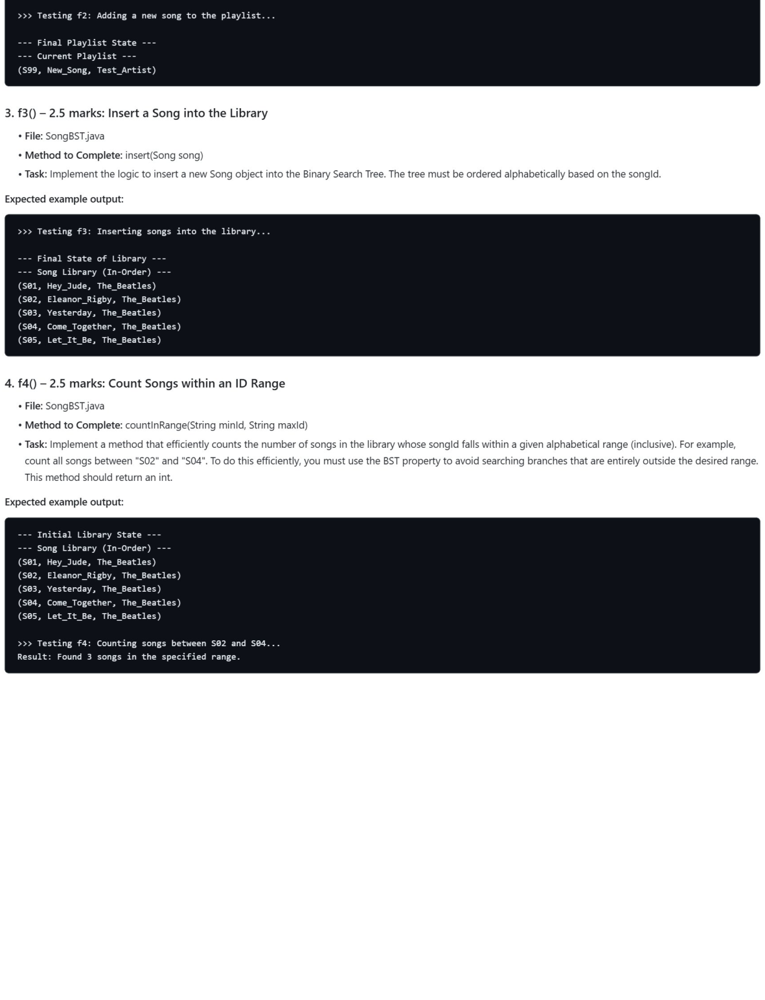

- **Đáp án mã nguồn Java hoàn chỉnh (Giữ format và comment gốc của Given):**
```java
/* This program contains 2 parts: (1) and (2)
   YOUR TASK IS TO COMPLETE THE PART  (2)  ONLY
 */
//(1)==============================================================
import java.io.*;
import java.util.*;
public class BSTree {
    Node root;
    BSTree() {
        root = null;
    }
    boolean isEmpty() {
        return (root == null);
    }
    void clear() {
        root = null;
    }
    void visit(Node p) {
        System.out.print("p.info: ");
        if (p != null) {
            System.out.println(p.info + " ");
        }
    }
    void fvisit(Node p, RandomAccessFile f) throws Exception {
        if (p != null) {
            f.writeBytes(p.info + " ");
        }
    }
    void breadth(Node p, RandomAccessFile f) throws Exception {
        if (p == null) {
            return;
        }
        Queue q = new Queue();
        q.enqueue(p);
        Node r;
        while (!q.isEmpty()) {
            r = q.dequeue();
            fvisit(r, f);
            if (r.left != null) {
                q.enqueue(r.left);
            }
            if (r.right != null) {
                q.enqueue(r.right);
            }
        }
    }
    void preOrder(Node p, RandomAccessFile f) throws Exception {
        if (p == null) {
            return;
        }
        fvisit(p, f);
        preOrder(p.left, f);
        preOrder(p.right, f);
    }
    void inOrder(Node p, RandomAccessFile f) throws Exception {
        if (p == null) {
            return;
        }
        inOrder(p.left, f);
        fvisit(p, f);
        inOrder(p.right, f);
    }
    void postOrder(Node p, RandomAccessFile f) throws Exception {
        if (p == null) {
            return;
        }
        postOrder(p.left, f);
        postOrder(p.right, f);
        fvisit(p, f);
    }
    void loadData(int k) {
        String[] a = Lib.readLineToStrArray("data.txt", k);
        int[] b = Lib.readLineToIntArray("data.txt", k + 1);
        int[] c = Lib.readLineToIntArray("data.txt", k + 2);
        int n = a.length;
        for (int i = 0; i < n; i++) {
            insert(a[i], b[i], c[i]);
        }
    }
//===========================================================================
//(2)===YOU CAN EDIT OR EVEN ADD NEW FUNCTIONS IN THE FOLLOWING PART========
//===========================================================================
/* 
   Khong su dung tieng Viet co dau de viet ghi chu.
   Neu dung khi chay truc tiep se bao loi va nhan 0 diem
*/
    void insert(String xPlace, int xWeight, int xColor) {
    //You should insert here statements to complete this function
        if (xPlace.charAt(0) == 'N') {
            return;
        }
        Node newNode = new Node(new Cat(xPlace, xWeight, xColor));
        if (root == null) {
            root = newNode;
            return;
        }
        Node current = root;
        Node parent = null;
        while (current != null) {
            parent = current;
            if (xWeight < current.info.weight) {
                current = current.left;
            } else if (xWeight > current.info.weight) {
                current = current.right;
            } else {
                return;
            }
        }
        if (xWeight < parent.info.weight) {
            parent.left = newNode;
        } else {
            parent.right = newNode;
        }
    }
//Do not edit this function. Your task is to complete insert function above only.
    void f1() throws Exception {
        clear();
        loadData(1);
        String fname = "f1.txt";
        File g123 = new File(fname);
        if (g123.exists()) {
            g123.delete();
        }
        RandomAccessFile f = new RandomAccessFile(fname, "rw");
        breadth(root, f);
        f.writeBytes("\r\n");
        inOrder(root, f);
        f.writeBytes("\r\n");
        f.close();
    }
    void f2() throws Exception {
        clear();
        loadData(5);
        String fname = "f2.txt";
        File g123 = new File(fname);
        if (g123.exists()) {
            g123.delete();
        }
        RandomAccessFile f = new RandomAccessFile(fname, "rw");
        breadth(root, f);
        f.writeBytes("\r\n");
        if (root != null) {
            preOrder2(root.left, f);
        }
        f.writeBytes("\r\n");
        f.close();
    }
    void preOrder2(Node p, RandomAccessFile f) throws Exception {
        if (p == null) {
            return;
        }
        if (p.info.color != 4) {
            fvisit(p, f);
        }
        preOrder2(p.left, f);
        preOrder2(p.right, f);
    }
    void f3() throws Exception {
        clear();
        loadData(9);
        String fname = "f3.txt";
        File g123 = new File(fname);
        if (g123.exists()) {
            g123.delete();
        }
        RandomAccessFile f = new RandomAccessFile(fname, "rw");
        descendingOrderTraversal(root, f);
        f.writeBytes("\r\n");
        f.close();
    }
    void descendingOrderTraversal(Node p, RandomAccessFile f) throws Exception {
        if (p == null) {
            return;
        }
        descendingOrderTraversal(p.right, f);
        fvisit(p, f);
        descendingOrderTraversal(p.left, f);
    }
    void f4() throws Exception {
        clear();
        loadData(13);
        String fname = "f4.txt";
        File g123 = new File(fname);
        if (g123.exists()) {
            g123.delete();
        }
        RandomAccessFile f = new RandomAccessFile(fname, "rw");
        preOrder(root, f);
        f.writeBytes("\r\n");
        leafNodesWithColorLessThan7(root, f);
        f.writeBytes("\r\n");
        f.close();
    }
    void leafNodesWithColorLessThan7(Node p, RandomAccessFile f) throws Exception {
        if (p == null) {
            return;
        }
        if (p.left == null && p.right == null && p.info.color < 7) {
            fvisit(p, f);
        }
        leafNodesWithColorLessThan7(p.left, f);
        leafNodesWithColorLessThan7(p.right, f);
    }
    void f5() throws Exception {
        clear();
        loadData(17);
        String fname = "f5.txt";
        File g123 = new File(fname);
        if (g123.exists()) {
            g123.delete();
        }
        RandomAccessFile f = new RandomAccessFile(fname, "rw");
        inOrder(root, f);
        f.writeBytes("\r\n");
        int result = 0;
        result = countInternalNodes(root);
        f.writeBytes(result + "\r\n");
        f.close();
    }
    int countInternalNodes(Node p) {
        if (p == null) {
            return 0;
        }
        int count = 0;
        if (p.left != null || p.right != null) {
            count = 1;
        }
        count += countInternalNodes(p.left);
        count += countInternalNodes(p.right);
        return count;
    }
}
```

- **Kết quả kiểm chứng thực tế:**
  - `f1.txt`: `(X,5,2) (P,1,3) (M,9,5) (R,4,8) (F,7,4) (Q,8,7)  | (P,1,3) (R,4,8) (X,5,2) (F,7,4) (Q,8,7) (M,9,5)`
  - `f2.txt`: `(P,7,9) (D,4,3) (G,9,6) (H,2,5) (B,6,4) (X,8,9) (L,1,8)  | (D,4,3) (H,2,5) (L,1,8)`
  - `f3.txt`: `(T,8,-5) (M,7,2) (P,6,3) (R,5,9) (S,4,1) (L,2,5) (Y,1,6)`
  - `f4.txt`: `(A,6,5) (B,2,7) (P,1,9) (C,3,-8) (F,4,2) (D,5,-3) (E,8,3) (G,7,4) (Q,9,1)  | (D,5,-3) (G,7,4) (Q,9,1)`
  - `f5.txt`: `(L,1,5) (H,2,6) (Q,3,1) (D,4,3) (B,6,-4) (M,7,9) (X,8,7) (G,9,-6)  | 4`

---

#### 6.2.10. Đề thi: CSD201- PE1 - FA25
- **Thư mục lưu trữ mã nguồn:** [solutions/2025/pe1_fa25](./solutions/2025/pe1_fa25/)
- **Thư mục tài liệu gốc:** `CSD201- PE1 - FA25`

##### [Question 1] Danh sách liên kết đơn (MyList.java)
- **Thư mục giải:** [solutions/2025/pe1_fa25](./solutions/2025/pe1_fa25)

- **Hình ảnh trích xuất đề bài Question 1 từ đề gốc:**


> **Nguyên văn đề bài (Question 1 - Tra cứu Ctrl+F):**
>
> PRACTICAL EXAM - CSD201 - FALL 2025
> Time allowed: 85 minutes
> Note: Submit only one Java file! You may use your own lab exercises and course notes, but NOT Internet access.
> Create a Java program that manages information of products. Each product contains two fields: code: int — a unique product code, price: int.
> l. [6.25 pts] Binary Search Tree (BST):
> Implement a Product class and a Node class (1.0 pts). Then, for a binary search tree T, whose nodes are ordered by code, implement the following functions:
> 1. [2.0 pts] Construct T from a given product array P.
> 2. [1.0 pts] Print all products in T in descending order of their codes.
> 3. [0.5 pts] Add a field level to each node and compute it for all nodes, where:
> 0 The root has a level of O,
> o Each child node has a level equal to its parent's level plus 1.
> 4. [0.5 pts] Add a field bal_factor (balance factor) to each node and compute it for all nodes, defined as the height of the left subtree minus that of the right subtree.
> 5. [0.5 pts] Count the total number of nodes of T using an iterative traversal with a stack.
> 6. [0.75 pts] Check whether the tree T is height-balanced.
> II. [2.0 pts] Sorting:
> 1. [1.5 pts] Write a function to sort a given product array in descending order of price, using an algorithm with the lowest possible average-case time complexity.
> 2. [0.5 pts] Briefly explain why this algorithm was chosen.
> Ill. [1.75 pts] Main Function:
> 1. Build the BST T from array P = 500), (3, 300), (2, 200), (4, 400), (7, 700), (6, 600), (8, 800), (1, 100), (9, 900)}.
> 2. Call and test all functions implemented in Part I and II.
> 3. Display the output results for each step.


##### [Chuyên đề / PE1] Đáp án mã nguồn hoàn chỉnh (Main.java)
- **Mã nguồn giải:** [solutions/2025/pe1_fa25\src\Main.java](./solutions/2025/pe1_fa25\src\Main.java)

- **Hình ảnh trích xuất đề bài từ đề gốc:**


> **Nguyên văn đề bài (Tra cứu Ctrl+F):**
>
> PRACTICAL EXAM - CSD201 - FALL 2025
> Time allowed: 85 minutes
> Note: Submit only one Java file! You may use your own lab exercises and course notes, but NOT Internet access.
> Create a Java program that manages information of products. Each product contains two fields: code: int — a unique product code, price: int.
> l. [6.25 pts] Binary Search Tree (BST):
> Implement a Product class and a Node class (1.0 pts). Then, for a binary search tree T, whose nodes are ordered by code, implement the following functions:
> 1. [2.0 pts] Construct T from a given product array P.
> 2. [1.0 pts] Print all products in T in descending order of their codes.
> 3. [0.5 pts] Add a field level to each node and compute it for all nodes, where:
> 0 The root has a level of O,
> o Each child node has a level equal to its parent's level plus 1.
> 4. [0.5 pts] Add a field bal_factor (balance factor) to each node and compute it for all nodes, defined as the height of the left subtree minus that of the right subtree.
> 5. [0.5 pts] Count the total number of nodes of T using an iterative traversal with a stack.
> 6. [0.75 pts] Check whether the tree T is height-balanced.
> II. [2.0 pts] Sorting:
> 1. [1.5 pts] Write a function to sort a given product array in descending order of price, using an algorithm with the lowest possible average-case time complexity.
> 2. [0.5 pts] Briefly explain why this algorithm was chosen.
> Ill. [1.75 pts] Main Function:
> 1. Build the BST T from array P = 500), (3, 300), (2, 200), (4, 400), (7, 700), (6, 600), (8, 800), (1, 100), (9, 900)}.
> 2. Call and test all functions implemented in Part I and II.
> 3. Display the output results for each step.

- **Đáp án mã nguồn Java hoàn chỉnh (Giữ format và comment gốc của Given):**
```java
import java.util.*;
public class Main {
    static class Employee {
        int id; String name; double salary;
        Employee(int id, String name, double salary) {
            this.id = id; this.name = name; this.salary = salary;
        }
        public String toString() { return "(" + id + "," + name + "," + salary + ")"; }
    }
    static class Node {
        Employee info; Node left, right;
        Node(Employee x) { info = x; left = right = null; }
    }
    static class BST {
        Node root;
        BST() { root = null; }
        void insert(Employee x) {
            Node q = new Node(x);
            if(root == null) { root = q; return; }
            Node p = root, f = null;
            while(p != null) {
                if(p.info.id == x.id) return;
                f = p;
                if(x.id < p.info.id) p = p.left;
                else p = p.right;
            }
            if(x.id < f.info.id) f.left = q;
            else f.right = q;
        }
        void inOrder(Node p) {
            if(p == null) return;
            inOrder(p.left); System.out.print(p.info + " "); inOrder(p.right);
        }
    }
    public static void main(String[] args) {
        BST tree = new BST();
        tree.insert(new Employee(3, "Alice", 1500));
        tree.insert(new Employee(1, "Bob", 1200));
        tree.insert(new Employee(5, "Charlie", 2000));
        tree.inOrder(tree.root);
        System.out.println();
    }
}
```

---

#### 6.2.11. Đề thi: CSD201-SU25-PE-FUDA
- **Thư mục lưu trữ mã nguồn:** [solutions/2025/su25_fuda](./solutions/2025/su25_fuda/)
- **Thư mục tài liệu gốc:** `CSD201-SU25-PE-FUDA`

##### [Question 1] Danh sách liên kết đơn (MyList.java)
- **Thư mục giải:** [solutions/2025/su25_fuda](./solutions/2025/su25_fuda)

- **Hình ảnh trích xuất đề bài Question 1 từ đề gốc:**

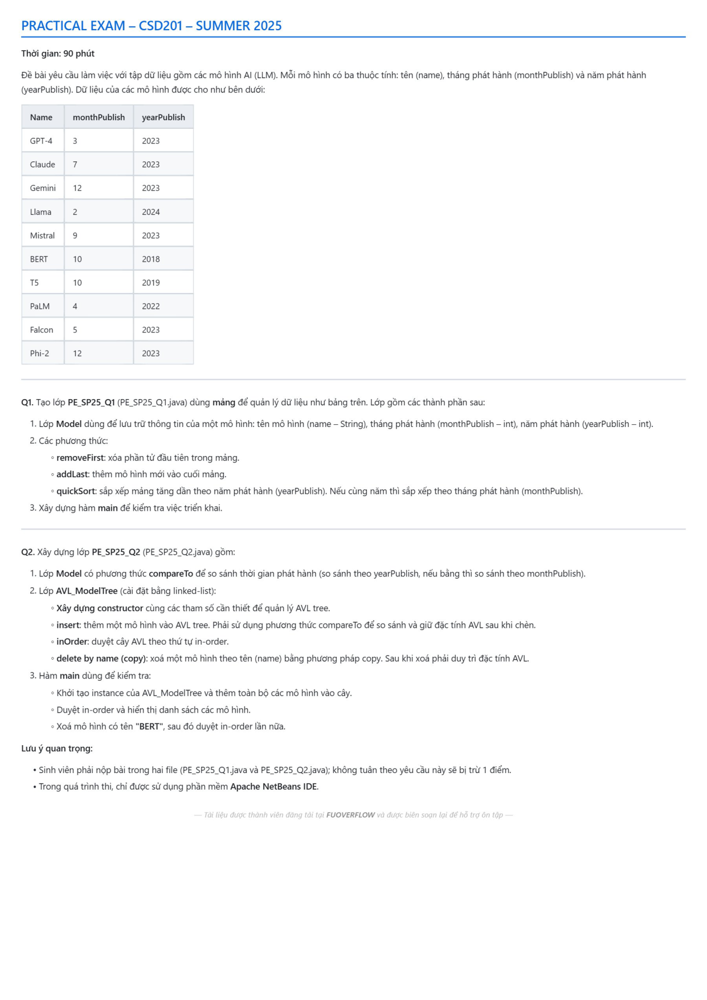

> **Nguyên văn đề bài (Question 1 - Tra cứu Ctrl+F):**
>
> PRACTICAL EXAM - CSD201 - SUMMER 2025
> Thdi gian: 90 phüt
> båi yéu cau låm viéc vdi tap dd liéu gom cåc md hinh Al (LLM). Mdi md hinh c6 ba thuöc tinh: tén (name), thång phåt hånh (monthPublish) vå näm phåt hånh
> (yearPublish). Dữ liệu của các mô hình được cho như bên dưới:
> Name
> GPT-4
> Claude
> Gemini
> Llama
> Mistral
> BERT
> T5
> PaLM
> Falcon
> Phi-2
> monthPublish yearPublish
> 3
> 7
> 12
> 2
> 9
> 10
> 10
> 4
> 5
> 12
> 2023
> 2023
> 2023
> 2024
> 2023
> 2018
> 2019
> 2022
> 2023
> 2023
> Q1. Tao IdP PE_SP25_Q1 java) düng mång dé quån 19 dCr liéu nhu bång trén. Ldp gbm cåc thånh Phin sau:
> 1. Ldp Model düng dé Idu trÜ thöng tin cüa mét mö hinh: tén mö hinh (name — String), thång phåt hånh (monthPublish — int), näm phåt hånh (yearPublish — int).
> 2. Cåc phuong thüc:
> 0 removeFirst: x6a phän tü däu tién trong mång.
> 0 addLast: thém mö hinh mdi våo cudi mång.
> 0 quickSort: såp xép mång täng din theo näm phåt hånh (yearPubIish). Néu cüng näm thi såp xép theo thång phåt hånh (monthPubIish).
> 3. Xåy dung håm main dé kiém tra viéc trién khai.
> Q2. Xåy dung IdP gam:
> 1. Ldp Model cé phddng thüc compareTo dé so sånh thdi gian phåt hånh (so sånh theo yearPublish, néu bång thi so sånh theo monthPublish).
> 2. Ldp AVL_ModelTree (cåi dét bång linked-list):
> Xåy dVng constructor cüng cåc tham Sö can thiét dé quån 19 AVL tree.
> 0 insert: thém möt rnö hinh våo AVL tree. Phåi Sü dung phuang thüc compareTo dé so sånh vå gid déc tinh AVL sau khi chén.
> inOrder. duyét cåy AVL theo thü tv in-order.
> o delete by name (copy): xoå mét md hinh theo tan (name) bång phuong phåp copy. Sau khi xoå phåi duy tri däc tinh AVL
> 3. Håm main ding dé kiém tra:
> o Khdi tao instance cüa AVL_ModelTree vå thém toån bö cåc md hinh våo cay.
> 0 Duyet in-order vå hién thi danh såch cåc mö hinh.
> Xoå m6 hinh cé tén "BERT", sau d6 duyét in-order län nüa.
> Luu quan trpng:
> > - Sinh vién phåi nöp båi trong hai file vå khång tuån theo yéu cau nåy sé bi tru 1 dlém.
> > - Trong quå trinh thi, chi durgc Sü dung phän mam Apache NetBeans IDE.


##### [Chuyên đề / PE1] Đáp án mã nguồn hoàn chỉnh (Main.java)
- **Mã nguồn giải:** [solutions/2025/su25_fuda\src\Main.java](./solutions/2025/su25_fuda\src\Main.java)

- **Hình ảnh trích xuất đề bài từ đề gốc:**


> **Nguyên văn đề bài (Tra cứu Ctrl+F):**
>
> PRACTICAL EXAM - CSD201 - SUMMER 2025
> Thdi gian: 90 phüt
> båi yéu cau låm viéc vdi tap dd liéu gom cåc md hinh Al (LLM). Mdi md hinh c6 ba thuöc tinh: tén (name), thång phåt hånh (monthPublish) vå näm phåt hånh
> (yearPublish). Dữ liệu của các mô hình được cho như bên dưới:
> Name
> GPT-4
> Claude
> Gemini
> Llama
> Mistral
> BERT
> T5
> PaLM
> Falcon
> Phi-2
> monthPublish yearPublish
> 3
> 7
> 12
> 2
> 9
> 10
> 10
> 4
> 5
> 12
> 2023
> 2023
> 2023
> 2024
> 2023
> 2018
> 2019
> 2022
> 2023
> 2023
> Q1. Tao IdP PE_SP25_Q1 java) düng mång dé quån 19 dCr liéu nhu bång trén. Ldp gbm cåc thånh Phin sau:
> 1. Ldp Model düng dé Idu trÜ thöng tin cüa mét mö hinh: tén mö hinh (name — String), thång phåt hånh (monthPublish — int), näm phåt hånh (yearPublish — int).
> 2. Cåc phuong thüc:
> 0 removeFirst: x6a phän tü däu tién trong mång.
> 0 addLast: thém mö hinh mdi våo cudi mång.
> 0 quickSort: såp xép mång täng din theo näm phåt hånh (yearPubIish). Néu cüng näm thi såp xép theo thång phåt hånh (monthPubIish).
> 3. Xåy dung håm main dé kiém tra viéc trién khai.
> Q2. Xåy dung IdP gam:
> 1. Ldp Model cé phddng thüc compareTo dé so sånh thdi gian phåt hånh (so sånh theo yearPublish, néu bång thi so sånh theo monthPublish).
> 2. Ldp AVL_ModelTree (cåi dét bång linked-list):
> Xåy dVng constructor cüng cåc tham Sö can thiét dé quån 19 AVL tree.
> 0 insert: thém möt rnö hinh våo AVL tree. Phåi Sü dung phuang thüc compareTo dé so sånh vå gid déc tinh AVL sau khi chén.
> inOrder. duyét cåy AVL theo thü tv in-order.
> o delete by name (copy): xoå mét md hinh theo tan (name) bång phuong phåp copy. Sau khi xoå phåi duy tri däc tinh AVL
> 3. Håm main ding dé kiém tra:
> o Khdi tao instance cüa AVL_ModelTree vå thém toån bö cåc md hinh våo cay.
> 0 Duyet in-order vå hién thi danh såch cåc mö hinh.
> Xoå m6 hinh cé tén "BERT", sau d6 duyét in-order län nüa.
> Luu quan trpng:
> > - Sinh vién phåi nöp båi trong hai file vå khång tuån theo yéu cau nåy sé bi tru 1 dlém.
> > - Trong quå trinh thi, chi durgc Sü dung phän mam Apache NetBeans IDE.

- **Đáp án mã nguồn Java hoàn chỉnh (Giữ format và comment gốc của Given):**
```java
import java.util.*;
public class Main {
    static class AIModel {
        String name; int monthPublish; int size;
        AIModel(String name, int monthPublish, int size) {
            this.name = name; this.monthPublish = monthPublish; this.size = size;
        }
        public String toString() { return "(" + name + "," + monthPublish + "," + size + ")"; }
    }
    static class Node {
        AIModel info; Node left, right; int height;
        Node(AIModel info) { this.info = info; this.height = 1; }
    }
    static class AVLTree {
        Node root;
        int height(Node n) { return n == null ? 0 : n.height; }
        int getBalance(Node n) { return n == null ? 0 : height(n.left) - height(n.right); }
        Node rightRotate(Node y) {
            Node x = y.left; Node T2 = x.right; x.right = y; y.left = T2;
            y.height = Math.max(height(y.left), height(y.right)) + 1;
            x.height = Math.max(height(x.left), height(x.right)) + 1;
            return x;
        }
        Node leftRotate(Node x) {
            Node y = x.right; Node T2 = y.left; y.left = x; x.right = T2;
            x.height = Math.max(height(x.left), height(x.right)) + 1;
            y.height = Math.max(height(y.left), height(y.right)) + 1;
            return y;
        }
        Node insert(Node node, AIModel info) {
            if (node == null) return new Node(info);
            if (info.size < node.info.size) node.left = insert(node.left, info);
            else if (info.size > node.info.size) node.right = insert(node.right, info);
            else return node;
            node.height = 1 + Math.max(height(node.left), height(node.right));
            int balance = getBalance(node);
            if (balance > 1 && info.size < node.left.info.size) return rightRotate(node);
            if (balance < -1 && info.size > node.right.info.size) return leftRotate(node);
            if (balance > 1 && info.size > node.left.info.size) { node.left = leftRotate(node.left); return rightRotate(node); }
            if (balance < -1 && info.size < node.right.info.size) { node.right = rightRotate(node.right); return leftRotate(node); }
            return node;
        }
        void inOrder(Node p) {
            if (p == null) return;
            inOrder(p.left); System.out.print(p.info + " "); inOrder(p.right);
        }
    }
    public static void main(String[] args) {
        AVLTree tree = new AVLTree();
        tree.root = tree.insert(tree.root, new AIModel("GPT4", 3, 175));
        tree.root = tree.insert(tree.root, new AIModel("BERT", 10, 110));
        tree.root = tree.insert(tree.root, new AIModel("LLaMA", 2, 70));
        tree.inOrder(tree.root);
        System.out.println();
    }
}
```

---

### 6.3. Nhóm đề năm 2026 (6 đề)

#### 6.3.1. Đề thi: CSD201 - SP26 - B5 - PE - Paper 4
- **Thư mục lưu trữ mã nguồn:** [solutions/2026/sp26_b5_p4](./solutions/2026/sp26_b5_p4/)
- **Thư mục tài liệu gốc:** `CSD201 - SP26 - B5 - PE - Paper 4`

##### [Question 1] Danh sách liên kết đơn (MyList.java)
- **Mã nguồn giải:** [solutions/2026/sp26_b5_p4\Q1\src\MyList.java](./solutions/2026/sp26_b5_p4\Q1\src\MyList.java)

- **Hình ảnh trích xuất đề bài Question 1 từ đề gốc:**

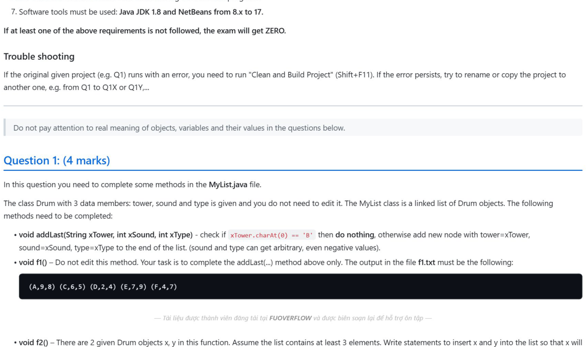

> **Nguyên văn đề bài (Question 1 - Tra cứu Ctrl+F):**
>
> Question 1: (4 marks)
> In this question you need to complete some methods in the MyList.java file.
> The class Drum with 3 data members: tower, sound and type is given and you do not need to edit it. The MyList class is a linked list of Drum objects. The following
> methods need to be completed:
> > - void addLast(String xTower, int xSound, int xType) - check if xTower. chant(Ø)
> 'B' then do nothing, otherwise add new node with tower=xTower,
> sound=xSound, type=xType to the end of the list. (sound and type can get arbitrary, even negative values).
> > - void fl() — Do not edit this method. Your task is to complete the addLast(...) method above only. The output in the file f1.txt must be the following:
> (A (C, 6, 5) (D, 2,4) (E, 7, 9) (F
> > - void f2() — There are 2 given Drum objects x, y in this function. Assume the list contains at least 3 elements. Write statements to insert x and y into the list so that x will
> be the 3rd node and y will be the 5th node. The output in the file f2.txt must be the following:
> (Y, 3.4) (1,4.9)
> > - void f3() — Suppose p is the first node having maximum sound and it is not the tail. Delete the node after p. The output in the file f3.txt must be the following:
> (D, 3.5) (1.7.3)
> > - void f4() — Assume the list contains at least 4 elements. Sort the last 4 elements in descending order by sound. The content of the output file f4.txt must be the
> following:
> (C, 1,2) (E, 2, 15) (1,6.14) (J, 11, 7) (K, 7,9)
> (C. 1, 2) (D,1e.3) (E, 2, 15) (K. 7.9) (1,6.14)

- **Đáp án mã nguồn Java hoàn chỉnh (Giữ format và comment gốc của Given):**
```java
/* This program contains 2 parts: (1) and (2)
   YOUR TASK IS TO COMPLETE THE PART  (2)  ONLY
 */
//(1)==============================================================
import java.util.*;
import java.io.*;
public class MyList {
  Node head,tail;
  MyList() {head=tail=null;}
  boolean isEmpty() {
    return(head==null);
   }
  void clear() {head=tail=null;}
  void fvisit(Node p, RandomAccessFile f) throws Exception {
    if(p != null) f.writeBytes(p.info + " ");
   }
  void ftraverse(RandomAccessFile f) throws Exception {
    Node p = head;
    while(p!=null) {
       fvisit(p,f);
       p=p.next;
      }
    f.writeBytes("\r\n");
   }
  void loadData(int k) {
    String [] a = Lib.readLineToStrArray("data.txt", k);
    int [] b = Lib.readLineToIntArray("data.txt", k+1);
    int [] c = Lib.readLineToIntArray("data.txt", k+2);
    int n = a.length;
    for(int i=0;i<n;i++) addLast(a[i],b[i],c[i]);
   }
//===========================================================================
//(2)===YOU CAN EDIT OR EVEN ADD NEW FUNCTIONS IN THE FOLLOWING PART========
//===========================================================================
/* 
   Khong su dung tieng Viet co dau de viet ghi chu.
   Neu dung khi chay truc tiep se bao loi va nhan 0 diem
*/
  void addLast(String xTower, int xSound, int xType) {
    //You should write here appropriate statements to complete this function.
   }
  //You do not need to edit this function. Your task is to complete the addLast function above only.
  void f1() throws Exception {
     clear();
     loadData(1);
     String fname = "f1.txt";
     File g123 = new File(fname);
     if(g123.exists()) g123.delete();
     RandomAccessFile  f = new RandomAccessFile(fname, "rw");
     ftraverse(f);
     f.close();
    }
  void f2() throws Exception {
     clear();
     loadData(5);
     String fname = "f2.txt";
     File g123 = new File(fname);
     if(g123.exists()) g123.delete();
     RandomAccessFile  f = new RandomAccessFile(fname, "rw");
     ftraverse(f);
     Drum x, y;
     x = new Drum("X",1,2);
     y = new Drum("Y",3,4);
     ftraverse(f);
     f.close();
    }
  void f3() throws Exception {
    clear();
    loadData(9);
    String fname = "f3.txt";
    File g123 = new File(fname);
    if(g123.exists()) g123.delete();
    RandomAccessFile  f = new RandomAccessFile(fname, "rw");
    ftraverse(f);
    ftraverse(f);
    f.close();
   }
  void f4() throws Exception {
    clear();
    loadData(13);
    String fname = "f4.txt";
    File g123 = new File(fname);
    if(g123.exists()) g123.delete();
    RandomAccessFile  f = new RandomAccessFile(fname, "rw");
    ftraverse(f);
    ftraverse(f);
    f.close();
   }
 }
```

- **Kết quả kiểm chứng thực tế:**
  - `f1.txt`: `EMPTY`
  - `f4.txt`: `EMPTY`

##### [Question 2] Cây nhị phân tìm kiếm (BSTree.java)
- **Mã nguồn giải:** [solutions/2026/sp26_b5_p4\Q2\src\BSTree.java](./solutions/2026/sp26_b5_p4\Q2\src\BSTree.java)

- **Hình ảnh trích xuất đề bài Question 2 từ đề gốc:**

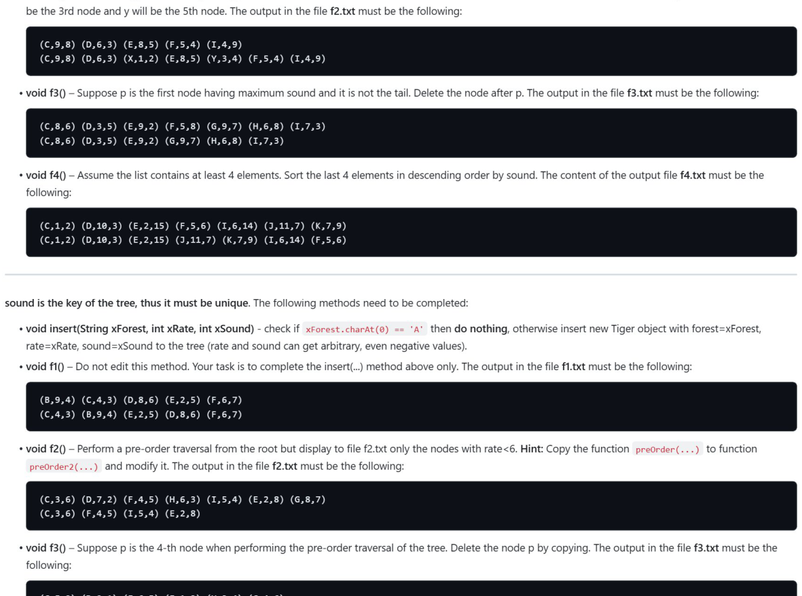

> **Nguyên văn đề bài (Question 2 - Tra cứu Ctrl+F):**
>
> Question 2: (4 marks)
> In this question you need to complete some methods in the BSTree.java file.
> The class Tiger with 3 data members: forest, rate and sound is given and you do not need to edit it. The BSTree class is a binary search tree of Tiger objects. The variable
> sound is the key of the tree, thus it must be unique. The following methods need to be completed:
> > - void insert(String xForest, int xRate, int xSound) - check if '(Forest. charAt(0)
> 'A' then do nothing, othemise insert new Tiger object with forest—xForest,
> rate=xRate, sound=xSound to the tree (rate and sound can get arbitrary, even negative values).
> > - void fl() — Do not edit this method. Your task is to complete the insert(...) method above only. The output in the file f1.txt must be the following:
> (E, 2,5)
> > - void f2() — Perform a pre-order traversal from the root but display to file f2.txt only the nodes with rate<6. Hint: Copy the function preorder(.
> .. ) and modify it. The output in the file f2.txt must be the following:
> preorder2( .
> (E, 2,8)
> ) to function
> > - void f3() — Suppose p is the 4-th node when performing the pre-order traversal of the tree. Delete the node p by copying. The output in the file f3.txt must be the
> following:
> (D, 2.1) (F, 1,3) (H, 3,4)
> > - void f4() — Suppose p is the 4-th node when performing the pre-order traversal of the tree. Check whether p has a right son; if so, rotate it to the left about its' right
> son. The output in the file f4.txt must be the following:
> (F, 1,3)
> (H, 3,4)

- **Đáp án mã nguồn Java hoàn chỉnh (Giữ format và comment gốc của Given):**
```java
/* This program contains 2 parts: (1) and (2)
   YOUR TASK IS TO COMPLETE THE PART  (2)  ONLY
 */
//(1)==============================================================
import java.io.*;
import java.util.*;
public class BSTree {
   Node root;
   BSTree() {root=null;}
   boolean isEmpty() {
       return(root==null);
      }
   void clear() {
       root=null;
      }
   void visit(Node p) {
      System.out.print("p.info: ");
      if(p != null) System.out.println(p.info + " ");
     }
   void fvisit(Node p, RandomAccessFile f) throws Exception {
      if(p != null) f.writeBytes(p.info + " ");
     }
   void breadth(Node p, RandomAccessFile f) throws Exception {
     if(p==null) return;
     Queue q = new Queue();
     q.enqueue(p);Node r;
     while(!q.isEmpty()) {
        r = q.dequeue();
        fvisit(r,f);
        if(r.left!=null) q.enqueue(r.left);
        if(r.right!=null) q.enqueue(r.right);
       }
    }
   void preOrder(Node p, RandomAccessFile f) throws Exception {
      if(p==null) return;
      fvisit(p,f);
      preOrder(p.left,f);
      preOrder(p.right,f);
     }
   void inOrder(Node p, RandomAccessFile f) throws Exception {
      if(p==null) return;
      inOrder(p.left,f);
      fvisit(p,f);
      inOrder(p.right,f);
     }
   void postOrder(Node p, RandomAccessFile f) throws Exception {
      if(p==null) return;
      postOrder(p.left,f);
      postOrder(p.right,f);
      fvisit(p,f);
     }
   void loadData(int k) {
      String [] a = Lib.readLineToStrArray("data.txt", k);
      int [] b = Lib.readLineToIntArray("data.txt", k+1);
      int [] c = Lib.readLineToIntArray("data.txt", k+2);
      int n = a.length;
      for(int i=0;i<n;i++) insert(a[i],b[i],c[i]);
     }
//===========================================================================
//(2)===YOU CAN EDIT OR EVEN ADD NEW FUNCTIONS IN THE FOLLOWING PART========
//===========================================================================
/* 
   Khong su dung tieng Viet co dau de viet ghi chu.
   Neu dung khi chay truc tiep se bao loi va nhan 0 diem
*/
  void insert(String xForest, int xRate, int xSound) {
    //You should insert here statements to complete this function
   }
//Do not edit this function. Your task is to complete insert function above only.
  void f1() throws Exception {
    clear();
    loadData(1);
    String fname = "f1.txt";
    File g123 = new File(fname);
    if(g123.exists()) g123.delete();
    RandomAccessFile  f = new RandomAccessFile(fname, "rw");
    breadth(root,f);
    f.writeBytes("\r\n");
    inOrder(root,f);
    f.writeBytes("\r\n");
    f.close();
   }
  void f2() throws Exception {
    clear();
    loadData(5);
    String fname = "f2.txt";
    File g123 = new File(fname);
    if(g123.exists()) g123.delete();
    RandomAccessFile  f = new RandomAccessFile(fname, "rw");
    preOrder(root,f);
    f.writeBytes("\r\n");
    f.writeBytes("\r\n");
    f.close();
   }
  void f3() throws Exception {
    clear();
    loadData(9);
    String fname = "f3.txt";
    File g123 = new File(fname);
    if(g123.exists()) g123.delete();
    RandomAccessFile  f = new RandomAccessFile(fname, "rw");
    preOrder(root,f);
    f.writeBytes("\r\n");
    preOrder(root,f);
    f.writeBytes("\r\n");
    f.close();
   }
  void f4() throws Exception {
    clear();
    loadData(13);;
    String fname = "f4.txt";
    File g123 = new File(fname);
    if(g123.exists()) g123.delete();
    RandomAccessFile  f = new RandomAccessFile(fname, "rw");
    preOrder(root,f);
    f.writeBytes("\r\n");
    preOrder(root,f);
    f.writeBytes("\r\n");
    f.close();
   }
 }
```

##### [Question 3] Đồ thị (Graph.java)
- **Mã nguồn giải:** [solutions/2026/sp26_b5_p4\Q3\src\Graph.java](./solutions/2026/sp26_b5_p4\Q3\src\Graph.java)

- **Hình ảnh trích xuất đề bài Question 3 từ đề gốc:**

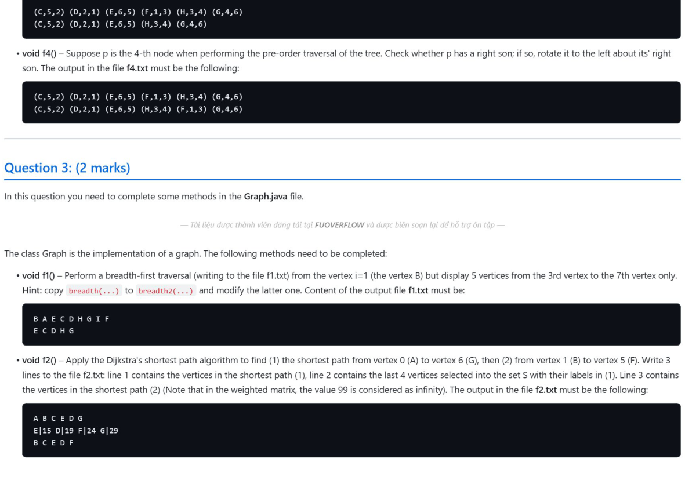

> **Nguyên văn đề bài (Question 3 - Tra cứu Ctrl+F):**
>
> Question 3: (2 marks)
> In this question you need to complete some methods in the Graph.java file.
> The class Graph is the implementation of a graph. The following methods need to be completed:
> > - void fl() — Perform a breadth-first traversal (writing to the file f1.txt) from the vertex (the vertex B) but display 5 vertices from the 3rd vertex to the 7th vertex only.
> Hint: copy breadth( ) to breadth2(.
> ) and modify the latter one. Content of the output file f1.txt must be:
> BAECDHGIF
> > - void f2() — Apply the Dijkstra's shortest path algorithm to find (1) the shortest path from vertex O (A) to vertex 6 (G), then (2) from vertex I (B) to vertex 5 (F). Write 3
> lines to the file f2.txt: line 1 contains the vertices in the shortest path (1), line 2 contains the last 4 vertices selected into the set S with their labels in (1). Line 3 contains
> the vertices in the shortest path (2) (Note that in the weighted matrix, the value 99 is considered as infinity). The output in the file f2.txt must be the following:
> ABC EDG
> E115 D119 F124 6129
> BCE DF

- **Đáp án mã nguồn Java hoàn chỉnh (Giữ format và comment gốc của Given):**
```java
/* This program contains 2 parts: (1) and (2)
   YOUR TASK IS TO COMPLETE THE PART  (2)  ONLY
 */
//(1)==============================================================
import java.io.*;
import java.util.*;
public class Graph {
  int [][] a; int n;
  char v[];
  int deg[];
  Graph() {
    v = "ABCDEFGHIJKLMNOP".toCharArray();
    deg = new int[20];
    a = new int[20][20];
    n = 0;
   }
  void loadData(int k) {
    RandomAccessFile f;int i,j,x;
    String s;StringTokenizer t;
    a = new int[20][20];
    try {
     f = new RandomAccessFile("data.txt","r");
     for(i=0;i<k;i++) f.readLine();
     s = f.readLine();s = s.trim();
     n = Integer.parseInt(s);
     for(i=0;i<n;i++) {
       s = f.readLine();s = s.trim();
       t = new StringTokenizer(s);
       for(j=0;j<n;j++) {
         x = Integer.parseInt(t.nextToken().trim());
         a[i][j] = x;
        }
       }
     f.close();
     }
    catch(Exception e) {}
   }
  void dispAdj() {
    int i,j;
    for(i=0;i<n;i++) {
      System.out.println();
      for(j=0;j<n;j++)
        System.out.printf("%4d",a[i][j]);
     }
   }
  void fvisit(int i, RandomAccessFile f) throws Exception {
    f.writeBytes("  "+v[i]);
   }
 void fdispAdj(RandomAccessFile f) throws Exception {
    int i,j;
    f.writeBytes("n = "+n+"\r\n");
    for(i=0;i<n;i++) {
      f.writeBytes("\r\n");
      for(j=0;j<n;j++)  f.writeBytes("  " + a[i][j]);
     }
    f.writeBytes("\r\n");
   }
  void breadth(boolean [] en, int i, RandomAccessFile f) throws Exception {
    Queue q = new Queue();
    int r,j;
    q.enqueue(i); en[i]=true;
    while(!q.isEmpty()) {
      r = q.dequeue();
      fvisit(r,f);
      for(j=0;j<n;j++) {
        if(!en[j] && a[r][j]>0) {
         q.enqueue(j);en[j]=true;
        }
       }
     }
   }
  void breadth(int  k, RandomAccessFile f) throws Exception {
    boolean [] en = new boolean[20];
    int i;
    for(i=0;i<n;i++) en[i]=false;
    breadth(en,k,f);
    for(i=0;i<n;i++)
      if(!en[i]) breadth(en,i,f);
   }
 void depth(boolean [] visited,int k, RandomAccessFile f) throws Exception {
    fvisit(k,f);visited[k]=true;
    for(int i=0;i<n;i++) {
      if(!visited[i] && a[k][i]>0) depth(visited,i,f);
     }
   }
  void depth(int k, RandomAccessFile f) throws Exception {
    boolean [] visited = new boolean[20];
    int i;
    for(i=0;i<n;i++) visited[i]=false;
    depth(visited,k,f);
    for(i=0;i<n;i++)
       if(!visited[i]) depth(visited,i,f);
   }
//===========================================================================
//(2)===YOU CAN EDIT OR EVEN ADD NEW FUNCTIONS IN THE FOLLOWING PART========
//===========================================================================
/* 
   Khong su dung tieng Viet co dau de viet ghi chu.
   Neu dung khi chay truc tiep se bao loi va nhan 0 diem
*/
  void f1() throws Exception {
    loadData(1);
    String fname = "f1.txt";
    File g123 = new File(fname);
    if(g123.exists()) g123.delete();
    RandomAccessFile  f = new RandomAccessFile(fname, "rw");
    breadth(1,f);
    f.writeBytes("\r\n");
    f.writeBytes("\r\n");
    f.close();
   }
  void f2() throws Exception {
    loadData(12);
    String fname = "f2.txt";
    File g123 = new File(fname);
    if(g123.exists()) g123.delete();
    RandomAccessFile  f = new RandomAccessFile(fname, "rw");
    f.writeBytes("\r\n");
    f.writeBytes("\r\n");
    f.close();
   }
}
```

---

#### 6.3.2. Đề thi: CSD201 - SP26 - PE - 6
- **Thư mục lưu trữ mã nguồn:** [solutions/2026/sp26_pe_6](./solutions/2026/sp26_pe_6/)
- **Thư mục tài liệu gốc:** `CSD201 - SP26 - PE - 6`

##### [Question 1] Danh sách liên kết đơn (MyList.java)
- **Mã nguồn giải:** [solutions/2026/sp26_pe_6\Q1\src\MyList.java](./solutions/2026/sp26_pe_6\Q1\src\MyList.java)

- **Hình ảnh trích xuất đề bài Question 1 từ đề gốc:**

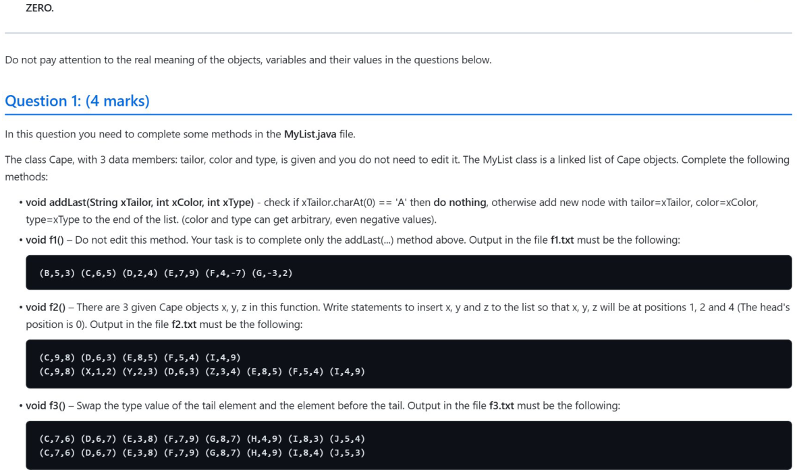

> **Nguyên văn đề bài (Question 1 - Tra cứu Ctrl+F):**
>
> Question 1: (4 marks)
> In this question you need to complete some methods in the MyList.java file.
> The class Cape, with 3 data members: tailor, color and type, is given and you do not need to edit it. The MyList class is a linked list of Cape objects. Complete the following
> methods:
> > - void addLast(String xTailor, int xColor, int xType) - check if xTailor.charAt(0) 'A' then do nothing, othervvise add new node with tailor=xTailor, color=xColor,
> type=xType to the end of the list. (color and type can get arbitrary, even negative values).
> > - void fl() — Do not edit this method. Your task is to complete only the addLast(...) method above. Output in the file f1.txt must be the following:
> (E, 7,9) (G, -3, 2)
> > - void f2() — There are 3 given Cape objects x, y, z in this function. Write statements to insert x, y and z to the list so that x, y, z will be at positions 1, 2 and 4 (The head's
> position is O). Output in the file f2.txt must be the following:
> (Y (F,5.4)
> > - void f3() — Swap the type value of the tail element and the element before the tail. Output in the file f3.txt must be the following:
> (C, 7,6) (F, 7,9) (J, 5.4)
> (C. 7,6) (F, 7,9) (G,8.7) (1.8,4) (3,5.3)
> - Täi lieu dtrgc thänh vién dong tåi tqi FIJOVERFLOW vd difgc bién soon Iqi dé hö tra ön top
> > - void f4() — Find the first node p having tailor = K. Sort 5 elements just before p ascendingly by type. The content of the output file f4.txt must be the following:
> (D, 11,12) (K (L
> (F,1.2) (D, 11,12) (1.7,9) (L.9,8)

- **Đáp án mã nguồn Java hoàn chỉnh (Giữ format và comment gốc của Given):**
```java
/* This program contains 2 parts: (1) and (2)
   YOUR TASK IS TO COMPLETE THE PART  (2)  ONLY
 */
//(1)==============================================================
import java.util.*;
import java.io.*;
public class MyList {
  Node head,tail;
  MyList() {head=tail=null;}
  boolean isEmpty() {
    return(head==null);
   }
  void clear() {head=tail=null;}
  void fvisit(Node p, RandomAccessFile f) throws Exception {
    if(p != null) f.writeBytes(p.info + " ");
   }
  void ftraverse(RandomAccessFile f) throws Exception {
    Node p = head;
    while(p!=null) {
       fvisit(p,f);
       p=p.next;
      }
    f.writeBytes("\r\n");
   }
  void loadData(int k) {
    String [] a = Lib.readLineToStrArray("data.txt", k);
    int [] b = Lib.readLineToIntArray("data.txt", k+1);
    int [] c = Lib.readLineToIntArray("data.txt", k+2);
    int n = a.length;
    for(int i=0;i<n;i++) addLast(a[i],b[i],c[i]);
   }
//===========================================================================
//(2)===YOU CAN EDIT OR EVEN ADD NEW FUNCTIONS IN THE FOLLOWING PART========
//===========================================================================
/* 
   Khong su dung tieng Viet co dau de viet ghi chu.
   Neu dung khi chay truc tiep se bao loi va nhan 0 diem
*/
  void addLast(String xTailor, int xColor, int xType) {
    //You should write here appropriate statements to complete this function.
   }
  //You do not need to edit this function. Your task is to complete the addLast function above only.
  void f1() throws Exception {
     clear();
     loadData(1);
     String fname = "f1.txt";
     File g123 = new File(fname);
     if(g123.exists()) g123.delete();
     RandomAccessFile  f = new RandomAccessFile(fname, "rw");
     ftraverse(f);
     f.close();
    }
  void f2() throws Exception {
     clear();
     loadData(5);
     String fname = "f2.txt";
     File g123 = new File(fname);
     if(g123.exists()) g123.delete();
     RandomAccessFile  f = new RandomAccessFile(fname, "rw");
     ftraverse(f);
     Cape x, y, z;
     x = new Cape("X",1,2);
     y = new Cape("Y",2,3);
     z = new Cape("Z",3,4);
     ftraverse(f);
     f.close();
    }
  void f3() throws Exception {
    clear();
    loadData(9);
    String fname = "f3.txt";
    File g123 = new File(fname);
    if(g123.exists()) g123.delete();
    RandomAccessFile  f = new RandomAccessFile(fname, "rw");
    ftraverse(f);
    ftraverse(f);
    f.close();
  }
  void f4() throws Exception {
    clear();
    loadData(13);
    String fname = "f4.txt";
    File g123 = new File(fname);
    if(g123.exists()) g123.delete();
    RandomAccessFile  f = new RandomAccessFile(fname, "rw");
    ftraverse(f);
    ftraverse(f);
    f.close();
   }
 }
```

- **Kết quả kiểm chứng thực tế:**
  - `f1.txt`: `EMPTY`

##### [Question 2] Cây nhị phân tìm kiếm (BSTree.java)
- **Mã nguồn giải:** [solutions/2026/sp26_pe_6\Q2\src\BSTree.java](./solutions/2026/sp26_pe_6\Q2\src\BSTree.java)

- **Hình ảnh trích xuất đề bài Question 2 từ đề gốc:**

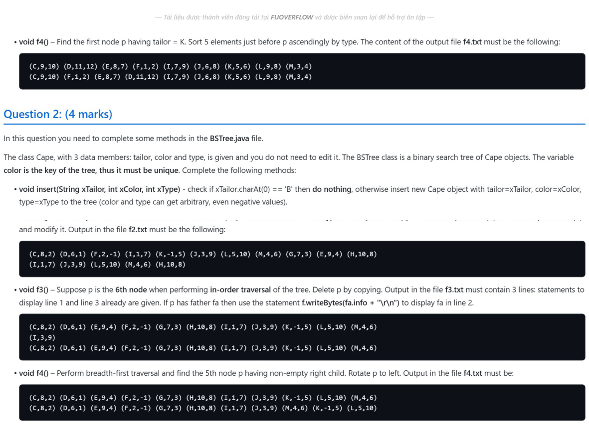

> **Nguyên văn đề bài (Question 2 - Tra cứu Ctrl+F):**
>
> Question 2: (4 marks)
> In this question you need to complete some methods in the BSTree.java file.
> The class Cape, with 3 data members: tailor, color and type, is given and you do not need to edit it. The BSTree class is a binary search tree of Cape objects. The variable
> color is the key of the tree, thus it must be unique. Complete the following methods:
> > - void insert(String xTaiIor, int xColor, int xType) - check if xTailor.charAt(0)
> 'B' then do nothing, otherwise insert new Cape object With tailor=xTailor, color=xColor,
> type=xType to the tree (color and type can get arbitrary, even negative values).
> > - void fl() — Do not edit this method. Your task is to complete only the insert(...) method above. Output in the file f1.txt must be the following:
> (A, 7,9) (E, 2, 5) (F, -6.7) (Y,6, -7)
> (F. -6, 7) (E,2.5) (Y.6,-7) (A. 7.9) (D,8.6)
> > - void f2() — Perform pre-order traversal from the root but display to file f2.txt nodes with type > 5 only. Hint: Copy the function to function preOrder2(...)
> and modify it. Output in the file f2.txt must be the following:
> (F,2,-1) (G, 7,3)
> > - void f3() — Suppose p is the 6th node when performing in-order traversal of the tree. Delete p by copying. Output in the file f3.txt must contain 3 lines: statements to
> display line 1 and line 3 already are given. If p has father fa then use the statement f.writeBytes(fa.info + "\r\n") to display fa in line 2.
> (F, 2, -1) (G, 7.3) (H,1e.8) (J, 3,9) (K, -1,5)
> (F, 2, -1) (G,7.3) (1.1, 7) (K, -1,5)
> > - void f4() — Perform breadth-first traversal and find the 5th node p having non-empty right child. Rotate p to left. Output in the file f4.txt must be:
> (F, 2, -1) (K, -1,5)
> (F, 2, -1) (G, 7.3) (H,1e.8) (J, 3,9) (K, -1,5) (L.5,1e)

- **Đáp án mã nguồn Java hoàn chỉnh (Giữ format và comment gốc của Given):**
```java
/* This program contains 2 parts: (1) and (2)
   YOUR TASK IS TO COMPLETE THE PART  (2)  ONLY
 */
//(1)==============================================================
import java.io.*;
import java.util.*;
public class BSTree {
   Node root;
   BSTree() {root=null;}
   boolean isEmpty() {
       return(root==null);
      }
   void clear() {
       root=null;
      }
   void visit(Node p) {
      System.out.print("p.info: ");
      if(p != null) System.out.println(p.info + " ");
     }
   void fvisit(Node p, RandomAccessFile f) throws Exception {
      if(p != null) f.writeBytes(p.info + " ");
     }
   void breadth(Node p, RandomAccessFile f) throws Exception {
     if(p==null) return;
     Queue q = new Queue();
     q.enqueue(p);Node r;
     while(!q.isEmpty()) {
        r = q.dequeue();
        fvisit(r,f);
        if(r.left!=null) q.enqueue(r.left);
        if(r.right!=null) q.enqueue(r.right);
       }
    }
   void preOrder(Node p, RandomAccessFile f) throws Exception {
      if(p==null) return;
      fvisit(p,f);
      preOrder(p.left,f);
      preOrder(p.right,f);
     }
   void inOrder(Node p, RandomAccessFile f) throws Exception {
      if(p==null) return;
      inOrder(p.left,f);
      fvisit(p,f);
      inOrder(p.right,f);
     }
   void postOrder(Node p, RandomAccessFile f) throws Exception {
      if(p==null) return;
      postOrder(p.left,f);
      postOrder(p.right,f);
      fvisit(p,f);
     }
   void loadData(int k) {
      String [] a = Lib.readLineToStrArray("data.txt", k);
      int [] b = Lib.readLineToIntArray("data.txt", k+1);
      int [] c = Lib.readLineToIntArray("data.txt", k+2);
      int n = a.length;
      for(int i=0;i<n;i++) insert(a[i],b[i],c[i]);
     }
//===========================================================================
//(2)===YOU CAN EDIT OR EVEN ADD NEW FUNCTIONS IN THE FOLLOWING PART========
//===========================================================================
/* 
   Khong su dung tieng Viet co dau de viet ghi chu.
   Neu dung khi chay truc tiep se bao loi va nhan 0 diem
*/
  void insert(String xTailor, int xColor, int xType) {
    //You should insert here statements to complete this function
   }
//Do not edit this function. Your task is to complete insert function above only.
  void f1() throws Exception {
    clear();
    loadData(1);
    String fname = "f1.txt";
    File g123 = new File(fname);
    if(g123.exists()) g123.delete();
    RandomAccessFile  f = new RandomAccessFile(fname, "rw");
    breadth(root,f);
    f.writeBytes("\r\n");
    inOrder(root,f);
    f.writeBytes("\r\n");
    f.close();
   }
 void f2() throws Exception {
    clear();
    loadData(5);
    String fname = "f2.txt";
    File g123 = new File(fname);
    if(g123.exists()) g123.delete();
    RandomAccessFile  f = new RandomAccessFile(fname, "rw");
    preOrder(root,f);
    f.writeBytes("\r\n");
    f.writeBytes("\r\n");
    f.close();
   }
 void f3() throws Exception {
    clear();
    loadData(9);
    String fname = "f3.txt";
    File g123 = new File(fname);
    if(g123.exists()) g123.delete();
    RandomAccessFile  f = new RandomAccessFile(fname, "rw");
    breadth(root,f);
    f.writeBytes("\r\n");
    breadth(root,f);
    f.writeBytes("\r\n");
    f.close();
   }
 void f4() throws Exception {
    clear();
    loadData(13);;
    String fname = "f4.txt";
    File g123 = new File(fname);
    if(g123.exists()) g123.delete();
    RandomAccessFile  f = new RandomAccessFile(fname, "rw");
    breadth(root,f);
    f.writeBytes("\r\n");
    breadth(root,f);
    f.writeBytes("\r\n");
    f.close();
   }
 }
```

- **Kết quả kiểm chứng thực tế:**
  - `f1.txt`: `EMPTY`

##### [Question 3] Đồ thị (Graph.java)
- **Mã nguồn giải:** [solutions/2026/sp26_pe_6\Q3\src\Graph.java](./solutions/2026/sp26_pe_6\Q3\src\Graph.java)

- **Hình ảnh trích xuất đề bài Question 3 từ đề gốc:**

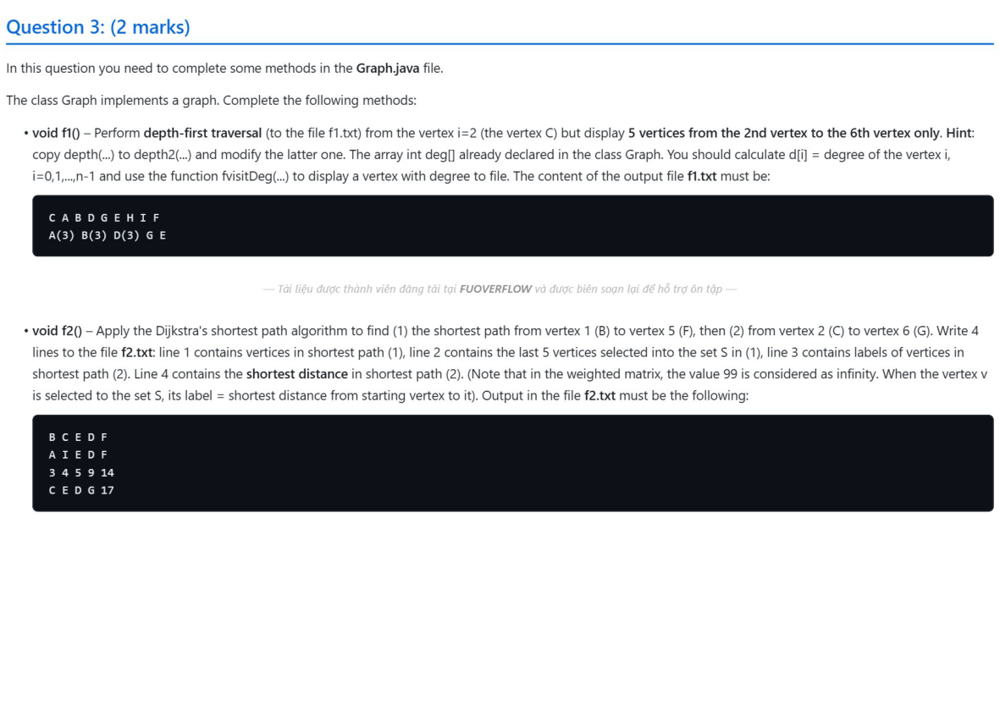

> **Nguyên văn đề bài (Question 3 - Tra cứu Ctrl+F):**
>
> Question 3: (2 marks)
> In this question you need to complete some methods in the Graph.java file.
> The class Graph implements a graph. Complete the following methods:
> > - void fl() — Perform depth-first traversal (to the file f1.txt) from the vertex i=2 (the vertex C) but display 5 vertices from the 2nd vertex to the 6th vertex only. Hint:
> copy depth(...) to depth2(.„) and modify the latter one. The array int dego already declared in the class Graph. You should calculate d[i] = degree of the vertex i,
> i=O, and use the function fvisitDeg(...) to display a vertex with degree to file. The content of the output file f1.txt must be:
> CABDGEHIF
> A(3) B(3) D(3) G E
> > - void f2() — Apply the Dijkstra's shortest path algorithm to find (1) the shortest path from vertex 1 (B) to vertex 5 (F), then (2) from vertex 2 (C) to vertex 6 (G). Write 4
> lines to the file f2.txt: line 1 contains vertices in shortest path (1), line 2 contains the last 5 vertices selected into the set S in (1), line 3 contains labels of vertices in
> shortest path (2). Line 4 contains the shortest distance in shortest path (2). (Note that in the weighted matrix, the value 99 is considered as infinity. When the vertex v
> is selected to the set S, its label = shortest distance from starting vertex to it). Output in the file f2.txt must be the following:
> B
> A
> 3
> c
> c
> 1
> 4
> E
> D
> D G 17
> E
> E
> 5
> 9 14

- **Đáp án mã nguồn Java hoàn chỉnh (Giữ format và comment gốc của Given):**
```java
/* This program contains 2 parts: (1) and (2)
   YOUR TASK IS TO COMPLETE THE PART  (2)  ONLY
 */
//(1)==============================================================
import java.io.*;
import java.util.*;
public class Graph {
  int [][] a; int n;
  char v[];
  int deg[];
  Graph() {
    v = "ABCDEFGHIJKLMNOP".toCharArray();
    deg = new int[20];
    a = new int[20][20];
    n = 0;
   }
  void loadData(int k) {
    RandomAccessFile f;int i,j,x;
    String s;StringTokenizer t;
    a = new int[20][20];
    try {
     f = new RandomAccessFile("data.txt","r");
     for(i=0;i<k;i++) f.readLine();
     s = f.readLine();s = s.trim();
     n = Integer.parseInt(s);
     for(i=0;i<n;i++) {
       s = f.readLine();s = s.trim();
       t = new StringTokenizer(s);
       for(j=0;j<n;j++) {
         x = Integer.parseInt(t.nextToken().trim());
         a[i][j] = x;
        }
       }
     f.close();
     }
    catch(Exception e) {}
   }
  void dispAdj() {
    int i,j;
    for(i=0;i<n;i++) {
      System.out.println();
      for(j=0;j<n;j++)
        System.out.printf("%4d",a[i][j]);
     }
   }
  void fvisit(int i, RandomAccessFile f) throws Exception {
    f.writeBytes("  "+v[i]);
   }
  void fvisitDeg(int i, RandomAccessFile f) throws Exception {
    f.writeBytes("  "+v[i]+"("+deg[i]+")");
   }
 void fdispAdj(RandomAccessFile f) throws Exception {
    int i,j;
    f.writeBytes("n = "+n+"\r\n");
    for(i=0;i<n;i++) {
      f.writeBytes("\r\n");
      for(j=0;j<n;j++)  f.writeBytes("  " + a[i][j]);
     }
    f.writeBytes("\r\n");
   }
  void breadth(boolean [] en, int i, RandomAccessFile f) throws Exception {
    Queue q = new Queue();
    int r,j;
    q.enqueue(i); en[i]=true;
    while(!q.isEmpty()) {
      r = q.dequeue();
      fvisit(r,f);
      for(j=0;j<n;j++) {
        if(!en[j] && a[r][j]>0) {
         q.enqueue(j);en[j]=true;
        }
       }
     }
   }
  void breadth(int  k, RandomAccessFile f) throws Exception {
    boolean [] en = new boolean[20];
    int i;
    for(i=0;i<n;i++) en[i]=false;
    breadth(en,k,f);
    for(i=0;i<n;i++)
      if(!en[i]) breadth(en,i,f);
   }
 void depth(boolean [] visited,int k, RandomAccessFile f) throws Exception {
    fvisit(k,f);visited[k]=true;
    for(int i=0;i<n;i++) {
      if(!visited[i] && a[k][i]>0) depth(visited,i,f);
     }
   }
  void depth(int k, RandomAccessFile f) throws Exception {
    boolean [] visited = new boolean[20];
    int i;
    for(i=0;i<n;i++) visited[i]=false;
    depth(visited,k,f);
    for(i=0;i<n;i++)
       if(!visited[i]) depth(visited,i,f);
   }
//===========================================================================
//(2)===YOU CAN EDIT OR EVEN ADD NEW FUNCTIONS IN THE FOLLOWING PART========
//===========================================================================
/* 
   Khong su dung tieng Viet co dau de viet ghi chu.
   Neu dung khi chay truc tiep se bao loi va nhan 0 diem
*/
  void f1() throws Exception {
    loadData(1);
    String fname = "f1.txt";
    File g123 = new File(fname);
    if(g123.exists()) g123.delete();
    RandomAccessFile  f = new RandomAccessFile(fname, "rw");
    depth(2,f);
    f.writeBytes("\r\n");
    f.writeBytes("\r\n");
    f.close();
   }
  void f2() throws Exception {
    loadData(12);
    String fname = "f2.txt";
    File g123 = new File(fname);
    if(g123.exists()) g123.delete();
    RandomAccessFile  f = new RandomAccessFile(fname, "rw");
    f.writeBytes("\r\n");
    f.close();
   }
}
```

- **Kết quả kiểm chứng thực tế:**
  - `f1.txt`: `C  A  B  D  G  E  H  I  F`
  - `f2.txt`: `EMPTY`

---

#### 6.3.3. Đề thi: CSD201 - SU26 - B1 - PE - Paper 2
- **Thư mục lưu trữ mã nguồn:** [solutions/2026/su26_b1_p2](./solutions/2026/su26_b1_p2/)
- **Thư mục tài liệu gốc:** `CSD201 - SU26 - B1 - PE - Paper 2`

##### [Question 1] Danh sách liên kết đơn (MyList.java)
- **Mã nguồn giải:** [solutions/2026/su26_b1_p2\Q1\src\MyList.java](./solutions/2026/su26_b1_p2\Q1\src\MyList.java)

- **Hình ảnh trích xuất đề bài Question 1 từ đề gốc:**

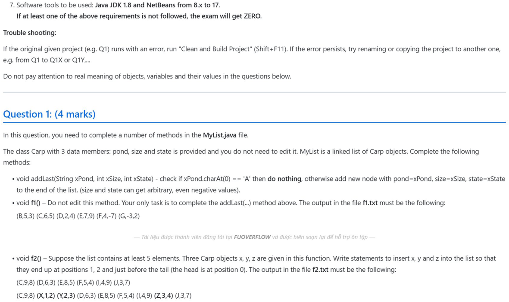

> **Nguyên văn đề bài (Question 1 - Tra cứu Ctrl+F):**
>
> Question 1: (4 marks)
> In this question, you need to complete a number of methods in the MyList.java file.
> The class Carp with 3 data members: pond, size and state is provided and you do not need to edit it. MyList is a linked list of Carp objects. Complete the following
> methods:
> > - void addLast(String xPond, int xSize, int xState) - check if xPond.charAt(0) 'A' then do nothing, otherwise add new node with pond=xPond, size=xSize, state=xState
> to the end of the list. (size and state can get arbitrary, even negative values).
> > - void fl() — Do not edit this method. Your only task is to complete the addLast(...) method above. The output in the file f1.txt must be the following:
> > - void f2() — Suppose the list contains at least 5 elements. Three Carp objects x, y, z are given in this function. Write statements to insert x, y and z into the list so that
> they end up at positions 1, 2 and just before the tail (the head is at position 0). The output in the file f2.txt must be the following:
> (Y,2,3) (E8,5)
> > - void f3() — Suppose the list is not empty. Find the (first) node having the maximum state and change its size to 77. The output in the file f3.txt must be the following:
> (G,8,7) (H,4,9)
> > - void f4() — Suppose the list contains only one element p with pond = D and one element q with pond = K. Reverse the elements from p to q. The content of the
> output file f4.txt must be the following:
> (F,1,2) (E8,7) (M,3A)

- **Đáp án mã nguồn Java hoàn chỉnh (Giữ format và comment gốc của Given):**
```java
/* This program contains 2 parts: (1) and (2)
   YOUR TASK IS TO COMPLETE THE PART  (2)  ONLY
 */
//(1)==============================================================
import java.util.*;
import java.io.*;
public class MyList {
  Node head,tail;
  MyList() {head=tail=null;}
  boolean isEmpty() {
    return(head==null);
   }
  void clear() {head=tail=null;}
  void fvisit(Node p, RandomAccessFile f) throws Exception {
    if(p != null) f.writeBytes(p.info + " ");
   }
  void ftraverse(RandomAccessFile f) throws Exception {
    Node p = head;
    while(p!=null) {
       fvisit(p,f);
       p=p.next;
      }
    f.writeBytes("\r\n");
   }
  void loadData(int k) {
    String [] a = Lib.readLineToStrArray("data.txt", k);
    int [] b = Lib.readLineToIntArray("data.txt", k+1);
    int [] c = Lib.readLineToIntArray("data.txt", k+2);
    int n = a.length;
    for(int i=0;i<n;i++) addLast(a[i],b[i],c[i]);
   }
//===========================================================================
//(2)===YOU CAN EDIT OR EVEN ADD NEW FUNCTIONS IN THE FOLLOWING PART========
//===========================================================================
/* 
   Khong su dung tieng Viet co dau de viet ghi chu.
   Neu dung khi chay truc tiep se bao loi va nhan 0 diem
*/
  void addLast(String xPond, int xSize, int xState) {
    //You should write here appropriate statements to complete this function.
   }
  //You do not need to edit this function. Your task is to complete the addLast function above only.
  void f1() throws Exception {
     clear();
     loadData(1);
     String fname = "f1.txt";
     File g123 = new File(fname);
     if(g123.exists()) g123.delete();
     RandomAccessFile  f = new RandomAccessFile(fname, "rw");
     ftraverse(f);
     f.close();
    }
  void f2() throws Exception {
     clear();
     loadData(5);
     String fname = "f2.txt";
     File g123 = new File(fname);
     if(g123.exists()) g123.delete();
     RandomAccessFile  f = new RandomAccessFile(fname, "rw");
     ftraverse(f);
     Carp x, y, z;
     x = new Carp("X",1,2);
     y = new Carp("Y",2,3);
     z = new Carp("Z",3,4);
     ftraverse(f);
     f.close();
    }
  void f3() throws Exception {
    clear();
    loadData(9);
    String fname = "f3.txt";
    File g123 = new File(fname);
    if(g123.exists()) g123.delete();
    RandomAccessFile  f = new RandomAccessFile(fname, "rw");
    ftraverse(f);
    ftraverse(f);
    f.close();
  }
  void f4() throws Exception {
    clear();
    loadData(13);
    String fname = "f4.txt";
    File g123 = new File(fname);
    if(g123.exists()) g123.delete();
    RandomAccessFile  f = new RandomAccessFile(fname, "rw");
    ftraverse(f);
    ftraverse(f);
    f.close();
   }
 }
```

##### [Question 2] Cây nhị phân tìm kiếm (BSTree.java)
- **Mã nguồn giải:** [solutions/2026/su26_b1_p2\Q2\src\BSTree.java](./solutions/2026/su26_b1_p2\Q2\src\BSTree.java)

- **Hình ảnh trích xuất đề bài Question 2 từ đề gốc:**

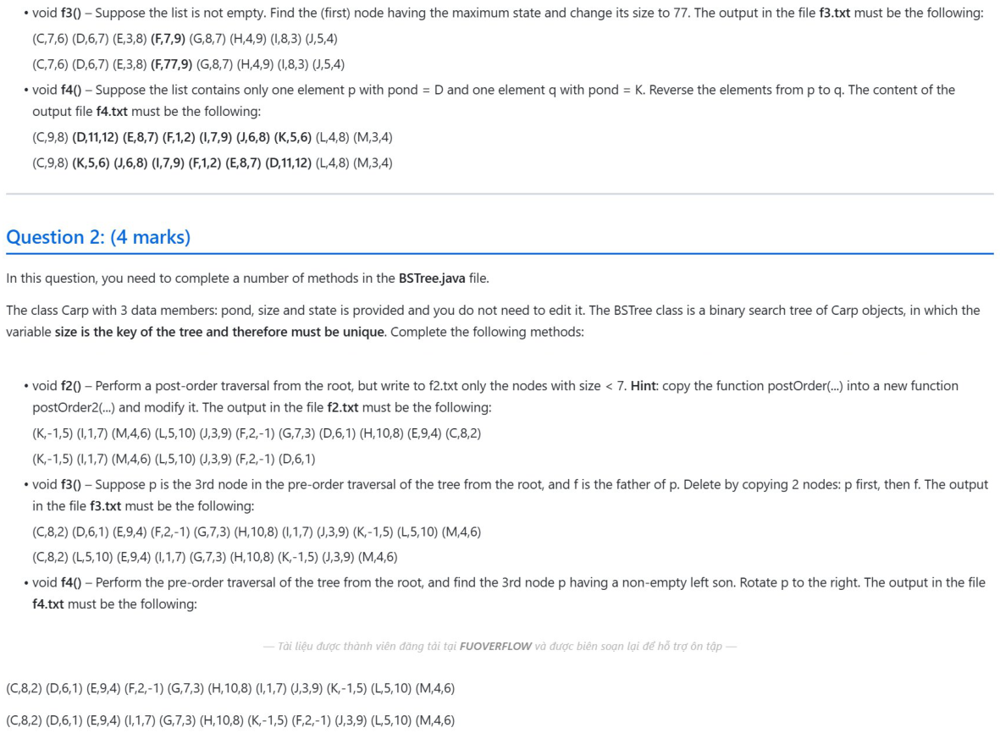

> **Nguyên văn đề bài (Question 2 - Tra cứu Ctrl+F):**
>
> Question 2: (4 marks)
> In this question, you need to complete a number of methods in the BSTree.java file.
> The class Carp with 3 data members: pond, size and state is provided and you do not need to edit it. The BSTree class is a binary search tree of Carp objects, in which the
> variable size is the key of the tree and therefore must be unique. Complete the following methods:
> > - void insert(String xPond, int xSize, int xState)- check if xPond.charAt(0) 'B' then do nothing, otherwise insert new Carp object with pond=xPond, size=xSize,
> state=xState to the tree (size and state can get arbitrary, even negative values).
> > - void fl() — Do not edit this method. Your only task is to complete the insert(...) method above. The output in the file f1.txt must be the following:
> > - void f2() — Perform a post-order traversal from the root, but write to f2.txt only the nodes with size < 7. Hint: copy the function postOrder(...) into a new function
> postOrder2(...) and modify it. The output in the file f2.txt must be the following:
> (l, 1,7) (L5,10) (H, 10,8)
> (l, 1,7) (L5,10)
> > - void f3() — Suppose p is the 3rd node in the pre-order traversal of the tree from the root, and f is the father of p. Delete by copying 2 nodes: p first, then f. The output
> in the file f3.txt must be the following:
> (D,6,1) (H, 10,8)
> (E9,4) (K-1,5)
> > - void f4() — Perform the pre-order traversal of the tree from the root, and find the 3rd node p having a non-empty left son. Rotate p to the right. The output in the file
> f4.txt must be the following:
> (F,2,-1) (H, 10,8) (K-1,5) (L5,10)
> (K-1,5) (L5,10)

- **Đáp án mã nguồn Java hoàn chỉnh (Giữ format và comment gốc của Given):**
```java
/* This program contains 2 parts: (1) and (2)
   YOUR TASK IS TO COMPLETE THE PART  (2)  ONLY
 */
//(1)==============================================================
import java.io.*;
import java.util.*;
public class BSTree {
   Node root;
   BSTree() {root=null;}
   boolean isEmpty() {
       return(root==null);
      }
   void clear() {
       root=null;
      }
   void visit(Node p) {
      System.out.print("p.info: ");
      if(p != null) System.out.println(p.info + " ");
     }
   void fvisit(Node p, RandomAccessFile f) throws Exception {
      if(p != null) f.writeBytes(p.info + " ");
     }
   void breadth(Node p, RandomAccessFile f) throws Exception {
     if(p==null) return;
     Queue q = new Queue();
     q.enqueue(p);Node r;
     while(!q.isEmpty()) {
        r = q.dequeue();
        fvisit(r,f);
        if(r.left!=null) q.enqueue(r.left);
        if(r.right!=null) q.enqueue(r.right);
       }
    }
   void preOrder(Node p, RandomAccessFile f) throws Exception {
      if(p==null) return;
      fvisit(p,f);
      preOrder(p.left,f);
      preOrder(p.right,f);
     }
   void inOrder(Node p, RandomAccessFile f) throws Exception {
      if(p==null) return;
      inOrder(p.left,f);
      fvisit(p,f);
      inOrder(p.right,f);
     }
   void postOrder(Node p, RandomAccessFile f) throws Exception {
      if(p==null) return;
      postOrder(p.left,f);
      postOrder(p.right,f);
      fvisit(p,f);
     }
   void loadData(int k) {
      String [] a = Lib.readLineToStrArray("data.txt", k);
      int [] b = Lib.readLineToIntArray("data.txt", k+1);
      int [] c = Lib.readLineToIntArray("data.txt", k+2);
      int n = a.length;
      for(int i=0;i<n;i++) insert(a[i],b[i],c[i]);
     }
//===========================================================================
//(2)===YOU CAN EDIT OR EVEN ADD NEW FUNCTIONS IN THE FOLLOWING PART========
//===========================================================================
/* 
   Khong su dung tieng Viet co dau de viet ghi chu.
   Neu dung khi chay truc tiep se bao loi va nhan 0 diem
*/
  void insert(String xPond, int xSize, int xState) {
    //You should insert here statements to complete this function
   }
//Do not edit this function. Your task is to complete insert function above only.
  void f1() throws Exception {
    clear();
    loadData(1);
    String fname = "f1.txt";
    File g123 = new File(fname);
    if(g123.exists()) g123.delete();
    RandomAccessFile  f = new RandomAccessFile(fname, "rw");
    breadth(root,f);
    f.writeBytes("\r\n");
    inOrder(root,f);
    f.writeBytes("\r\n");
    f.close();
   }
 void f2() throws Exception {
    clear();
    loadData(5);
    String fname = "f2.txt";
    File g123 = new File(fname);
    if(g123.exists()) g123.delete();
    RandomAccessFile  f = new RandomAccessFile(fname, "rw");
    postOrder(root,f);
    f.writeBytes("\r\n");
    f.writeBytes("\r\n");
    f.close();
   }
 void f3() throws Exception {
    clear();
    loadData(9);
    String fname = "f3.txt";
    File g123 = new File(fname);
    if(g123.exists()) g123.delete();
    RandomAccessFile  f = new RandomAccessFile(fname, "rw");
    breadth(root,f);
    f.writeBytes("\r\n");
    breadth(root,f);
    f.writeBytes("\r\n");
    f.close();
   }
 void f4() throws Exception {
    clear();
    loadData(13);;
    String fname = "f4.txt";
    File g123 = new File(fname);
    if(g123.exists()) g123.delete();
    RandomAccessFile  f = new RandomAccessFile(fname, "rw");
    breadth(root,f);
    f.writeBytes("\r\n");
    breadth(root,f);
    f.writeBytes("\r\n");
    f.close();
   }
 }
```

##### [Question 3] Đồ thị (Graph.java)
- **Mã nguồn giải:** [solutions/2026/su26_b1_p2\Q3\src\Graph.java](./solutions/2026/su26_b1_p2\Q3\src\Graph.java)

- **Hình ảnh trích xuất đề bài Question 3 từ đề gốc:**

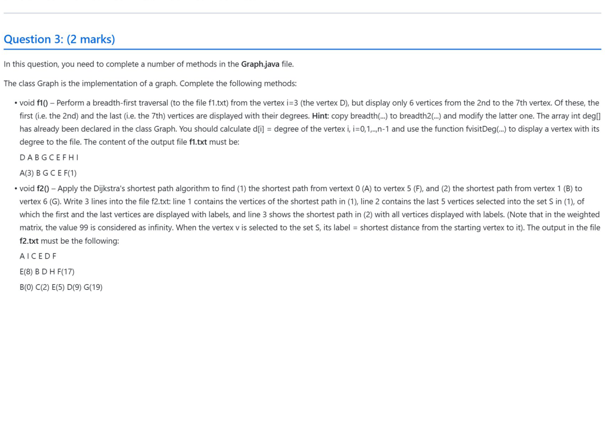

> **Nguyên văn đề bài (Question 3 - Tra cứu Ctrl+F):**
>
> Question 3: (2 marks)
> In this question, you need to complete a number of methods in the Graph.java file.
> The class Graph is the implementation of a graph. Complete the following methods:
> > - void fl() — Perform a breadth-first traversal (to the file f1 .txt) from the vertex (the vertex D), but display only 6 vertices from the 2nd to the 7th vertex. Of these, the
> first (i.e. the 2nd) and the last (i.e. the 7th) vertices are displayed with their degrees. Hint: copy breadth(...) to breadth2(...) and modify the latter one. The array int dego
> has already been declared in the class Graph. You should calculate d[i] = degree of the vertex i, i=O,1,..,n-1 and use the function fvisitDeg(...) to display a vertex with its
> degree to the file. The content of the output file f1.txt must be:
> DABGCEFHI
> A(3) BGC E F(l)
> > - void f2() — Apply the Dijkstra's shortest path algorithm to find (1) the shortest path from vertext O (A) to vertex 5 (F), and (2) the shortest path from vertex 1 (B) to
> vertex 6 (G). Write 3 lines into the file f2.txt: line I contains the vertices of the shortest path in (I), line 2 contains the last 5 vertices selected into the set S in (I), of
> which the first and the last vertices are displayed with labels, and line 3 shows the shortest path in (2) with all vertices displayed with labels. (Note that in the weighted
> matrix, the value 99 is considered as infinity. When the vertex v is selected to the set S, its label = shortest distance from the starting vertex to it). The output in the file
> f2.txt must be the following:
> A ICED F
> E(8) B D H F(17)
> B(0) C(2) E(5) D(9) G(19)

- **Đáp án mã nguồn Java hoàn chỉnh (Giữ format và comment gốc của Given):**
```java
/* This program contains 2 parts: (1) and (2)
   YOUR TASK IS TO COMPLETE THE PART  (2)  ONLY
 */
//(1)==============================================================
import java.io.*;
import java.util.*;
public class Graph {
  int [][] a; int n;
  char v[];
  int deg[];
  Graph() {
    v = "ABCDEFGHIJKLMNOP".toCharArray();
    deg = new int[20];
    a = new int[20][20];
    n = 0;
   }
  void loadData(int k) {
    RandomAccessFile f;int i,j,x;
    String s;StringTokenizer t;
    a = new int[20][20];
    try {
     f = new RandomAccessFile("data.txt","r");
     for(i=0;i<k;i++) f.readLine();
     s = f.readLine();s = s.trim();
     n = Integer.parseInt(s);
     for(i=0;i<n;i++) {
       s = f.readLine();s = s.trim();
       t = new StringTokenizer(s);
       for(j=0;j<n;j++) {
         x = Integer.parseInt(t.nextToken().trim());
         a[i][j] = x;
        }
       }
     f.close();
     }
    catch(Exception e) {}
   }
  void dispAdj() {
    int i,j;
    for(i=0;i<n;i++) {
      System.out.println();
      for(j=0;j<n;j++)
        System.out.printf("%4d",a[i][j]);
     }
   }
  void fvisit(int i, RandomAccessFile f) throws Exception {
    f.writeBytes("  "+v[i]);
   }
  void fvisitDeg(int i, RandomAccessFile f) throws Exception {
    f.writeBytes("  "+v[i]+"("+deg[i]+")");
   }
 void fdispAdj(RandomAccessFile f) throws Exception {
    int i,j;
    f.writeBytes("n = "+n+"\r\n");
    for(i=0;i<n;i++) {
      f.writeBytes("\r\n");
      for(j=0;j<n;j++)  f.writeBytes("  " + a[i][j]);
     }
    f.writeBytes("\r\n");
   }
  void breadth(boolean [] en, int i, RandomAccessFile f) throws Exception {
    Queue q = new Queue();
    int r,j;
    q.enqueue(i); en[i]=true;
    while(!q.isEmpty()) {
      r = q.dequeue();
      fvisit(r,f);
      for(j=0;j<n;j++) {
        if(!en[j] && a[r][j]>0) {
         q.enqueue(j);en[j]=true;
        }
       }
     }
   }
  void breadth(int  k, RandomAccessFile f) throws Exception {
    boolean [] en = new boolean[20];
    int i;
    for(i=0;i<n;i++) en[i]=false;
    breadth(en,k,f);
    for(i=0;i<n;i++)
      if(!en[i]) breadth(en,i,f);
   }
 void depth(boolean [] visited,int k, RandomAccessFile f) throws Exception {
    fvisit(k,f);visited[k]=true;
    for(int i=0;i<n;i++) {
      if(!visited[i] && a[k][i]>0) depth(visited,i,f);
     }
   }
  void depth(int k, RandomAccessFile f) throws Exception {
    boolean [] visited = new boolean[20];
    int i;
    for(i=0;i<n;i++) visited[i]=false;
    depth(visited,k,f);
    for(i=0;i<n;i++)
       if(!visited[i]) depth(visited,i,f);
   }
//===========================================================================
//(2)===YOU CAN EDIT OR EVEN ADD NEW FUNCTIONS IN THE FOLLOWING PART========
//===========================================================================
/* 
   Khong su dung tieng Viet co dau de viet ghi chu.
   Neu dung khi chay truc tiep se bao loi va nhan 0 diem
*/
 void f1() throws Exception {
    loadData(1);
    String fname = "f1.txt";
    File g123 = new File(fname);
    if(g123.exists()) g123.delete();
    RandomAccessFile  f = new RandomAccessFile(fname, "rw");
    breadth(3,f);
    f.writeBytes("\r\n");
    f.writeBytes("\r\n");
    f.close();
   }
  void f2() throws Exception {
    loadData(12);
    String fname = "f2.txt";
    File g123 = new File(fname);
    if(g123.exists()) g123.delete();
    RandomAccessFile  f = new RandomAccessFile(fname, "rw");
    f.writeBytes("\r\n");
    f.close();
   }
}
```

---

#### 6.3.4. Đề thi: CSD201 - SU26 - B1 - PE - Paper 10
- **Thư mục lưu trữ mã nguồn:** [solutions/2026/su26_b1_p10](./solutions/2026/su26_b1_p10/)
- **Thư mục tài liệu gốc:** `CSD201 - SU26 - B1 - PE - Paper 10`

##### [Question 1] Danh sách liên kết đơn (MyList.java)
- **Mã nguồn giải:** [solutions/2026/su26_b1_p10\Q1\src\MyList.java](./solutions/2026/su26_b1_p10\Q1\src\MyList.java)

- **Hình ảnh trích xuất đề bài Question 1 từ đề gốc:**

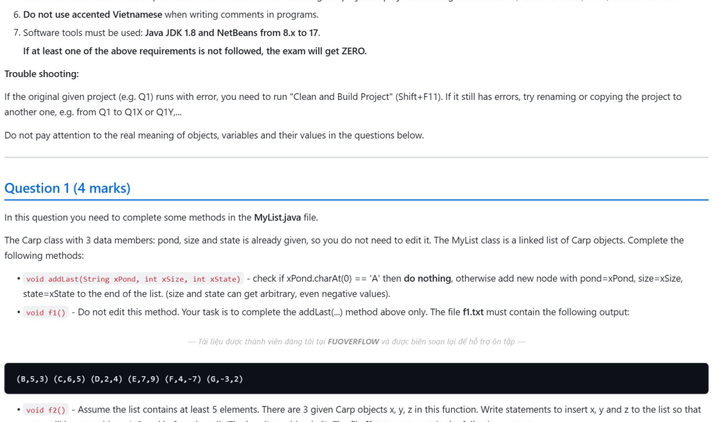

> **Nguyên văn đề bài (Question 1 - Tra cứu Ctrl+F):**
>
> Question 1 (4 marks)
> In this question you need to complete some methods in the MyList.java file.
> The Carp class with 3 data members: pond, size and state is already given, so you do not need to edit it. The MyList class is a linked list of Carp objects. Complete the
> following methods:
> > - void addLast(String xPond, int xSize, int xState) - check if xPond.charAt(0) 'A' then do nothing, otherwise add new node with pond=xPond, size=xSize,
> state=xState to the end of the list. (size and state can get arbitrary, even negative values).
> > - void fl() - Do not edit this method. Your task is to complete the addLast(...) method above only. The file f1.txt must contain the following output:
> (D, 2,4) (G, -3, 2)
> > - void f2() - Assume the list contains at least 5 elements. There are 3 given Carp objects x, y, z in this function. Write statements to insert x, y and z to the list so that
> x, y, z will be at positions 1, 2 and before the tail. (The head's position is O). The file f2.txt must contain the following output:
> > - void f3()
> > - void f4()
> (Z, 3.4)
> - Assume the list is not empty. Find the (first) node having maximum state and change size to 77.. The file f3.txt must contain the following output:
> (F. 7,9) (G,8.7) (1.8,3) (3,5.4)
> (F, 77,9)
> - Assume that in the list there is only one element p having pond = D and q having pond-K. Reverse elements from p to q. The content of the output file
> f4.txt must be the following:
> (1, 7.9) (K (L (M, 3.4)
> (C.9,8) (K,5.6) (F,1.2) (D. 11,12) (L .4,8) (M, 3.4)

- **Đáp án mã nguồn Java hoàn chỉnh (Giữ format và comment gốc của Given):**
```java
/* This program contains 2 parts: (1) and (2)
   YOUR TASK IS TO COMPLETE THE PART  (2)  ONLY
 */
//(1)==============================================================
import java.util.*;
import java.io.*;
public class MyList {
  Node head,tail;
  MyList() {head=tail=null;}
  boolean isEmpty() {
    return(head==null);
   }
  void clear() {head=tail=null;}
  void fvisit(Node p, RandomAccessFile f) throws Exception {
    if(p != null) f.writeBytes(p.info + " ");
   }
  void ftraverse(RandomAccessFile f) throws Exception {
    Node p = head;
    while(p!=null) {
       fvisit(p,f);
       p=p.next;
      }
    f.writeBytes("\r\n");
   }
  void loadData(int k) {
    String [] a = Lib.readLineToStrArray("data.txt", k);
    int [] b = Lib.readLineToIntArray("data.txt", k+1);
    int [] c = Lib.readLineToIntArray("data.txt", k+2);
    int n = a.length;
    for(int i=0;i<n;i++) addLast(a[i],b[i],c[i]);
   }
//===========================================================================
//(2)===YOU CAN EDIT OR EVEN ADD NEW FUNCTIONS IN THE FOLLOWING PART========
//===========================================================================
/* 
   Khong su dung tieng Viet co dau de viet ghi chu.
   Neu dung khi chay truc tiep se bao loi va nhan 0 diem
*/
  void addLast(String xPond, int xSize, int xState) {
    //You should write here appropriate statements to complete this function.
   }
  //You do not need to edit this function. Your task is to complete the addLast function above only.
  void f1() throws Exception {
     clear();
     loadData(1);
     String fname = "f1.txt";
     File g123 = new File(fname);
     if(g123.exists()) g123.delete();
     RandomAccessFile  f = new RandomAccessFile(fname, "rw");
     ftraverse(f);
     f.close();
    }
  void f2() throws Exception {
     clear();
     loadData(5);
     String fname = "f2.txt";
     File g123 = new File(fname);
     if(g123.exists()) g123.delete();
     RandomAccessFile  f = new RandomAccessFile(fname, "rw");
     ftraverse(f);
     Carp x, y, z;
     x = new Carp("X",1,2);
     y = new Carp("Y",2,3);
     z = new Carp("Z",3,4);
     ftraverse(f);
     f.close();
    }
  void f3() throws Exception {
    clear();
    loadData(9);
    String fname = "f3.txt";
    File g123 = new File(fname);
    if(g123.exists()) g123.delete();
    RandomAccessFile  f = new RandomAccessFile(fname, "rw");
    ftraverse(f);
    ftraverse(f);
    f.close();
  }
  void f4() throws Exception {
    clear();
    loadData(13);
    String fname = "f4.txt";
    File g123 = new File(fname);
    if(g123.exists()) g123.delete();
    RandomAccessFile  f = new RandomAccessFile(fname, "rw");
    ftraverse(f);
    ftraverse(f);
    f.close();
   }
 }
```

##### [Question 2] Cây nhị phân tìm kiếm (BSTree.java)
- **Mã nguồn giải:** [solutions/2026/su26_b1_p10\Q2\src\BSTree.java](./solutions/2026/su26_b1_p10\Q2\src\BSTree.java)

- **Hình ảnh trích xuất đề bài Question 2 từ đề gốc:**


> **Nguyên văn đề bài (Question 2 - Tra cứu Ctrl+F):**
>
> Question 2 (4 marks)
> In this question you need to complete some methods in the BSTree.java file.
> Ine carp Class Witn s aata memoers: pona, sue ana state IS alreaay given, so you ao not neea toe I I
> variable size is the key of the tree, thus it must be unique. Complete the following methods:
> ne ± Iree Class IS a Dinary searcn tree OT carp ODJe s
> > - void insert(String xpond, int xSize, int xState) - check if xPond.charAt(0) 'B' then do nothing, otherwise insert new Carp object with pond—xPond,
> size=xSize, state=xState to the tree (size and state can get arbitrary, even negative values).
> > - void fl() - Do not edit this method. Your task is to complete the insert(...) method above only. The file f1.txt must contain the following output:
> (A, 7,9) (E, 2,5) (F, -6.7)
> (E,2.5) (A,7.9) (D,8.6)
> - Perform post-order traversal from the root but display to file f2.txt nodes with size < 7 only. Hint: Copy the function postOrder(...) to function
> postOrder2(...) and modify it. The file f2.txt must contain the following output:
> void f2()
> (K, -1,5)
> (K, -1,5)
> > - void f
> - Assume p is the 3rd node in the pre-order traversal of the tree from the root, and f is the father of p. Delete by copying 2 nodes: firstly p, then f. The file
> f3.txt must contain the following output:
> (F, 2, -1) (K, -1,5)
> (K, -1,5)
> > - void f4() - Perform the pre-order traversal of the tree from the root, and find the 3rd node p having non-empty left son. Rotate p to right. The file f4.txt must
> contain the following output:
> (J, 3.9) (K, -1,5)

- **Đáp án mã nguồn Java hoàn chỉnh (Giữ format và comment gốc của Given):**
```java
/* This program contains 2 parts: (1) and (2)
   YOUR TASK IS TO COMPLETE THE PART  (2)  ONLY
 */
//(1)==============================================================
import java.io.*;
import java.util.*;
public class BSTree {
   Node root;
   BSTree() {root=null;}
   boolean isEmpty() {
       return(root==null);
      }
   void clear() {
       root=null;
      }
   void visit(Node p) {
      System.out.print("p.info: ");
      if(p != null) System.out.println(p.info + " ");
     }
   void fvisit(Node p, RandomAccessFile f) throws Exception {
      if(p != null) f.writeBytes(p.info + " ");
     }
   void breadth(Node p, RandomAccessFile f) throws Exception {
     if(p==null) return;
     Queue q = new Queue();
     q.enqueue(p);Node r;
     while(!q.isEmpty()) {
        r = q.dequeue();
        fvisit(r,f);
        if(r.left!=null) q.enqueue(r.left);
        if(r.right!=null) q.enqueue(r.right);
       }
    }
   void preOrder(Node p, RandomAccessFile f) throws Exception {
      if(p==null) return;
      fvisit(p,f);
      preOrder(p.left,f);
      preOrder(p.right,f);
     }
   void inOrder(Node p, RandomAccessFile f) throws Exception {
      if(p==null) return;
      inOrder(p.left,f);
      fvisit(p,f);
      inOrder(p.right,f);
     }
   void postOrder(Node p, RandomAccessFile f) throws Exception {
      if(p==null) return;
      postOrder(p.left,f);
      postOrder(p.right,f);
      fvisit(p,f);
     }
   void loadData(int k) {
      String [] a = Lib.readLineToStrArray("data.txt", k);
      int [] b = Lib.readLineToIntArray("data.txt", k+1);
      int [] c = Lib.readLineToIntArray("data.txt", k+2);
      int n = a.length;
      for(int i=0;i<n;i++) insert(a[i],b[i],c[i]);
     }
//===========================================================================
//(2)===YOU CAN EDIT OR EVEN ADD NEW FUNCTIONS IN THE FOLLOWING PART========
//===========================================================================
/* 
   Khong su dung tieng Viet co dau de viet ghi chu.
   Neu dung khi chay truc tiep se bao loi va nhan 0 diem
*/
  void insert(String xPond, int xSize, int xState) {
    //You should insert here statements to complete this function
   }
//Do not edit this function. Your task is to complete insert function above only.
  void f1() throws Exception {
    clear();
    loadData(1);
    String fname = "f1.txt";
    File g123 = new File(fname);
    if(g123.exists()) g123.delete();
    RandomAccessFile  f = new RandomAccessFile(fname, "rw");
    breadth(root,f);
    f.writeBytes("\r\n");
    inOrder(root,f);
    f.writeBytes("\r\n");
    f.close();
   }
 void f2() throws Exception {
    clear();
    loadData(5);
    String fname = "f2.txt";
    File g123 = new File(fname);
    if(g123.exists()) g123.delete();
    RandomAccessFile  f = new RandomAccessFile(fname, "rw");
    postOrder(root,f);
    f.writeBytes("\r\n");
    f.writeBytes("\r\n");
    f.close();
   }
 void f3() throws Exception {
    clear();
    loadData(9);
    String fname = "f3.txt";
    File g123 = new File(fname);
    if(g123.exists()) g123.delete();
    RandomAccessFile  f = new RandomAccessFile(fname, "rw");
    breadth(root,f);
    f.writeBytes("\r\n");
    breadth(root,f);
    f.writeBytes("\r\n");
    f.close();
   }
 void f4() throws Exception {
    clear();
    loadData(13);;
    String fname = "f4.txt";
    File g123 = new File(fname);
    if(g123.exists()) g123.delete();
    RandomAccessFile  f = new RandomAccessFile(fname, "rw");
    breadth(root,f);
    f.writeBytes("\r\n");
    breadth(root,f);
    f.writeBytes("\r\n");
    f.close();
   }
 }
```

##### [Question 3] Đồ thị (Graph.java)
- **Mã nguồn giải:** [solutions/2026/su26_b1_p10\Q3\src\Graph.java](./solutions/2026/su26_b1_p10\Q3\src\Graph.java)

- **Hình ảnh trích xuất đề bài Question 3 từ đề gốc:**


> **Nguyên văn đề bài (Question 3 - Tra cứu Ctrl+F):**
>
> Question 3 (2 marks)
> In this question you need to complete some methods in the Graph.java file.
> The class Graph is the implementation of a graph. Complete the following methods:
> > - void fl() - Perform breadth-first traversal (to the file f 1 .txt) from the vertex (the vertex D) but display 6 vertices from the 2nd vertex to the 7th vertex only. Of
> these, the first (i.e 2nd) and the last (i.e.7th) vertices displayed with degrees. Hint: copy breadth(...) to breadth2(...) and modify the latter one. The array int dego
> already declared in the class Graph. You should calculate d[i] = degree of the vertex i, and use the function fvisitDeg(...) to display a vertice with degree to
> file. Content of the output file f1.txt must be:
> DABGCEFHI
> A(3) BGC E F(l)
> > - void f2() - Apply the Dijkstra's shortest path algorithm to find (1) the shortest path from vertext 0 (A) to vertex 5 (F), then (2) from vertex 1 (B) to vertex 6 (G). Write
> 3 lines to the file f2.txt: line 1 contains vertices in shortest path (1), line 2 contains the last 5 vertices selected into the set S in (1), of these, the first and the last vertices
> displayed with labels, line 3 displays shortest path (2), in which all vertices displayed with labels. (Note that in the weighted matrix, the value 99 is considered as
> infinity. When the vertex v is selected to the set S, its label = shortest distance from starting vertex to it). The file f2.txt must contain the following output:
> AICEDF
> E(8) B D H F(17)
> B(e) C(2) E(5) D(9) G(19)

- **Đáp án mã nguồn Java hoàn chỉnh (Giữ format và comment gốc của Given):**
```java
/* This program contains 2 parts: (1) and (2)
   YOUR TASK IS TO COMPLETE THE PART  (2)  ONLY
 */
//(1)==============================================================
import java.io.*;
import java.util.*;
public class Graph {
  int [][] a; int n;
  char v[];
  int deg[];
  Graph() {
    v = "ABCDEFGHIJKLMNOP".toCharArray();
    deg = new int[20];
    a = new int[20][20];
    n = 0;
   }
  void loadData(int k) {
    RandomAccessFile f;int i,j,x;
    String s;StringTokenizer t;
    a = new int[20][20];
    try {
     f = new RandomAccessFile("data.txt","r");
     for(i=0;i<k;i++) f.readLine();
     s = f.readLine();s = s.trim();
     n = Integer.parseInt(s);
     for(i=0;i<n;i++) {
       s = f.readLine();s = s.trim();
       t = new StringTokenizer(s);
       for(j=0;j<n;j++) {
         x = Integer.parseInt(t.nextToken().trim());
         a[i][j] = x;
        }
       }
     f.close();
     }
    catch(Exception e) {}
   }
  void dispAdj() {
    int i,j;
    for(i=0;i<n;i++) {
      System.out.println();
      for(j=0;j<n;j++)
        System.out.printf("%4d",a[i][j]);
     }
   }
  void fvisit(int i, RandomAccessFile f) throws Exception {
    f.writeBytes("  "+v[i]);
   }
  void fvisitDeg(int i, RandomAccessFile f) throws Exception {
    f.writeBytes("  "+v[i]+"("+deg[i]+")");
   }
 void fdispAdj(RandomAccessFile f) throws Exception {
    int i,j;
    f.writeBytes("n = "+n+"\r\n");
    for(i=0;i<n;i++) {
      f.writeBytes("\r\n");
      for(j=0;j<n;j++)  f.writeBytes("  " + a[i][j]);
     }
    f.writeBytes("\r\n");
   }
  void breadth(boolean [] en, int i, RandomAccessFile f) throws Exception {
    Queue q = new Queue();
    int r,j;
    q.enqueue(i); en[i]=true;
    while(!q.isEmpty()) {
      r = q.dequeue();
      fvisit(r,f);
      for(j=0;j<n;j++) {
        if(!en[j] && a[r][j]>0) {
         q.enqueue(j);en[j]=true;
        }
       }
     }
   }
  void breadth(int  k, RandomAccessFile f) throws Exception {
    boolean [] en = new boolean[20];
    int i;
    for(i=0;i<n;i++) en[i]=false;
    breadth(en,k,f);
    for(i=0;i<n;i++)
      if(!en[i]) breadth(en,i,f);
   }
 void depth(boolean [] visited,int k, RandomAccessFile f) throws Exception {
    fvisit(k,f);visited[k]=true;
    for(int i=0;i<n;i++) {
      if(!visited[i] && a[k][i]>0) depth(visited,i,f);
     }
   }
  void depth(int k, RandomAccessFile f) throws Exception {
    boolean [] visited = new boolean[20];
    int i;
    for(i=0;i<n;i++) visited[i]=false;
    depth(visited,k,f);
    for(i=0;i<n;i++)
       if(!visited[i]) depth(visited,i,f);
   }
//===========================================================================
//(2)===YOU CAN EDIT OR EVEN ADD NEW FUNCTIONS IN THE FOLLOWING PART========
//===========================================================================
/* 
   Khong su dung tieng Viet co dau de viet ghi chu.
   Neu dung khi chay truc tiep se bao loi va nhan 0 diem
*/
 void f1() throws Exception {
    loadData(1);
    String fname = "f1.txt";
    File g123 = new File(fname);
    if(g123.exists()) g123.delete();
    RandomAccessFile  f = new RandomAccessFile(fname, "rw");
    breadth(3,f);
    f.writeBytes("\r\n");
    f.writeBytes("\r\n");
    f.close();
   }
  void f2() throws Exception {
    loadData(12);
    String fname = "f2.txt";
    File g123 = new File(fname);
    if(g123.exists()) g123.delete();
    RandomAccessFile  f = new RandomAccessFile(fname, "rw");
    f.writeBytes("\r\n");
    f.close();
   }
}
```

---

#### 6.3.5. Đề thi: CSD201 - PE - SP26 - Paper 1
- **Thư mục lưu trữ mã nguồn:** [solutions/2026/sp26_b5_p4](./solutions/2026/sp26_b5_p4/)
- **Thư mục tài liệu gốc:** `CSD201 - PE - SP26 - Paper 1`

##### [Question 1] Danh sách liên kết đơn (MyList.java)
- **Mã nguồn giải:** [solutions/2026/sp26_b5_p4\Q1\src\MyList.java](./solutions/2026/sp26_b5_p4\Q1\src\MyList.java)

- **Hình ảnh trích xuất đề bài Question 1 từ đề gốc:**


> **Nguyên văn đề bài (Question 1 - Tra cứu Ctrl+F):**
>
> CSD201 PE INSTRUCTIONS
> Complete the PE by following the steps below:
> 1. Create a folder to save the given projects, e.g. CSD_given (1), then download the given materials into (1).
> 2. Complete the requirements of the test.
> 3. Before submission:
> 1. Clean and Build Project (Shift+F11),
> 2. Then rename the folder dist to run. (If the folder run already exists, delete it before renaming).
> 4. Submission:
> 1. To submit the project Q1, at first you must select the Question No: 1
> 2. Browse and select the project folder (e.g. Q1, or QIA, or Q2, ...)
> 3. Then click the Submit button.
> 5. Do not use accented Vietnamese when writing comments in programs.
> 6. Your task is to complete the method bodies only. Do not change method signatures or add new import statements.
> 7. Software tools must be used: NetBeans IDE 13 and Java JDK 8.
> If at least one of the above requirements is not followed, the exam will get ZERO.
> . Notes:
> 0 The input and expected output below are only used to test your codes.
> o The input and expected output in the real testcases (for marking) are different with the examples below.
> o Do not hardcode with the given expected results.
> Troubleshooting
> If the given project (e.g. Q1) fails to run, run "Clean and Build Project" (Shift+F11). If the error persists, try renaming or copying the project to another one, e.g. from Q1 to
> QIX or QIY.
> Questions: (10 marks)
> Scenario
> You will complete a Java program that manages a fruit import-export store. The system uses a Circularly Linked List (CLL) to manage today's shipment list and a Binary
> Search Tree (BST) to store all fruit products in the warehouse, sorted by fruitld.
> Class Structure
> > - Fruit: Contains information about a fruit: fruitld (String), name (String), quantity (int) and price (double)
> > - ShipmentCLL: A Circular Linked List structure, used to store the fruits that are being shipped today.
> > - FruitBST: A Binary Search Tree structure, storing all fruits in warehouse sorted by fruitld.
> Carefully read the provided code segments to fully understand the relationships between the classes and the functions within each class. The specific task of the test is to
> complete the following requirements:
> Cäu 1: fl() — 2.5 marks: Count Fruits in Shipment
> > - File: ShipmentCLLjava
> > - Methods to Complete:
> countFruits()
> > - Task: Walk through the circular linked list and return the number of fruits currently in today's shipment list. If the shipment list is empty, return O.
> Expected example output:
> Current Shipment:
> (FE , Apple, 2øe.1.2) ( FL Banana, 8) (FØ4,Mango, 2.5) (FU , Orange, 18e,1.5) e) (F99, DragonFruit, 5ø,4.5)
> Counted fruits: 6
> Cäu 2: f2() — 2.5 marks: Remove a Fruit from Shipment by ID
> > - File: ShipmentCLL.java
> > - Method to Complete:
> removeById(String id)
> > - Task: Remove the node whose fruitld equals the given id from the Circular Linked List. Handle all possible cases.
> Expected example output:
> Current Shipment:
> (FU , Apple, 2øe,1.2) (FØ2, Banana, e. 8) ( Fei, Grape, 12ø,3.e) (F99, DragonFruit, 5ø,4.5)
> Shipment after removing FØ2:
> 2øe.1.2) Mango, lee, 2.5) (FBI. Grape, 12e,3. e) (F99, se,4.5)
> Cåu 3: f3() — 2.5 marks: Insert Fruit into Warehouse (Binary Search Tree)
> > - File: FruitBST.java
> > - Method to Complete: insert(Fr-uit fruit)
> > - Task: Implement the logic to insert a new Fruit object into the Binary Search Tree. The tree is ordered alphabetically by the fruitld.
> 0 Insert the fruit into the correct position according to BST rules.
> 0 If the fruitld already exists in the tree, that fruit is ignored.
> Expected example output:
> Current Fruits (Alphabetically Ordered by ID):
> (FBI, crape, e) Banana , Ise, e. 8) (F03 lee, 2.5) (Fess orange, 1.5) (F99,DragonFruit, 50, 4.5)
> Cåu 4: f4() — 2.5 marks: Count Fruits in ID Range
> > - File: FruitBST.java
> > - Method to Complete:
> countlnRange(String minld, String maxld)
> > - Task: Count the fruits in the BST whose id lies between minld and maxld (inclusive).
> o If no fruit satisfies the condition, return O
> Expected example output:
> Current Fruits:
> (FBI, Grape, e) ( F02, Banana, 8) (FB3 , Apple, 2ee.1.2) (FØ4,Mango, lee, 2.5) 1.5) (F99 , DragonFruit, 50,4.5)
> Counting fruits with fruitld in range [FØ3,Fe8] :
> Result: 3

- **Đáp án mã nguồn Java hoàn chỉnh (Giữ format và comment gốc của Given):**
```java
/* This program contains 2 parts: (1) and (2)
   YOUR TASK IS TO COMPLETE THE PART  (2)  ONLY
 */
//(1)==============================================================
import java.util.*;
import java.io.*;
public class MyList {
  Node head,tail;
  MyList() {head=tail=null;}
  boolean isEmpty() {
    return(head==null);
   }
  void clear() {head=tail=null;}
  void fvisit(Node p, RandomAccessFile f) throws Exception {
    if(p != null) f.writeBytes(p.info + " ");
   }
  void ftraverse(RandomAccessFile f) throws Exception {
    Node p = head;
    while(p!=null) {
       fvisit(p,f);
       p=p.next;
      }
    f.writeBytes("\r\n");
   }
  void loadData(int k) {
    String [] a = Lib.readLineToStrArray("data.txt", k);
    int [] b = Lib.readLineToIntArray("data.txt", k+1);
    int [] c = Lib.readLineToIntArray("data.txt", k+2);
    int n = a.length;
    for(int i=0;i<n;i++) addLast(a[i],b[i],c[i]);
   }
//===========================================================================
//(2)===YOU CAN EDIT OR EVEN ADD NEW FUNCTIONS IN THE FOLLOWING PART========
//===========================================================================
/* 
   Khong su dung tieng Viet co dau de viet ghi chu.
   Neu dung khi chay truc tiep se bao loi va nhan 0 diem
*/
  void addLast(String xTower, int xSound, int xType) {
    //You should write here appropriate statements to complete this function.
   }
  //You do not need to edit this function. Your task is to complete the addLast function above only.
  void f1() throws Exception {
     clear();
     loadData(1);
     String fname = "f1.txt";
     File g123 = new File(fname);
     if(g123.exists()) g123.delete();
     RandomAccessFile  f = new RandomAccessFile(fname, "rw");
     ftraverse(f);
     f.close();
    }
  void f2() throws Exception {
     clear();
     loadData(5);
     String fname = "f2.txt";
     File g123 = new File(fname);
     if(g123.exists()) g123.delete();
     RandomAccessFile  f = new RandomAccessFile(fname, "rw");
     ftraverse(f);
     Drum x, y;
     x = new Drum("X",1,2);
     y = new Drum("Y",3,4);
     ftraverse(f);
     f.close();
    }
  void f3() throws Exception {
    clear();
    loadData(9);
    String fname = "f3.txt";
    File g123 = new File(fname);
    if(g123.exists()) g123.delete();
    RandomAccessFile  f = new RandomAccessFile(fname, "rw");
    ftraverse(f);
    ftraverse(f);
    f.close();
   }
  void f4() throws Exception {
    clear();
    loadData(13);
    String fname = "f4.txt";
    File g123 = new File(fname);
    if(g123.exists()) g123.delete();
    RandomAccessFile  f = new RandomAccessFile(fname, "rw");
    ftraverse(f);
    ftraverse(f);
    f.close();
   }
 }
```

- **Kết quả kiểm chứng thực tế:**
  - `f1.txt`: `EMPTY`
  - `f4.txt`: `EMPTY`

##### [Question 2] Cây nhị phân tìm kiếm (BSTree.java)
- **Mã nguồn giải:** [solutions/2026/sp26_b5_p4\Q2\src\BSTree.java](./solutions/2026/sp26_b5_p4\Q2\src\BSTree.java)

- **Hình ảnh trích xuất đề bài Question 2 từ đề gốc:**


- **Đáp án mã nguồn Java hoàn chỉnh (Giữ format và comment gốc của Given):**
```java
/* This program contains 2 parts: (1) and (2)
   YOUR TASK IS TO COMPLETE THE PART  (2)  ONLY
 */
//(1)==============================================================
import java.io.*;
import java.util.*;
public class BSTree {
   Node root;
   BSTree() {root=null;}
   boolean isEmpty() {
       return(root==null);
      }
   void clear() {
       root=null;
      }
   void visit(Node p) {
      System.out.print("p.info: ");
      if(p != null) System.out.println(p.info + " ");
     }
   void fvisit(Node p, RandomAccessFile f) throws Exception {
      if(p != null) f.writeBytes(p.info + " ");
     }
   void breadth(Node p, RandomAccessFile f) throws Exception {
     if(p==null) return;
     Queue q = new Queue();
     q.enqueue(p);Node r;
     while(!q.isEmpty()) {
        r = q.dequeue();
        fvisit(r,f);
        if(r.left!=null) q.enqueue(r.left);
        if(r.right!=null) q.enqueue(r.right);
       }
    }
   void preOrder(Node p, RandomAccessFile f) throws Exception {
      if(p==null) return;
      fvisit(p,f);
      preOrder(p.left,f);
      preOrder(p.right,f);
     }
   void inOrder(Node p, RandomAccessFile f) throws Exception {
      if(p==null) return;
      inOrder(p.left,f);
      fvisit(p,f);
      inOrder(p.right,f);
     }
   void postOrder(Node p, RandomAccessFile f) throws Exception {
      if(p==null) return;
      postOrder(p.left,f);
      postOrder(p.right,f);
      fvisit(p,f);
     }
   void loadData(int k) {
      String [] a = Lib.readLineToStrArray("data.txt", k);
      int [] b = Lib.readLineToIntArray("data.txt", k+1);
      int [] c = Lib.readLineToIntArray("data.txt", k+2);
      int n = a.length;
      for(int i=0;i<n;i++) insert(a[i],b[i],c[i]);
     }
//===========================================================================
//(2)===YOU CAN EDIT OR EVEN ADD NEW FUNCTIONS IN THE FOLLOWING PART========
//===========================================================================
/* 
   Khong su dung tieng Viet co dau de viet ghi chu.
   Neu dung khi chay truc tiep se bao loi va nhan 0 diem
*/
  void insert(String xForest, int xRate, int xSound) {
    //You should insert here statements to complete this function
   }
//Do not edit this function. Your task is to complete insert function above only.
  void f1() throws Exception {
    clear();
    loadData(1);
    String fname = "f1.txt";
    File g123 = new File(fname);
    if(g123.exists()) g123.delete();
    RandomAccessFile  f = new RandomAccessFile(fname, "rw");
    breadth(root,f);
    f.writeBytes("\r\n");
    inOrder(root,f);
    f.writeBytes("\r\n");
    f.close();
   }
  void f2() throws Exception {
    clear();
    loadData(5);
    String fname = "f2.txt";
    File g123 = new File(fname);
    if(g123.exists()) g123.delete();
    RandomAccessFile  f = new RandomAccessFile(fname, "rw");
    preOrder(root,f);
    f.writeBytes("\r\n");
    f.writeBytes("\r\n");
    f.close();
   }
  void f3() throws Exception {
    clear();
    loadData(9);
    String fname = "f3.txt";
    File g123 = new File(fname);
    if(g123.exists()) g123.delete();
    RandomAccessFile  f = new RandomAccessFile(fname, "rw");
    preOrder(root,f);
    f.writeBytes("\r\n");
    preOrder(root,f);
    f.writeBytes("\r\n");
    f.close();
   }
  void f4() throws Exception {
    clear();
    loadData(13);;
    String fname = "f4.txt";
    File g123 = new File(fname);
    if(g123.exists()) g123.delete();
    RandomAccessFile  f = new RandomAccessFile(fname, "rw");
    preOrder(root,f);
    f.writeBytes("\r\n");
    preOrder(root,f);
    f.writeBytes("\r\n");
    f.close();
   }
 }
```

---

#### 6.3.6. Đề thi: CSD201 - PE - SU26 - Paper 1
- **Thư mục lưu trữ mã nguồn:** [solutions/2026/su26_b1_p2](./solutions/2026/su26_b1_p2/)
- **Thư mục tài liệu gốc:** `CSD201 - PE - SU26 - Paper 1`

##### [Question 1] Danh sách liên kết đơn (MyList.java)
- **Mã nguồn giải:** [solutions/2026/su26_b1_p2\Q1\src\MyList.java](./solutions/2026/su26_b1_p2\Q1\src\MyList.java)

- **Hình ảnh trích xuất đề bài Question 1 từ đề gốc:**


> **Nguyên văn đề bài (Question 1 - Tra cứu Ctrl+F):**
>
> Question 1 — fl() (2.5 marks): Count Books in the Library.
> > - File: BookList.java
> > - Methods to Complete: count()
> > - Task: Walk through the singly linked list and return the total number of books. Return O if the list is empty.
> Expected example output:
> Current Books :
> {Bei , J ava_Basics, Data_structures, Database_systems , 2017}
> Total books: 4

- **Đáp án mã nguồn Java hoàn chỉnh (Giữ format và comment gốc của Given):**
```java
/* This program contains 2 parts: (1) and (2)
   YOUR TASK IS TO COMPLETE THE PART  (2)  ONLY
 */
//(1)==============================================================
import java.util.*;
import java.io.*;
public class MyList {
  Node head,tail;
  MyList() {head=tail=null;}
  boolean isEmpty() {
    return(head==null);
   }
  void clear() {head=tail=null;}
  void fvisit(Node p, RandomAccessFile f) throws Exception {
    if(p != null) f.writeBytes(p.info + " ");
   }
  void ftraverse(RandomAccessFile f) throws Exception {
    Node p = head;
    while(p!=null) {
       fvisit(p,f);
       p=p.next;
      }
    f.writeBytes("\r\n");
   }
  void loadData(int k) {
    String [] a = Lib.readLineToStrArray("data.txt", k);
    int [] b = Lib.readLineToIntArray("data.txt", k+1);
    int [] c = Lib.readLineToIntArray("data.txt", k+2);
    int n = a.length;
    for(int i=0;i<n;i++) addLast(a[i],b[i],c[i]);
   }
//===========================================================================
//(2)===YOU CAN EDIT OR EVEN ADD NEW FUNCTIONS IN THE FOLLOWING PART========
//===========================================================================
/* 
   Khong su dung tieng Viet co dau de viet ghi chu.
   Neu dung khi chay truc tiep se bao loi va nhan 0 diem
*/
  void addLast(String xPond, int xSize, int xState) {
    //You should write here appropriate statements to complete this function.
   }
  //You do not need to edit this function. Your task is to complete the addLast function above only.
  void f1() throws Exception {
     clear();
     loadData(1);
     String fname = "f1.txt";
     File g123 = new File(fname);
     if(g123.exists()) g123.delete();
     RandomAccessFile  f = new RandomAccessFile(fname, "rw");
     ftraverse(f);
     f.close();
    }
  void f2() throws Exception {
     clear();
     loadData(5);
     String fname = "f2.txt";
     File g123 = new File(fname);
     if(g123.exists()) g123.delete();
     RandomAccessFile  f = new RandomAccessFile(fname, "rw");
     ftraverse(f);
     Carp x, y, z;
     x = new Carp("X",1,2);
     y = new Carp("Y",2,3);
     z = new Carp("Z",3,4);
     ftraverse(f);
     f.close();
    }
  void f3() throws Exception {
    clear();
    loadData(9);
    String fname = "f3.txt";
    File g123 = new File(fname);
    if(g123.exists()) g123.delete();
    RandomAccessFile  f = new RandomAccessFile(fname, "rw");
    ftraverse(f);
    ftraverse(f);
    f.close();
  }
  void f4() throws Exception {
    clear();
    loadData(13);
    String fname = "f4.txt";
    File g123 = new File(fname);
    if(g123.exists()) g123.delete();
    RandomAccessFile  f = new RandomAccessFile(fname, "rw");
    ftraverse(f);
    ftraverse(f);
    f.close();
   }
 }
```

##### [Question 2] Cây nhị phân tìm kiếm (BSTree.java)
- **Mã nguồn giải:** [solutions/2026/su26_b1_p2\Q2\src\BSTree.java](./solutions/2026/su26_b1_p2\Q2\src\BSTree.java)

- **Hình ảnh trích xuất đề bài Question 2 từ đề gốc:**


> **Nguyên văn đề bài (Question 2 - Tra cứu Ctrl+F):**
>
> Question 2 — f2() (2.5 marks): List books published after a given year.
> > - File: BookList.java
> > - Method to Complete: printAfter(int year)
> > - Task: Walk through the list and return a new Booklist containing all books whose year is strictly greater than the given value.
> 0 If there is no possible value, "Empty" will be printed.
> 0 The books must remain in the same order as in the original list.
> 0 The original list must not be modified.
> Expected example output:
> Current Books :
> {801, , , Data_structures , Algorithms , Database_systems , 2017}
> Listing books published after 2018:
> {802. Data_Structures , , Algorithms 2e2ø}

- **Đáp án mã nguồn Java hoàn chỉnh (Giữ format và comment gốc của Given):**
```java
/* This program contains 2 parts: (1) and (2)
   YOUR TASK IS TO COMPLETE THE PART  (2)  ONLY
 */
//(1)==============================================================
import java.io.*;
import java.util.*;
public class BSTree {
   Node root;
   BSTree() {root=null;}
   boolean isEmpty() {
       return(root==null);
      }
   void clear() {
       root=null;
      }
   void visit(Node p) {
      System.out.print("p.info: ");
      if(p != null) System.out.println(p.info + " ");
     }
   void fvisit(Node p, RandomAccessFile f) throws Exception {
      if(p != null) f.writeBytes(p.info + " ");
     }
   void breadth(Node p, RandomAccessFile f) throws Exception {
     if(p==null) return;
     Queue q = new Queue();
     q.enqueue(p);Node r;
     while(!q.isEmpty()) {
        r = q.dequeue();
        fvisit(r,f);
        if(r.left!=null) q.enqueue(r.left);
        if(r.right!=null) q.enqueue(r.right);
       }
    }
   void preOrder(Node p, RandomAccessFile f) throws Exception {
      if(p==null) return;
      fvisit(p,f);
      preOrder(p.left,f);
      preOrder(p.right,f);
     }
   void inOrder(Node p, RandomAccessFile f) throws Exception {
      if(p==null) return;
      inOrder(p.left,f);
      fvisit(p,f);
      inOrder(p.right,f);
     }
   void postOrder(Node p, RandomAccessFile f) throws Exception {
      if(p==null) return;
      postOrder(p.left,f);
      postOrder(p.right,f);
      fvisit(p,f);
     }
   void loadData(int k) {
      String [] a = Lib.readLineToStrArray("data.txt", k);
      int [] b = Lib.readLineToIntArray("data.txt", k+1);
      int [] c = Lib.readLineToIntArray("data.txt", k+2);
      int n = a.length;
      for(int i=0;i<n;i++) insert(a[i],b[i],c[i]);
     }
//===========================================================================
//(2)===YOU CAN EDIT OR EVEN ADD NEW FUNCTIONS IN THE FOLLOWING PART========
//===========================================================================
/* 
   Khong su dung tieng Viet co dau de viet ghi chu.
   Neu dung khi chay truc tiep se bao loi va nhan 0 diem
*/
  void insert(String xPond, int xSize, int xState) {
    //You should insert here statements to complete this function
   }
//Do not edit this function. Your task is to complete insert function above only.
  void f1() throws Exception {
    clear();
    loadData(1);
    String fname = "f1.txt";
    File g123 = new File(fname);
    if(g123.exists()) g123.delete();
    RandomAccessFile  f = new RandomAccessFile(fname, "rw");
    breadth(root,f);
    f.writeBytes("\r\n");
    inOrder(root,f);
    f.writeBytes("\r\n");
    f.close();
   }
 void f2() throws Exception {
    clear();
    loadData(5);
    String fname = "f2.txt";
    File g123 = new File(fname);
    if(g123.exists()) g123.delete();
    RandomAccessFile  f = new RandomAccessFile(fname, "rw");
    postOrder(root,f);
    f.writeBytes("\r\n");
    f.writeBytes("\r\n");
    f.close();
   }
 void f3() throws Exception {
    clear();
    loadData(9);
    String fname = "f3.txt";
    File g123 = new File(fname);
    if(g123.exists()) g123.delete();
    RandomAccessFile  f = new RandomAccessFile(fname, "rw");
    breadth(root,f);
    f.writeBytes("\r\n");
    breadth(root,f);
    f.writeBytes("\r\n");
    f.close();
   }
 void f4() throws Exception {
    clear();
    loadData(13);;
    String fname = "f4.txt";
    File g123 = new File(fname);
    if(g123.exists()) g123.delete();
    RandomAccessFile  f = new RandomAccessFile(fname, "rw");
    breadth(root,f);
    f.writeBytes("\r\n");
    breadth(root,f);
    f.writeBytes("\r\n");
    f.close();
   }
 }
```

##### [Question 3] Đồ thị (Graph.java)
- **Mã nguồn giải:** [solutions/2026/su26_b1_p2\Q3\src\Graph.java](./solutions/2026/su26_b1_p2\Q3\src\Graph.java)

- **Hình ảnh trích xuất đề bài Question 3 từ đề gốc:**


> **Nguyên văn đề bài (Question 3 - Tra cứu Ctrl+F):**
>
> Question 3 — f3() (2.5 marks): Insert readers into the BST.
> > - File: ReaderBST.java
> > - Method to Complete: insert(Reader r)
> > - Task: Add a new Reader into the BST ordered by id.
> o Place the reader in the correct position following BST rules.
> o If the id already exists, the reader is ignored (no exception, no duplicate).
> Expected example output:
> Current Readers (Alphabetically Ordered by ID) :
> {RØ1.AnHRØ2,
> Question 4 — f4() (2.5 marks): Count readers with ID greater than a given value.
> > - File: ReaderBST.java
> > - Method to Complete: countGreater(String id)
> > - Task: Count every reader in the BST whose id is strictly greater than the given value.
> 0 If no reader satisfies the condition, return O.
> o The tree structure must remain unchanged.
> Expected example output:
> Current Readers :
> Counting readers with ID > RO:
> Result: 2

- **Đáp án mã nguồn Java hoàn chỉnh (Giữ format và comment gốc của Given):**
```java
/* This program contains 2 parts: (1) and (2)
   YOUR TASK IS TO COMPLETE THE PART  (2)  ONLY
 */
//(1)==============================================================
import java.io.*;
import java.util.*;
public class Graph {
  int [][] a; int n;
  char v[];
  int deg[];
  Graph() {
    v = "ABCDEFGHIJKLMNOP".toCharArray();
    deg = new int[20];
    a = new int[20][20];
    n = 0;
   }
  void loadData(int k) {
    RandomAccessFile f;int i,j,x;
    String s;StringTokenizer t;
    a = new int[20][20];
    try {
     f = new RandomAccessFile("data.txt","r");
     for(i=0;i<k;i++) f.readLine();
     s = f.readLine();s = s.trim();
     n = Integer.parseInt(s);
     for(i=0;i<n;i++) {
       s = f.readLine();s = s.trim();
       t = new StringTokenizer(s);
       for(j=0;j<n;j++) {
         x = Integer.parseInt(t.nextToken().trim());
         a[i][j] = x;
        }
       }
     f.close();
     }
    catch(Exception e) {}
   }
  void dispAdj() {
    int i,j;
    for(i=0;i<n;i++) {
      System.out.println();
      for(j=0;j<n;j++)
        System.out.printf("%4d",a[i][j]);
     }
   }
  void fvisit(int i, RandomAccessFile f) throws Exception {
    f.writeBytes("  "+v[i]);
   }
  void fvisitDeg(int i, RandomAccessFile f) throws Exception {
    f.writeBytes("  "+v[i]+"("+deg[i]+")");
   }
 void fdispAdj(RandomAccessFile f) throws Exception {
    int i,j;
    f.writeBytes("n = "+n+"\r\n");
    for(i=0;i<n;i++) {
      f.writeBytes("\r\n");
      for(j=0;j<n;j++)  f.writeBytes("  " + a[i][j]);
     }
    f.writeBytes("\r\n");
   }
  void breadth(boolean [] en, int i, RandomAccessFile f) throws Exception {
    Queue q = new Queue();
    int r,j;
    q.enqueue(i); en[i]=true;
    while(!q.isEmpty()) {
      r = q.dequeue();
      fvisit(r,f);
      for(j=0;j<n;j++) {
        if(!en[j] && a[r][j]>0) {
         q.enqueue(j);en[j]=true;
        }
       }
     }
   }
  void breadth(int  k, RandomAccessFile f) throws Exception {
    boolean [] en = new boolean[20];
    int i;
    for(i=0;i<n;i++) en[i]=false;
    breadth(en,k,f);
    for(i=0;i<n;i++)
      if(!en[i]) breadth(en,i,f);
   }
 void depth(boolean [] visited,int k, RandomAccessFile f) throws Exception {
    fvisit(k,f);visited[k]=true;
    for(int i=0;i<n;i++) {
      if(!visited[i] && a[k][i]>0) depth(visited,i,f);
     }
   }
  void depth(int k, RandomAccessFile f) throws Exception {
    boolean [] visited = new boolean[20];
    int i;
    for(i=0;i<n;i++) visited[i]=false;
    depth(visited,k,f);
    for(i=0;i<n;i++)
       if(!visited[i]) depth(visited,i,f);
   }
//===========================================================================
//(2)===YOU CAN EDIT OR EVEN ADD NEW FUNCTIONS IN THE FOLLOWING PART========
//===========================================================================
/* 
   Khong su dung tieng Viet co dau de viet ghi chu.
   Neu dung khi chay truc tiep se bao loi va nhan 0 diem
*/
 void f1() throws Exception {
    loadData(1);
    String fname = "f1.txt";
    File g123 = new File(fname);
    if(g123.exists()) g123.delete();
    RandomAccessFile  f = new RandomAccessFile(fname, "rw");
    breadth(3,f);
    f.writeBytes("\r\n");
    f.writeBytes("\r\n");
    f.close();
   }
  void f2() throws Exception {
    loadData(12);
    String fname = "f2.txt";
    File g123 = new File(fname);
    if(g123.exists()) g123.delete();
    RandomAccessFile  f = new RandomAccessFile(fname, "rw");
    f.writeBytes("\r\n");
    f.close();
   }
}
```

---

### 6.4. Nhóm đề năm 2023 (7 đề)

#### 6.4.1. Đề thi: CSD201 - PE - FA 2023 - HB
- **Thư mục lưu trữ mã nguồn:** [solutions/2023/pe_fa23_hb](./solutions/2023/pe_fa23_hb/)
- **Thư mục tài liệu gốc:** `CSD201 - PE - FA 2023 - HB`

##### [Question 1] Danh sách liên kết đơn (MyList.java)
- **Mã nguồn giải:** [solutions/2023/pe_fa23_hb\Q1\src\MyList.java](./solutions/2023/pe_fa23_hb\Q1\src\MyList.java)

- **Hình ảnh trích xuất đề bài Question 1 từ đề gốc:**


> **Nguyên văn đề bài (Question 1 - Tra cứu Ctrl+F):**
>
> Question 1: (6 marks)
> In this question, you need to complete some methods in the MyList.java file.
> The class Worker (with 3 data members: name, salary and ability) is provided and you do not need to modify it. The MyList class is a linked list of Worker objects. Complete
> the following methods:
> > - void addLast(String xName, int Salary, int xAbility) - if xName.charAt(0) == 'A' then do nothing, otherwise add a new node with name=xName, salary=xSalary,
> ability=xAbility to the end of the list. (salary and ability can take arbitrary values, even negative ones).
> > - void fl() — Do not edit this method. Your only task is to complete the addLast(...) method above. The output in the file f1.txt must be as follows:
> (E, 7,9) (G, -3.2)
> > - void f2() — There are 2 given Worker objects x, y in this function. Assume the list contains at least 5 elements. Write statements to insert x and y into the list so that x
> becomes the 1st node and y becomes the 5th node. The output in the file f2.txt must be as follows:
> > - void f3() — Find the first node having salary>8 then change its ability to 100. The output in the file f3.txt must be as follows:
> (D, 3,5) (F, 5,8) (G,9.7) (H,6.8) (1,7,3)
> > - void f4() — Sort all elements descendingly by salary. The content of the output file f4.txt must be as follows:
> (C, 1,2) (E, 2, 15)
> (J, 12,15) (F, 11,6) (1.6, 14) (E. 2,15)
> > - void f5() — Sort the linked list in descending order of salary, then delete the 1st and 3rd elements. The content of the output file f5.txt must be as follows:
> (C, 1,2) (E, 2, 15) (J, 12, 15) (K
> (F, 11,6) (K, 7.9) (C. 1, 2)
> > - void f6() — Find and delete the Worker having Salary = 11. The content of the output file f6.txt must be as follows:
> (C. 1, 2) (E, 2, 15) (1.6,14) 0.12, 15)
> (C, 1,2) (E, 2, 15) (K, 7,9)

- **Đáp án mã nguồn Java hoàn chỉnh (Giữ format và comment gốc của Given):**
```java
/* This program contains 2 parts: (1) and (2)
   YOUR TASK IS TO COMPLETE THE PART  (2)  ONLY
 */
//(1)==============================================================
import java.util.*;
import java.io.*;
public class MyList {
    Node head, tail;
    MyList() {
        head = tail = null;
    }
    boolean isEmpty() {
        return (head == null);
    }
    void clear() {
        head = tail = null;
    }
    void fvisit(Node p, RandomAccessFile f) throws Exception {
        if (p != null) {
            f.writeBytes(p.info + " ");
        }
    }
    void ftraverse(RandomAccessFile f) throws Exception {
        Node p = head;
        while (p != null) {
            fvisit(p, f);
            p = p.next;
        }
        f.writeBytes("\r\n");
    }
    void loadData(int k) {
        String[] a = Lib.readLineToStrArray("data.txt", k);
        int[] b = Lib.readLineToIntArray("data.txt", k + 1);
        int[] c = Lib.readLineToIntArray("data.txt", k + 2);
        int n = a.length;
        for (int i = 0; i < n; i++) {
            addLast(a[i], b[i], c[i]);
        }
    }
//===========================================================================
//(2)===YOU CAN EDIT OR EVEN ADD NEW FUNCTIONS IN THE FOLLOWING PART========
//===========================================================================
/* 
   Khong su dung tieng Viet co dau de viet ghi chu.
   Neu dung khi chay truc tiep se bao loi va nhan 0 diem
*/
    void addLast(String xName, int xSalary, int xAbility) {
    //You should write here appropriate statements to complete this function.
        if (xName.charAt(0) == 'A') return;
    Node q = new Node(new Worker(xName, xSalary, xAbility));
        if (isEmpty()) {
            head = tail = q;
            return;
        }
        tail.next = q;
        tail = q;
    }
  //You do not need to edit this function. Your task is to complete the addLast function above only.
    void f1() throws Exception {
        clear();
        loadData(1);
        String fname = "f1.txt";
        File g123 = new File(fname);
        if (g123.exists()) {
            g123.delete();
        }
        RandomAccessFile f = new RandomAccessFile(fname, "rw");
        ftraverse(f);
        f.close();
    }
    void insertPos(Worker data, int position) {
        Node newNode = new Node(data);
        if (position == 1) {
            newNode.next = head;
            head = newNode;
        } else {
            Node previous = head;
            int count = 1;
            while (count < position - 1 && previous.next != null) {
                previous = previous.next;
                count++;
            }
            if (count == position - 1 && previous != null) {
                newNode.next = previous.next;
                previous.next = newNode;
            } else {
            }
        }
    }
    void f2() throws Exception {
        clear();
        loadData(5);
        String fname = "f2.txt";
        File g123 = new File(fname);
        if (g123.exists()) {
            g123.delete();
        }
        RandomAccessFile f = new RandomAccessFile(fname, "rw");
        ftraverse(f);
        Worker x, y;
        x = new Worker("X", 1, 2);
        y = new Worker("Y", 3, 4);
        insertPos(x, 1);
        insertPos(y, 5);
        ftraverse(f);
        f.close();
    }
    void f3() throws Exception {
        clear();
        loadData(9);
        String fname = "f3.txt";
        File g123 = new File(fname);
        if (g123.exists()) {
            g123.delete();
        }
        RandomAccessFile f = new RandomAccessFile(fname, "rw");
        ftraverse(f);
        Node curr = head;
        while (curr != null){
            if (curr.info.salary > 8) {
                curr.info.ability = 100;
                break;
            }
            curr = curr.next;
        }
        ftraverse(f);
        f.close();
    }
    void f4() throws Exception {
        clear();
        loadData(13);
        String fname = "f4.txt";
        File g123 = new File(fname);
        if (g123.exists()) {
            g123.delete();
        }
        RandomAccessFile f = new RandomAccessFile(fname, "rw");
        ftraverse(f);
        for (Node i = head; i!= null; i = i.next)
            for (Node j = i.next; j!=null; j=j.next){
                if (i.info.salary < j.info.salary){
                    Worker tmp = i.info;
                    i.info = j.info;
                    j.info = tmp;
                }
            }
        ftraverse(f);
        f.close();
    }
    void deleteNodeAtPosition(int position) {
        if (head == null) {
            return;
        }
        if (position == 0) {
            head = head.next;
            return;
        }
        Node current = head;
        Node previous = null;
        int currentPosition = 0;
        while (current != null) {
            if (currentPosition == position) {
                previous.next = current.next;
                return;
            }
            previous = current;
            current = current.next;
            currentPosition++;
        }
        System.out.println("Invalid position");
    }
    void f5() throws Exception {
        clear();
        loadData(17);
        String fname = "f5.txt";
        File g123 = new File(fname);
        if (g123.exists()) {
            g123.delete();
        }
        RandomAccessFile f = new RandomAccessFile(fname, "rw");
        ftraverse(f);
        for (Node i = head; i!= null; i = i.next)
            for (Node j = i.next; j!=null; j=j.next){
                if (i.info.salary < j.info.salary){
                    Worker tmp = i.info;
                    i.info = j.info;
                    j.info = tmp;
                }
            }
        deleteNodeAtPosition(0);
        deleteNodeAtPosition(1);
        ftraverse(f);
        f.close();
    }
    void f6() throws Exception {
        clear();
        loadData(21);
        String fname = "f6.txt";
        File g123 = new File(fname);
        if (g123.exists()) {
            g123.delete();
        }
        RandomAccessFile f = new RandomAccessFile(fname, "rw");
        ftraverse(f);
        int deleteSalary = 11;
        ftraverse(f);
        f.close();
    }
}
```

- **Kết quả kiểm chứng thực tế:**
  - `f1.txt`: `(B,5,3) (C,6,5) (D,2,4) (E,7,9) (F,4,-7) (G,-3,2)`
  - `f2.txt`: `(C,9,8) (D,6,3) (E,8,5) (F,5,4) (I,4,9)  | (X,1,2) (C,9,8) (D,6,3) (E,8,5) (Y,3,4) (F,5,4) (I,4,9)`
  - `f3.txt`: `(C,8,6) (D,3,5) (E,9,2) (F,5,8) (G,9,7) (H,6,8) (I,7,3)  | (C,8,6) (D,3,5) (E,9,100) (F,5,8) (G,9,7) (H,6,8) (I,7,3)`
  - `f4.txt`: `(C,1,2) (D,10,3) (E,2,15) (F,11,6) (I,6,14) (J,12,15) (K,7,9)  | (J,12,15) (F,11,6) (D,10,3) (K,7,9) (I,6,14) (E,2,15) (C,1,2)`
  - `f5.txt`: `(C,1,2) (D,10,3) (E,2,15) (F,11,6) (I,6,14) (J,12,15) (K,7,9)  | (F,11,6) (K,7,9) (I,6,14) (E,2,15) (C,1,2)`

##### [Question 2] Cây nhị phân tìm kiếm (BSTree.java)
- **Mã nguồn giải:** [solutions/2023/pe_fa23_hb\Q2\src\BSTree.java](./solutions/2023/pe_fa23_hb\Q2\src\BSTree.java)

- **Hình ảnh trích xuất đề bài Question 2 từ đề gốc:**


> **Nguyên văn đề bài (Question 2 - Tra cứu Ctrl+F):**
>
> Question 2: (4 marks)
> In this question, you need to complete some methods in the BSTree.java file.
> The class Worker (with 3 data members: name, salary and ability) is provided and you do not need to modify it. The BSTree class is a binary search tree of Worker objects.
> The variable salary is the key of the tree, thus it must be unique. Complete the following methods:
> > - void insert(String xName, int xSalary, int Ability) - if xName.charAt(0) 'B' then do nothing, otherwise insert a new Worker object with name=xName,
> salary—xSalary, ability-xAbility into the tree (salary and ability can take arbitrary values, even negative ones).
> > - void fl() — Do not edit this method. Your only task is to complete the insert(...) method above. The output in the file f1.txt must be as follows:
> (A, 7,9) (E, 2,5) (F, -6.7)
> (F, -6,7) (A, 7.9)
> > - void f2() — Perform breadth-first traversal from the root but display to file f2.txt only the nodes with abilitY<6. Hint: Copy the function breadth(...) to function
> breadth2(...) and modify it. The output in the file f2.txt must be as follows:
> (F, 2, 3) (G, 7.8) (1, 3.9)
> (F, 2,3)
> > - void f3() — Suppose p is the 7-th node when performing the post-order traversal of the tree and f is the father of p. Delete the node f by copying (Note: replace node f
> by the rightmost node in the left subtree of f if f has two children). The output in the file f3.txt must be as follows:
> (H, 1, 7) (F, 2,3) (G, 7,8)
> (H, 1, 7) (K (F, 2, 3) (G, 7,8)
> > - void f4() — Suppose p is the 7-th node when performing the post-order traversal of the tree. Calculate the height of sub-tree with root p and suppose this height is k,
> then set p.info.ability = k. The output in the file f4.txt must be as follows:
> (H, 1,7) (F, 2,3) (G, 7,8)
> (F, 2,3) (G, 7,8)

- **Đáp án mã nguồn Java hoàn chỉnh (Giữ format và comment gốc của Given):**
```java
/* This program contains 2 parts: (1) and (2)
   YOUR TASK IS TO COMPLETE THE PART  (2)  ONLY
 */
//(1)==============================================================
import java.io.*;
import java.util.*;
public class BSTree {
    Node root;
    BSTree() {
        root = null;
    }
    boolean isEmpty() {
        return (root == null);
    }
    void clear() {
        root = null;
    }
    void visit(Node p) {
        System.out.print("p.info: ");
        if (p != null) {
            System.out.println(p.info + " ");
        }
    }
    void fvisit(Node p, RandomAccessFile f) throws Exception {
        if (p != null) {
            f.writeBytes(p.info + " ");
        }
    }
    void breadth(Node p, RandomAccessFile f) throws Exception {
        if (p == null) {
            return;
        }
        Queue q = new Queue();
        q.enqueue(p);
        Node r;
        while (!q.isEmpty()) {
            r = q.dequeue();
            fvisit(r, f);
            if (r.left != null) {
                q.enqueue(r.left);
            }
            if (r.right != null) {
                q.enqueue(r.right);
            }
        }
    }
    void preOrder(Node p, RandomAccessFile f) throws Exception {
        if (p == null) {
            return;
        }
        fvisit(p, f);
        preOrder(p.left, f);
        preOrder(p.right, f);
    }
    void inOrder(Node p, RandomAccessFile f) throws Exception {
        if (p == null) {
            return;
        }
        inOrder(p.left, f);
        fvisit(p, f);
        inOrder(p.right, f);
    }
    void postOrder(Node p, RandomAccessFile f) throws Exception {
        if (p == null) {
            return;
        }
        postOrder(p.left, f);
        postOrder(p.right, f);
        fvisit(p, f);
    }
    void loadData(int k) {
        String[] a = Lib.readLineToStrArray("data.txt", k);
        int[] b = Lib.readLineToIntArray("data.txt", k + 1);
        int[] c = Lib.readLineToIntArray("data.txt", k + 2);
        int n = a.length;
        for (int i = 0; i < n; i++) {
            insert(a[i], b[i], c[i]);
        }
    }
//===========================================================================
//(2)===YOU CAN EDIT OR EVEN ADD NEW FUNCTIONS IN THE FOLLOWING PART========
//===========================================================================
/* 
   Khong su dung tieng Viet co dau de viet ghi chu.
   Neu dung khi chay truc tiep se bao loi va nhan 0 diem
*/
    void insert(String xName, int xSalary, int xAbility) {
    //You should insert here statements to complete this function
        if (xName.charAt(0) == 'B') return;
    Worker x = new Worker(xName, xSalary, xAbility);
        Node q = new Node(x);
        if (isEmpty()) {
            root = q;
            return;
        }
        Node f, p;
        f = null;
        p = root;
        while (p != null) {
            if (p.info.salary == x.salary) {
                return;
            }
            f = p;
            if (x.salary < p.info.salary) {
                p = p.left;
            } else {
                p = p.right;
            }
        }
        if (x.salary < f.info.salary) {
            f.left = q;
        } else {
            f.right = q;
        }
    }
//Do not edit this function. Your task is to complete insert function above only.
    void f1() throws Exception {
        clear();
        loadData(1);
        String fname = "f1.txt";
        File g123 = new File(fname);
        if (g123.exists()) {
            g123.delete();
        }
        RandomAccessFile f = new RandomAccessFile(fname, "rw");
        breadth(root, f);
        f.writeBytes("\r\n");
        inOrder(root, f);
        f.writeBytes("\r\n");
        f.close();
    }
    void breadth2(Node p, RandomAccessFile f) throws Exception {
        if (p == null) {
            return;
        }
        Queue q = new Queue();
        q.enqueue(p);
        Node r;
        while (!q.isEmpty()) {
            r = q.dequeue();
            if (r.info.ability < 6) fvisit(r, f);
            if (r.left != null) {
                q.enqueue(r.left);
            }
            if (r.right != null) {
                q.enqueue(r.right);
            }
        }
    }
    void f2() throws Exception {
        clear();
        loadData(5);
        String fname = "f2.txt";
        File g123 = new File(fname);
        if (g123.exists()) {
            g123.delete();
        }
        RandomAccessFile f = new RandomAccessFile(fname, "rw");
        breadth(root, f);
        f.writeBytes("\r\n");
        breadth2(root, f);
        f.writeBytes("\r\n");
        f.close();
    }
    void f3() throws Exception {
        clear();
        loadData(9);
        String fname = "f3.txt";
        File g123 = new File(fname);
        if (g123.exists()) {
            g123.delete();
        }
        RandomAccessFile f = new RandomAccessFile(fname, "rw");
        postOrder(root, f);
        f.writeBytes("\r\n");
        postOrder(root, f);
        f.writeBytes("\r\n");
        f.close();
    }
    void f4() throws Exception {
        clear();
        loadData(13);;
        String fname = "f4.txt";
        File g123 = new File(fname);
        if (g123.exists()) {
            g123.delete();
        }
        RandomAccessFile f = new RandomAccessFile(fname, "rw");
        postOrder(root, f);
        f.writeBytes("\r\n");
        postOrder(root, f);
        f.writeBytes("\r\n");
        f.close();
    }
}
```

- **Kết quả kiểm chứng thực tế:**
  - `f1.txt`: `(A,7,9) (C,4,3) (D,8,6) (E,2,5) (Y,6,-7) (F,-6,7)  | (F,-6,7) (E,2,5) (C,4,3) (Y,6,-7) (A,7,9) (D,8,6)`
  - `f2.txt`: `(C,8,2) (D,6,1) (E,9,4) (F,2,3) (G,7,8) (H,1,7) (I,3,9) (J,5,5) (K,4,6)  | (C,8,2) (D,6,1) (E,9,4) (F,2,3) (J,5,5)`

---

#### 6.4.2. Đề thi: CSD201 - PE - FA 2023 - NT
- **Thư mục lưu trữ mã nguồn:** [solutions/2023/pe_fa23_nt](./solutions/2023/pe_fa23_nt/)
- **Thư mục tài liệu gốc:** `CSD201 - PE - FA 2023 - NT`

##### [Question 1] Danh sách liên kết đơn (MyList.java)
- **Mã nguồn giải:** [solutions/2023/pe_fa23_nt\Q1\src\MyList.java](./solutions/2023/pe_fa23_nt\Q1\src\MyList.java)

- **Hình ảnh trích xuất đề bài Question 1 từ đề gốc:**


> **Nguyên văn đề bài (Question 1 - Tra cứu Ctrl+F):**
>
> Question 1: (5 marks)
> In this question, you need to complete some methods in the MyList.java file.
> The class Lion (with 3 data members: place, weight and color) is provided, and you do not need to edit it. The MyList class is a linked list of Lion objects. The following
> methods should be completed:
> > - void addLast(String xPlace, int xWeight, int xColor) - if xWeight = = 6, do nothing; otherwise, add a new node with place=xPlace, weight=xWeight, color=xCoIor to
> the end of the list (weight and color can take arbitrary values, even negative ones).
> > - void fl() — Do not edit this method. Your task is to complete only the addLast(...) method above. The output in the file f1.txt must be the following:
> (C, 3.5) (K, -1.4) (X, 2, -3) (Y, 7,8)
> > - void f2() — Insert the two new nodes (B, 7,2) and (A,4,1) into the list. Output in the file f2.txt must be the following:
> (B, 7.2) (D, 2, -4) (E,1.3) (F, -2.4)
> > - void f3() — Assume the list contains at least 4 elements. Delete the fourth element of the original list. The output in the file f3.txt must be the following:
> (C, 3,1) (D, -5.9) (E, 7, 2)
> (D, -5,9) (E, 7, 2)
> > - void f4() — How many lions are in the list? The output in the f4.txt file should be as follows:
> (C, 2, 1) (L (W,lß)
> > - void f5() — Sort the elements in descending order by color. The content of the output file f5.txt must be the following:
> (MS, 3) (P,4, -2) (Q. 1,4) (R. 7.9) (T, 2.8)
> (R, 7,9)

- **Đáp án mã nguồn Java hoàn chỉnh (Giữ format và comment gốc của Given):**
```java
/* This program contains 2 parts: (1) and (2)
   YOUR TASK IS TO COMPLETE THE PART  (2)  ONLY
 */
//(1)==============================================================
import java.util.*;
import java.io.*;
public class MyList {
    Node head, tail;
    MyList() {
        head = tail = null;
    }
    boolean isEmpty() {
        return (head == null);
    }
    void clear() {
        head = tail = null;
    }
    void fvisit(Node p, RandomAccessFile f) throws Exception {
        if (p != null) {
            f.writeBytes(p.info + " ");
        }
    }
    void ftraverse(RandomAccessFile f) throws Exception {
        Node p = head;
        while (p != null) {
            fvisit(p, f);
            p = p.next;
        }
        f.writeBytes("\r\n");
    }
    void loadData(int k) {
        String[] a = Lib.readLineToStrArray("data.txt", k);
        int[] b = Lib.readLineToIntArray("data.txt", k + 1);
        int[] c = Lib.readLineToIntArray("data.txt", k + 2);
        int n = a.length;
        for (int i = 0; i < n; i++) {
            addLast(a[i], b[i], c[i]);
        }
    }
//===========================================================================
//(2)===YOU CAN EDIT OR EVEN ADD NEW FUNCTIONS IN THE FOLLOWING PART========
//===========================================================================
/* 
   Khong su dung tieng Viet co dau de viet ghi chu.
   Neu dung khi chay truc tiep se bao loi va nhan 0 diem
*/
    void addLast(String xPlace, int xWeight, int xColor) {
    //You should write here appropriate statements to complete this function.
    }
  //You do not need to edit this function. Your task is to complete the addLast function above only.
    void f1() throws Exception {
        clear();
        loadData(1);
        String fname = "f1.txt";
        File g123 = new File(fname);
        if (g123.exists()) {
            g123.delete();
        }
        RandomAccessFile f = new RandomAccessFile(fname, "rw");
        ftraverse(f);
        f.close();
    }
    void f2() throws Exception {
        clear();
        loadData(5);
        String fname = "f2.txt";
        File g123 = new File(fname);
        if (g123.exists()) {
            g123.delete();
        }
        RandomAccessFile f = new RandomAccessFile(fname, "rw");
        ftraverse(f);
        Node a = new Node(new Lion("A", 4, 1));
        Node b = new Node(new Lion("B", 7, 2));
        ftraverse(f);
        f.close();
    }
    void f3() throws Exception {
        clear();
        loadData(9);
        String fname = "f3.txt";
        File g123 = new File(fname);
        if (g123.exists()) {
            g123.delete();
        }
        RandomAccessFile f = new RandomAccessFile(fname, "rw");
        ftraverse(f);
        ftraverse(f);
        f.close();
    }
    void f4() throws Exception {
        clear();
        loadData(13);
        String fname = "f4.txt";
        File g123 = new File(fname);
        if (g123.exists()) {
            g123.delete();
        }
        RandomAccessFile f = new RandomAccessFile(fname, "rw");
        ftraverse(f);
        f.close();
    }
    void f5() throws Exception {
        clear();
        loadData(17);
        String fname = "f5.txt";
        File g123 = new File(fname);
        if (g123.exists()) {
            g123.delete();
        }
        RandomAccessFile f = new RandomAccessFile(fname, "rw");
        ftraverse(f);
        ftraverse(f);
        f.close();
    }
}
```

##### [Question 2] Cây nhị phân tìm kiếm (BSTree.java)
- **Mã nguồn giải:** [solutions/2023/pe_fa23_nt\Q2\src\BSTree.java](./solutions/2023/pe_fa23_nt\Q2\src\BSTree.java)

- **Hình ảnh trích xuất đề bài Question 2 từ đề gốc:**


> **Nguyên văn đề bài (Question 2 - Tra cứu Ctrl+F):**
>
> Question 2: (5 marks)
> In this question, you need to complete some methods in the BSTree.java file.
> The class Lion (with 3 data members: place, weight and color) is provided, and you do not need to edit it. The BSTree class is a binary search tree of Lion objects. The
> variable weight is the key of the tree, thus it must be unique. The following methods should be completed:
> > - void insert(String xPIace, int xWeight, int xCoIor) - The variable weight is the key of the tree, thus it must be unique. The new node is inserted into the binary search
> tree.
> > - void fl() — Add statements in the insert(...) method so that any node with xPlace.charAt(0) 'B' is not inserted into the tree. The output in file f1.txt should be as
> follows (line 1: Breadth first traversal, line 2: In-order traversal):
> (E, 1,3) (G,8, -1)
> (E, 1,3) (C,
> 3.4) (D,9, -2)
> > - void f2() — Perform a pre-order traversal from the root, but write only the nodes with color>3 to file f2.txt. Hint: Copy the function preorder(...) to function
> preOrder2(...) and modify it. Output in the file f2.txt must be the following (line 1: Breadth first traversal, line 2: pre-order traversal (with color>3)):
> (NE, -2) (C, 3.9) (G, 1,4) (T, 7.6) (Y
> > - void f3() — (question text not captured in images)
> > - void f4() — Print all internal nodes of the tree. Output in the file f4.txt must be the following (line 1: pre-order traversal, line 2: internal nodes (by pre-order traversal)):
> (L (M, 3.9) (AD. -3)
> > - void f5() — Assume p is the 2nd node obtained when performing the pre-order traversal of the tree. Delete the node p by copying. Output in the file f5.txt must be
> the following (line 1: pre-order traversal, line 2: pre-order traversal (deleted 2nd)):
> (K, 7,9)
> (K, 7,9) (Q. 3, 1)
> (H, 2,6) (L (G,9, -6)

- **Đáp án mã nguồn Java hoàn chỉnh (Giữ format và comment gốc của Given):**
```java
/* This program contains 2 parts: (1) and (2)
   YOUR TASK IS TO COMPLETE THE PART  (2)  ONLY
 */
//(1)==============================================================
import java.io.*;
import java.util.*;
public class BSTree {
    Node root;
    BSTree() {
        root = null;
    }
    boolean isEmpty() {
        return (root == null);
    }
    void clear() {
        root = null;
    }
    void visit(Node p) {
        System.out.print("p.info: ");
        if (p != null) {
            System.out.println(p.info + " ");
        }
    }
    void fvisit(Node p, RandomAccessFile f) throws Exception {
        if (p != null) {
            f.writeBytes(p.info + " ");
        }
    }
    void breadth(Node p, RandomAccessFile f) throws Exception {
        if (p == null) {
            return;
        }
        Queue q = new Queue();
        q.enqueue(p);
        Node r;
        while (!q.isEmpty()) {
            r = q.dequeue();
            fvisit(r, f);
            if (r.left != null) {
                q.enqueue(r.left);
            }
            if (r.right != null) {
                q.enqueue(r.right);
            }
        }
    }
    void preOrder(Node p, RandomAccessFile f) throws Exception {
        if (p == null) {
            return;
        }
        fvisit(p, f);
        preOrder(p.left, f);
        preOrder(p.right, f);
    }
    void inOrder(Node p, RandomAccessFile f) throws Exception {
        if (p == null) {
            return;
        }
        inOrder(p.left, f);
        fvisit(p, f);
        inOrder(p.right, f);
    }
    void postOrder(Node p, RandomAccessFile f) throws Exception {
        if (p == null) {
            return;
        }
        postOrder(p.left, f);
        postOrder(p.right, f);
        fvisit(p, f);
    }
    void loadData(int k) {
        String[] a = Lib.readLineToStrArray("data.txt", k);
        int[] b = Lib.readLineToIntArray("data.txt", k + 1);
        int[] c = Lib.readLineToIntArray("data.txt", k + 2);
        int n = a.length;
        for (int i = 0; i < n; i++) {
            insert(a[i], b[i], c[i]);
        }
    }
//===========================================================================
//(2)===YOU CAN EDIT OR EVEN ADD NEW FUNCTIONS IN THE FOLLOWING PART========
//===========================================================================
/* 
   Khong su dung tieng Viet co dau de viet ghi chu.
   Neu dung khi chay truc tiep se bao loi va nhan 0 diem
*/
    void insert(String xPlace, int xWeight, int xColor) {
    //You should insert here statements to complete this function
        Lion x = new Lion(xPlace, xWeight, xColor);
        Node q = new Node(x);
        if (this.isEmpty()) {
            root = q;
            return;
        }
        Node cur = root;
        int cmp;
        while (true) {
            cmp = xWeight - cur.info.weight;
            if (cmp == 0) {
                return;
            } else if (cmp < 0) {
                if (cur.left == null) {
                    cur.left = q;
                    return;
                }
                cur = cur.left;
            } else {
                if (cur.right == null) {
                    cur.right = q;
                    return;
                }
                cur = cur.right;
            }
        }
    }
//Do not edit this function. Your task is to complete insert function above only.
    void f1() throws Exception {
        clear();
        loadData(1);
        String fname = "f1.txt";
        File g123 = new File(fname);
        if (g123.exists()) {
            g123.delete();
        }
        RandomAccessFile f = new RandomAccessFile(fname, "rw");
        breadth(root, f);
        f.writeBytes("\r\n");
        inOrder(root, f);
        f.writeBytes("\r\n");
        f.close();
    }
    void f2() throws Exception {
        clear();
        loadData(5);
        String fname = "f2.txt";
        File g123 = new File(fname);
        if (g123.exists()) {
            g123.delete();
        }
        RandomAccessFile f = new RandomAccessFile(fname, "rw");
        breadth(root, f);
        f.writeBytes("\r\n");
        f.writeBytes("\r\n");
        f.close();
    }
    void f3() throws Exception {
        clear();
        loadData(9);
        String fname = "f3.txt";
        File g123 = new File(fname);
        if (g123.exists()) {
            g123.delete();
        }
        RandomAccessFile f = new RandomAccessFile(fname, "rw");
        f.writeBytes("\r\n");
        f.close();
    }
    void f4() throws Exception {
        clear();
        loadData(13);
        String fname = "f4.txt";
        File g123 = new File(fname);
        if (g123.exists()) {
            g123.delete();
        }
        RandomAccessFile f = new RandomAccessFile(fname, "rw");
        preOrder(root, f);
        f.writeBytes("\r\n");
        f.writeBytes("\r\n");
        f.close();
    }
    void f5() throws Exception {
        clear();
        loadData(17);
        String fname = "f5.txt";
        File g123 = new File(fname);
        if (g123.exists()) {
            g123.delete();
        }
        RandomAccessFile f = new RandomAccessFile(fname, "rw");
        preOrder(root, f);
        f.writeBytes("\r\n");
        preOrder(root, f);
        f.writeBytes("\r\n");
        f.close();
    }
}
```

---

#### 6.4.3. Đề thi: CSD201 - PE - SU 2023 - Đề số - 2
- **Thư mục lưu trữ mã nguồn:** [solutions/2023/pe_su23_de4](./solutions/2023/pe_su23_de4/)
- **Thư mục tài liệu gốc:** `CSD201 - PE - SU 2023 - Đề số - 2`

##### [Question 1] Danh sách liên kết đơn (MyList.java)
- **Mã nguồn giải:** [solutions/2023/pe_su23_de4\Q1\src\MyList.java](./solutions/2023/pe_su23_de4\Q1\src\MyList.java)

- **Hình ảnh trích xuất đề bài Question 1 từ đề gốc:**


> **Nguyên văn đề bài (Question 1 - Tra cứu Ctrl+F):**
>
> Ouestion 1:
> INSTRUCTIONS - PRACTICAL EXAM - csD201
> Read the instructions below carefully before stan coding.
> Students are ONLY to use:
> Software tools must be used: NetBeans IDE 8.1 and Java JDK I X
> > - His \ her own Stud y like presentation Slides, notes, sample program examples,
> electronic txyoks stored on his her computer only.
> For distance learning: Google Meet, Hangout (for Exam Monitoring purpose).
> Step : run and guild Project" (Shift-FFI l) to dist and file.
> Step 2: Prepare to submit answer:
> o For each question (e.g„ question I), please create two sub-folders: run and src.
> o Copy into run
> o Compress source code into zip, then copy lip file into sre folder.
> Step 2: Submit each question:
> o Choose question number (e.g.. I) in PEA software, and then attach eonesponding
> solution folder 1). to finish submitting this
> DO not use accented Vietnamese When writing comments in programs.
> Solutions will bc marked by Automated Marking Software,
> > - If at least or the is the get ZERO.
> (3 marks)
> Write a pmgram to build a BSI' (Binary Search Tree) by inserting N (I 100) integer values into
> the BST one by one. Note that the ncx3es have no duplicate values.
> Your task is showing the BFS (Breadth First Traversal) traversing ofthe BST which node's value must
> he greater than or equal to V.
> For example.
> Create a BST tree by inserting into the tree N integer values as follows: 7, 9, 4, I, 12, 6, IO.
> DO not accented Vietnamese When writing comments in programs.
> > - Solutions will bc marked by Automated Marking Software,
> If at one requirements is exam get ZERO.
> (3 marks)
> Write a pmgram to build a BSI' (Binary Search Tree) by inserting N (I 100) integer values into
> the BST one by one. Note that the ncxjes have no duplicate values.
> Your task is showing the BFS (Breadth First Traversal) traversing of the BST which node's value must
> be greater than or equal to V.
> For example.
> Create a BST tree by insetting into the tree N integer values as follows: 7, 9, 4, I, 12, 6, IO.
> The value of V is 7.
> The BFS traversing ofthe BST tree which node's value are greater than or equal to 7 is: 7, 9, 12,
> 2 of2
> paper No: 2
> Figure 1. nveBs-rrha1crea/edby 7, 9. 4, 1. 12, 6, 10 one byone
> The input: are stored in the BFS_input.txt text file:
> The first line contains a positive integer N (I N 100) which is the number of integer values
> to into the BST_
> Ille second line containing N integers that will be inserted into the BST One by one, each
> number separated by at least one space,
> Figure 1. nveBs-rthatcrea/edbyimerri'W7,9. 4. 1, 12, 6, loonebyo.w
> The input: are stored in the BFS_input.txt text file
> The first line contains a positive integer N (I N which is the integer values
> to into the BST_
> The second line containing N integers that will be inserted into the BST one by one, each
> number separated by at least one space,
> The third line cmtaining positive integer V. Of V tO
> resubs when Wu-versing lhe Wee.
> The output: thc results need to be saved to the BFS_output.txt text file;
> Om line contains thc list of thc BFS traversing of the BST which s
> value must be greater than or equal to V _ Each number separated by one comma.
> Sample I
> 7941
> Sample I
> 7, 9, 12,10
> *ample 2
> 91, 9B,
> 7B 21 36 lg 3C 91 "4 5S gg IOC

- **Đáp án mã nguồn Java hoàn chỉnh (Giữ format và comment gốc của Given):**
```java
/* This program contains 2 parts: (1) and (2)
   YOUR TASK IS TO COMPLETE THE PART  (2)  ONLY
 */
//(1)==============================================================
import java.util.*;
import java.io.*;
public class MyList {
  Node head,tail;
  MyList() {head=tail=null;}
  boolean isEmpty() {
    return(head==null);
   }
  void clear() {head=tail=null;}
  void fvisit(Node p, RandomAccessFile f) throws Exception {
    if(p != null) f.writeBytes(p.info + " ");
   }
  void ftraverse(RandomAccessFile f) throws Exception {
    Node p = head;
    while(p!=null) {
       fvisit(p,f);
       p=p.next;
      }
    f.writeBytes("\r\n");
   }
  void loadData(int k) {
    String [] a = Lib.readLineToStrArray("data.txt", k);
    int [] b = Lib.readLineToIntArray("data.txt", k+1);
    int [] c = Lib.readLineToIntArray("data.txt", k+2);
    int n = a.length;
    for(int i=0;i<n;i++) addLast(a[i],b[i],c[i]);
   }
//===========================================================================
//(2)===YOU CAN EDIT OR EVEN ADD NEW FUNCTIONS IN THE FOLLOWING PART========
//===========================================================================
/* 
   Khong su dung tieng Viet co dau de viet ghi chu.
   Neu dung khi chay truc tiep se bao loi va nhan 0 diem
*/
  void addLast(String xSea, int xSail, int xPaddle) {
    //You should write here appropriate statements to complete this function.
   }
  //You do not need to edit this function. Your task is to complete the addLast function above only.
  void f1() throws Exception {
     clear();
     loadData(1);
     String fname = "f1.txt";
     File g123 = new File(fname);
     if(g123.exists()) g123.delete();
     RandomAccessFile  f = new RandomAccessFile(fname, "rw");
     ftraverse(f);
     f.close();
    }
  void f2() throws Exception {
     clear();
     loadData(5);
     String fname = "f2.txt";
     File g123 = new File(fname);
     if(g123.exists()) g123.delete();
     RandomAccessFile  f = new RandomAccessFile(fname, "rw");
     ftraverse(f);
     Boat x, y, z;
     x = new Boat("X",1,2);
     y = new Boat("Y",2,3);
     z = new Boat("Z",3,4);
     ftraverse(f);
     f.close();
    }
  void f3() throws Exception {
    clear();
    loadData(9);
    String fname = "f3.txt";
    File g123 = new File(fname);
    if(g123.exists()) g123.delete();
    RandomAccessFile  f = new RandomAccessFile(fname, "rw");
    ftraverse(f);
    ftraverse(f);
    f.close();
  }
  void f4() throws Exception {
    clear();
    loadData(13);
    String fname = "f4.txt";
    File g123 = new File(fname);
    if(g123.exists()) g123.delete();
    RandomAccessFile  f = new RandomAccessFile(fname, "rw");
    ftraverse(f);
    ftraverse(f);
    f.close();
   }
 }
```

##### [Question 2] Cây nhị phân tìm kiếm (BSTree.java)
- **Mã nguồn giải:** [solutions/2023/pe_su23_de4\Q2\src\BSTree.java](./solutions/2023/pe_su23_de4\Q2\src\BSTree.java)

- **Hình ảnh trích xuất đề bài Question 2 từ đề gốc:**


> **Nguyên văn đề bài (Question 2 - Tra cứu Ctrl+F):**
>
> Ouestion 2:
> Questuu_2: (4 marks)
> Write a program to build a binary scarvh tree by inserting N (I S N S integer values into the BST
> one by one. Note that the nckies
> Your task is to display the BFS traversing of the BST.
> For example.
> Ouestion 2:
> Questigu_2: (4 marks)
> Write a program to build a binary scanh tree by inserting N (I g N S integer values into thc BST
> one by one. Note that the mules
> Your task is to display the BFS traversing of the BST.
> For example.
> 3 0f3
> Paper No: 2
> Create a BSTtrce by adding into the tree N integer values as follows; 7, 9, 4, 9, I, 12, 6, 7, I, IO.
> Thc BFS traversing OftheBST 9, 9, l,
> cou -1
> count—2
> count-2
> 6 count—I
> 9 count—2
> count—1
> count—I to
> Figure / The BST that created by 7, 9. I, 12, 6, I one hy one
> The input; are stored in the text file:
> Thc contains a integer N (l N which is thc number of values to
> insert into the BST
> > - Thc second containing N integers that will into BST onc by one, number
> separated by at least one space
> The output: the results need to be saved to the duplicwle_ourpuztrt text file:
> The list of representing the BFS traversing Of the BST. Exh number separated by one
> Sample Inpu/ I
> 79491 12 67 1 10
> Sample Ourpu/ I
> cou -1
> 1 count—2
> count—2
> 6 count—I
> 9 count—2
> count=1
> count—I to
> Figure BST that created hy 7, 9. I, 12. 6, I O one by one
> The input; are stored in the text file;
> Thc contains a positive integer N (l S N which is the number of integer values to
> insert into the BST.
> > - Thc second containing N integers that will inserted into thc BST by number
> separated by at least one spaæ
> The output: the results need to be saved to the duplicwte_ourpuztxt text file:
> The list of representing the BFS traversing of the BST. Each number separated by one
> Sample Inpu/ /
> 79491 12 67 In
> Sample Inpuj 2
> 7B 21 36 1B 3C 91 74 55 9B IOC

- **Đáp án mã nguồn Java hoàn chỉnh (Giữ format và comment gốc của Given):**
```java
/* This program contains 2 parts: (1) and (2)
   YOUR TASK IS TO COMPLETE THE PART  (2)  ONLY
 */
//(1)==============================================================
import java.io.*;
import java.util.*;
public class BSTree {
   Node root;
   BSTree() {root=null;}
   boolean isEmpty() {
       return(root==null);
      }
   void clear() {
       root=null;
      }
   void visit(Node p) {
      System.out.print("p.info: ");
      if(p != null) System.out.println(p.info + " ");
     }
   void fvisit(Node p, RandomAccessFile f) throws Exception {
      if(p != null) f.writeBytes(p.info + " ");
     }
   void breadth(Node p, RandomAccessFile f) throws Exception {
     if(p==null) return;
     Queue q = new Queue();
     q.enqueue(p);Node r;
     while(!q.isEmpty()) {
        r = q.dequeue();
        fvisit(r,f);
        if(r.left!=null) q.enqueue(r.left);
        if(r.right!=null) q.enqueue(r.right);
       }
    }
   void preOrder(Node p, RandomAccessFile f) throws Exception {
      if(p==null) return;
      fvisit(p,f);
      preOrder(p.left,f);
      preOrder(p.right,f);
     }
   void inOrder(Node p, RandomAccessFile f) throws Exception {
      if(p==null) return;
      inOrder(p.left,f);
      fvisit(p,f);
      inOrder(p.right,f);
     }
   void postOrder(Node p, RandomAccessFile f) throws Exception {
      if(p==null) return;
      postOrder(p.left,f);
      postOrder(p.right,f);
      fvisit(p,f);
     }
   void loadData(int k) {
      String [] a = Lib.readLineToStrArray("data.txt", k);
      int [] b = Lib.readLineToIntArray("data.txt", k+1);
      int [] c = Lib.readLineToIntArray("data.txt", k+2);
      int n = a.length;
      for(int i=0;i<n;i++) insert(a[i],b[i],c[i]);
     }
//===========================================================================
//(2)===YOU CAN EDIT OR EVEN ADD NEW FUNCTIONS IN THE FOLLOWING PART========
//===========================================================================
/* 
   Khong su dung tieng Viet co dau de viet ghi chu.
   Neu dung khi chay truc tiep se bao loi va nhan 0 diem
*/
  void insert(String xSea, int xSail, int xPaddle) {
    //You should insert here statements to complete this function
   }
//Do not edit this function. Your task is to complete insert function above only.
  void f1() throws Exception {
    clear();
    loadData(1);
    String fname = "f1.txt";
    File g123 = new File(fname);
    if(g123.exists()) g123.delete();
    RandomAccessFile  f = new RandomAccessFile(fname, "rw");
    breadth(root,f);
    f.writeBytes("\r\n");
    inOrder(root,f);
    f.writeBytes("\r\n");
    f.close();
   }
 void f2() throws Exception {
    clear();
    loadData(5);
    String fname = "f2.txt";
    File g123 = new File(fname);
    if(g123.exists()) g123.delete();
    RandomAccessFile  f = new RandomAccessFile(fname, "rw");
    breadth(root,f);
    f.writeBytes("\r\n");
    f.writeBytes("\r\n");
    f.close();
   }
  void f3() throws Exception {
    clear();
    loadData(9);
    String fname = "f3.txt";
    File g123 = new File(fname);
    if(g123.exists()) g123.delete();
    RandomAccessFile  f = new RandomAccessFile(fname, "rw");
    breadth(root,f);
    f.writeBytes("\r\n");
    breadth(root,f);
    f.writeBytes("\r\n");
    f.close();
   }
 void f4() throws Exception {
    clear();
    loadData(13);;
    String fname = "f4.txt";
    File g123 = new File(fname);
    if(g123.exists()) g123.delete();
    RandomAccessFile  f = new RandomAccessFile(fname, "rw");
    breadth(root,f);
    f.writeBytes("\r\n");
    breadth(root,f);
    f.writeBytes("\r\n");
    f.close();
   }
 }
```

- **Kết quả kiểm chứng thực tế:**
  - `f1.txt`: `EMPTY`

##### [Question 3] Đồ thị (Graph.java)
- **Mã nguồn giải:** [solutions/2023/pe_su23_de4\Q3\src\Graph.java](./solutions/2023/pe_su23_de4\Q3\src\Graph.java)

- **Hình ảnh trích xuất đề bài Question 3 từ đề gốc:**


> **Nguyên văn đề bài (Question 3 - Tra cứu Ctrl+F):**
>
> Ouestion 3:
> (3 marks)
> Sample I
> Sample Outpul 2
> 78, 21, 91, 36, 9B, 30, 74, 100, 55
> Write a program to build a binary search tree by inserting N (I Ng '(NJ) integer values into the BST
> one by Note that the nodes have no duplicate values.
> Your task ig Showing the list Of full-child nodes or the BST by using Note that
> full-child node is a ncxie that has left-child and right-child.
> For example,
> Create a BST tree by inserting into the tree N integer values as follows: 7, 9, 4, I 12.6, IO.
> The BST has 2 full-child nodes including 7 and 4.
> Ouestion 3:
> (3 marks)
> Write a program to build a binary search tree by inserting N (I N integer values into the BST
> one by Note that the nodes have no duplicate values.
> Your task ig Showing the list Of full-child nodes or the BST by using Note that
> full-child node is a ncxie that has left-child and right-child.
> For example,
> Createa BST tree by inserting into thc tree N integer values as follows: 7, 9, 4, I 12, 6, IO.
> The BST has 2 full-child nodes including 7 and 4.
> paper No: 2
> Figure 4. BST has 2fuII
> > - chiId nodes including 7 and 4
> The input: are stored in the fullChiIdNode_inpuLtrt text file:
> Thc first line contains a positive integer N (I N f I which is the numtxr of integer values
> to inserl into the BST.
> > - Thc second linc containing N integers that will be inserted into thc BST one by each
> number separated by at least one space.
> The output: the results need to be saved to the fullChiIdNode_ou1puLtr1 text tile:
> > - Only one line contains the list of full-child nodes ofthe BST by using preorder traversing, each
> Separated by
> If the BST doesn't have any full-child node, the result file will contain the message WI-here is a
> linked
> Sample Inpul I
> Figure 4. The BST has 2fuII
> > - ehi/d nodes including 7 and 4
> The input: are stored in the fullChiIdNode_inpuLtx-t text file:
> The first line contains a positive integer N (I f N S I which is the number of integer values
> to insen into the BST.
> > - The second linc containing N integers that will bc inserted into thc BST one by one, each
> number separated by ut one space.
> The output: the results need to be saved to the fullCiiIdNode_outpuLtrt text file:
> > - Only one line contains the list of full-child nodes ofthe BST by using pre-ordertraversing, each
> Separated by
> Ifthe BST doesn't have any full<hild node, the result file will contain the message ' envere is a
> linked list".
> Sample Inpul I
> 194 1 12 6 10
> Sample Input 2
> 10 11 12 15 18 12 11
> Sample Outpul I
> Sample Ourpu/ 2
> There is a linked list

- **Đáp án mã nguồn Java hoàn chỉnh (Giữ format và comment gốc của Given):**
```java
/* This program contains 2 parts: (1) and (2)
   YOUR TASK IS TO COMPLETE THE PART  (2)  ONLY
 */
//(1)==============================================================
import java.io.*;
import java.util.*;
public class Graph {
  int [][] a; int n;
  char v[];
  int deg[];
  Graph() {
    v = "ABCDEFGHIJKLMNOP".toCharArray();
    deg = new int[20];
    a = new int[20][20];
    n = 0;
   }
  void loadData(int k) {
    RandomAccessFile f;int i,j,x;
    String s;StringTokenizer t;
    a = new int[20][20];
    try {
     f = new RandomAccessFile("data.txt","r");
     for(i=0;i<k;i++) f.readLine();
     s = f.readLine();s = s.trim();
     n = Integer.parseInt(s);
     for(i=0;i<n;i++) {
       s = f.readLine();s = s.trim();
       t = new StringTokenizer(s);
       for(j=0;j<n;j++) {
         x = Integer.parseInt(t.nextToken().trim());
         a[i][j] = x;
        }
       }
     f.close();
     }
    catch(Exception e) {}
   }
  void dispAdj() {
    int i,j;
    for(i=0;i<n;i++) {
      System.out.println();
      for(j=0;j<n;j++)
        System.out.printf("%4d",a[i][j]);
     }
   }
  void fvisit(int i, RandomAccessFile f) throws Exception {
    f.writeBytes("  "+v[i]);
   }
 void fdispAdj(RandomAccessFile f) throws Exception {
    int i,j;
    f.writeBytes("n = "+n+"\r\n");
    for(i=0;i<n;i++) {
      f.writeBytes("\r\n");
      for(j=0;j<n;j++)  f.writeBytes("  " + a[i][j]);
     }
    f.writeBytes("\r\n");
   }
  void breadth(boolean [] en, int i, RandomAccessFile f) throws Exception {
    Queue q = new Queue();
    int r,j;
    q.enqueue(i); en[i]=true;
    while(!q.isEmpty()) {
      r = q.dequeue();
      fvisit(r,f);
      for(j=0;j<n;j++) {
        if(!en[j] && a[r][j]>0) {
         q.enqueue(j);en[j]=true;
        }
       }
     }
   }
  void breadth(int  k, RandomAccessFile f) throws Exception {
    boolean [] en = new boolean[20];
    int i;
    for(i=0;i<n;i++) en[i]=false;
    breadth(en,k,f);
    for(i=0;i<n;i++)
      if(!en[i]) breadth(en,i,f);
   }
 void depth(boolean [] visited,int k, RandomAccessFile f) throws Exception {
    fvisit(k,f);visited[k]=true;
    for(int i=0;i<n;i++) {
      if(!visited[i] && a[k][i]>0) depth(visited,i,f);
     }
   }
  void depth(int k, RandomAccessFile f) throws Exception {
    boolean [] visited = new boolean[20];
    int i;
    for(i=0;i<n;i++) visited[i]=false;
    depth(visited,k,f);
    for(i=0;i<n;i++)
       if(!visited[i]) depth(visited,i,f);
   }
//===========================================================================
//(2)===YOU CAN EDIT OR EVEN ADD NEW FUNCTIONS IN THE FOLLOWING PART========
//===========================================================================
/* 
   Khong su dung tieng Viet co dau de viet ghi chu.
   Neu dung khi chay truc tiep se bao loi va nhan 0 diem
*/
  void f1() throws Exception {
    loadData(1);
    String fname = "f1.txt";
    File g123 = new File(fname);
    if(g123.exists()) g123.delete();
    RandomAccessFile  f = new RandomAccessFile(fname, "rw");
    breadth(4,f);
    f.writeBytes("\r\n");
    f.writeBytes("\r\n");
    f.close();
   }
  void f2() throws Exception {
    loadData(12);
    String fname = "f2.txt";
    File g123 = new File(fname);
    if(g123.exists()) g123.delete();
    RandomAccessFile  f = new RandomAccessFile(fname, "rw");
    f.writeBytes("\r\n");
    f.writeBytes("\r\n");
    f.close();
   }
}
```

- **Kết quả kiểm chứng thực tế:**
  - `f1.txt`: `E  B  H  A  I  C  D  G  F`

---

#### 6.4.4. Đề thi: CSD201 - PE - SU 2023 - Đề số - 4
- **Thư mục lưu trữ mã nguồn:** [solutions/2023/pe_su23_de4](./solutions/2023/pe_su23_de4/)
- **Thư mục tài liệu gốc:** `CSD201 - PE - SU 2023 - Đề số - 4`

##### [Question 1] Danh sách liên kết đơn (MyList.java)
- **Mã nguồn giải:** [solutions/2023/pe_su23_de4\Q1\src\MyList.java](./solutions/2023/pe_su23_de4\Q1\src\MyList.java)

- **Hình ảnh trích xuất đề bài Question 1 từ đề gốc:**


> **Nguyên văn đề bài (Question 1 - Tra cứu Ctrl+F):**
>
> Ouestion 1: (4 marks)
> In this question you should complete some methods in MyList.java file.
> The class Boat with 3 data members: sea, sail and paddle is given and you do not need to edit it. The
> MyList class is a linked list of Boat objects. The following methods should be completed:
> > - void addLast(String xSea, int Sail, int xPaddle) - check if xSea.charAt(0) 'A' then do nothing,
> Otherwise add new node with sea—Sea, sail=xSail, paddle=xPaddle to the end of the list. (sail and
> paddle Can get arbitrary, even negative values).
> > - void not edit this method. Your task is to complete the addLast(...) method above only.
> Output in the file f1.txt must be the following:
> > - are 3 given Boat objects x, y, z inthisfunction.Supposethe list contains at least
> 3 elements. Write statements to insert x, y and z to the list so that x, y, z will be at positions 1, 3
> and 4 (The head's position is O). Output in the file f2.txt must be the following:
> (Eß,5) (FS,4)
> 1
> (Z,3A) (Eß,5)
> > - void BO— Move the second node having maximum paddle to the tail (thus if there is only one
> maximum paddle then do nothing). Output in the file f3.txt must be the following:
> x
> Close
> Question paper (build 07.05.20.19)
> > - void BO— Move the second node having maximum paddle to the tail (thus if there is only one
> maximum paddle then do nothing). Output in the file f3.txt must be the following:
> > - void f4() — Suppose the list contains at least 7 elements. Sort the 5 elements from position 2 to
> position 6 ascendingly by paddle (The heds position is O). The content of the output file ß,txt
> must be the following:
> (D,11, 12) (J,€8) (1,799) (Nt3,4)

- **Đáp án mã nguồn Java hoàn chỉnh (Giữ format và comment gốc của Given):**
```java
/* This program contains 2 parts: (1) and (2)
   YOUR TASK IS TO COMPLETE THE PART  (2)  ONLY
 */
//(1)==============================================================
import java.util.*;
import java.io.*;
public class MyList {
  Node head,tail;
  MyList() {head=tail=null;}
  boolean isEmpty() {
    return(head==null);
   }
  void clear() {head=tail=null;}
  void fvisit(Node p, RandomAccessFile f) throws Exception {
    if(p != null) f.writeBytes(p.info + " ");
   }
  void ftraverse(RandomAccessFile f) throws Exception {
    Node p = head;
    while(p!=null) {
       fvisit(p,f);
       p=p.next;
      }
    f.writeBytes("\r\n");
   }
  void loadData(int k) {
    String [] a = Lib.readLineToStrArray("data.txt", k);
    int [] b = Lib.readLineToIntArray("data.txt", k+1);
    int [] c = Lib.readLineToIntArray("data.txt", k+2);
    int n = a.length;
    for(int i=0;i<n;i++) addLast(a[i],b[i],c[i]);
   }
//===========================================================================
//(2)===YOU CAN EDIT OR EVEN ADD NEW FUNCTIONS IN THE FOLLOWING PART========
//===========================================================================
/* 
   Khong su dung tieng Viet co dau de viet ghi chu.
   Neu dung khi chay truc tiep se bao loi va nhan 0 diem
*/
  void addLast(String xSea, int xSail, int xPaddle) {
    //You should write here appropriate statements to complete this function.
   }
  //You do not need to edit this function. Your task is to complete the addLast function above only.
  void f1() throws Exception {
     clear();
     loadData(1);
     String fname = "f1.txt";
     File g123 = new File(fname);
     if(g123.exists()) g123.delete();
     RandomAccessFile  f = new RandomAccessFile(fname, "rw");
     ftraverse(f);
     f.close();
    }
  void f2() throws Exception {
     clear();
     loadData(5);
     String fname = "f2.txt";
     File g123 = new File(fname);
     if(g123.exists()) g123.delete();
     RandomAccessFile  f = new RandomAccessFile(fname, "rw");
     ftraverse(f);
     Boat x, y, z;
     x = new Boat("X",1,2);
     y = new Boat("Y",2,3);
     z = new Boat("Z",3,4);
     ftraverse(f);
     f.close();
    }
  void f3() throws Exception {
    clear();
    loadData(9);
    String fname = "f3.txt";
    File g123 = new File(fname);
    if(g123.exists()) g123.delete();
    RandomAccessFile  f = new RandomAccessFile(fname, "rw");
    ftraverse(f);
    ftraverse(f);
    f.close();
  }
  void f4() throws Exception {
    clear();
    loadData(13);
    String fname = "f4.txt";
    File g123 = new File(fname);
    if(g123.exists()) g123.delete();
    RandomAccessFile  f = new RandomAccessFile(fname, "rw");
    ftraverse(f);
    ftraverse(f);
    f.close();
   }
 }
```

##### [Question 2] Cây nhị phân tìm kiếm (BSTree.java)
- **Mã nguồn giải:** [solutions/2023/pe_su23_de4\Q2\src\BSTree.java](./solutions/2023/pe_su23_de4\Q2\src\BSTree.java)

- **Hình ảnh trích xuất đề bài Question 2 từ đề gốc:**


> **Nguyên văn đề bài (Question 2 - Tra cứu Ctrl+F):**
>
> Question 2: (4 marks)
> In this question you should complete some methods in BSTree.java file.
> The class Boat with 3 data members: sea, sail and paddle is given and you do not need to edit it. The
> BSTree class is a binary search tree of Boat objects. The variable sail is the key of the tree, thus it must
> be unique. The following methods should be completed:
> > - void insert(String xSea, int xSail, int xPaddle) - Check if xSea.charAt(0) then do nothing,
> otherwise insert new Boat object with sea—Sea, sail—sail, paddle—xpaddle to the tree (sail and
> paddle can get arbitrary, even negative values).
> > - void f10— Do not edit this method. Your task is to complete the insert(...) method above only.
> Output in the file f1.txt must be the following:
> > - void m) — Perform breadth-first traversal from the root but display to file f2.txt nodes with
> paddle>5 only. Hint: Copy the function to function breadth2(...) and modify it. Output
> in the file f2.txt must be the folbwing:
> x
> Close
> Question paper (build 07.05.20.19)
> > - void f2() — Perform breadth-first traversal from the root but display to file f2.txt nodes with
> paddle>5 only. Hint: Copy the function breadth(...) to function breadth2(...) and modify it. Output
> in the file f2.txt must be the folbwing:
> (Cß,2)
> (H,10ß)
> > - void BO— Perfom in-order traversal from the root and find the second node p having left child.
> If such node does not exist then do nothing, otherwise delete the node q p.left by copying.
> Output in the file f3.txt must be the following:
> (F,2,-1) (G,7,3) (H,10ß) (J,3,9) (M,4,6)
> (C,8,2) (F,2,-1) (G,7,3) (H,10ß) (K,-IS) (J,3,9) (L,5,10) (M,4,6)
> 2
> > - voidf4() Perfom in-order traversal from the root and find the second node p having left
> child. If such node does rx»t exist then nothing, otherwise rotate p to right. Output in
> the file f4.txt must the following:
> (Cß,2) (Eß,4) (H,10ß) (M,4,6)
> (Eß,4) (K,-IS) (F,2,-1) (LS,IO) (MA6)

- **Đáp án mã nguồn Java hoàn chỉnh (Giữ format và comment gốc của Given):**
```java
/* This program contains 2 parts: (1) and (2)
   YOUR TASK IS TO COMPLETE THE PART  (2)  ONLY
 */
//(1)==============================================================
import java.io.*;
import java.util.*;
public class BSTree {
   Node root;
   BSTree() {root=null;}
   boolean isEmpty() {
       return(root==null);
      }
   void clear() {
       root=null;
      }
   void visit(Node p) {
      System.out.print("p.info: ");
      if(p != null) System.out.println(p.info + " ");
     }
   void fvisit(Node p, RandomAccessFile f) throws Exception {
      if(p != null) f.writeBytes(p.info + " ");
     }
   void breadth(Node p, RandomAccessFile f) throws Exception {
     if(p==null) return;
     Queue q = new Queue();
     q.enqueue(p);Node r;
     while(!q.isEmpty()) {
        r = q.dequeue();
        fvisit(r,f);
        if(r.left!=null) q.enqueue(r.left);
        if(r.right!=null) q.enqueue(r.right);
       }
    }
   void preOrder(Node p, RandomAccessFile f) throws Exception {
      if(p==null) return;
      fvisit(p,f);
      preOrder(p.left,f);
      preOrder(p.right,f);
     }
   void inOrder(Node p, RandomAccessFile f) throws Exception {
      if(p==null) return;
      inOrder(p.left,f);
      fvisit(p,f);
      inOrder(p.right,f);
     }
   void postOrder(Node p, RandomAccessFile f) throws Exception {
      if(p==null) return;
      postOrder(p.left,f);
      postOrder(p.right,f);
      fvisit(p,f);
     }
   void loadData(int k) {
      String [] a = Lib.readLineToStrArray("data.txt", k);
      int [] b = Lib.readLineToIntArray("data.txt", k+1);
      int [] c = Lib.readLineToIntArray("data.txt", k+2);
      int n = a.length;
      for(int i=0;i<n;i++) insert(a[i],b[i],c[i]);
     }
//===========================================================================
//(2)===YOU CAN EDIT OR EVEN ADD NEW FUNCTIONS IN THE FOLLOWING PART========
//===========================================================================
/* 
   Khong su dung tieng Viet co dau de viet ghi chu.
   Neu dung khi chay truc tiep se bao loi va nhan 0 diem
*/
  void insert(String xSea, int xSail, int xPaddle) {
    //You should insert here statements to complete this function
   }
//Do not edit this function. Your task is to complete insert function above only.
  void f1() throws Exception {
    clear();
    loadData(1);
    String fname = "f1.txt";
    File g123 = new File(fname);
    if(g123.exists()) g123.delete();
    RandomAccessFile  f = new RandomAccessFile(fname, "rw");
    breadth(root,f);
    f.writeBytes("\r\n");
    inOrder(root,f);
    f.writeBytes("\r\n");
    f.close();
   }
 void f2() throws Exception {
    clear();
    loadData(5);
    String fname = "f2.txt";
    File g123 = new File(fname);
    if(g123.exists()) g123.delete();
    RandomAccessFile  f = new RandomAccessFile(fname, "rw");
    breadth(root,f);
    f.writeBytes("\r\n");
    f.writeBytes("\r\n");
    f.close();
   }
  void f3() throws Exception {
    clear();
    loadData(9);
    String fname = "f3.txt";
    File g123 = new File(fname);
    if(g123.exists()) g123.delete();
    RandomAccessFile  f = new RandomAccessFile(fname, "rw");
    breadth(root,f);
    f.writeBytes("\r\n");
    breadth(root,f);
    f.writeBytes("\r\n");
    f.close();
   }
 void f4() throws Exception {
    clear();
    loadData(13);;
    String fname = "f4.txt";
    File g123 = new File(fname);
    if(g123.exists()) g123.delete();
    RandomAccessFile  f = new RandomAccessFile(fname, "rw");
    breadth(root,f);
    f.writeBytes("\r\n");
    breadth(root,f);
    f.writeBytes("\r\n");
    f.close();
   }
 }
```

- **Kết quả kiểm chứng thực tế:**
  - `f1.txt`: `EMPTY`

##### [Question 3] Đồ thị (Graph.java)
- **Mã nguồn giải:** [solutions/2023/pe_su23_de4\Q3\src\Graph.java](./solutions/2023/pe_su23_de4\Q3\src\Graph.java)

- **Hình ảnh trích xuất đề bài Question 3 từ đề gốc:**


> **Nguyên văn đề bài (Question 3 - Tra cứu Ctrl+F):**
>
> Question 3: (2 marks)
> In this auestion vou should cornolete some methods in Graoh.iava file.
> x
> Close
> Question paper (build 07.05.20.19)
> Question 3: (2 marks)
> In this question you should complete some methods in Graph.java file.
> The class Graph is the implementation Of a graph. The folbwing methods should be completed:
> > - void breadth-first traversal (to the filefl.txt)from the vertex (the vertex E) but
> display 5 vertices from the 2nd vertex to the 6th vertex only. Hint: copy breadth(...) to
> breadth2(...) and modify the latter one. Content of the output file f1.txt must be:
> E BHAI CDG F
> BHAI C
> > - void m —Apply the Dijkstra's shortest path algorithm to find (1) the shortest path from vertexO
> (A) to vertex 6 (G), then (2) from vertext2 (C) to vertex 5 (F). Write 3 lines to the file f2.txt: line 1
> contains the last 3 vertices selected into the set S for shortest path (1), line 2 contains labels of
> vertices in the line 1 correspondingly, line 3 contains vertices in shortest path (2). (Note that in
> the weighted matrix, the value 99 is considered as infinity). Output in the file f2.txt must be the
> following:
> 192429
> CED F
> x
> Close

- **Đáp án mã nguồn Java hoàn chỉnh (Giữ format và comment gốc của Given):**
```java
/* This program contains 2 parts: (1) and (2)
   YOUR TASK IS TO COMPLETE THE PART  (2)  ONLY
 */
//(1)==============================================================
import java.io.*;
import java.util.*;
public class Graph {
  int [][] a; int n;
  char v[];
  int deg[];
  Graph() {
    v = "ABCDEFGHIJKLMNOP".toCharArray();
    deg = new int[20];
    a = new int[20][20];
    n = 0;
   }
  void loadData(int k) {
    RandomAccessFile f;int i,j,x;
    String s;StringTokenizer t;
    a = new int[20][20];
    try {
     f = new RandomAccessFile("data.txt","r");
     for(i=0;i<k;i++) f.readLine();
     s = f.readLine();s = s.trim();
     n = Integer.parseInt(s);
     for(i=0;i<n;i++) {
       s = f.readLine();s = s.trim();
       t = new StringTokenizer(s);
       for(j=0;j<n;j++) {
         x = Integer.parseInt(t.nextToken().trim());
         a[i][j] = x;
        }
       }
     f.close();
     }
    catch(Exception e) {}
   }
  void dispAdj() {
    int i,j;
    for(i=0;i<n;i++) {
      System.out.println();
      for(j=0;j<n;j++)
        System.out.printf("%4d",a[i][j]);
     }
   }
  void fvisit(int i, RandomAccessFile f) throws Exception {
    f.writeBytes("  "+v[i]);
   }
 void fdispAdj(RandomAccessFile f) throws Exception {
    int i,j;
    f.writeBytes("n = "+n+"\r\n");
    for(i=0;i<n;i++) {
      f.writeBytes("\r\n");
      for(j=0;j<n;j++)  f.writeBytes("  " + a[i][j]);
     }
    f.writeBytes("\r\n");
   }
  void breadth(boolean [] en, int i, RandomAccessFile f) throws Exception {
    Queue q = new Queue();
    int r,j;
    q.enqueue(i); en[i]=true;
    while(!q.isEmpty()) {
      r = q.dequeue();
      fvisit(r,f);
      for(j=0;j<n;j++) {
        if(!en[j] && a[r][j]>0) {
         q.enqueue(j);en[j]=true;
        }
       }
     }
   }
  void breadth(int  k, RandomAccessFile f) throws Exception {
    boolean [] en = new boolean[20];
    int i;
    for(i=0;i<n;i++) en[i]=false;
    breadth(en,k,f);
    for(i=0;i<n;i++)
      if(!en[i]) breadth(en,i,f);
   }
 void depth(boolean [] visited,int k, RandomAccessFile f) throws Exception {
    fvisit(k,f);visited[k]=true;
    for(int i=0;i<n;i++) {
      if(!visited[i] && a[k][i]>0) depth(visited,i,f);
     }
   }
  void depth(int k, RandomAccessFile f) throws Exception {
    boolean [] visited = new boolean[20];
    int i;
    for(i=0;i<n;i++) visited[i]=false;
    depth(visited,k,f);
    for(i=0;i<n;i++)
       if(!visited[i]) depth(visited,i,f);
   }
//===========================================================================
//(2)===YOU CAN EDIT OR EVEN ADD NEW FUNCTIONS IN THE FOLLOWING PART========
//===========================================================================
/* 
   Khong su dung tieng Viet co dau de viet ghi chu.
   Neu dung khi chay truc tiep se bao loi va nhan 0 diem
*/
  void f1() throws Exception {
    loadData(1);
    String fname = "f1.txt";
    File g123 = new File(fname);
    if(g123.exists()) g123.delete();
    RandomAccessFile  f = new RandomAccessFile(fname, "rw");
    breadth(4,f);
    f.writeBytes("\r\n");
    f.writeBytes("\r\n");
    f.close();
   }
  void f2() throws Exception {
    loadData(12);
    String fname = "f2.txt";
    File g123 = new File(fname);
    if(g123.exists()) g123.delete();
    RandomAccessFile  f = new RandomAccessFile(fname, "rw");
    f.writeBytes("\r\n");
    f.writeBytes("\r\n");
    f.close();
   }
}
```

- **Kết quả kiểm chứng thực tế:**
  - `f1.txt`: `E  B  H  A  I  C  D  G  F`

---

#### 6.4.5. Đề thi: CSD201 - SU 2023 - PE - 1 - Đề số - 6
- **Thư mục lưu trữ mã nguồn:** [solutions/2023/pe_su23_de6](./solutions/2023/pe_su23_de6/)
- **Thư mục tài liệu gốc:** `CSD201 - SU 2023 - PE - 1 - Đề số - 6`

##### [Question 1] Danh sách liên kết đơn (MyList.java)
- **Mã nguồn giải:** [solutions/2023/pe_su23_de6\Q1\src\MyList.java](./solutions/2023/pe_su23_de6\Q1\src\MyList.java)

- **Hình ảnh trích xuất đề bài Question 1 từ đề gốc:**


> **Nguyên văn đề bài (Question 1 - Tra cứu Ctrl+F):**
>
> Question 1, and
> > - BSTree.iava for Question 2, and
> > - Graph.java for Question 3.
> Before submission:
> > - "Clean and Build Project" then
> > - rename the folder 'dise to 'run' (if the folder 'run' exists, delete it before
> renaming).
> Submission. to subrnit the project Q1 at first you must select Question NO = I , browse and
> select the project folder (e.b, l, Q1 or QIX. etc.) then click the Submit button. Do the same
> for other questions. Do not submit the un-edited given project.
> Do not use accented Vietnamese when wnting comments in programs.
> DO not add new import statement(s) to given files.
> Troubleshooting: if the given project runs with error, you need to run
> > - Clean and Build
> Project" (Shift+F11). If still error, rename or copy the project to another folder, e.B, from Q1
> to QlXorQlY,etc
> IO. If at least one of the alx»ve requirements is not followd the exam will get ZERO.
> (4 marks)
> Class description: Each Apartment Object has three attributes: district (String), price (int) and area
> (int). This class is defined in the project Q1, and will be wed for Question I. You should NOT
> care about the actual meaning of an Apartment in the real-world, just focus on your code
> Code provided Q1 java project at»ut Linked Lists
> Student tasks:
> Quegiggg: (4 marks)
> Class description: Each Apartment Object has three attributes: district (String), price (int) and area
> (int). This class is defined in the project Q1. and will be used for Question I. You should NOT
> care about the actual meaning of an Apartment in the real-world, just focus on your code
> Code provided Q1 java project Linked Lists
> Student tasks:
> open and build the project, if there is error then open file MyLisLjava
> > - find the following methmis, read the description and implunent them accordingly
> I _ void addLast(String *District, int XPrice, int XArea)
> 2. void
> 3. void BO
> 4. void f4()
> > - Follow the instructions to sublnit the project Q1

- **Đáp án mã nguồn Java hoàn chỉnh (Giữ format và comment gốc của Given):**
```java
/* This program contains 2 parts: (1) and (2)
   YOUR TASK IS TO COMPLETE THE PART  (2)  ONLY
 */
//(1)==============================================================
import java.util.*;
import java.io.*;
public class MyList {
    Node head, tail;
    int size;
    MyList() {
        this.head = null;
        this.tail=null;
        this.size = 0;
    }
    public boolean isEmpty() {
        return this.size == 0;
    }
    public void clear() {
        this.head = null;
        this.tail = null;
        this.size = 0;
    }
    void ftraverse(RandomAccessFile f) throws Exception {
        Node p = head;
        while(p != null) {
            f.writeBytes(p.getInfo() + " ");
            p = p.next;
        }
        f.writeBytes("\r\n");
    }
    void loadData(int k) {
        String [] a = Lib.readLineToStrArray("data.txt", k);
        int [] b = Lib.readLineToIntArray("data.txt", k+1);
        int [] c = Lib.readLineToIntArray("data.txt", k+2);
        int n = a.length;
        for(int i = 0; i < n; i++)
            addLast(a[i],b[i],c[i]);
    }
//===========================================================================
//(2)===YOU CAN EDIT OR EVEN ADD NEW FUNCTIONS IN THE FOLLOWING PART========
//===========================================================================
/* 
   Khong su dung tieng Viet co dau de viet ghi chu.
   Neu dung khi chay truc tiep se bao loi va nhan 0 diem
*/
    void addLast(String xDistrict, int xPrice, int xArea) {
    //You should write here appropriate statements to complete this function.
    }
  //You do not need to edit this function. Your task is to complete the addLast function above only.
    void f1() throws Exception {
        clear();
        loadData(1);
        String fname = "f1.txt";
        File g123 = new File(fname);
        if(g123.exists()) g123.delete();
        RandomAccessFile f = new RandomAccessFile(fname, "rw");
        ftraverse(f);
        f.close();
    }
    void f2() throws Exception {
        clear();
        loadData(5);
        String fname = "f2.txt";
        File g123 = new File(fname);
        if(g123.exists()) g123.delete();
        RandomAccessFile  f = new RandomAccessFile(fname, "rw");
        ftraverse(f);
        f.close();
    }
    void f3() throws Exception {
        clear();
        loadData(9);
        String fname = "f3.txt";
        File g123 = new File(fname);
        if(g123.exists()) g123.delete();
        RandomAccessFile  f = new RandomAccessFile(fname, "rw");
        ftraverse(f);
        f.close();
    }
    void f4() throws Exception {
        clear();
        loadData(13);
        String fname = "f4.txt";
        File g123 = new File(fname);
        if(g123.exists()) g123.delete();
        RandomAccessFile f = new RandomAccessFile(fname, "rw");
        ftraverse(f);
        f.close();
    }
}
```

##### [Question 2] Cây nhị phân tìm kiếm (BSTree.java)
- **Mã nguồn giải:** [solutions/2023/pe_su23_de6\Q2\src\BSTree.java](./solutions/2023/pe_su23_de6\Q2\src\BSTree.java)

- **Hình ảnh trích xuất đề bài Question 2 từ đề gốc:**


> **Nguyên văn đề bài (Question 2 - Tra cứu Ctrl+F):**
>
> Question 2: (4 marks)
> Class description
> > - Each Bird object has attributes: owner (String), price (number) and color
> (number). This class is defined in the project Q2, and will used for Question 2. You should
> NOT care about the meaning of a Bird in the real-woru just focus on your
> Code provided: Q1 java project about Binary Search Trees
> Student tasks:
> open and build the project, if there is no error then open file BSTre.java
> Bird 's price as the key attribute When building a BST.
> > - find the following methods, read the description and implement them accordingly
> I. void insert (String Owner, int XPrice, int XColor)
> 4. void f4()
> > - Follow the Instructions to subnli t the poject Q1
> Qyg!igg2: (4 marks)
> Class description - Each Bird object has th.ræ attributes: owner (String), price (number) and color
> (number). This class is defined in the project O2, and will used for Question 2. You should
> NOT care about the meaning of a Bird in the just focus on your code.
> Code provided: Q2 java project about Binary Search Trees
> Student tasks:
> open and build the project, if there is error then open file BSTræjava
> Bird 's price as the key attribute When building a BST.
> > - find the following meth(RIs, read the description and implement them accordingly
> I. void inset (String Owner, int xprice. int xColor)
> 2. voidü()
> 3. voidf30
> 4. void f4()
> > - Follow the instructions to submlt the project Q2

- **Đáp án mã nguồn Java hoàn chỉnh (Giữ format và comment gốc của Given):**
```java
/* This program contains 2 parts: (1) and (2)
   YOUR TASK IS TO COMPLETE THE PART  (2)  ONLY
 */
//(1)==============================================================
import java.io.*;
import java.util.*;
public class BSTree {
    Node root;
    BSTree() {
        this.root = null;
    }
    public boolean isEmpty() {
        return this.root == null;
    }
    public void clear() {
        this.root = null;
    }
    public void visit(Node p) {
        System.out.print("p.info: ");
        if(p != null) System.out.println(p.getInfo() + " ");
    }
    public void fvisit(Node p, RandomAccessFile f) throws Exception {
        if(p != null)
            f.writeBytes(p.getInfo() + " ");
    }
    public void breadth(Node p, RandomAccessFile f) throws Exception {
        if(p == null)
            return;
        Queue q = new Queue();
        q.enqueue(p);
        Node r;
        while(!q.isEmpty()) {
            r = q.dequeue();
            fvisit(r,f);
            if(r.left != null)
                q.enqueue(r.left);
            if(r.right != null)
                q.enqueue(r.right);
        }
    }
    public void preOrder(Node p, RandomAccessFile f) throws Exception {
        if(p == null)
            return;
        fvisit(p,f);
        preOrder(p.left,f);
        preOrder(p.right,f);
    }
    void inOrder(Node p, RandomAccessFile f) throws Exception {
        if(p == null)
            return;
        inOrder(p.left,f);
        fvisit(p,f);
        inOrder(p.right,f);
    }
    void postOrder(Node p, RandomAccessFile f) throws Exception {
        if(p == null)
            return;
        postOrder(p.left,f);
        postOrder(p.right,f);
        fvisit(p,f);
     }
    void loadData(int k) {
        String [] a = Lib.readLineToStrArray("data.txt", k);
        int [] b = Lib.readLineToIntArray("data.txt", k+1);
        int [] c = Lib.readLineToIntArray("data.txt", k+2);
        int n = a.length;
        for(int i=0;i<n;i++)
            insert(a[i],b[i],c[i]);
    }
//===========================================================================
//(2)===YOU CAN EDIT OR EVEN ADD NEW FUNCTIONS IN THE FOLLOWING PART========
//===========================================================================
/* 
   Khong su dung tieng Viet co dau de viet ghi chu.
   Neu dung khi chay truc tiep se bao loi va nhan 0 diem
*/
    void insert(String xOwner, int xPrice, int xColor) {
    //You should insert here statements to complete this function
    }
//Do not edit this function. Your task is to complete insert function above only.
    void f1() throws Exception {
        clear();
        loadData(1);
        String fname = "f1.txt";
        File g123 = new File(fname);
        if(g123.exists()) g123.delete();
        RandomAccessFile  f = new RandomAccessFile(fname, "rw");
        breadth(root,f);
        f.writeBytes("\r\n");
        inOrder(root,f);
        f.writeBytes("\r\n");
        f.close();
    }
    void f2() throws Exception {
        clear();
        loadData(5);
        String fname = "f2.txt";
        File g123 = new File(fname);
        if(g123.exists()) g123.delete();
        RandomAccessFile  f = new RandomAccessFile(fname, "rw");
        breadth(root,f);
        f.writeBytes("\r\n");
        f.writeBytes("\r\n");
        f.close();
    }
    void f3() throws Exception {
        clear();
        loadData(9);
        String fname = "f3.txt";
        File g123 = new File(fname);
        if(g123.exists()) g123.delete();
        RandomAccessFile f = new RandomAccessFile(fname, "rw");
        postOrder(root,f);
        f.writeBytes("\r\n");
        postOrder(root,f);
        f.writeBytes("\r\n");
        f.close();
    }
    void f4() throws Exception {
        clear();
        loadData(13);;
        String fname = "f4.txt";
        File g123 = new File(fname);
        if(g123.exists()) g123.delete();
        RandomAccessFile f = new RandomAccessFile(fname, "rw");
        postOrder(root,f);
        f.writeBytes("\r\n");
        postOrder(root,f);
        f.writeBytes("\r\n");
        f.close();
    }
 }
```

- **Kết quả kiểm chứng thực tế:**
  - `f1.txt`: `EMPTY`

##### [Question 3] Đồ thị (Graph.java)
- **Mã nguồn giải:** [solutions/2023/pe_su23_de6\Q3\src\Graph.java](./solutions/2023/pe_su23_de6\Q3\src\Graph.java)

- **Hình ảnh trích xuất đề bài Question 3 từ đề gốc:**


> **Nguyên văn đề bài (Question 3 - Tra cứu Ctrl+F):**
>
> Question 3: (2 marks)
> Code provided Q3 java project atxjut Graphs
> Student tasks;
> open and build the projecL if there is no error then open file Graph.java
> > - find the following read the description and implement them accordingly
> I. voidfl()
> 2. void12()
> > - Follow the instructions to submit the project Q3
> Student tasks:
> open and build the if there is no error then open file
> Bird 's price as the key attribute When building a BST.
> > - find the following methods, read the description and implement them accordingly
> l. void insert (String Owner, int xprice, int xColor)
> 2. voidf2()
> 3. void
> 4. void f4()
> > - Follow the instructions to submit the project Q2
> Question 3: (2 marks)
> Code provided: Q3 java project atxjut Graphs
> Student tasks
> open and build the if there is no error then open file Graph-java
> > - find the following methods, read the description and implement them accordingly
> I. void fl()
> 2. voidfi()
> > - Follow the instructions to submit the project Q3

- **Đáp án mã nguồn Java hoàn chỉnh (Giữ format và comment gốc của Given):**
```java
/* This program contains 2 parts: (1) and (2)
   YOUR TASK IS TO COMPLETE THE PART  (2)  ONLY
 */
//(1)==============================================================
import java.io.*;
import java.util.*;
public class Graph {
    int [][] a;
    int n;
    char v[];
    int deg[];
    Graph() {
        v = "ABCDEFGHIJKLMNOP".toCharArray();
        deg = new int[20];
        a = new int[20][20];
        n = 0;
    }
    void loadData(int k) {
    RandomAccessFile f;int i,j,x;
        String s;StringTokenizer t;
        a = new int[20][20];
        try{
            f = new RandomAccessFile("data.txt","r");
            for(i = 0; i < k; i++)
                f.readLine();
            s = f.readLine();
            s = s.trim();
            n = Integer.parseInt(s);
            for(i = 0; i < n; i++) {
                s = f.readLine();
                s = s.trim();
                t = new StringTokenizer(s);
                for(j = 0; j < n; j++) {
                    x = Integer.parseInt(t.nextToken().trim());
                    a[i][j] = x;
                }
            }
            f.close();
        }catch(Exception e) {}
    }
    void dispAdj() {
        int i,j;
        for(i = 0; i < n; i++) {
            System.out.println();
            for(j = 0; j < n; j++)
                System.out.printf("%4d",a[i][j]);
        }
    }
    void fvisit(int i, RandomAccessFile f) throws Exception {
        f.writeBytes("  " + v[i]);
    }
    void fdispAdj(RandomAccessFile f) throws Exception {
        int i,j;
        f.writeBytes("n = "+n+"\r\n");
        for(i = 0; i < n; i++) {
            f.writeBytes("\r\n");
            for(j = 0; j < n; j++)
                f.writeBytes("  " + a[i][j]);
        }
        f.writeBytes("\r\n");
    }
    void breadth(int k, RandomAccessFile f) throws Exception {
        Queue q = new Queue();
        int i,h;
        boolean [] enqueued = new boolean[n];
        for(i = 0; i < n; i++)
            enqueued[i] = false;
        q.enqueue(k);
        enqueued[k] = true;
        while(!q.isEmpty()){
            h = q.dequeue();
            fvisit(h, f);
            for(i = 0; i < n; i++)
                if(!enqueued[i] && a[h][i] > 0) {
                    q.enqueue(i);
                    enqueued[i] = true;
                }
        }
        System.out.println();
    }
    void depth_rec(boolean [] visited,int k, RandomAccessFile f) throws Exception {
        fvisit(k,f);
        visited[k] = true;
        for(int i = 0; i < n; i++) {
            if(!visited[i] && a[k][i]>0)
                depth_rec(visited,i,f);
        }
    }
    void depth(int k, RandomAccessFile f) throws Exception {
        boolean [] visited = new boolean[20];
        int i;
        for(i = 0; i < n; i++)
            visited[i] = false;
        depth_rec(visited,k,f);
        for(i = 0; i < n; i++)
            if(!visited[i])
                depth_rec(visited,i,f);
    }
//===========================================================================
//(2)===YOU CAN EDIT OR EVEN ADD NEW FUNCTIONS IN THE FOLLOWING PART========
//===========================================================================
/* 
   Khong su dung tieng Viet co dau de viet ghi chu.
   Neu dung khi chay truc tiep se bao loi va nhan 0 diem
*/
    void f1() throws Exception {
        loadData(1);
        String fname = "f1.txt";
        File g123 = new File(fname);
        if(g123.exists()) g123.delete();
        RandomAccessFile f = new RandomAccessFile(fname, "rw");
        breadth(2,f);
        f.writeBytes("\r\n");
        f.writeBytes("\r\n");
        f.close();
    }
    void f2() throws Exception {
        loadData(1);
        String fname = "f2.txt";
        File g123 = new File(fname);
        if(g123.exists()) g123.delete();
        RandomAccessFile f = new RandomAccessFile(fname, "rw");
        f.writeBytes("\r\n");
        f.writeBytes("\r\n");
        f.close();
    }
}
```

- **Kết quả kiểm chứng thực tế:**
  - `f1.txt`: `C  A  F  B  D  H  E  G  I`
  - `f2.txt`: `E  B  A  C  F  H  I  G  D`

---

#### 6.4.6. Đề thi: CSD201 - SP23 - PE
- **Thư mục lưu trữ mã nguồn:** [solutions/2023/sp23_pe](./solutions/2023/sp23_pe/)
- **Thư mục tài liệu gốc:** `CSD201 - SP23 - PE`

##### [Question 1] Danh sách liên kết đơn (MyList.java)
- **Mã nguồn giải:** [solutions/2023/sp23_pe\Q1\src\MyList.java](./solutions/2023/sp23_pe\Q1\src\MyList.java)

- **Hình ảnh trích xuất đề bài Question 1 từ đề gốc:**


> **Nguyên văn đề bài (Question 1 - Tra cứu Ctrl+F):**
>
> Question 1: (4 marks)
> In this question you need to complete several methods in the MyList.java file.
> A class Bike with 3 data members: brand, color and weight is given and does not need to be edited. The MyList class is a linked list of Bike objects. The following methods
> should be completed:
> > - void addLast(String xBrand, int xColor, int xWeight) - check if xBrand.charAt(0) 'B' then do nothing, otherwise add new node with brand=xBrand, color=xColor,
> weight=xWeight to the end of the list. (color and weight can get arbitrary, even negative values).
> > - void fl() — Do not edit this method. Your task is to complete only the addLast(...) method above. The output in the file f1.txt must be:
> (E, 7,9) (G, -3.2)
> > - void f2() — This function provides 2 given Bike objects x, y. Suppose the list contains at least 3 elements. Write statements to insert x and y into the list so that x will be
> the 2nd, y will be the 5th node. The output in the file f2.txt must be:
> > - void f3() — Remove the second node having min color (thus if there is only one min color then do nothing). The output in the file f3.txt must be:
> (D, 3,8)
> > - void f4() — Suppose the list contains at least 7 elements. Sort the first 4 elements ascendingly and the last 3 elements descendingly by color. The content of the
> output file f4.txt must be:
> (D, 3, 2) (F, 1,9) (K, 7.6)
> (F. 1,9) (D, 3.2) (E.IØ,7) (K, 7.6)

- **Đáp án mã nguồn Java hoàn chỉnh (Giữ format và comment gốc của Given):**
```java
/* This program contains 2 parts: (1) and (2)
   YOUR TASK IS TO COMPLETE THE PART  (2)  ONLY
 */
//(1)==============================================================
import java.util.*;
import java.io.*;
public class MyList {
  Node head,tail;
  MyList() {head=tail=null;}
  boolean isEmpty() { return head==null; }
  void clear() {head=tail=null;}
  void fvisit(Node p, RandomAccessFile f) throws Exception { if(p != null) f.writeBytes(p.info + " "); }
  void ftraverse(RandomAccessFile f) throws Exception {
    Node p = head;
    while(p!=null) { fvisit(p,f); p=p.next; }
    f.writeBytes("\r\n");
  }
  void loadData(int k) {
    String [] a = Lib.readLineToStrArray("data.txt", k);
    int [] b = Lib.readLineToIntArray("data.txt", k+1);
    for(int i=0;i<a.length;i++) addLast(a[i],b[i]);
  }
//===========================================================================
//(2)===YOU CAN EDIT OR EVEN ADD NEW FUNCTIONS IN THE FOLLOWING PART========
//===========================================================================
/* 
   Khong su dung tieng Viet co dau de viet ghi chu.
   Neu dung khi chay truc tiep se bao loi va nhan 0 diem
*/
  void addLast(String xOwner, int xPrice) {
    //You should write here appropriate statements to complete this function.
    if(xOwner.charAt(0) == 'B' || xPrice > 100) return;
    Bike x = new Bike(xOwner, xPrice);
    Node q = new Node(x);
    if(isEmpty()) head = tail = q;
    else { tail.next = q; tail = q; }
  }
  //You do not need to edit this function. Your task is to complete the addLast function above only.
  void f1() throws Exception {
     clear(); loadData(1);
     String fname = "f1.txt"; File g123 = new File(fname); if(g123.exists()) g123.delete();
     RandomAccessFile f = new RandomAccessFile(fname, "rw"); ftraverse(f); f.close();
  }
  void f2() throws Exception {
     clear(); loadData(4);
     String fname = "f2.txt"; File g123 = new File(fname); if(g123.exists()) g123.delete();
     RandomAccessFile f = new RandomAccessFile(fname, "rw"); ftraverse(f);
     Bike x = new Bike("X", 1); Node q = new Node(x);
     q.next = head; head = q; if(tail == null) tail = q;
     ftraverse(f); f.close();
  }
  void f3() throws Exception {
     clear(); loadData(7);
     String fname = "f3.txt"; File g123 = new File(fname); if(g123.exists()) g123.delete();
     RandomAccessFile f = new RandomAccessFile(fname, "rw"); ftraverse(f);
     Node p = head, prev = null;
     while(p != null) {
       if(p.info.price == 5) {
         if(prev == null) { head = head.next; if(head == null) tail = null; }
         else { prev.next = p.next; if(p == tail) tail = prev; }
         break;
       }
       prev = p; p = p.next;
     }
     ftraverse(f); f.close();
  }
  void f4() throws Exception {
     clear(); loadData(10);
     String fname = "f4.txt"; File g123 = new File(fname); if(g123.exists()) g123.delete();
     RandomAccessFile f = new RandomAccessFile(fname, "rw"); ftraverse(f);
     for(Node p = head; p != null; p = p.next) {
       for(Node q = p.next; q != null; q = q.next) {
         if(p.info.price > q.info.price) {
           Bike tmp = p.info; p.info = q.info; q.info = tmp;
         }
       }
     }
     ftraverse(f); f.close();
  }
}
```

- **Kết quả kiểm chứng thực tế:**
  - `f1.txt`: `(A,9) (C,7) (D,2) (E,6) (F,4)`
  - `f2.txt`: `(C,9) (D,6) (E,8) (F,2) (I,6)  | (X,1) (C,9) (D,6) (E,8) (F,2) (I,6)`
  - `f3.txt`: `(C,9) (D,5) (E,3) (F,5) (I,6)  | (C,9) (E,3) (F,5) (I,6)`
  - `f4.txt`: `(C,9) (D,2) (E,5) (F,13) (I,6) (J,1)  | (J,1) (D,2) (E,5) (I,6) (C,9) (F,13)`

##### [Question 2] Cây nhị phân tìm kiếm (BSTree.java)
- **Mã nguồn giải:** [solutions/2023/sp23_pe\Q2\src\BSTree.java](./solutions/2023/sp23_pe\Q2\src\BSTree.java)

- **Hình ảnh trích xuất đề bài Question 2 từ đề gốc:**


> **Nguyên văn đề bài (Question 2 - Tra cứu Ctrl+F):**
>
> Question 2: (4 marks)
> In this question you need to complete several methods in the BSTree.java file.
> A class Bike with 3 data members: brand, color and weight is given and does not need to be edited. The BSTree class is a binary search tree of Bike objects. The variable
> weight is the key of the tree, thus it must be unique. The following methods should be completed:
> > - void insert(String xBrand, int xColor, int xWeight) - check if xBrand.charAt(0) 'A' then do nothing, otherwise insert new Bike object with brand=xBrand,
> color=xColor, weight=xWeight to the tree (color and weight can get arbitrary, even negative values).
> (E, 2.5) (F, -6.7)
> (E, 2,5) (F, -6.7)
> > - void f2() — Perforrn post-order traversal from the root but display to file f2.txt nodes with color<7 only. Hint: Copy the function postOrder(...) to function
> postOrder2(...) and modify it. The output in the file f2.txt must be:
> (F, 2, -1) (D,6.1) (K. -1, 5) (1, 1.7) (L,5.1Ø) O, 3.9)
> > - void f3() — Perform breadth-first traversal from the root and find the second node p having 2 children. If such node does not exist then do nothing, otherwise delete
> the node q = p.right by copying. The output in the file f3.txt must be:
> (F, 2, -1) (K, -1,5)
> (E,9,4) (F, 2, -1) (G, 7.3) (1,1,7) (K, -1,5)
> > - void f4() — Find the node p having maximum weight. Suppose f is the father of p. Check if f is not null then rotate f about p. The output in the file f4.txt must be:
> (F, 2, -1) (G, 7.3) (K, -1,5)
> (F, 2, -1) (G, 7.3) (K, -1,5)

- **Đáp án mã nguồn Java hoàn chỉnh (Giữ format và comment gốc của Given):**
```java
/* This program contains 2 parts: (1) and (2)
   YOUR TASK IS TO COMPLETE THE PART  (2)  ONLY
 */
//(1)==============================================================
import java.io.*;
import java.util.*;
public class BSTree {
  Node root;
  BSTree() {root=null;}
  boolean isEmpty() { return root==null; }
  void clear() {root=null;}
  void fvisit(Node p, RandomAccessFile f) throws Exception { if(p != null) f.writeBytes(p.info + " "); }
  void breadth(Node p, RandomAccessFile f) throws Exception {
    if(p==null) return;
    Queue q = new Queue(); q.enqueue(p); Node r;
    while(!q.isEmpty()) {
      r = q.dequeue(); fvisit(r,f);
      if(r.left!=null) q.enqueue(r.left);
      if(r.right!=null) q.enqueue(r.right);
    }
  }
  void preOrder(Node p, RandomAccessFile f) throws Exception {
    if(p==null) return;
    fvisit(p,f); preOrder(p.left,f); preOrder(p.right,f);
  }
  void inOrder(Node p, RandomAccessFile f) throws Exception {
    if(p==null) return;
    inOrder(p.left,f); fvisit(p,f); inOrder(p.right,f);
  }
  void postOrder(Node p, RandomAccessFile f) throws Exception {
    if(p==null) return;
    postOrder(p.left,f); postOrder(p.right,f); fvisit(p,f);
  }
  void loadData(int k) {
    String [] a = Lib.readLineToStrArray("data.txt", k);
    int [] b = Lib.readLineToIntArray("data.txt", k+1);
    for(int i=0;i<a.length;i++) insert(a[i],b[i]);
  }
//===========================================================================
//(2)===YOU CAN EDIT OR EVEN ADD NEW FUNCTIONS IN THE FOLLOWING PART========
//===========================================================================
/* 
   Khong su dung tieng Viet co dau de viet ghi chu.
   Neu dung khi chay truc tiep se bao loi va nhan 0 diem
*/
  void insert(String xOwner, int xPrice) {
    //You should insert here statements to complete this function
    if(xOwner.charAt(0) == 'B' || xPrice > 100) return;
    Bike x = new Bike(xOwner, xPrice); Node q = new Node(x);
    if(isEmpty()) { root = q; return; }
    Node p = root, f = null;
    while(p != null) {
      if(p.info.price == xPrice) return;
      f = p;
      if(xPrice < p.info.price) p = p.left;
      else p = p.right;
    }
    if(xPrice < f.info.price) f.left = q;
    else f.right = q;
  }
//Do not edit this function. Your task is to complete insert function above only.
  void f1() throws Exception {
    clear(); loadData(1);
    String fname = "f1.txt"; File g123 = new File(fname); if(g123.exists()) g123.delete();
    RandomAccessFile f = new RandomAccessFile(fname, "rw");
    breadth(root,f); f.writeBytes("\r\n"); inOrder(root,f); f.writeBytes("\r\n"); f.close();
  }
  void preOrder2(Node p, RandomAccessFile f) throws Exception {
    if(p==null) return;
    if(p.info.price >= 3 && p.info.price <= 5) fvisit(p,f);
    preOrder2(p.left,f); preOrder2(p.right,f);
  }
  void f2() throws Exception {
    clear(); loadData(4);
    String fname = "f2.txt"; File g123 = new File(fname); if(g123.exists()) g123.delete();
    RandomAccessFile f = new RandomAccessFile(fname, "rw");
    preOrder(root,f); f.writeBytes("\r\n"); preOrder2(root,f); f.writeBytes("\r\n"); f.close();
  }
  Node findNodeForF3F4() {
    if(root == null) return null;
    Queue q = new Queue(); q.enqueue(root);
    while(!q.isEmpty()) {
      Node r = q.dequeue();
      if(r.left != null && r.info.price < 7) return r;
      if(r.left != null) q.enqueue(r.left);
      if(r.right != null) q.enqueue(r.right);
    }
    return null;
  }
  void deleByCopy(Node p) {
    if(p == null || p.left == null) return;
    Node rightMost = p.left, pRightMost = p;
    while(rightMost.right != null) { pRightMost = rightMost; rightMost = rightMost.right; }
    p.info = rightMost.info;
    if(pRightMost == p) p.left = rightMost.left;
    else pRightMost.right = rightMost.left;
  }
  Node getParent(Node child) {
    if(root == null || child == null || root == child) return null;
    Node p = root, parent = null;
    while(p != null) {
      if(p == child) return parent;
      parent = p;
      if(child.info.price < p.info.price) p = p.left;
      else p = p.right;
    }
    return null;
  }
  void rotateRight(Node p) {
    if(p == null || p.left == null) return;
    Node c = p.left; Node parent = getParent(p);
    p.left = c.right; c.right = p;
    if(parent == null) root = c;
    else if(parent.left == p) parent.left = c;
    else parent.right = c;
  }
  void f3() throws Exception {
    clear(); loadData(7);
    String fname = "f3.txt"; File g123 = new File(fname); if(g123.exists()) g123.delete();
    RandomAccessFile f = new RandomAccessFile(fname, "rw");
    breadth(root,f); f.writeBytes("\r\n");
    Node p = findNodeForF3F4(); deleByCopy(p);
    breadth(root,f); f.writeBytes("\r\n"); f.close();
  }
  void f4() throws Exception {
    clear(); loadData(10);
    String fname = "f4.txt"; File g123 = new File(fname); if(g123.exists()) g123.delete();
    RandomAccessFile f = new RandomAccessFile(fname, "rw");
    breadth(root,f); f.writeBytes("\r\n");
    Node p = findNodeForF3F4(); rotateRight(p);
    breadth(root,f); f.writeBytes("\r\n"); f.close();
  }
}
```

- **Kết quả kiểm chứng thực tế:**
  - `f1.txt`: `(A,5) (C,2) (D,6) (E,4) (F,7) (G,3)  | (C,2) (G,3) (E,4) (A,5) (D,6) (F,7)`
  - `f2.txt`: `(C,6) (D,2) (F,4) (H,3) (I,5) (E,8) (G,7)  | (F,4) (H,3) (I,5)`
  - `f3.txt`: `(C,8) (D,6) (E,9) (F,2) (G,7) (H,1) (I,3) (J,5) (K,4)  | (C,8) (J,5) (E,9) (F,2) (G,7) (H,1) (I,3) (K,4)`
  - `f4.txt`: `(C,8) (D,6) (E,9) (F,2) (G,7) (H,1) (I,3) (J,5) (K,4)  | (C,8) (F,2) (E,9) (H,1) (D,6) (I,3) (G,7) (J,5) (K,4)`

##### [Question 3] Đồ thị (Graph.java)
- **Mã nguồn giải:** [solutions/2023/sp23_pe\Q3\src\Graph.java](./solutions/2023/sp23_pe\Q3\src\Graph.java)

- **Hình ảnh trích xuất đề bài Question 3 từ đề gốc:**


> **Nguyên văn đề bài (Question 3 - Tra cứu Ctrl+F):**
>
> Question 3: (2 marks)
> In this question you need to complete several methods in the Graph.java file.
> The class Graph is the implementation of a graph. The following methods should be completed:
> > - void fl() — Perform depth-first traversal (to the file f1 .txt) from the vertex (the vertex D) but display 5 vertices from the 3rd vertex to the 7th vertex only. Hint: copy
> to depth2(...) and modify the latter one. The content of the output file f1.txt must be:
> DABEHICGF
> BE HIC
> > - void f2() — Apply the Dijkstra's shortest path algorithm to find (1) the shortest path from vertex O (A) to vertex 6 (G), then (2) from vertex 1 (B) to vertex 5 (F). Write 3
> lines to the file f2.txt: line I contains the last 3 vertices selected into the set S with their labels in (I), line 2 contains the 1st, 3rd and last vertices in shortest path (1),
> line 3 contains vertices in shortest path (2). (Note that in the weighted matrix, the value 99 is considered as infinity). The output in the file f2.txt must be:
> D 19 F 24 G 29
> ACG
> BCE DF

- **Đáp án mã nguồn Java hoàn chỉnh (Giữ format và comment gốc của Given):**
```java
/* This program contains 2 parts: (1) and (2)
   YOUR TASK IS TO COMPLETE THE PART  (2)  ONLY
 */
//(1)==============================================================
import java.io.*;
import java.util.*;
public class Graph {
  int [][] a;
  int n;
  char v[];
  int deg[];
  Graph() {
    v = "ABCDEFGHIJKLMNOP".toCharArray();
    deg = new int[20];
    a = new int[20][20];
    n = 0;
  }
  void loadData(int k) {
    RandomAccessFile f; int i,j,x; String s; StringTokenizer t;
    a = new int[20][20];
    try {
      f = new RandomAccessFile("data.txt","r");
      for(i=0;i<k;i++) f.readLine();
      s = f.readLine();s = s.trim(); n = Integer.parseInt(s);
      for(i=0;i<n;i++) {
        s = f.readLine();s = s.trim(); t = new StringTokenizer(s);
        for(j=0;j<n;j++) { x = Integer.parseInt(t.nextToken().trim()); a[i][j] = x; }
      }
      f.close();
    } catch(Exception e) {}
  }
  void fvisit(int i, RandomAccessFile f) throws Exception { f.writeBytes("  " + v[i]); }
  void breadth(boolean [] enqueued, int k, RandomAccessFile f) throws Exception {
    Queue q = new Queue(); int r,i;
    q.enqueue(k); enqueued[k]=true;
    while(!q.isEmpty()) {
      r = q.dequeue(); fvisit(r,f);
      for(i=0;i<n;i++) {
        if(!enqueued[i] && a[r][i]>0) { q.enqueue(i); enqueued[i]=true; }
      }
    }
  }
//===========================================================================
//(2)===YOU CAN EDIT OR EVEN ADD NEW FUNCTIONS IN THE FOLLOWING PART========
//===========================================================================
/* 
   Khong su dung tieng Viet co dau de viet ghi chu.
   Neu dung khi chay truc tiep se bao loi va nhan 0 diem
*/
  void f1() throws Exception {
    loadData(1);
    String fname = "f1.txt"; File g123 = new File(fname); if(g123.exists()) g123.delete();
    RandomAccessFile f = new RandomAccessFile(fname, "rw");
    boolean [] enqueued = new boolean[20];
    for(int i=0;i<n;i++) enqueued[i] = false;
    breadth(enqueued, 1, f); f.writeBytes("\r\n"); f.close();
  }
  void f2() throws Exception {
    loadData(10);
    String fname = "f2.txt"; File g123 = new File(fname); if(g123.exists()) g123.delete();
    RandomAccessFile f = new RandomAccessFile(fname, "rw");
    int[] d = new int[n]; int[] p = new int[n]; boolean[] visited = new boolean[n];
    for(int i=0; i<n; i++) { d[i] = 99; p[i] = 0; visited[i] = false; }
    d[0] = 0;
    for(int i=0; i<n; i++) {
      int u = -1, min = 99;
      for(int j=0; j<n; j++) { if(!visited[j] && d[j] < min) { min = d[j]; u = j; } }
      if(u == -1) break;
      visited[u] = true;
      for(int k=0; k<n; k++) {
        if(!visited[k] && a[u][k] > 0 && a[u][k] < 99) {
          if(d[u] + a[u][k] < d[k]) { d[k] = d[u] + a[u][k]; p[k] = u; }
        }
      }
    }
    ArrayList<Integer> path = new ArrayList<Integer>(); int curr = 4;
    while(curr != 0) { path.add(curr); curr = p[curr]; }
    path.add(0); Collections.reverse(path);
    for(int node : path) f.writeBytes(v[node] + " ");
    f.writeBytes("\r\n"); f.writeBytes("" + d[4]); f.writeBytes("\r\n"); f.close();
  }
}
```

- **Kết quả kiểm chứng thực tế:**
  - `f1.txt`: `B  G  A  E  F  I`
  - `f2.txt`: `EMPTY`

---

#### 6.4.7. Đề thi: CSD201 Fall-2023 HCM
- **Thư mục lưu trữ mã nguồn:** [solutions/2023/fa23_hcm](./solutions/2023/fa23_hcm/)
- **Thư mục tài liệu gốc:** `CSD201 Fall-2023 HCM`

##### [Question 1] Danh sách liên kết đơn (MyList.java)
- **Mã nguồn giải:** [solutions/2023/fa23_hcm\Q1\src\MyList.java](./solutions/2023/fa23_hcm\Q1\src\MyList.java)

- **Hình ảnh trích xuất đề bài Question 1 từ đề gốc:**


> **Nguyên văn đề bài (Question 1 - Tra cứu Ctrl+F):**
>
> Question 1: (4 marks)
> In this question you need to complete some methods in the MyList.java file.
> The class Plane with 3 data members: type, capacity and price is provided and you do not need to edit it. The MyList class is a linked list of Plane objects. Complete the
> following methods:
> > - void addLast(String xType, int xCapacity, int xprice) - If xprice< 1000 then do nothing; otherwise add a new node with type=xType, capacity=xCapacity, price=xprice
> to the end of the list.
> > - void fl() — This method is used to test the addLast method above. You do not need to edit this function. The output saved to f1.txt must be as follows:
> (B,5,3eøø) (E, 7.9øee) (F.4,7øee)
> > - void f2() — There are 2 given Plane objects x, y in this function. Assuming the list contains at least 3 elements, write statements to insert x and y into the list so that y
> will be the second node and x will be the last node. The output saved to f2.txt must be as follows:
> > - void f3() — Assume the list contains at least 5 elements. Swap the element at position 1 with the element at position 4 (the head's position is O). The output saved to
> f3.txt must be as follows. (Hint: You only need to swap the data between nodes, not necessarily swap nodes.)
> (c.9,2øee) (F,l.søee) (G.5,9øee)
> (D, 2,5øee)
> > - void f4() — Assume the list contains at least 6 elements. Reverse the last 4 elements. The content of the output file f4.txt must be as follows. (Hint: You only need to
> swap the data between nodes, not necessarily swap nodes.)
> (c, 7,6øee) (K, 2,1øøe)
> (c, 7,6øøe) (K, 2, leee)

- **Đáp án mã nguồn Java hoàn chỉnh (Giữ format và comment gốc của Given):**
```java
/* This program contains 2 parts: (1) and (2)
   YOUR TASK IS TO COMPLETE THE PART  (2)  ONLY
 */
//(1)==============================================================
import java.util.*;
import java.io.*;
public class MyList {
  Node head,tail;
  MyList() {head=tail=null;}
  boolean isEmpty() { return head==null; }
  void clear() {head=tail=null;}
  void fvisit(Node p, RandomAccessFile f) throws Exception { if(p != null) f.writeBytes(p.info + " "); }
  void ftraverse(RandomAccessFile f) throws Exception {
    Node p = head;
    while(p!=null) { fvisit(p,f); p=p.next; }
    f.writeBytes("\r\n");
  }
  void loadData(int k) {
    String [] a = Lib.readLineToStrArray("data.txt", k);
    int [] b = Lib.readLineToIntArray("data.txt", k+1);
    for(int i=0;i<a.length;i++) addLast(a[i],b[i]);
  }
//===========================================================================
//(2)===YOU CAN EDIT OR EVEN ADD NEW FUNCTIONS IN THE FOLLOWING PART========
//===========================================================================
/* 
   Khong su dung tieng Viet co dau de viet ghi chu.
   Neu dung khi chay truc tiep se bao loi va nhan 0 diem
*/
  void addLast(String xOwner, int xPrice) {
    //You should write here appropriate statements to complete this function.
    if(xOwner.charAt(0) == 'B' || xPrice > 100) return;
    Plane x = new Plane(xOwner, xPrice);
    Node q = new Node(x);
    if(isEmpty()) head = tail = q;
    else { tail.next = q; tail = q; }
  }
  //You do not need to edit this function. Your task is to complete the addLast function above only.
  void f1() throws Exception {
     clear(); loadData(1);
     String fname = "f1.txt"; File g123 = new File(fname); if(g123.exists()) g123.delete();
     RandomAccessFile f = new RandomAccessFile(fname, "rw"); ftraverse(f); f.close();
  }
  void f2() throws Exception {
     clear(); loadData(4);
     String fname = "f2.txt"; File g123 = new File(fname); if(g123.exists()) g123.delete();
     RandomAccessFile f = new RandomAccessFile(fname, "rw"); ftraverse(f);
     Plane x = new Plane("X", 1); Node q = new Node(x);
     q.next = head; head = q; if(tail == null) tail = q;
     ftraverse(f); f.close();
  }
  void f3() throws Exception {
     clear(); loadData(7);
     String fname = "f3.txt"; File g123 = new File(fname); if(g123.exists()) g123.delete();
     RandomAccessFile f = new RandomAccessFile(fname, "rw"); ftraverse(f);
     Node p = head, prev = null;
     while(p != null) {
       if(p.info.price == 5) {
         if(prev == null) { head = head.next; if(head == null) tail = null; }
         else { prev.next = p.next; if(p == tail) tail = prev; }
         break;
       }
       prev = p; p = p.next;
     }
     ftraverse(f); f.close();
  }
  void f4() throws Exception {
     clear(); loadData(10);
     String fname = "f4.txt"; File g123 = new File(fname); if(g123.exists()) g123.delete();
     RandomAccessFile f = new RandomAccessFile(fname, "rw"); ftraverse(f);
     for(Node p = head; p != null; p = p.next) {
       for(Node q = p.next; q != null; q = q.next) {
         if(p.info.price > q.info.price) {
           Plane tmp = p.info; p.info = q.info; q.info = tmp;
         }
       }
     }
     ftraverse(f); f.close();
  }
}
```

- **Kết quả kiểm chứng thực tế:**
  - `f1.txt`: `(A,9) (C,7) (D,2) (E,6) (F,4)`
  - `f2.txt`: `(C,9) (D,6) (E,8) (F,2) (I,6)  | (X,1) (C,9) (D,6) (E,8) (F,2) (I,6)`
  - `f3.txt`: `(C,9) (D,5) (E,3) (F,5) (I,6)  | (C,9) (E,3) (F,5) (I,6)`
  - `f4.txt`: `(C,9) (D,2) (E,5) (F,13) (I,6) (J,1)  | (J,1) (D,2) (E,5) (I,6) (C,9) (F,13)`

##### [Question 2] Cây nhị phân tìm kiếm (BSTree.java)
- **Mã nguồn giải:** [solutions/2023/fa23_hcm\Q2\src\BSTree.java](./solutions/2023/fa23_hcm\Q2\src\BSTree.java)

- **Hình ảnh trích xuất đề bài Question 2 từ đề gốc:**


> **Nguyên văn đề bài (Question 2 - Tra cứu Ctrl+F):**
>
> Question 2: (6 marks)
> In this question you need to complete some methods in the BSTree.java file.
> The class User with 3 data members: name, age and id is provided and you do not need to edit it. The BSTree class is a binary search tree of User objects. The variable id is
> the key of the tree, thus it must be unique. Complete the following methods:
> > - void insert(String xName, int xAge, int xld) - insert a new User with name=xName, age=xAge, and id=xld into the tree (age>O).
> (C,4.5) (F. 14.9) (H. 34.11) (D, 25.4) (G, 7,6) (J, 19, 3)
> (D, 25.4) (G, 7.6)
> > - void f2() — Perforrn the post-order traversal from the root but write to f2.txt only the nodes with age<25. (Hint: Copy the function postOrder(...) to function
> postOrder2(...) and modify it.) The output saved to f2.txt must be as follows:
> (J, 19,3) (F, 14,9)
> (J, 19, 3) (G, 7.6) (F, 14,9)
> > - void f3() — Add 3 to the age of all nodes that have only one child (age=age+3). (Hint: such nodes will have either a left child or a right child.) The output saved to
> f3.txt must be as follows:
> (E, 10) (F, 14,9) (G, 7,6)
> (B, 13, 2) (C (F. 14.9) (H. 34,11) (D, 28.4) (3.19, 3)
> > - void f4() — Calculate the height of the last node in the postOrder traversal from the root. (Hint: Calculate the height of the node (the height of a node is the height of
> the subtree whose root is that node; assume that if there is only one node then height = 1).) The output saved to f4.txt must be as follows:
> 5
> > - void f5() — Set the age of all nodes located in the left branch of the 1st node in the preOrder traversal from the root to zero (age—O). (Hint: Traverse all nodes in the
> left branch of that node and set the age of each node to O.) The output saved to f5.txt must be as follows:
> (B.IØ,2) (D, 25.4) (G. 7.6) (A.se,8) (E, 3m 10) (H, 34.11)
> > - void f6() — Find the node with the biggest id (right most node) in the tree. The output of f6.txt is as follows:
> (G, 7,6)

- **Đáp án mã nguồn Java hoàn chỉnh (Giữ format và comment gốc của Given):**
```java
/* This program contains 2 parts: (1) and (2)
   YOUR TASK IS TO COMPLETE THE PART  (2)  ONLY
 */
//(1)==============================================================
import java.io.*;
import java.util.*;
public class BSTree {
  Node root;
  BSTree() {root=null;}
  boolean isEmpty() { return root==null; }
  void clear() {root=null;}
  void fvisit(Node p, RandomAccessFile f) throws Exception { if(p != null) f.writeBytes(p.info + " "); }
  void breadth(Node p, RandomAccessFile f) throws Exception {
    if(p==null) return;
    Queue q = new Queue(); q.enqueue(p); Node r;
    while(!q.isEmpty()) {
      r = q.dequeue(); fvisit(r,f);
      if(r.left!=null) q.enqueue(r.left);
      if(r.right!=null) q.enqueue(r.right);
    }
  }
  void preOrder(Node p, RandomAccessFile f) throws Exception {
    if(p==null) return;
    fvisit(p,f); preOrder(p.left,f); preOrder(p.right,f);
  }
  void inOrder(Node p, RandomAccessFile f) throws Exception {
    if(p==null) return;
    inOrder(p.left,f); fvisit(p,f); inOrder(p.right,f);
  }
  void postOrder(Node p, RandomAccessFile f) throws Exception {
    if(p==null) return;
    postOrder(p.left,f); postOrder(p.right,f); fvisit(p,f);
  }
  void loadData(int k) {
    String [] a = Lib.readLineToStrArray("data.txt", k);
    int [] b = Lib.readLineToIntArray("data.txt", k+1);
    for(int i=0;i<a.length;i++) insert(a[i],b[i]);
  }
//===========================================================================
//(2)===YOU CAN EDIT OR EVEN ADD NEW FUNCTIONS IN THE FOLLOWING PART========
//===========================================================================
/* 
   Khong su dung tieng Viet co dau de viet ghi chu.
   Neu dung khi chay truc tiep se bao loi va nhan 0 diem
*/
  void insert(String xOwner, int xPrice) {
    //You should insert here statements to complete this function
    if(xOwner.charAt(0) == 'B' || xPrice > 100) return;
    Plane x = new Plane(xOwner, xPrice); Node q = new Node(x);
    if(isEmpty()) { root = q; return; }
    Node p = root, f = null;
    while(p != null) {
      if(p.info.price == xPrice) return;
      f = p;
      if(xPrice < p.info.price) p = p.left;
      else p = p.right;
    }
    if(xPrice < f.info.price) f.left = q;
    else f.right = q;
  }
//Do not edit this function. Your task is to complete insert function above only.
  void f1() throws Exception {
    clear(); loadData(1);
    String fname = "f1.txt"; File g123 = new File(fname); if(g123.exists()) g123.delete();
    RandomAccessFile f = new RandomAccessFile(fname, "rw");
    breadth(root,f); f.writeBytes("\r\n"); inOrder(root,f); f.writeBytes("\r\n"); f.close();
  }
  void preOrder2(Node p, RandomAccessFile f) throws Exception {
    if(p==null) return;
    if(p.info.price >= 3 && p.info.price <= 5) fvisit(p,f);
    preOrder2(p.left,f); preOrder2(p.right,f);
  }
  void f2() throws Exception {
    clear(); loadData(4);
    String fname = "f2.txt"; File g123 = new File(fname); if(g123.exists()) g123.delete();
    RandomAccessFile f = new RandomAccessFile(fname, "rw");
    preOrder(root,f); f.writeBytes("\r\n"); preOrder2(root,f); f.writeBytes("\r\n"); f.close();
  }
  Node findNodeForF3F4() {
    if(root == null) return null;
    Queue q = new Queue(); q.enqueue(root);
    while(!q.isEmpty()) {
      Node r = q.dequeue();
      if(r.left != null && r.info.price < 7) return r;
      if(r.left != null) q.enqueue(r.left);
      if(r.right != null) q.enqueue(r.right);
    }
    return null;
  }
  void deleByCopy(Node p) {
    if(p == null || p.left == null) return;
    Node rightMost = p.left, pRightMost = p;
    while(rightMost.right != null) { pRightMost = rightMost; rightMost = rightMost.right; }
    p.info = rightMost.info;
    if(pRightMost == p) p.left = rightMost.left;
    else pRightMost.right = rightMost.left;
  }
  Node getParent(Node child) {
    if(root == null || child == null || root == child) return null;
    Node p = root, parent = null;
    while(p != null) {
      if(p == child) return parent;
      parent = p;
      if(child.info.price < p.info.price) p = p.left;
      else p = p.right;
    }
    return null;
  }
  void rotateRight(Node p) {
    if(p == null || p.left == null) return;
    Node c = p.left; Node parent = getParent(p);
    p.left = c.right; c.right = p;
    if(parent == null) root = c;
    else if(parent.left == p) parent.left = c;
    else parent.right = c;
  }
  void f3() throws Exception {
    clear(); loadData(7);
    String fname = "f3.txt"; File g123 = new File(fname); if(g123.exists()) g123.delete();
    RandomAccessFile f = new RandomAccessFile(fname, "rw");
    breadth(root,f); f.writeBytes("\r\n");
    Node p = findNodeForF3F4(); deleByCopy(p);
    breadth(root,f); f.writeBytes("\r\n"); f.close();
  }
  void f4() throws Exception {
    clear(); loadData(10);
    String fname = "f4.txt"; File g123 = new File(fname); if(g123.exists()) g123.delete();
    RandomAccessFile f = new RandomAccessFile(fname, "rw");
    breadth(root,f); f.writeBytes("\r\n");
    Node p = findNodeForF3F4(); rotateRight(p);
    breadth(root,f); f.writeBytes("\r\n"); f.close();
  }
}
```

- **Kết quả kiểm chứng thực tế:**
  - `f1.txt`: `(A,5) (C,2) (D,6) (E,4) (F,7) (G,3)  | (C,2) (G,3) (E,4) (A,5) (D,6) (F,7)`
  - `f2.txt`: `(C,6) (D,2) (F,4) (H,3) (I,5) (E,8) (G,7)  | (F,4) (H,3) (I,5)`
  - `f3.txt`: `(C,8) (D,6) (E,9) (F,2) (G,7) (H,1) (I,3) (J,5) (K,4)  | (C,8) (J,5) (E,9) (F,2) (G,7) (H,1) (I,3) (K,4)`
  - `f4.txt`: `(C,8) (D,6) (E,9) (F,2) (G,7) (H,1) (I,3) (J,5) (K,4)  | (C,8) (F,2) (E,9) (H,1) (D,6) (I,3) (G,7) (J,5) (K,4)`

---

### 6.5. Nhóm đề năm 2022 (2 đề)

#### 6.5.1. Đề thi: CSD201 - PE - 01 - SU 2022 - Trial
- **Thư mục lưu trữ mã nguồn:** [solutions/2022/pe_01_su22_trial](./solutions/2022/pe_01_su22_trial/)
- **Thư mục tài liệu gốc:** `CSD201 - PE - 01 - SU 2022 - Trial`

##### [Question 1] Danh sách liên kết đơn (MyList.java)
- **Mã nguồn giải:** [solutions/2022/pe_01_su22_trial\Q1\src\MyList.java](./solutions/2022/pe_01_su22_trial\Q1\src\MyList.java)

- **Hình ảnh trích xuất đề bài Question 1 từ đề gốc:**


> **Nguyên văn đề bài (Question 1 - Tra cứu Ctrl+F):**
>
> Question 1: (4 marks)
> In this question you need to complete some methods in MyList.java file.
> The class Car with 2 data members: owner and price is given, and you do not need to edit it. MyList is a linked list of Car objects. The following methods should be
> completed:
> > - void addLast(String xOwner, int xprice) - check if xOwner.charAt(0) 'A' or xprice» 100 then do nothing, otherwise append a new car with owner=xOwner,
> price=xPrice to the end of the list (price can be any value, even negative).
> > - void fl()
> — This method tests the addLast method above. You do not need to edit it. The output in the file f1.txt must be the following:
> (CD) (D, 2) (E,6) (F, 4)
> > - void f2() — Objects x and y are given. You should write statements so that y becomes the first element of the list. The output in the file f2.txt must be the following:
> (D,6) (E,8) (F, 2) (1.6)
> (C,9) (D,6) (E,8) (F, 2) (1.6)
> > - void f3() — Suppose the list contains at least 3 elements. Delete the second node having price=5. The output in the file f3.txt must be the following:
> (D,5) (E,3) (F,5) (1,6)
> (D,5) (E,3) (1,6)
> > - void f4() — (content not captured in images)

- **Đáp án mã nguồn Java hoàn chỉnh (Giữ format và comment gốc của Given):**
```java
/* This program contains 2 parts: (1) and (2)
   YOUR TASK IS TO COMPLETE THE PART  (2)  ONLY
 */
//(1)==============================================================
import java.util.*;
import java.io.*;
public class MyList {
  Node head,tail;
  MyList() {head=tail=null;}
  boolean isEmpty() { return head==null; }
  void clear() {head=tail=null;}
  void fvisit(Node p, RandomAccessFile f) throws Exception { if(p != null) f.writeBytes(p.info + " "); }
  void ftraverse(RandomAccessFile f) throws Exception {
    Node p = head;
    while(p!=null) { fvisit(p,f); p=p.next; }
    f.writeBytes("\r\n");
  }
  void loadData(int k) {
    String [] a = Lib.readLineToStrArray("data.txt", k);
    int [] b = Lib.readLineToIntArray("data.txt", k+1);
    for(int i=0;i<a.length;i++) addLast(a[i],b[i]);
  }
//===========================================================================
//(2)===YOU CAN EDIT OR EVEN ADD NEW FUNCTIONS IN THE FOLLOWING PART========
//===========================================================================
/* 
   Khong su dung tieng Viet co dau de viet ghi chu.
   Neu dung khi chay truc tiep se bao loi va nhan 0 diem
*/
  void addLast(String xOwner, int xPrice) {
    //You should write here appropriate statements to complete this function.
    if(xOwner.charAt(0) == 'B' || xPrice > 100) return;
    Car x = new Car(xOwner, xPrice);
    Node q = new Node(x);
    if(isEmpty()) head = tail = q;
    else { tail.next = q; tail = q; }
  }
  //You do not need to edit this function. Your task is to complete the addLast function above only.
  void f1() throws Exception {
     clear(); loadData(1);
     String fname = "f1.txt"; File g123 = new File(fname); if(g123.exists()) g123.delete();
     RandomAccessFile f = new RandomAccessFile(fname, "rw"); ftraverse(f); f.close();
  }
  void f2() throws Exception {
     clear(); loadData(4);
     String fname = "f2.txt"; File g123 = new File(fname); if(g123.exists()) g123.delete();
     RandomAccessFile f = new RandomAccessFile(fname, "rw"); ftraverse(f);
     Car x = new Car("X", 1); Node q = new Node(x);
     q.next = head; head = q; if(tail == null) tail = q;
     ftraverse(f); f.close();
  }
  void f3() throws Exception {
     clear(); loadData(7);
     String fname = "f3.txt"; File g123 = new File(fname); if(g123.exists()) g123.delete();
     RandomAccessFile f = new RandomAccessFile(fname, "rw"); ftraverse(f);
     Node p = head, prev = null;
     while(p != null) {
       if(p.info.price == 5) {
         if(prev == null) { head = head.next; if(head == null) tail = null; }
         else { prev.next = p.next; if(p == tail) tail = prev; }
         break;
       }
       prev = p; p = p.next;
     }
     ftraverse(f); f.close();
  }
  void f4() throws Exception {
     clear(); loadData(10);
     String fname = "f4.txt"; File g123 = new File(fname); if(g123.exists()) g123.delete();
     RandomAccessFile f = new RandomAccessFile(fname, "rw"); ftraverse(f);
     for(Node p = head; p != null; p = p.next) {
       for(Node q = p.next; q != null; q = q.next) {
         if(p.info.price > q.info.price) {
           Car tmp = p.info; p.info = q.info; q.info = tmp;
         }
       }
     }
     ftraverse(f); f.close();
  }
}
```

- **Kết quả kiểm chứng thực tế:**
  - `f1.txt`: `(A,9) (C,7) (D,2) (E,6) (F,4)`
  - `f2.txt`: `(C,9) (D,6) (E,8) (F,2) (I,6)  | (X,1) (C,9) (D,6) (E,8) (F,2) (I,6)`
  - `f3.txt`: `(C,9) (D,5) (E,3) (F,5) (I,6)  | (C,9) (E,3) (F,5) (I,6)`
  - `f4.txt`: `(C,9) (D,2) (E,5) (F,13) (I,6) (J,1)  | (J,1) (D,2) (E,5) (I,6) (C,9) (F,13)`

##### [Question 2] Cây nhị phân tìm kiếm (BSTree.java)
- **Mã nguồn giải:** [solutions/2022/pe_01_su22_trial\Q2\src\BSTree.java](./solutions/2022/pe_01_su22_trial\Q2\src\BSTree.java)

- **Hình ảnh trích xuất đề bài Question 2 từ đề gốc:**


> **Nguyên văn đề bài (Question 2 - Tra cứu Ctrl+F):**
>
> Question 2: (4 marks)
> In this question you need to complete some methods in BSTree.java files.
> The class Car with 2 data members: owner and price is given and you do not need to edit it. BSTree is a binary search tree of Car objects, in which price is the key of the
> tree. The following methods should be completed:
> > - void insert(string xOwner, int xPrice) - check if xOwner.charAt(0) 'B' or xPrice> 100 then do nothing, otherwise insert a new car with owner=xOwner, price=xPrice
> into the tree.
> > - void fl() — You do not need to edit this function; your task is to complete the insert(...) function above only. The output in the file f1.txt must be the following:
> (C, 2) (E,4) (G, 3) (D,6) (F, 7)
> (G,3) (E,4) (A,5) (D,6) (F, 7)
> > - void f2() — Perform a pre-order traversal from the root, but display to the file f2.txt only nodes having price in the interval [3,5]. Hint: Copy the function preOrder(...) to
> (CS) (D. 2) (F,4) (H, 3) (1.5) (EN) (G, 7)
> (F,4) (H,3) (1,5)
> > - void f3() — Perform a breadth-first traversal from the root and delete by copying the first node having both 2 sons and price < 7. The output in the file f3.txt must be
> the following:
> (C,8) (D,6) (E,9) (F, 2) (G, 7) (H,l) (I, 3) (3, 5) (KA)
> (C,8) (3,5) (E,9) (F, 2) (G, 7) (H.l) (1.3) (K,4)
> > - void f4() — Perform a breadth-first traversal from the root and find the first node p having left son and price < 7. Rotate p to right about its' left son. The output in the
> file f4.txt must be the following:
> (C,8) (D,6) (E,9) (F, 2) (G, 7) (H, 1) (1, 3) (3,5) (KA)
> (C,8) (F, 2) (E,9) (H,l) (D,6) (1.3) (G,7) (3,5) (KA)

- **Đáp án mã nguồn Java hoàn chỉnh (Giữ format và comment gốc của Given):**
```java
/* This program contains 2 parts: (1) and (2)
   YOUR TASK IS TO COMPLETE THE PART  (2)  ONLY
 */
//(1)==============================================================
import java.io.*;
import java.util.*;
public class BSTree {
  Node root;
  BSTree() {root=null;}
  boolean isEmpty() { return root==null; }
  void clear() {root=null;}
  void fvisit(Node p, RandomAccessFile f) throws Exception { if(p != null) f.writeBytes(p.info + " "); }
  void breadth(Node p, RandomAccessFile f) throws Exception {
    if(p==null) return;
    Queue q = new Queue(); q.enqueue(p); Node r;
    while(!q.isEmpty()) {
      r = q.dequeue(); fvisit(r,f);
      if(r.left!=null) q.enqueue(r.left);
      if(r.right!=null) q.enqueue(r.right);
    }
  }
  void preOrder(Node p, RandomAccessFile f) throws Exception {
    if(p==null) return;
    fvisit(p,f); preOrder(p.left,f); preOrder(p.right,f);
  }
  void inOrder(Node p, RandomAccessFile f) throws Exception {
    if(p==null) return;
    inOrder(p.left,f); fvisit(p,f); inOrder(p.right,f);
  }
  void postOrder(Node p, RandomAccessFile f) throws Exception {
    if(p==null) return;
    postOrder(p.left,f); postOrder(p.right,f); fvisit(p,f);
  }
  void loadData(int k) {
    String [] a = Lib.readLineToStrArray("data.txt", k);
    int [] b = Lib.readLineToIntArray("data.txt", k+1);
    for(int i=0;i<a.length;i++) insert(a[i],b[i]);
  }
//===========================================================================
//(2)===YOU CAN EDIT OR EVEN ADD NEW FUNCTIONS IN THE FOLLOWING PART========
//===========================================================================
/* 
   Khong su dung tieng Viet co dau de viet ghi chu.
   Neu dung khi chay truc tiep se bao loi va nhan 0 diem
*/
  void insert(String xOwner, int xPrice) {
    //You should insert here statements to complete this function
    if(xOwner.charAt(0) == 'B' || xPrice > 100) return;
    Car x = new Car(xOwner, xPrice); Node q = new Node(x);
    if(isEmpty()) { root = q; return; }
    Node p = root, f = null;
    while(p != null) {
      if(p.info.price == xPrice) return;
      f = p;
      if(xPrice < p.info.price) p = p.left;
      else p = p.right;
    }
    if(xPrice < f.info.price) f.left = q;
    else f.right = q;
  }
//Do not edit this function. Your task is to complete insert function above only.
  void f1() throws Exception {
    clear(); loadData(1);
    String fname = "f1.txt"; File g123 = new File(fname); if(g123.exists()) g123.delete();
    RandomAccessFile f = new RandomAccessFile(fname, "rw");
    breadth(root,f); f.writeBytes("\r\n"); inOrder(root,f); f.writeBytes("\r\n"); f.close();
  }
  void preOrder2(Node p, RandomAccessFile f) throws Exception {
    if(p==null) return;
    if(p.info.price >= 3 && p.info.price <= 5) fvisit(p,f);
    preOrder2(p.left,f); preOrder2(p.right,f);
  }
  void f2() throws Exception {
    clear(); loadData(4);
    String fname = "f2.txt"; File g123 = new File(fname); if(g123.exists()) g123.delete();
    RandomAccessFile f = new RandomAccessFile(fname, "rw");
    preOrder(root,f); f.writeBytes("\r\n"); preOrder2(root,f); f.writeBytes("\r\n"); f.close();
  }
  Node findNodeForF3F4() {
    if(root == null) return null;
    Queue q = new Queue(); q.enqueue(root);
    while(!q.isEmpty()) {
      Node r = q.dequeue();
      if(r.left != null && r.info.price < 7) return r;
      if(r.left != null) q.enqueue(r.left);
      if(r.right != null) q.enqueue(r.right);
    }
    return null;
  }
  void deleByCopy(Node p) {
    if(p == null || p.left == null) return;
    Node rightMost = p.left, pRightMost = p;
    while(rightMost.right != null) { pRightMost = rightMost; rightMost = rightMost.right; }
    p.info = rightMost.info;
    if(pRightMost == p) p.left = rightMost.left;
    else pRightMost.right = rightMost.left;
  }
  Node getParent(Node child) {
    if(root == null || child == null || root == child) return null;
    Node p = root, parent = null;
    while(p != null) {
      if(p == child) return parent;
      parent = p;
      if(child.info.price < p.info.price) p = p.left;
      else p = p.right;
    }
    return null;
  }
  void rotateRight(Node p) {
    if(p == null || p.left == null) return;
    Node c = p.left; Node parent = getParent(p);
    p.left = c.right; c.right = p;
    if(parent == null) root = c;
    else if(parent.left == p) parent.left = c;
    else parent.right = c;
  }
  void f3() throws Exception {
    clear(); loadData(7);
    String fname = "f3.txt"; File g123 = new File(fname); if(g123.exists()) g123.delete();
    RandomAccessFile f = new RandomAccessFile(fname, "rw");
    breadth(root,f); f.writeBytes("\r\n");
    Node p = findNodeForF3F4(); deleByCopy(p);
    breadth(root,f); f.writeBytes("\r\n"); f.close();
  }
  void f4() throws Exception {
    clear(); loadData(10);
    String fname = "f4.txt"; File g123 = new File(fname); if(g123.exists()) g123.delete();
    RandomAccessFile f = new RandomAccessFile(fname, "rw");
    breadth(root,f); f.writeBytes("\r\n");
    Node p = findNodeForF3F4(); rotateRight(p);
    breadth(root,f); f.writeBytes("\r\n"); f.close();
  }
}
```

- **Kết quả kiểm chứng thực tế:**
  - `f1.txt`: `(A,5) (C,2) (D,6) (E,4) (F,7) (G,3)  | (C,2) (G,3) (E,4) (A,5) (D,6) (F,7)`
  - `f2.txt`: `(C,6) (D,2) (F,4) (H,3) (I,5) (E,8) (G,7)  | (F,4) (H,3) (I,5)`
  - `f3.txt`: `(C,8) (D,6) (E,9) (F,2) (G,7) (H,1) (I,3) (J,5) (K,4)  | (C,8) (J,5) (E,9) (F,2) (G,7) (H,1) (I,3) (K,4)`
  - `f4.txt`: `(C,8) (D,6) (E,9) (F,2) (G,7) (H,1) (I,3) (J,5) (K,4)  | (C,8) (F,2) (E,9) (H,1) (D,6) (I,3) (G,7) (J,5) (K,4)`

##### [Question 3] Đồ thị (Graph.java)
- **Mã nguồn giải:** [solutions/2022/pe_01_su22_trial\Q3\src\Graph.java](./solutions/2022/pe_01_su22_trial\Q3\src\Graph.java)

- **Hình ảnh trích xuất đề bài Question 3 từ đề gốc:**


> **Nguyên văn đề bài (Question 3 - Tra cứu Ctrl+F):**
>
> Question 3: (2 marks)
> In this question you need to complete some methods in Graph.java file.
> The Graph class is the implementation of a graph. The following methods should be completed:
> > - void fl() — Perform a depth-first traversal (to the file f1.txt) from the vertex (the vertex B) but display first 5 vertices only. Hint: copy depth(...) to depth2(...) and
> modify the latter one. Content of the output file f1.txt must be:
> BGAEFICHD
> B GA E F
> > - void f2() — Supposed the given graph has Euler's cycle. Apply the pseudocode in the Graph.java file to write statements to find the Euler's cycle from the vertex I (B).
> The output in the file f2.txt must be the following:
> BDEDCBEGFAB

- **Đáp án mã nguồn Java hoàn chỉnh (Giữ format và comment gốc của Given):**
```java
/* This program contains 2 parts: (1) and (2)
   YOUR TASK IS TO COMPLETE THE PART  (2)  ONLY
 */
//(1)==============================================================
import java.io.*;
import java.util.*;
public class Graph {
  int [][] a;
  int n;
  char v[];
  int deg[];
  Graph() {
    v = "ABCDEFGHIJKLMNOP".toCharArray();
    deg = new int[20];
    a = new int[20][20];
    n = 0;
  }
  void loadData(int k) {
    RandomAccessFile f; int i,j,x; String s; StringTokenizer t;
    a = new int[20][20];
    try {
      f = new RandomAccessFile("data.txt","r");
      for(i=0;i<k;i++) f.readLine();
      s = f.readLine();s = s.trim(); n = Integer.parseInt(s);
      for(i=0;i<n;i++) {
        s = f.readLine();s = s.trim(); t = new StringTokenizer(s);
        for(j=0;j<n;j++) { x = Integer.parseInt(t.nextToken().trim()); a[i][j] = x; }
      }
      f.close();
    } catch(Exception e) {}
  }
  void fvisit(int i, RandomAccessFile f) throws Exception { f.writeBytes("  " + v[i]); }
  void breadth(boolean [] enqueued, int k, RandomAccessFile f) throws Exception {
    Queue q = new Queue(); int r,i;
    q.enqueue(k); enqueued[k]=true;
    while(!q.isEmpty()) {
      r = q.dequeue(); fvisit(r,f);
      for(i=0;i<n;i++) {
        if(!enqueued[i] && a[r][i]>0) { q.enqueue(i); enqueued[i]=true; }
      }
    }
  }
//===========================================================================
//(2)===YOU CAN EDIT OR EVEN ADD NEW FUNCTIONS IN THE FOLLOWING PART========
//===========================================================================
/* 
   Khong su dung tieng Viet co dau de viet ghi chu.
   Neu dung khi chay truc tiep se bao loi va nhan 0 diem
*/
  void f1() throws Exception {
    loadData(1);
    String fname = "f1.txt"; File g123 = new File(fname); if(g123.exists()) g123.delete();
    RandomAccessFile f = new RandomAccessFile(fname, "rw");
    boolean [] enqueued = new boolean[20];
    for(int i=0;i<n;i++) enqueued[i] = false;
    breadth(enqueued, 1, f); f.writeBytes("\r\n"); f.close();
  }
  void f2() throws Exception {
    loadData(10);
    String fname = "f2.txt"; File g123 = new File(fname); if(g123.exists()) g123.delete();
    RandomAccessFile f = new RandomAccessFile(fname, "rw");
    int[] d = new int[n]; int[] p = new int[n]; boolean[] visited = new boolean[n];
    for(int i=0; i<n; i++) { d[i] = 99; p[i] = 0; visited[i] = false; }
    d[0] = 0;
    for(int i=0; i<n; i++) {
      int u = -1, min = 99;
      for(int j=0; j<n; j++) { if(!visited[j] && d[j] < min) { min = d[j]; u = j; } }
      if(u == -1) break;
      visited[u] = true;
      for(int k=0; k<n; k++) {
        if(!visited[k] && a[u][k] > 0 && a[u][k] < 99) {
          if(d[u] + a[u][k] < d[k]) { d[k] = d[u] + a[u][k]; p[k] = u; }
        }
      }
    }
    ArrayList<Integer> path = new ArrayList<Integer>(); int curr = 4;
    while(curr != 0) { path.add(curr); curr = p[curr]; }
    path.add(0); Collections.reverse(path);
    for(int node : path) f.writeBytes(v[node] + " ");
    f.writeBytes("\r\n"); f.writeBytes("" + d[4]); f.writeBytes("\r\n"); f.close();
  }
}
```

- **Kết quả kiểm chứng thực tế:**
  - `f1.txt`: `B  G  A  E  F  I`
  - `f2.txt`: `EMPTY`

---

#### 6.5.2. Đề thi: PE - CSD201 - SU22 - Trial - Paper 2
- **Thư mục lưu trữ mã nguồn:** [solutions/2022/pe_su22_trial_p2](./solutions/2022/pe_su22_trial_p2/)
- **Thư mục tài liệu gốc:** `PE - CSD201 - SU22 - Trial - Paper 2`

##### [Question 1] Danh sách liên kết đơn (MyList.java)
- **Mã nguồn giải:** [solutions/2022/pe_su22_trial_p2\Q1\src\MyList.java](./solutions/2022/pe_su22_trial_p2\Q1\src\MyList.java)

- **Hình ảnh trích xuất đề bài Question 1 từ đề gốc:**


> **Nguyên văn đề bài (Question 1 - Tra cứu Ctrl+F):**
>
> Question 1 (4 marks)
> In this question you need to complete some methods in the MyList.java file.
> The class Car with 2 data members: owner and price is provided and you do not need to edit it. The MyList class is a linked list of Car objects. The following methods need
> to be completed:
> > - void addLast(String xOwner, int xprice) - if xOwner.charAt(0) = 'B' or xPrice>100 then do nothing; otherwise, add a new car with owner=xOwner, price=xprice to the
> end of the list. (price can get arbitrary value, even negative).
> > - void fl() — This method is used to test the addLast method above. You do not need to edit this function. Output in the file f1.txt must be the following:
> (A,9) (C, 7) (D, 2) (E,6) (F,4)
> > - void f2() — Objects x and y are given. Write statements so that x becomes the first element of the list. Output in the file f2.txt must be the following:
> (C,9) (D,6) (E,8) (F,2) (1,6)
> (X, 1) (C,9) (D,6) (E,8) (F,2) (1,6)
> > - void f3() — Assume the list contains at least 3 elements. Delete the first node having price>5. Output in the file f3.txt must be the following:
> (C,9) (D,5) (E,3) (F,5) (1,6)
> (09) (E, 3) (F,5) (1.6)
> > - void f4() - Sort the list ascendingly by price. Output in the file f4.txt must be the following:
> (C,9) (D, 2) (E,5) (F,13) (1,6) (1,1)
> (1, 1) (D, 2) (E,5) (1,6) (C,9) (F, 13)

- **Đáp án mã nguồn Java hoàn chỉnh (Giữ format và comment gốc của Given):**
```java
/* This program contains 2 parts: (1) and (2)
   YOUR TASK IS TO COMPLETE THE PART  (2)  ONLY
 */
//(1)==============================================================
import java.util.*;
import java.io.*;
public class MyList {
  Node head,tail;
  MyList() {head=tail=null;}
  boolean isEmpty() { return head==null; }
  void clear() {head=tail=null;}
  void fvisit(Node p, RandomAccessFile f) throws Exception { if(p != null) f.writeBytes(p.info + " "); }
  void ftraverse(RandomAccessFile f) throws Exception {
    Node p = head;
    while(p!=null) { fvisit(p,f); p=p.next; }
    f.writeBytes("\r\n");
  }
  void loadData(int k) {
    String [] a = Lib.readLineToStrArray("data.txt", k);
    int [] b = Lib.readLineToIntArray("data.txt", k+1);
    for(int i=0;i<a.length;i++) addLast(a[i],b[i]);
  }
//===========================================================================
//(2)===YOU CAN EDIT OR EVEN ADD NEW FUNCTIONS IN THE FOLLOWING PART========
//===========================================================================
/* 
   Khong su dung tieng Viet co dau de viet ghi chu.
   Neu dung khi chay truc tiep se bao loi va nhan 0 diem
*/
  void addLast(String xOwner, int xPrice) {
    //You should write here appropriate statements to complete this function.
    if(xOwner.charAt(0) == 'B' || xPrice > 100) return;
    Car x = new Car(xOwner, xPrice);
    Node q = new Node(x);
    if(isEmpty()) head = tail = q;
    else { tail.next = q; tail = q; }
  }
  //You do not need to edit this function. Your task is to complete the addLast function above only.
  void f1() throws Exception {
     clear(); loadData(1);
     String fname = "f1.txt"; File g123 = new File(fname); if(g123.exists()) g123.delete();
     RandomAccessFile f = new RandomAccessFile(fname, "rw"); ftraverse(f); f.close();
  }
  void f2() throws Exception {
     clear(); loadData(4);
     String fname = "f2.txt"; File g123 = new File(fname); if(g123.exists()) g123.delete();
     RandomAccessFile f = new RandomAccessFile(fname, "rw"); ftraverse(f);
     Car x = new Car("X", 1); Node q = new Node(x);
     q.next = head; head = q; if(tail == null) tail = q;
     ftraverse(f); f.close();
  }
  void f3() throws Exception {
     clear(); loadData(7);
     String fname = "f3.txt"; File g123 = new File(fname); if(g123.exists()) g123.delete();
     RandomAccessFile f = new RandomAccessFile(fname, "rw"); ftraverse(f);
     Node p = head, prev = null;
     while(p != null) {
       if(p.info.price == 5) {
         if(prev == null) { head = head.next; if(head == null) tail = null; }
         else { prev.next = p.next; if(p == tail) tail = prev; }
         break;
       }
       prev = p; p = p.next;
     }
     ftraverse(f); f.close();
  }
  void f4() throws Exception {
     clear(); loadData(10);
     String fname = "f4.txt"; File g123 = new File(fname); if(g123.exists()) g123.delete();
     RandomAccessFile f = new RandomAccessFile(fname, "rw"); ftraverse(f);
     for(Node p = head; p != null; p = p.next) {
       for(Node q = p.next; q != null; q = q.next) {
         if(p.info.price > q.info.price) {
           Car tmp = p.info; p.info = q.info; q.info = tmp;
         }
       }
     }
     ftraverse(f); f.close();
  }
}
```

- **Kết quả kiểm chứng thực tế:**
  - `f1.txt`: `(A,9) (C,7) (D,2) (E,6) (F,4)`
  - `f2.txt`: `(C,9) (D,6) (E,8) (F,2) (I,6)  | (X,1) (C,9) (D,6) (E,8) (F,2) (I,6)`
  - `f3.txt`: `(C,9) (D,5) (E,3) (F,5) (I,6)  | (C,9) (E,3) (F,5) (I,6)`
  - `f4.txt`: `(C,9) (D,2) (E,5) (F,13) (I,6) (J,1)  | (J,1) (D,2) (E,5) (I,6) (C,9) (F,13)`

##### [Question 2] Cây nhị phân tìm kiếm (BSTree.java)
- **Mã nguồn giải:** [solutions/2022/pe_su22_trial_p2\Q2\src\BSTree.java](./solutions/2022/pe_su22_trial_p2\Q2\src\BSTree.java)

- **Hình ảnh trích xuất đề bài Question 2 từ đề gốc:**


> **Nguyên văn đề bài (Question 2 - Tra cứu Ctrl+F):**
>
> Question 2 (4 marks)
> In this question you need to complete some methods in the BSTree.java file.
> The class Car with 2 data members: owner and price is provided and you do not need to edit it. The BSTree class is a binary search tree of Car objects. The variable price is
> > - void insert(String xOwner, int xprice) - if xOwner.charAt(0) = 'A' or xprice> 100 then do nothing; otherwise, insert a new car with owner=xOwner, price=xprice into
> the tree.
> > - void fl() — This function does not need to be edited; your task is only to complete the insert(...) function above. The output in the file f1.txt must be the following:
> (B, le) (C, 2) (D,6) (E,4) (G,3) (F,7)
> (C,2) (G, 3) (E,4) (D,6) (F,7) (B,IØ)
> > - void f2() - Perform pre-order traversal from the root but display to file f2.txt only the nodes whose price is in the interval [4,7]. Hint: Copy the function preorder(...) to
> preOrder2(...) and modify it. Output in the file f2.txt must be the following:
> (CS) (D, 2) (F.4) (H, 3) (1,5) (EN) (G. 7)
> (C,6) (F,4) (1.5) (G,7)
> > - void f3() — Perform breadth-first traversal from the root and delete by copying the first node having both 2 sons and price < 7. Output in the file f3.txt must be the
> following:
> (C,8) (D,6) (E.9) (F,2) (G,7) (H. 1) (1.3) (3,5) (K,4)
> (C,8) (J,5) (E,9) (F,2) (G,7) (H, 1) (1.3) (K,4)
> > - void f4() - Perform breadth-first traversal from the root and find the first node p having a left son and price < 7. Rotate p to the right about its left son. Output in the
> file f4.txt must be the following:
> (C,8) (D,6) (E,9) (F,2) (G,7) (H.l) (1.3) 0,5) (K,4)
> (C,8) (F, 2) (E,9) (H,l) (D,6) (1.3) (G, 7) (3,5) (K,4)

- **Đáp án mã nguồn Java hoàn chỉnh (Giữ format và comment gốc của Given):**
```java
/* This program contains 2 parts: (1) and (2)
   YOUR TASK IS TO COMPLETE THE PART  (2)  ONLY
 */
//(1)==============================================================
import java.io.*;
import java.util.*;
public class BSTree {
  Node root;
  BSTree() {root=null;}
  boolean isEmpty() { return root==null; }
  void clear() {root=null;}
  void fvisit(Node p, RandomAccessFile f) throws Exception { if(p != null) f.writeBytes(p.info + " "); }
  void breadth(Node p, RandomAccessFile f) throws Exception {
    if(p==null) return;
    Queue q = new Queue(); q.enqueue(p); Node r;
    while(!q.isEmpty()) {
      r = q.dequeue(); fvisit(r,f);
      if(r.left!=null) q.enqueue(r.left);
      if(r.right!=null) q.enqueue(r.right);
    }
  }
  void preOrder(Node p, RandomAccessFile f) throws Exception {
    if(p==null) return;
    fvisit(p,f); preOrder(p.left,f); preOrder(p.right,f);
  }
  void inOrder(Node p, RandomAccessFile f) throws Exception {
    if(p==null) return;
    inOrder(p.left,f); fvisit(p,f); inOrder(p.right,f);
  }
  void postOrder(Node p, RandomAccessFile f) throws Exception {
    if(p==null) return;
    postOrder(p.left,f); postOrder(p.right,f); fvisit(p,f);
  }
  void loadData(int k) {
    String [] a = Lib.readLineToStrArray("data.txt", k);
    int [] b = Lib.readLineToIntArray("data.txt", k+1);
    for(int i=0;i<a.length;i++) insert(a[i],b[i]);
  }
//===========================================================================
//(2)===YOU CAN EDIT OR EVEN ADD NEW FUNCTIONS IN THE FOLLOWING PART========
//===========================================================================
/* 
   Khong su dung tieng Viet co dau de viet ghi chu.
   Neu dung khi chay truc tiep se bao loi va nhan 0 diem
*/
  void insert(String xOwner, int xPrice) {
    //You should insert here statements to complete this function
    if(xOwner.charAt(0) == 'B' || xPrice > 100) return;
    Car x = new Car(xOwner, xPrice); Node q = new Node(x);
    if(isEmpty()) { root = q; return; }
    Node p = root, f = null;
    while(p != null) {
      if(p.info.price == xPrice) return;
      f = p;
      if(xPrice < p.info.price) p = p.left;
      else p = p.right;
    }
    if(xPrice < f.info.price) f.left = q;
    else f.right = q;
  }
//Do not edit this function. Your task is to complete insert function above only.
  void f1() throws Exception {
    clear(); loadData(1);
    String fname = "f1.txt"; File g123 = new File(fname); if(g123.exists()) g123.delete();
    RandomAccessFile f = new RandomAccessFile(fname, "rw");
    breadth(root,f); f.writeBytes("\r\n"); inOrder(root,f); f.writeBytes("\r\n"); f.close();
  }
  void preOrder2(Node p, RandomAccessFile f) throws Exception {
    if(p==null) return;
    if(p.info.price >= 3 && p.info.price <= 5) fvisit(p,f);
    preOrder2(p.left,f); preOrder2(p.right,f);
  }
  void f2() throws Exception {
    clear(); loadData(4);
    String fname = "f2.txt"; File g123 = new File(fname); if(g123.exists()) g123.delete();
    RandomAccessFile f = new RandomAccessFile(fname, "rw");
    preOrder(root,f); f.writeBytes("\r\n"); preOrder2(root,f); f.writeBytes("\r\n"); f.close();
  }
  Node findNodeForF3F4() {
    if(root == null) return null;
    Queue q = new Queue(); q.enqueue(root);
    while(!q.isEmpty()) {
      Node r = q.dequeue();
      if(r.left != null && r.info.price < 7) return r;
      if(r.left != null) q.enqueue(r.left);
      if(r.right != null) q.enqueue(r.right);
    }
    return null;
  }
  void deleByCopy(Node p) {
    if(p == null || p.left == null) return;
    Node rightMost = p.left, pRightMost = p;
    while(rightMost.right != null) { pRightMost = rightMost; rightMost = rightMost.right; }
    p.info = rightMost.info;
    if(pRightMost == p) p.left = rightMost.left;
    else pRightMost.right = rightMost.left;
  }
  Node getParent(Node child) {
    if(root == null || child == null || root == child) return null;
    Node p = root, parent = null;
    while(p != null) {
      if(p == child) return parent;
      parent = p;
      if(child.info.price < p.info.price) p = p.left;
      else p = p.right;
    }
    return null;
  }
  void rotateRight(Node p) {
    if(p == null || p.left == null) return;
    Node c = p.left; Node parent = getParent(p);
    p.left = c.right; c.right = p;
    if(parent == null) root = c;
    else if(parent.left == p) parent.left = c;
    else parent.right = c;
  }
  void f3() throws Exception {
    clear(); loadData(7);
    String fname = "f3.txt"; File g123 = new File(fname); if(g123.exists()) g123.delete();
    RandomAccessFile f = new RandomAccessFile(fname, "rw");
    breadth(root,f); f.writeBytes("\r\n");
    Node p = findNodeForF3F4(); deleByCopy(p);
    breadth(root,f); f.writeBytes("\r\n"); f.close();
  }
  void f4() throws Exception {
    clear(); loadData(10);
    String fname = "f4.txt"; File g123 = new File(fname); if(g123.exists()) g123.delete();
    RandomAccessFile f = new RandomAccessFile(fname, "rw");
    breadth(root,f); f.writeBytes("\r\n");
    Node p = findNodeForF3F4(); rotateRight(p);
    breadth(root,f); f.writeBytes("\r\n"); f.close();
  }
}
```

- **Kết quả kiểm chứng thực tế:**
  - `f1.txt`: `(A,5) (C,2) (D,6) (E,4) (F,7) (G,3)  | (C,2) (G,3) (E,4) (A,5) (D,6) (F,7)`
  - `f2.txt`: `(C,6) (D,2) (F,4) (H,3) (I,5) (E,8) (G,7)  | (F,4) (H,3) (I,5)`
  - `f3.txt`: `(C,8) (D,6) (E,9) (F,2) (G,7) (H,1) (I,3) (J,5) (K,4)  | (C,8) (J,5) (E,9) (F,2) (G,7) (H,1) (I,3) (K,4)`
  - `f4.txt`: `(C,8) (D,6) (E,9) (F,2) (G,7) (H,1) (I,3) (J,5) (K,4)  | (C,8) (F,2) (E,9) (H,1) (D,6) (I,3) (G,7) (J,5) (K,4)`

##### [Question 3] Đồ thị (Graph.java)
- **Mã nguồn giải:** [solutions/2022/pe_su22_trial_p2\Q3\src\Graph.java](./solutions/2022/pe_su22_trial_p2\Q3\src\Graph.java)

- **Hình ảnh trích xuất đề bài Question 3 từ đề gốc:**


> **Nguyên văn đề bài (Question 3 - Tra cứu Ctrl+F):**
>
> Question 3 (2 marks)
> In this question you need to complete some methods in the Graph.java file.
> The class Graph is the implementation of a graph. The following methods need to be completed:
> > - void fl() - Perform depth-first traversal (to the file f1.txt) from the vertex (the vertex B) but display only the first 5 vertices. Hint: copy depth(...) to depth2(...) and
> modify the latter one. Content of the output file f1.txt must be:
> BGAEFICHD
> B GA E F
> > - void f2() — Suppose the given graph has an Euler's cycle. Apply the pseudocode in the Graph.java file to write statements that find the Euler's cycle from the vertex 1
> (B). Output in the file f2.txt must be the following:
> BDEDCBEGFAB

- **Đáp án mã nguồn Java hoàn chỉnh (Giữ format và comment gốc của Given):**
```java
/* This program contains 2 parts: (1) and (2)
   YOUR TASK IS TO COMPLETE THE PART  (2)  ONLY
 */
//(1)==============================================================
import java.io.*;
import java.util.*;
public class Graph {
  int [][] a;
  int n;
  char v[];
  int deg[];
  Graph() {
    v = "ABCDEFGHIJKLMNOP".toCharArray();
    deg = new int[20];
    a = new int[20][20];
    n = 0;
  }
  void loadData(int k) {
    RandomAccessFile f; int i,j,x; String s; StringTokenizer t;
    a = new int[20][20];
    try {
      f = new RandomAccessFile("data.txt","r");
      for(i=0;i<k;i++) f.readLine();
      s = f.readLine();s = s.trim(); n = Integer.parseInt(s);
      for(i=0;i<n;i++) {
        s = f.readLine();s = s.trim(); t = new StringTokenizer(s);
        for(j=0;j<n;j++) { x = Integer.parseInt(t.nextToken().trim()); a[i][j] = x; }
      }
      f.close();
    } catch(Exception e) {}
  }
  void fvisit(int i, RandomAccessFile f) throws Exception { f.writeBytes("  " + v[i]); }
  void breadth(boolean [] enqueued, int k, RandomAccessFile f) throws Exception {
    Queue q = new Queue(); int r,i;
    q.enqueue(k); enqueued[k]=true;
    while(!q.isEmpty()) {
      r = q.dequeue(); fvisit(r,f);
      for(i=0;i<n;i++) {
        if(!enqueued[i] && a[r][i]>0) { q.enqueue(i); enqueued[i]=true; }
      }
    }
  }
//===========================================================================
//(2)===YOU CAN EDIT OR EVEN ADD NEW FUNCTIONS IN THE FOLLOWING PART========
//===========================================================================
/* 
   Khong su dung tieng Viet co dau de viet ghi chu.
   Neu dung khi chay truc tiep se bao loi va nhan 0 diem
*/
  void f1() throws Exception {
    loadData(1);
    String fname = "f1.txt"; File g123 = new File(fname); if(g123.exists()) g123.delete();
    RandomAccessFile f = new RandomAccessFile(fname, "rw");
    boolean [] enqueued = new boolean[20];
    for(int i=0;i<n;i++) enqueued[i] = false;
    breadth(enqueued, 1, f); f.writeBytes("\r\n"); f.close();
  }
  void f2() throws Exception {
    loadData(10);
    String fname = "f2.txt"; File g123 = new File(fname); if(g123.exists()) g123.delete();
    RandomAccessFile f = new RandomAccessFile(fname, "rw");
    int[] d = new int[n]; int[] p = new int[n]; boolean[] visited = new boolean[n];
    for(int i=0; i<n; i++) { d[i] = 99; p[i] = 0; visited[i] = false; }
    d[0] = 0;
    for(int i=0; i<n; i++) {
      int u = -1, min = 99;
      for(int j=0; j<n; j++) { if(!visited[j] && d[j] < min) { min = d[j]; u = j; } }
      if(u == -1) break;
      visited[u] = true;
      for(int k=0; k<n; k++) {
        if(!visited[k] && a[u][k] > 0 && a[u][k] < 99) {
          if(d[u] + a[u][k] < d[k]) { d[k] = d[u] + a[u][k]; p[k] = u; }
        }
      }
    }
    ArrayList<Integer> path = new ArrayList<Integer>(); int curr = 4;
    while(curr != 0) { path.add(curr); curr = p[curr]; }
    path.add(0); Collections.reverse(path);
    for(int node : path) f.writeBytes(v[node] + " ");
    f.writeBytes("\r\n"); f.writeBytes("" + d[4]); f.writeBytes("\r\n"); f.close();
  }
}
```

- **Kết quả kiểm chứng thực tế:**
  - `f1.txt`: `B  G  A  E  F  I`
  - `f2.txt`: `EMPTY`

---

### 6.6. Nhóm đề cơ sở & Đề chuyên đề khác (6 đề)

#### 6.6.1. Đề thi: CSD201 - HCM - BST - 01
- **Thư mục lưu trữ mã nguồn:** [solutions/other/hcm_bst_01](./solutions/other/hcm_bst_01/)
- **Thư mục tài liệu gốc:** `CSD201 - HCM - BST - 01`

##### [Question 1] Danh sách liên kết đơn (MyList.java)
- **Thư mục giải:** [solutions/other/hcm_bst_01](./solutions/other/hcm_bst_01)

- **Hình ảnh trích xuất đề bài Question 1 từ đề gốc:**


> **Nguyên văn đề bài (Question 1 - Tra cứu Ctrl+F):**
>
> CSD201 PE INSTRUCTIONS
> Read the following instructions carefully before you begin the exam.
> Allowed Materials and Tools:
> > - Materials available on the computer (including JDK, NetBeans)
> > - For distance learning: Google Meet, Hangout (used for exam supervision)
> > - Software tools in use: NetBeans IDE 8.x and Java JDK 1.8
> Steps to Complete the Exam:
> 1. Create a folder to store the project files, e.g., CSD_given (1). Download the provided materials into (1).
> 2. Finish all the requirements of the exam.
> 3. Before submitting:
> 0 Clean and Build Project (Shift+F11)
> o Then rename the dist folder to run. (If a run folder already exists, delete it before renaming)
> 4. Submit your work:
> 0 To submit project Q1, first select Question number: 1
> o Browse and select the project folder (e.g., Q1, or QIA or Q2, .
> 0 Then click the Submit button
> 5. Additional requirements:
> o Do not use Vietnamese with diacritics when writing comments in the program
> 0 Do not add any new import statements to the provided files
> Failure to comply with any of the above requirements will result in a ZERO grade.
> Important Notes:
> > - The sample input and output examples are used only to check your code
> > - The expected input and output in actual test cases (for grading) will be different from the examples below
> > - Do not hard code with the given expected results
> Student and Scholarship Management System
> The supplied files contain code for a program that manages students and scholarships. The main classes are structured as follows:
> > - Student Class: stores information about a student, including id, name, gpa, major, and balance (amount in the account)
> > - TreeNode Class: holds a Student object and left/right pointers for the BST structure
> > - ListNode Class: holds a Student object and a next pointer for linking
> > - StudentBST Class: a binary search tree that manages all students in the system
> > - ScholarshipList Class: a linked list that manages scholarship recipients
> > - StudentManager Class: the main class of the program, containing StudentBST to store data about existing students in the system and ScholarshipList corresponding
> to the list of scholarship recipients
> Note: In this problem, when a student belongs to the scholarship list, the scholarship amount is stored in the balance field of the Student object.
> Students should read the provided code carefully to fully understand the relationship between classes and the functions in each class. The specific tasks of the exam are to
> implement the following requirements:
> fl(): (2.5 points)
> To finish the f1 requirement, students need to perform two specific tasks:
> > - Implement the insert() function in the StudentBST structure - insert a new student into the BST
> > - Implement the addLast() function in the ScholarshipList structure - add a student to the end of the scholarship list
> Expected output to check your code:
> Student BST (Inorder Traversal):
> Engineering,18Ø.Ø)
> Scholarship List:
> (seel, John,
> Note: The scholarship list is initialized with sample students from the data.txt file.
> To complete the f2 requirement, students need to:
> > - Implement the findHighestGPA() function in the StudentBST structure to find the student with the highest GPA
> > - Print this student's information
> Expected output to check your code:
> Student BST (Inorder Traversal):
> IT, 120.e)
> Scholarship List:
> Student with highest GPA:
> f3(): (2.5 points)
> To complete the f3 requirement, students need to:
> > - Count and display the number of students whose GPA is greater than or equal to 3.5
> > - Implement the countByGPA() method in the StudentBST structure
> The expected output consists of only a single number (the count of students with GPA > = 3.5), for example:
> 4
> f4(): (2.5 points)
> To finish the f4 requirement, students need to:
> > - Implement the removeByld() function in the ScholarshipList structure to remove a student from the scholarship list
> > - Implement the updateStudentBaIance() function in the StudentBST structure to update the amount in the student's account
> > - Process scholarships: remove students from the scholarship list and add the scholarship amount to the student's account in the BST
> Expected output to check your code:
> Student BST (Inorder Traversal):
> Engineering, 180.0)
> Scholarship List:
> Student BST (Inorder Traversal):
> IT,12ø.e) Engineering, 630.0)
> Scholarship List:
> Empty


- **Kết quả kiểm chứng thực tế:**
  - `f1.txt`: `Student BST (Inorder Traversal): | (S001,John,3.8,CS,100.0) (S002,Mary,3.5,Business,150.0) (S003,David,3.9,CS,200.0) (S004,Sarah,3.2,IT,120.0) (S005,Michael,3.7,Engineering,180.0) `
  - `f2.txt`: `Student BST (Inorder Traversal): | (S001,John,3.8,CS,100.0) (S002,Mary,3.5,Business,150.0) (S003,David,3.9,CS,200.0) (S004,Sarah,3.2,IT,120.0) (S005,Michael,3.7,Engineering,180.0) `
  - `f3.txt`: `4`
  - `f4.txt`: `Student BST (Inorder Traversal): | (S001,John,3.8,CS,100.0) (S002,Mary,3.5,Business,150.0) (S003,David,3.9,CS,200.0) (S004,Sarah,3.2,IT,120.0) (S005,Michael,3.7,Engineering,180.0) `

##### [Chuyên đề / PE1] Đáp án mã nguồn hoàn chỉnh (Main.java)
- **Thư mục giải:** [solutions/other/hcm_bst_01](./solutions/other/hcm_bst_01)

- **Hình ảnh trích xuất đề bài từ đề gốc:**


> **Nguyên văn đề bài (Tra cứu Ctrl+F):**
>
> CSD201 PE INSTRUCTIONS
> Read the following instructions carefully before you begin the exam.
> Allowed Materials and Tools:
> > - Materials available on the computer (including JDK, NetBeans)
> > - For distance learning: Google Meet, Hangout (used for exam supervision)
> > - Software tools in use: NetBeans IDE 8.x and Java JDK 1.8
> Steps to Complete the Exam:
> 1. Create a folder to store the project files, e.g., CSD_given (1). Download the provided materials into (1).
> 2. Finish all the requirements of the exam.
> 3. Before submitting:
> 0 Clean and Build Project (Shift+F11)
> o Then rename the dist folder to run. (If a run folder already exists, delete it before renaming)
> 4. Submit your work:
> 0 To submit project Q1, first select Question number: 1
> o Browse and select the project folder (e.g., Q1, or QIA or Q2, .
> 0 Then click the Submit button
> 5. Additional requirements:
> o Do not use Vietnamese with diacritics when writing comments in the program
> 0 Do not add any new import statements to the provided files
> Failure to comply with any of the above requirements will result in a ZERO grade.
> Important Notes:
> > - The sample input and output examples are used only to check your code
> > - The expected input and output in actual test cases (for grading) will be different from the examples below
> > - Do not hard code with the given expected results
> Student and Scholarship Management System
> The supplied files contain code for a program that manages students and scholarships. The main classes are structured as follows:
> > - Student Class: stores information about a student, including id, name, gpa, major, and balance (amount in the account)
> > - TreeNode Class: holds a Student object and left/right pointers for the BST structure
> > - ListNode Class: holds a Student object and a next pointer for linking
> > - StudentBST Class: a binary search tree that manages all students in the system
> > - ScholarshipList Class: a linked list that manages scholarship recipients
> > - StudentManager Class: the main class of the program, containing StudentBST to store data about existing students in the system and ScholarshipList corresponding
> to the list of scholarship recipients
> Note: In this problem, when a student belongs to the scholarship list, the scholarship amount is stored in the balance field of the Student object.
> Students should read the provided code carefully to fully understand the relationship between classes and the functions in each class. The specific tasks of the exam are to
> implement the following requirements:
> fl(): (2.5 points)
> To finish the f1 requirement, students need to perform two specific tasks:
> > - Implement the insert() function in the StudentBST structure - insert a new student into the BST
> > - Implement the addLast() function in the ScholarshipList structure - add a student to the end of the scholarship list
> Expected output to check your code:
> Student BST (Inorder Traversal):
> Engineering,18Ø.Ø)
> Scholarship List:
> (seel, John,
> Note: The scholarship list is initialized with sample students from the data.txt file.
> To complete the f2 requirement, students need to:
> > - Implement the findHighestGPA() function in the StudentBST structure to find the student with the highest GPA
> > - Print this student's information
> Expected output to check your code:
> Student BST (Inorder Traversal):
> IT, 120.e)
> Scholarship List:
> Student with highest GPA:
> f3(): (2.5 points)
> To complete the f3 requirement, students need to:
> > - Count and display the number of students whose GPA is greater than or equal to 3.5
> > - Implement the countByGPA() method in the StudentBST structure
> The expected output consists of only a single number (the count of students with GPA > = 3.5), for example:
> 4
> f4(): (2.5 points)
> To finish the f4 requirement, students need to:
> > - Implement the removeByld() function in the ScholarshipList structure to remove a student from the scholarship list
> > - Implement the updateStudentBaIance() function in the StudentBST structure to update the amount in the student's account
> > - Process scholarships: remove students from the scholarship list and add the scholarship amount to the student's account in the BST
> Expected output to check your code:
> Student BST (Inorder Traversal):
> Engineering, 180.0)
> Scholarship List:
> Student BST (Inorder Traversal):
> IT,12ø.e) Engineering, 630.0)
> Scholarship List:
> Empty


---

#### 6.6.2. Đề thi: CSD201 - PE - 03
- **Thư mục lưu trữ mã nguồn:** [solutions/other/pe_03](./solutions/other/pe_03/)
- **Thư mục tài liệu gốc:** `CSD201 - PE - 03`

##### [Question 1] Danh sách liên kết đơn (MyList.java)
- **Thư mục giải:** [solutions/other/pe_03](./solutions/other/pe_03)

- **Hình ảnh trích xuất đề bài Question 1 từ đề gốc:**


> **Nguyên văn đề bài (Question 1 - Tra cứu Ctrl+F):**
>
> CSD201 PE INSTRUCTIONS
> Read all the instructions below carefully before you start coding.
> Students are permitted to use ONLY:
> > - Materials available on his/her computer (including JDK, NetBeans...).
> > - For distance learning: Google Meet, Hangout (for Exam Monitoring Purpose).
> Complete the PE by following the steps below:
> 1. Create a folder to store the given projects, e.g. CSD_given (1). Download the given materials into (1).
> 2. How to work on the question: Open NetBeans, open the given project, then edit the source files to match the requirements of the exam.
> 3. Before submission: Run the function "Clean and Build Project" (Shift+F11), to ensure BUILD SUCCESSFUL (if not, the project will get O mark).
> 4. Submission: browse and select the project folder then click the Submit button. Do not submit the un-edited given project.
> 5. Do not use accented Vietnamese when writing comments in programs.
> 6. Do not add new import statement(s) to given files.
> 7. Software tools must be used: NetBeans IDE 8.x and Java JDK 1.8. If at least one of the above requirements is not followed, the exam will get ZERO.
> Questions: (10 marks)
> The given files already contain statements for implementing a program that manages a Hotel. The main classes are structured as follows:
> > - Class Room: stores information about a Room object, including:
> code (001, 002, 003, VIP,
> o status: is 0 (if the Room is empty), or 1 (if there is/are customer(s) in the Room)
> o size (must be > O): the maximum number of people renting/using this Room
> 0 price (must be > O)
> > - Class Node: consists of info (a Room object) and next (a pointer for linking).
> > - Class dataList: is a singly linked list that manages regular Nodes with complete information. This class is responsible for managing all Room in the Hotel.
> > - Class requestQueue: is a queue structure (implemented as a linked list), in which the info component of the Nodes contains only size (the number of people renting
> the Room) and price (the expected price, i.e. the maximum amount of money the customer(s) can pay). Note: size>O and price>O.
> > - Class Hotel: is the main class of the program, containing a dataList used to manage the Room objects and a requestQueue corresponding to a queue of orders.
> Students must carefully read the provided code segments so that they fully understand the relationships between the classes and the functions inside each class. The exact
> task of the test is to carry out the following requirements:
> a. fl(): 2.5 marks — Load data
> To finish the requirement f1 0, students need to fulfill two specific tasks: implement the function addLast() in the dataList class and the function enQueue() (similar to
> addLast) in the requestQueue class.
> The expected output used to test your code is as follows:
> Data List.
> : (1, lee) (12,5øø) (4,5e) (4,4øø)
> Request
> b. f2(): 2.5 marks — Serve the first request in the requestQueue
> To complete the requirement f2(), students need to perform three specific tasks: (1) implement the deQueue() function of the requestQueue structure, (2) use the result
> returned by deQueue() to perform the rent() function, then (3) use these two functions to serve the first request in the body of the f2() function.
> The rent() action is carried out in two steps:
> > - First, search for the best Room to rent. If found, move on to step 2. The best Room is:
> o An empty Room
> o Size the size in the request
> 0 Price the price in the request
> o If there are more than one Room satisfying these three conditions, you should choose the Room with lowest price.
> 0 If there are more than one Room satisfying these four conditions, you should choose the last Room. For example: if Room 003, 005, and VIP satisfy four
> conditions, the answer is Room VIP.
> > - If the best Room is found, carry out the renting action: update the status in the dataList from O to 1.
> The expected output used to test your code is as follows:
> Data List:
> Data List.
> : (12,500) (4,50) (4.4øe)
> Request
> Explanation:
> > - The request (1, 100) is removed from the requestQueue, and then this request is processed.
> > - The request is for renting a room for one person (size-I), with the available money being 100 (price: 100).
> > - The system finds two suitable rooms (empty (status=O), priced < = 100, with the lowest price being 70), which are 003 and 005.
> > - The system then picks room 005 because it appears after room 003 in the dataList. Finally, the status of this room is updated to status-I to indicate that it is now in
> use.
> c. f3(): 2.5 marks — Serve all requests in the requestQueue
> You should apply the pair of operations deQueue() and rent() to all elements in the requestQueue.
> The expected output used to test your code is as follows:
> Data List:
> : (1,1eø) (12,5øø) (4,5e) (4,4øø)
> Request
> Data List.
> > - (VIP,
> Request
> : Empty
> Explanation:
> > - As in the f2() function, the request (1,100) is served in room 005.
> > - The request (12,500) finds no suitable Room because the number of people (size: 12) is too large, exceeding the size of all available rooms (VIP has size: IO, but
> 10<12, so no room with size> -12 exists).
> > - The request (4,50) also fails to find a room because it offers too little money (price=50), specifically less than the price of the cheapest available rooms (price=70).
> > - The request (4,400) has multiple suitable rooms. Among them, VIP (price=80) has the lowest price, so VIP is rented.
> > - As a result, rooms 005 and VIP are rented, and the requestQueue is empty.
> d. f4(): 2.5 marks — Compute total revenue after serving all requests
> You should: (1) apply the pair of operations deQueue() and rent() to all elements in the requestQueue, then (2) compute the total revenue (sum of prices of all rented
> rooms).
> The expected output used to test your code is as follows:
> Data List:
> Request : (1, lee) (12, see) (4,5ø) (4,4øø)
> Data List: (VIP,
> Request : Empty
> Total Revenue: 150
> Explanation: As in the f3() function, rooms 005 (price: 70) and VIP (price=80) are rented. Total Revenue
> End -
> = 70 + 80 = 150


- **Kết quả kiểm chứng thực tế:**
  - `f1.txt`: `Data List: (001,0,10,200) (003,0,3,70) (004,0,4,100) (005,0,3,70) (VIP,0,10,80)  | Request  : (1,100) (12,500) (4,50) (4,400)`
  - `f2.txt`: `Data List: (001,0,10,200) (003,0,3,70) (004,0,4,100) (005,0,3,70) (VIP,0,10,80)  | Request  : (1,100) (12,500) (4,50) (4,400) `
  - `f3.txt`: `Data List: (001,0,10,200) (003,0,3,70) (004,0,4,100) (005,0,3,70) (VIP,0,10,80)  | Request  : (1,100) (12,500) (4,50) (4,400) `
  - `f4.txt`: `Data List: (001,0,10,200) (003,0,3,70) (004,0,4,100) (005,0,3,70) (VIP,0,10,80)  | Request  : (1,100) (12,500) (4,50) (4,400) `

##### [Chuyên đề / PE1] Đáp án mã nguồn hoàn chỉnh (Main.java)
- **Thư mục giải:** [solutions/other/pe_03](./solutions/other/pe_03)

- **Hình ảnh trích xuất đề bài từ đề gốc:**


> **Nguyên văn đề bài (Tra cứu Ctrl+F):**
>
> CSD201 PE INSTRUCTIONS
> Read all the instructions below carefully before you start coding.
> Students are permitted to use ONLY:
> > - Materials available on his/her computer (including JDK, NetBeans...).
> > - For distance learning: Google Meet, Hangout (for Exam Monitoring Purpose).
> Complete the PE by following the steps below:
> 1. Create a folder to store the given projects, e.g. CSD_given (1). Download the given materials into (1).
> 2. How to work on the question: Open NetBeans, open the given project, then edit the source files to match the requirements of the exam.
> 3. Before submission: Run the function "Clean and Build Project" (Shift+F11), to ensure BUILD SUCCESSFUL (if not, the project will get O mark).
> 4. Submission: browse and select the project folder then click the Submit button. Do not submit the un-edited given project.
> 5. Do not use accented Vietnamese when writing comments in programs.
> 6. Do not add new import statement(s) to given files.
> 7. Software tools must be used: NetBeans IDE 8.x and Java JDK 1.8. If at least one of the above requirements is not followed, the exam will get ZERO.
> Questions: (10 marks)
> The given files already contain statements for implementing a program that manages a Hotel. The main classes are structured as follows:
> > - Class Room: stores information about a Room object, including:
> code (001, 002, 003, VIP,
> o status: is 0 (if the Room is empty), or 1 (if there is/are customer(s) in the Room)
> o size (must be > O): the maximum number of people renting/using this Room
> 0 price (must be > O)
> > - Class Node: consists of info (a Room object) and next (a pointer for linking).
> > - Class dataList: is a singly linked list that manages regular Nodes with complete information. This class is responsible for managing all Room in the Hotel.
> > - Class requestQueue: is a queue structure (implemented as a linked list), in which the info component of the Nodes contains only size (the number of people renting
> the Room) and price (the expected price, i.e. the maximum amount of money the customer(s) can pay). Note: size>O and price>O.
> > - Class Hotel: is the main class of the program, containing a dataList used to manage the Room objects and a requestQueue corresponding to a queue of orders.
> Students must carefully read the provided code segments so that they fully understand the relationships between the classes and the functions inside each class. The exact
> task of the test is to carry out the following requirements:
> a. fl(): 2.5 marks — Load data
> To finish the requirement f1 0, students need to fulfill two specific tasks: implement the function addLast() in the dataList class and the function enQueue() (similar to
> addLast) in the requestQueue class.
> The expected output used to test your code is as follows:
> Data List.
> : (1, lee) (12,5øø) (4,5e) (4,4øø)
> Request
> b. f2(): 2.5 marks — Serve the first request in the requestQueue
> To complete the requirement f2(), students need to perform three specific tasks: (1) implement the deQueue() function of the requestQueue structure, (2) use the result
> returned by deQueue() to perform the rent() function, then (3) use these two functions to serve the first request in the body of the f2() function.
> The rent() action is carried out in two steps:
> > - First, search for the best Room to rent. If found, move on to step 2. The best Room is:
> o An empty Room
> o Size the size in the request
> 0 Price the price in the request
> o If there are more than one Room satisfying these three conditions, you should choose the Room with lowest price.
> 0 If there are more than one Room satisfying these four conditions, you should choose the last Room. For example: if Room 003, 005, and VIP satisfy four
> conditions, the answer is Room VIP.
> > - If the best Room is found, carry out the renting action: update the status in the dataList from O to 1.
> The expected output used to test your code is as follows:
> Data List:
> Data List.
> : (12,500) (4,50) (4.4øe)
> Request
> Explanation:
> > - The request (1, 100) is removed from the requestQueue, and then this request is processed.
> > - The request is for renting a room for one person (size-I), with the available money being 100 (price: 100).
> > - The system finds two suitable rooms (empty (status=O), priced < = 100, with the lowest price being 70), which are 003 and 005.
> > - The system then picks room 005 because it appears after room 003 in the dataList. Finally, the status of this room is updated to status-I to indicate that it is now in
> use.
> c. f3(): 2.5 marks — Serve all requests in the requestQueue
> You should apply the pair of operations deQueue() and rent() to all elements in the requestQueue.
> The expected output used to test your code is as follows:
> Data List:
> : (1,1eø) (12,5øø) (4,5e) (4,4øø)
> Request
> Data List.
> > - (VIP,
> Request
> : Empty
> Explanation:
> > - As in the f2() function, the request (1,100) is served in room 005.
> > - The request (12,500) finds no suitable Room because the number of people (size: 12) is too large, exceeding the size of all available rooms (VIP has size: IO, but
> 10<12, so no room with size> -12 exists).
> > - The request (4,50) also fails to find a room because it offers too little money (price=50), specifically less than the price of the cheapest available rooms (price=70).
> > - The request (4,400) has multiple suitable rooms. Among them, VIP (price=80) has the lowest price, so VIP is rented.
> > - As a result, rooms 005 and VIP are rented, and the requestQueue is empty.
> d. f4(): 2.5 marks — Compute total revenue after serving all requests
> You should: (1) apply the pair of operations deQueue() and rent() to all elements in the requestQueue, then (2) compute the total revenue (sum of prices of all rented
> rooms).
> The expected output used to test your code is as follows:
> Data List:
> Request : (1, lee) (12, see) (4,5ø) (4,4øø)
> Data List: (VIP,
> Request : Empty
> Total Revenue: 150
> Explanation: As in the f3() function, rooms 005 (price: 70) and VIP (price=80) are rented. Total Revenue
> End -
> = 70 + 80 = 150


---

#### 6.6.3. Đề thi: CSD201 - PE - D2
- **Thư mục lưu trữ mã nguồn:** [solutions/other/pe_d2](./solutions/other/pe_d2/)
- **Thư mục tài liệu gốc:** `CSD201 - PE - D2`

##### [Question 1] Danh sách liên kết đơn (MyList.java)
- **Thư mục giải:** [solutions/other/pe_d2](./solutions/other/pe_d2)

- **Hình ảnh trích xuất đề bài Question 1 từ đề gốc:**


> **Nguyên văn đề bài (Question 1 - Tra cứu Ctrl+F):**
>
> CSD201 PE INSTRUCTIONS
> Read the instructions below carefully before you begin coding.
> Students may use only the following:
> > - Materials available on their computer (including JDK, NetBeans...).
> > - For distance learning: Google Meet, Hangout (for exam monitoring purposes).
> Follow these steps to complete the PE:
> 1. Create a folder to store the given projects, e.g. CSD_given (1). Download the given materials into (1).
> 2. Implement the requirements of the test.
> 3. Before submission:
> o Clean and Build Project (Shift+F11)
> 0 Then rename the folder dist to run. (If a folder named run already exists, delete it before renaming).
> 4. Submission:
> o To submit project Q1, you must first select Question No: 1
> 0 Browse and select the project folder (e.g. Q1, or QIA, or Q2, ...)
> o Then click the Submit button.
> 5. Do not use accented Vietnamese when writing comments in programs.
> 6. Do not add new import statement(s) to given files.
> 7. The software tools required are: NetBeans IDE 8.x and Java JDK 1.8. If at least one of the above requirements is not followed, the exam will get ZERO.
> Notes:
> > - The input and expected output shown below are used only to test your codes.
> > - The input and expected output in the real testcases (for marking) are different from the examples below.
> > - Do not hardcode your code against the given expected results.
> Questions: (10 marks)
> The provided files already contain code skeletons for implementing a program that manages a House moving process. The structure of the main classes is described
> below.
> > - Class Item: stores information about a furniture item, including:
> 0 name (e.g., "Table", "Chair", "Sofa")
> o weight (must be > O, representing the weight of the item in kg)
> length (must be > O, indicating the number of meters the item occupies)
> 0 fragile is 1 (if the Item is fragile), or O (if this is not fragile)
> > - Class Node: consists of info (an Item object) and next (a pointer for linking).
> > - Class ItemList: is a singly linked list that manages regular Nodes holding complete information about the furniture in the house.
> > - Class Truck: is a stack structure (implemented as a linked list) whose Nodes hold the furniture items loaded onto the truck. The stack has FIFO properties; in this test it
> is built using a singly linked list, with items pushed to the head.
> > - Class House: is the main class of the program, containing an ItemList used to manage the furniture and a Truck corresponding to the truck that transports the
> furniture.
> Students must carefully read the provided code segments to fully understand the relationships between the classes and the functions within each class. The specific task of
> the test is to implement the following requirements:
> a. fl(): 2.5 marks — Load data
> To complete requirement fl(), students must:
> 1. Implement the function addLast(String name, int weight, int length, int fragile) in the ItemList class - list
> 2. Implement the function push(String name, int weight, int length, int fragile) in the Truck class - truck
> The expected output used to test your code is shown below:
> ItemList Inventory: (Stove, Ie, 2, e) (Lamp, 5, 1, 1) (Table,
> (Chair, 7, 1, e)
> Truck Contents: (Pot, le, 1, 1) (Bed, lee, 2, e)
> 8ø,
> 3,
> e) (sofa,
> 2,
> e) (TV,
> 2e,
> 1,
> 1)
> b. f2(): 2.5 marks — Load the first fragile item onto the truck
> To complete requirement f2(), students must:
> 1. Implement the deleteFirstFragile() function to remove the first fragile item from the list.
> 2. Then push this item into the truck.
> The expected output used to test your code is shown below:
> ItemList Inventory: (stove,
> (Chair, 7, 1, e)
> Truck Contents: (Pot, Iø, 1,
> ItemList Inventory: (Stove,
> Truck Contents: (Lamp, 5. 1,
> le,
> 1)
> le,
> 1)
> 2, e) (Lamp,
> 5, 1, 1) (Table, 80, 3, O) (sofa, 2, 0) (TV, 2e, 1, 1)
> (Bed, løø, 2, e)
> 2, 0) (Table,
> 8e, 3, e) (sofa, so, 2, e) (TV, 20, 1, 1) (Chair, 7, 1, e)
> (Pot, lø, 1,
> 1) (Bed, lee, 2, e)
> c. f3(): 2.5 marks — Load all fragile items onto the truck
> To complete requirement f3(), students must:
> 1. Remove all fragile items from the list.
> 2. Then push each removed item into the truck in the same order they were removed from the original list.
> The expected output used to test your code is shown below:
> ItemList Inventory: (Stove,
> (Chair, 7. 1, e)
> Truck Contents: (Pot, 1,
> ItemList Inventory: (Stove,
> Truck contents: (TV, 28, 1,
> le, 2, O)
> 1) (Bed,
> le, 2, 0)
> 1) (Lamp,
> (Lamp, 5, 1, 1) (Table, 80, 3, B) (sofa. se. 2, O) (TV,
> løø, 2, e)
> (Table, 8e, 3, e) (sofa, 5ø, 2, e) (Chair, 7, 1, e)
> 5, 1, 1) (Pot, 10, 1, 1) (Bed, lee, 2, 0)
> Ze ,
> d. f4(): 2.5 marks — Compute total weight of items on the truck
> To complete requirement f4(), students must:
> 1. Remove all fragile items from the list. (as f3)
> 2. Push each removed item into the truck in the same order as they appeared in the original list. (as f3)
> 3. Compute and return the total weight of all items in the truck.
> The expected output used to test your code is shown below:
> 1,
> 1.
> 1)
> 1)
> ItemList Inventory : (Stove,
> (Chair, 7, 1, e)
> Truck Contents: (Pot, Ie, 1,
> ItemList Inventory: (stove,
> Truck Contents: (TV, 2B, 1,
> Total weight: 135
> of
> (Lamp, 5. 1, 1) (Table, 8Ø, 3. e) (Sofa, se. 2. O) (TV,
> 1) (Bed,
> le, 2, O)
> 1) (Lamp,
> løø, 2, e)
> (Table, 8e, 3,
> 5. 1, 1) (Pot,
> e) (sofa, 5ø, 2, e) (Chair, 7, 1, 0)
> 1B, 1, 1) (Bed. lee, 2, e)


##### [Chuyên đề / PE1] Đáp án mã nguồn hoàn chỉnh (Main.java)
- **Thư mục giải:** [solutions/other/pe_d2](./solutions/other/pe_d2)

- **Hình ảnh trích xuất đề bài từ đề gốc:**


> **Nguyên văn đề bài (Tra cứu Ctrl+F):**
>
> CSD201 PE INSTRUCTIONS
> Read the instructions below carefully before you begin coding.
> Students may use only the following:
> > - Materials available on their computer (including JDK, NetBeans...).
> > - For distance learning: Google Meet, Hangout (for exam monitoring purposes).
> Follow these steps to complete the PE:
> 1. Create a folder to store the given projects, e.g. CSD_given (1). Download the given materials into (1).
> 2. Implement the requirements of the test.
> 3. Before submission:
> o Clean and Build Project (Shift+F11)
> 0 Then rename the folder dist to run. (If a folder named run already exists, delete it before renaming).
> 4. Submission:
> o To submit project Q1, you must first select Question No: 1
> 0 Browse and select the project folder (e.g. Q1, or QIA, or Q2, ...)
> o Then click the Submit button.
> 5. Do not use accented Vietnamese when writing comments in programs.
> 6. Do not add new import statement(s) to given files.
> 7. The software tools required are: NetBeans IDE 8.x and Java JDK 1.8. If at least one of the above requirements is not followed, the exam will get ZERO.
> Notes:
> > - The input and expected output shown below are used only to test your codes.
> > - The input and expected output in the real testcases (for marking) are different from the examples below.
> > - Do not hardcode your code against the given expected results.
> Questions: (10 marks)
> The provided files already contain code skeletons for implementing a program that manages a House moving process. The structure of the main classes is described
> below.
> > - Class Item: stores information about a furniture item, including:
> 0 name (e.g., "Table", "Chair", "Sofa")
> o weight (must be > O, representing the weight of the item in kg)
> length (must be > O, indicating the number of meters the item occupies)
> 0 fragile is 1 (if the Item is fragile), or O (if this is not fragile)
> > - Class Node: consists of info (an Item object) and next (a pointer for linking).
> > - Class ItemList: is a singly linked list that manages regular Nodes holding complete information about the furniture in the house.
> > - Class Truck: is a stack structure (implemented as a linked list) whose Nodes hold the furniture items loaded onto the truck. The stack has FIFO properties; in this test it
> is built using a singly linked list, with items pushed to the head.
> > - Class House: is the main class of the program, containing an ItemList used to manage the furniture and a Truck corresponding to the truck that transports the
> furniture.
> Students must carefully read the provided code segments to fully understand the relationships between the classes and the functions within each class. The specific task of
> the test is to implement the following requirements:
> a. fl(): 2.5 marks — Load data
> To complete requirement fl(), students must:
> 1. Implement the function addLast(String name, int weight, int length, int fragile) in the ItemList class - list
> 2. Implement the function push(String name, int weight, int length, int fragile) in the Truck class - truck
> The expected output used to test your code is shown below:
> ItemList Inventory: (Stove, Ie, 2, e) (Lamp, 5, 1, 1) (Table,
> (Chair, 7, 1, e)
> Truck Contents: (Pot, le, 1, 1) (Bed, lee, 2, e)
> 8ø,
> 3,
> e) (sofa,
> 2,
> e) (TV,
> 2e,
> 1,
> 1)
> b. f2(): 2.5 marks — Load the first fragile item onto the truck
> To complete requirement f2(), students must:
> 1. Implement the deleteFirstFragile() function to remove the first fragile item from the list.
> 2. Then push this item into the truck.
> The expected output used to test your code is shown below:
> ItemList Inventory: (stove,
> (Chair, 7, 1, e)
> Truck Contents: (Pot, Iø, 1,
> ItemList Inventory: (Stove,
> Truck Contents: (Lamp, 5. 1,
> le,
> 1)
> le,
> 1)
> 2, e) (Lamp,
> 5, 1, 1) (Table, 80, 3, O) (sofa, 2, 0) (TV, 2e, 1, 1)
> (Bed, løø, 2, e)
> 2, 0) (Table,
> 8e, 3, e) (sofa, so, 2, e) (TV, 20, 1, 1) (Chair, 7, 1, e)
> (Pot, lø, 1,
> 1) (Bed, lee, 2, e)
> c. f3(): 2.5 marks — Load all fragile items onto the truck
> To complete requirement f3(), students must:
> 1. Remove all fragile items from the list.
> 2. Then push each removed item into the truck in the same order they were removed from the original list.
> The expected output used to test your code is shown below:
> ItemList Inventory: (Stove,
> (Chair, 7. 1, e)
> Truck Contents: (Pot, 1,
> ItemList Inventory: (Stove,
> Truck contents: (TV, 28, 1,
> le, 2, O)
> 1) (Bed,
> le, 2, 0)
> 1) (Lamp,
> (Lamp, 5, 1, 1) (Table, 80, 3, B) (sofa. se. 2, O) (TV,
> løø, 2, e)
> (Table, 8e, 3, e) (sofa, 5ø, 2, e) (Chair, 7, 1, e)
> 5, 1, 1) (Pot, 10, 1, 1) (Bed, lee, 2, 0)
> Ze ,
> d. f4(): 2.5 marks — Compute total weight of items on the truck
> To complete requirement f4(), students must:
> 1. Remove all fragile items from the list. (as f3)
> 2. Push each removed item into the truck in the same order as they appeared in the original list. (as f3)
> 3. Compute and return the total weight of all items in the truck.
> The expected output used to test your code is shown below:
> 1,
> 1.
> 1)
> 1)
> ItemList Inventory : (Stove,
> (Chair, 7, 1, e)
> Truck Contents: (Pot, Ie, 1,
> ItemList Inventory: (stove,
> Truck Contents: (TV, 2B, 1,
> Total weight: 135
> of
> (Lamp, 5. 1, 1) (Table, 8Ø, 3. e) (Sofa, se. 2. O) (TV,
> 1) (Bed,
> le, 2, O)
> 1) (Lamp,
> løø, 2, e)
> (Table, 8e, 3,
> 5. 1, 1) (Pot,
> e) (sofa, 5ø, 2, e) (Chair, 7, 1, 0)
> 1B, 1, 1) (Bed. lee, 2, e)


---

#### 6.6.4. Đề thi: CSD201 - PE - De01
- **Thư mục lưu trữ mã nguồn:** [solutions/other/pe_de01](./solutions/other/pe_de01/)
- **Thư mục tài liệu gốc:** `CSD201 - PE - De01`

##### [Question 1] Danh sách liên kết đơn (MyList.java)
- **Thư mục giải:** [solutions/other/pe_de01](./solutions/other/pe_de01)

- **Hình ảnh trích xuất đề bài Question 1 từ đề gốc:**


> **Nguyên văn đề bài (Question 1 - Tra cứu Ctrl+F):**
>
> CSD201 PE INSTRUCTIONS
> Read the following instructions carefully before you start coding.
> Students may use ONLY:
> > - Materials available on their own computer (including JDK, NetBeans, ...).
> > - For distance learning: Google Meet, Hangout (for exam monitoring purposes).
> Carry out the steps below to complete the PE:
> 1. Create a folder to store the given projects, e.g., CSD_given (1), and download the given materials into it.
> 2. Implement all the requirements of the test.
> 3. Before submitting:
> o Clean and Build Project (Shift+F11)
> 0 Then rename the folder dist to run. (If the folder run already exists, delete it before renaming).
> 4. Submission:
> o To submit project Q1, first select the Question No: 1
> 0 Browse to and select the project folder (e.g., Q1, or QIA, or Q2, ...)
> o Then click the Submit button.
> 5. Do not use accented Vietnamese when writing comments in your programs.
> 6. Do not add new import statement(s) to the given files.
> 7. Required software tools: NetBeans IDE 8.x and Java JDK 1.8. If at least one of the above requirements is not followed, the exam will get ZERO.
> Notes:
> > - The input and expected output below are provided only to test your code.
> > - The input and expected output in the real test cases (for marking) are different from the examples below.
> > - Do not hardcode to match the given expected results.
> Questions: (10 marks)
> The provided files contain statements for implementing a program that manages a Course Registration process. The structure of the main classes is as follows:
> > - Class Student: holds information about a student, including:
> id (student ID)
> o name (student name)
> 0 fee (boolean — true if student has paid fees, false if not)
> > - Class SIINode: contains a Student object and a next pointer for linking.
> > - Class BstNode: contains a Student object and left/right pointers for the BST structure.
> > - Class SIIStudent: a singly linked list that manages students in insertion order.
> > - Class BstStudent: a binary search tree (BST) that manages students, with id as the key.
> > - Class CourseRegistration: the main class of the program, holding an SIIStudent (insertion-order list) and a BstStudent (BST by ID).
> You should read the provided code segments carefully to fully understand the relationships between the classes and the functions inside each class.
> fl(): (2.5 marks) — Load data
> To fulfill requirement fl(), students need to:
> 1. Implement the addStudent() function in the SIIStudent class to add students in insertion order
> 2. Implement the insert() function in the BstStudent class to insert students into the BST by ID
> The expected output used to test your code is shown below:
> Insertion Order:
> (3, T, true)
> BST (Inorder) :
> f2(): (2.5 marks) — Count students who have not paid fees
> To fulfill requirement f2(), students need to:
> > - Count the students in the BST who have not paid fees (fee false)
> > - Implement the counting logic inside the BstStudent structure
> The expected output used to test your code is:
> f3(): (2.5 marks) — Search by ID
> To fulfill requirement f3(), students need to:
> > - Implement the searchByld() function inside the BstStudent structure
> > - Search for a student in the BST by their ID and display the result
> The expected output used to test your code is:
> Found: (7, A, true)
> Not found
> (The test case looks up ID=7, which is found, and another ID that does not exist, which is not found)
> f4(): (2.5 marks) — Print students who have paid fees in descending order by ID
> To fulfill requirement f4(), students need to:
> > - Implement the printPaidDesc() function inside the BstStudent structure
> > - Print every student who has paid fees (fee true) in descending order by ID
> The expected output used to test your code is:
> (11,P.true) (3, T.true)


##### [Chuyên đề / PE1] Đáp án mã nguồn hoàn chỉnh (Main.java)
- **Thư mục giải:** [solutions/other/pe_de01](./solutions/other/pe_de01)

- **Hình ảnh trích xuất đề bài từ đề gốc:**


> **Nguyên văn đề bài (Tra cứu Ctrl+F):**
>
> CSD201 PE INSTRUCTIONS
> Read the following instructions carefully before you start coding.
> Students may use ONLY:
> > - Materials available on their own computer (including JDK, NetBeans, ...).
> > - For distance learning: Google Meet, Hangout (for exam monitoring purposes).
> Carry out the steps below to complete the PE:
> 1. Create a folder to store the given projects, e.g., CSD_given (1), and download the given materials into it.
> 2. Implement all the requirements of the test.
> 3. Before submitting:
> o Clean and Build Project (Shift+F11)
> 0 Then rename the folder dist to run. (If the folder run already exists, delete it before renaming).
> 4. Submission:
> o To submit project Q1, first select the Question No: 1
> 0 Browse to and select the project folder (e.g., Q1, or QIA, or Q2, ...)
> o Then click the Submit button.
> 5. Do not use accented Vietnamese when writing comments in your programs.
> 6. Do not add new import statement(s) to the given files.
> 7. Required software tools: NetBeans IDE 8.x and Java JDK 1.8. If at least one of the above requirements is not followed, the exam will get ZERO.
> Notes:
> > - The input and expected output below are provided only to test your code.
> > - The input and expected output in the real test cases (for marking) are different from the examples below.
> > - Do not hardcode to match the given expected results.
> Questions: (10 marks)
> The provided files contain statements for implementing a program that manages a Course Registration process. The structure of the main classes is as follows:
> > - Class Student: holds information about a student, including:
> id (student ID)
> o name (student name)
> 0 fee (boolean — true if student has paid fees, false if not)
> > - Class SIINode: contains a Student object and a next pointer for linking.
> > - Class BstNode: contains a Student object and left/right pointers for the BST structure.
> > - Class SIIStudent: a singly linked list that manages students in insertion order.
> > - Class BstStudent: a binary search tree (BST) that manages students, with id as the key.
> > - Class CourseRegistration: the main class of the program, holding an SIIStudent (insertion-order list) and a BstStudent (BST by ID).
> You should read the provided code segments carefully to fully understand the relationships between the classes and the functions inside each class.
> fl(): (2.5 marks) — Load data
> To fulfill requirement fl(), students need to:
> 1. Implement the addStudent() function in the SIIStudent class to add students in insertion order
> 2. Implement the insert() function in the BstStudent class to insert students into the BST by ID
> The expected output used to test your code is shown below:
> Insertion Order:
> (3, T, true)
> BST (Inorder) :
> f2(): (2.5 marks) — Count students who have not paid fees
> To fulfill requirement f2(), students need to:
> > - Count the students in the BST who have not paid fees (fee false)
> > - Implement the counting logic inside the BstStudent structure
> The expected output used to test your code is:
> f3(): (2.5 marks) — Search by ID
> To fulfill requirement f3(), students need to:
> > - Implement the searchByld() function inside the BstStudent structure
> > - Search for a student in the BST by their ID and display the result
> The expected output used to test your code is:
> Found: (7, A, true)
> Not found
> (The test case looks up ID=7, which is found, and another ID that does not exist, which is not found)
> f4(): (2.5 marks) — Print students who have paid fees in descending order by ID
> To fulfill requirement f4(), students need to:
> > - Implement the printPaidDesc() function inside the BstStudent structure
> > - Print every student who has paid fees (fee true) in descending order by ID
> The expected output used to test your code is:
> (11,P.true) (3, T.true)


---

#### 6.6.5. Đề thi: CSD201 - T1
- **Thư mục lưu trữ mã nguồn:** [solutions/other/t1](./solutions/other/t1/)
- **Thư mục tài liệu gốc:** `CSD201 - T1`

##### [Question 1] Danh sách liên kết đơn (MyList.java)
- **Thư mục giải:** [solutions/other/t1](./solutions/other/t1)

- **Hình ảnh trích xuất đề bài Question 1 từ đề gốc:**


> **Nguyên văn đề bài (Question 1 - Tra cứu Ctrl+F):**
>
> CSD201 PE INSTRUCTIONS
> Read the instructions below carefully before you start coding.
> Students are ONLY allowed to use:
> > - Materials on their computer (including JDK, NetBeans...).
> > - For distance learning: Google Meet, Hangout (for Exam Monitoring Purpose).
> Follow the steps below to complete PE:
> 1. Create a folder to store the given projects, e.g. CSD_given (1). Download the given materials into (1).
> 2. Complete the requirements of the test.
> 3. Before submission:
> o Clean and Build Project (Shift+F11)
> 0 Then rename the folder dist to run. (If the folder run already exists, delete it before renaming).
> 4. Submission:
> o To submit the project Q1, at first you must select the Question No: 1
> 0 Browse and select the project folder (e.g. Q1, or QIA, or Q2, ...)
> o Then click the Submit button.
> 5. Do not use accented Vietnamese when writing comments in the programs.
> 6. Do not add new import statement(s) to the given files.
> 7. The software tools to be used are: NetBeans IDE 8.x and Java JDK 1.8. If at least one of the above requirements is not followed, the exam will get ZERO.
> Notes:
> > - The input and expected output below are only for testing your codes.
> > - The input and expected output in the real testcases (for marking) are different from the examples below.
> > - Do not hardcode the given expected results.
> Troubleshooting:
> If the given project (e.g. Q1) runs with an error, run "Clean and Build Project" (Shift+F11). If the error persists, try renaming or copying the project to another name, e.g.
> from Q1 to QlXor QIY.
> Questions: (10 marks)
> The given files already contain the code statements to implement a program that manages a Hotel. The main classes are structured as follows:
> > - Class Room: stores information about a Room object, including:
> 0 code (001, 002, 003, ...)
> o status: is O (if the Room is empty), or 1 (if the Room is occupied by customer(s))
> 0 size (must be > O): the maximum number of people renting/using this Room
> price (must be > O)
> > - Class Node: holds info (a Room object) and next (a pointer for linking).
> > - Class dataList: is a singly linked list that manages regular Nodes with complete information. This class is responsible for managing all the Rooms in the Hotel.
> > - Class requestQueue: is a queue structure (implemented as a linked list), in which the info component of the Nodes contains only size (the number of people renting
> the Room) and price (the expected price, or the maximum money the customer(s) can pay). Note: size>O and price>O.
> > - Class Hotel: is the main class of the program, containing a dataList that manages the Room objects and a requestQueue that represents a queue of orders.
> Students must carefully read the provided code segments to fully understand the relationships between the classes and the functions inside each class. The specific task of
> the test is to implement the following requirements:
> a. fl(): 2.5 marks — Load data
> To complete requirement fl(), students need to carry out two specific tasks: implement the function addLast() in the dataList class and the function enQueue() (similar to
> addLast) in the requestQueue class.
> The expected output used to test your code is as follows:
> Data List:
> : (1, lee) (12,5øø) (4,5e) (4,4øø)
> Request
> b. f2(): 2.5 marks — Serve the first request in the requestQueue
> To complete requirement f2(), students need to perform three specific tasks: (1) implement the deQueue() function of the requestQueue structure, (2) use the result
> returned by deQueue() to perform the rent() function, then (3) use these two functions to serve the first request in the body of f2().
> The rent() action consists of two steps:
> > - First, search for the best Room to rent. If one is found, proceed to step 2. The best Room is:
> 0 An empty Room
> o Size >= the size in the request
> 0 Price the price in the request
> o If more than one Room satisfies these three conditions, choose the Room with the lowest price.
> o If more than one Room satisfies these four conditions, you should choose the last Room. For example: if Rooms 003, 005, and 007 satisfy the four conditions, the
> answer is Room 007.
> > - If the best Room is found, perform the renting action by updating the status in the dataList from O to 1.
> The expected output used to test your code is as follows:
> Data List.
> : (1, lee) (12, søø) (4,5e) (4,4øø)
> Request
> Data List.
> : (12,5øe) (4,5ø) (4,4øe)
> Request
> Explanation:
> > - The request (1,100) is removed from the requestQueue, and then this request is processed.
> > - This request is for renting a room for one person (size-I), with the available money being 100 (price=100).
> > - The system finds two suitable rooms (empty (status=O), price lowest price 70), which are 003 and 005.
> > - The system then chooses room 005 because it appears after room 003 in the dataList. Finally, the status of this room is updated to status: 1 to indicate that the room
> is now occupied.
> c. f3(): 2.5 marks — Serve all requests in the requestQueue
> Perform the pair of operations deQueue() and rent() for all elements in the requestQueue.
> The expected output used to test your code is as follows:
> Data List:
> : (1 *lee) (12,5øø) (4,5e) (4,4øø)
> Request
> Data List.
> Request
> : Empty
> Explanation:
> > - As in f2(), the request (I , 100) is served in room 005.
> > - The request (12,500) does not find a suitable Room because the number of people (size= 12) exceeds the size of every available room.
> > - The request (450) also fails to find a room because it offers too little money (price—50), specifically less than the price of the cheapest room (price=70).
> > - The request (4,400) has two suitable rooms: 001 (price=200) and 004 (price=100), so room 004 is chosen because it has the lower price.
> > - As a result, rooms 004 and 005 are rented, and the requestQueue is empty.
> d. f4(): 2.5 marks — Count the available Rooms after serve all requests in the requestQueue
> You should: (1) perform the pair of operations deQueue() and rent() for all elements in the requestQueue, then (2) count the available Rooms with status = O.
> The expected output used to test your code is as follows:
> Data List.
> : (1, lee) (12,500) (4,5e)
> Request
> Data List.
> Request
> : Empty
> Available
> Room(s): 2
> Explanation:
> As in f3(), rooms 004 and 005 are rented. At that point, the Hotel has two available rooms: 001 and 003.
> End -


##### [Chuyên đề / PE1] Đáp án mã nguồn hoàn chỉnh (Main.java)
- **Thư mục giải:** [solutions/other/t1](./solutions/other/t1)

- **Hình ảnh trích xuất đề bài từ đề gốc:**


> **Nguyên văn đề bài (Tra cứu Ctrl+F):**
>
> CSD201 PE INSTRUCTIONS
> Read the instructions below carefully before you start coding.
> Students are ONLY allowed to use:
> > - Materials on their computer (including JDK, NetBeans...).
> > - For distance learning: Google Meet, Hangout (for Exam Monitoring Purpose).
> Follow the steps below to complete PE:
> 1. Create a folder to store the given projects, e.g. CSD_given (1). Download the given materials into (1).
> 2. Complete the requirements of the test.
> 3. Before submission:
> o Clean and Build Project (Shift+F11)
> 0 Then rename the folder dist to run. (If the folder run already exists, delete it before renaming).
> 4. Submission:
> o To submit the project Q1, at first you must select the Question No: 1
> 0 Browse and select the project folder (e.g. Q1, or QIA, or Q2, ...)
> o Then click the Submit button.
> 5. Do not use accented Vietnamese when writing comments in the programs.
> 6. Do not add new import statement(s) to the given files.
> 7. The software tools to be used are: NetBeans IDE 8.x and Java JDK 1.8. If at least one of the above requirements is not followed, the exam will get ZERO.
> Notes:
> > - The input and expected output below are only for testing your codes.
> > - The input and expected output in the real testcases (for marking) are different from the examples below.
> > - Do not hardcode the given expected results.
> Troubleshooting:
> If the given project (e.g. Q1) runs with an error, run "Clean and Build Project" (Shift+F11). If the error persists, try renaming or copying the project to another name, e.g.
> from Q1 to QlXor QIY.
> Questions: (10 marks)
> The given files already contain the code statements to implement a program that manages a Hotel. The main classes are structured as follows:
> > - Class Room: stores information about a Room object, including:
> 0 code (001, 002, 003, ...)
> o status: is O (if the Room is empty), or 1 (if the Room is occupied by customer(s))
> 0 size (must be > O): the maximum number of people renting/using this Room
> price (must be > O)
> > - Class Node: holds info (a Room object) and next (a pointer for linking).
> > - Class dataList: is a singly linked list that manages regular Nodes with complete information. This class is responsible for managing all the Rooms in the Hotel.
> > - Class requestQueue: is a queue structure (implemented as a linked list), in which the info component of the Nodes contains only size (the number of people renting
> the Room) and price (the expected price, or the maximum money the customer(s) can pay). Note: size>O and price>O.
> > - Class Hotel: is the main class of the program, containing a dataList that manages the Room objects and a requestQueue that represents a queue of orders.
> Students must carefully read the provided code segments to fully understand the relationships between the classes and the functions inside each class. The specific task of
> the test is to implement the following requirements:
> a. fl(): 2.5 marks — Load data
> To complete requirement fl(), students need to carry out two specific tasks: implement the function addLast() in the dataList class and the function enQueue() (similar to
> addLast) in the requestQueue class.
> The expected output used to test your code is as follows:
> Data List:
> : (1, lee) (12,5øø) (4,5e) (4,4øø)
> Request
> b. f2(): 2.5 marks — Serve the first request in the requestQueue
> To complete requirement f2(), students need to perform three specific tasks: (1) implement the deQueue() function of the requestQueue structure, (2) use the result
> returned by deQueue() to perform the rent() function, then (3) use these two functions to serve the first request in the body of f2().
> The rent() action consists of two steps:
> > - First, search for the best Room to rent. If one is found, proceed to step 2. The best Room is:
> 0 An empty Room
> o Size >= the size in the request
> 0 Price the price in the request
> o If more than one Room satisfies these three conditions, choose the Room with the lowest price.
> o If more than one Room satisfies these four conditions, you should choose the last Room. For example: if Rooms 003, 005, and 007 satisfy the four conditions, the
> answer is Room 007.
> > - If the best Room is found, perform the renting action by updating the status in the dataList from O to 1.
> The expected output used to test your code is as follows:
> Data List.
> : (1, lee) (12, søø) (4,5e) (4,4øø)
> Request
> Data List.
> : (12,5øe) (4,5ø) (4,4øe)
> Request
> Explanation:
> > - The request (1,100) is removed from the requestQueue, and then this request is processed.
> > - This request is for renting a room for one person (size-I), with the available money being 100 (price=100).
> > - The system finds two suitable rooms (empty (status=O), price lowest price 70), which are 003 and 005.
> > - The system then chooses room 005 because it appears after room 003 in the dataList. Finally, the status of this room is updated to status: 1 to indicate that the room
> is now occupied.
> c. f3(): 2.5 marks — Serve all requests in the requestQueue
> Perform the pair of operations deQueue() and rent() for all elements in the requestQueue.
> The expected output used to test your code is as follows:
> Data List:
> : (1 *lee) (12,5øø) (4,5e) (4,4øø)
> Request
> Data List.
> Request
> : Empty
> Explanation:
> > - As in f2(), the request (I , 100) is served in room 005.
> > - The request (12,500) does not find a suitable Room because the number of people (size= 12) exceeds the size of every available room.
> > - The request (450) also fails to find a room because it offers too little money (price—50), specifically less than the price of the cheapest room (price=70).
> > - The request (4,400) has two suitable rooms: 001 (price=200) and 004 (price=100), so room 004 is chosen because it has the lower price.
> > - As a result, rooms 004 and 005 are rented, and the requestQueue is empty.
> d. f4(): 2.5 marks — Count the available Rooms after serve all requests in the requestQueue
> You should: (1) perform the pair of operations deQueue() and rent() for all elements in the requestQueue, then (2) count the available Rooms with status = O.
> The expected output used to test your code is as follows:
> Data List.
> : (1, lee) (12,500) (4,5e)
> Request
> Data List.
> Request
> : Empty
> Available
> Room(s): 2
> Explanation:
> As in f3(), rooms 004 and 005 are rented. At that point, the Hotel has two available rooms: 001 and 003.
> End -


---

#### 6.6.6. Đề thi: Tổng hợp một số đề ôn tập PE CSD201
- **Thư mục lưu trữ mã nguồn:** [solutions/2022/pe_01_su22_trial](./solutions/2022/pe_01_su22_trial/)
- **Thư mục tài liệu gốc:** `Tổng hợp một số đề ôn tập PE CSD201`

##### [Question 1] Danh sách liên kết đơn (MyList.java)
- **Mã nguồn giải:** [solutions/2022/pe_01_su22_trial\Q1\src\MyList.java](./solutions/2022/pe_01_su22_trial\Q1\src\MyList.java)

- **Hình ảnh trích xuất đề bài Question 1 từ đề gốc:**


> **Nguyên văn đề bài (Question 1 - Tra cứu Ctrl+F):**
>
> Ouestion 1: (4 marks)
> In this question you should complete some methods in MyList.java file.
> The class Bee with 3 data members: forest, rate and sound is given and you do not need to edit it. The
> MyList class is a linked list Of Bee objects. The following methods should be completed:
> + 100%
> > - void 12() —There are 2 given Ball objects x, y in this function. Suppose the list contains
> at least 5 elements. Write statements to insert x and y to the list so that x will be the 3rd,
> y will be the 4th element in the list. Output in the file 12.txt must be the following:
> (X,1,2)
> void f3() — Suppose the list contains at least 4 elements. Remove the second node having
> maximum type (thus if only one node having maximum type then do nothing). Output in
> the file f3.txt must be the following:
> (E,9,2) (Et6,2)
> > - void f4() — Suppose the list contains at least 4 elements. Son the first 4 elements
> descendingly by type. The content of the output file f4.txt must be the following:
> (C,2,1)
> (L5,4) (K, 7,6)
> (4 marks)
> > - void f4() — Supose the list contains at least 4 elements. Sort the first 4 elements
> descendingly by type. The content of the output file ".txt must be the following:
> (L5,4)
> (FAI 1)
> Ouesion 2: (4 marks)
> In this question you should complete some methods in BSTree.java file.
> The class Corn with 3 data members: code, type and price is given and you do not need to edit it.
> The BSTree clmss is a binary search tree of Corn objects. The variable type is the key of the tree,
> thus it must be unique. The following methods should be completed:
> > - void insert(String xC0de, int xType, int XPrice) - check if 'B' then do
> nothing, otherwise insert new corn with code—xC0de, type—xType, price—xPrice to the tree
> (type and price can get negative value).
> > - void fl() — Do not edit this method. Your task is to complete the insert(...) method above
> only. Output in the file n .txt must be the following:
> (C, 1,2)
> (C, 1,2)
> > - void — Perform in-order traversal from the root but display to file n.txt nodes with
> price<5 only. Hint: Copy the function inOrder(...) to function inOrder2( and modify it.
> Output in the file n.txt must be the following:
> (D, 1,6) (L4,5)
> > - void ßO — Perform pre-order traversal and find the first node p having type<lO, then delete
> p by copying. Output in the file ß.txt must be the following:
> (C, 10,4) (E, 12,10)
> (C, 10,4)
> Question paper (build 07.05.20.19)
> > - void addLast(String xForest, int xRate, int xSound) - check if xForest.charAt(0) 'A' then do
> nothing, otherwise add new node with forest=xForest, rate—xRate, sound-Sound to the end Of
> the list. (rate and sound can get arbitrary, even negative values).
> > - void f1()—Do not edit this method. Yourtask is to complete the addLast(...) method above only.
> Output in the file f1.txt must be the following:
> (BS,3) (C6,5) (D,2A) (s7,9)
> > - void m) —There are 2 given Bee objects x, y in this function. Suppose the list contains at least 3
> elements. Write statements to insert x and y to the list so that y will be the 2nd , x will be the 3rd
> elements in the list. Output in the file f2.txt must be the following:
> (FS,4) (IA,9)
> (IA,9)
> > - listcontains at least3 elements. Delete the second and the third elements
> Of the original list. Output in the file f3.txt must be the following:
> > - voidß() — Suppose the list contains at least 5 elements. Sort the first 5 elements ascendingly by
> sound. The content of the output file f4.txt must be the following:
> (K.2,1)

- **Đáp án mã nguồn Java hoàn chỉnh (Giữ format và comment gốc của Given):**
```java
/* This program contains 2 parts: (1) and (2)
   YOUR TASK IS TO COMPLETE THE PART  (2)  ONLY
 */
//(1)==============================================================
import java.util.*;
import java.io.*;
public class MyList {
  Node head,tail;
  MyList() {head=tail=null;}
  boolean isEmpty() { return head==null; }
  void clear() {head=tail=null;}
  void fvisit(Node p, RandomAccessFile f) throws Exception { if(p != null) f.writeBytes(p.info + " "); }
  void ftraverse(RandomAccessFile f) throws Exception {
    Node p = head;
    while(p!=null) { fvisit(p,f); p=p.next; }
    f.writeBytes("\r\n");
  }
  void loadData(int k) {
    String [] a = Lib.readLineToStrArray("data.txt", k);
    int [] b = Lib.readLineToIntArray("data.txt", k+1);
    for(int i=0;i<a.length;i++) addLast(a[i],b[i]);
  }
//===========================================================================
//(2)===YOU CAN EDIT OR EVEN ADD NEW FUNCTIONS IN THE FOLLOWING PART========
//===========================================================================
/* 
   Khong su dung tieng Viet co dau de viet ghi chu.
   Neu dung khi chay truc tiep se bao loi va nhan 0 diem
*/
  void addLast(String xOwner, int xPrice) {
    //You should write here appropriate statements to complete this function.
    if(xOwner.charAt(0) == 'B' || xPrice > 100) return;
    Car x = new Car(xOwner, xPrice);
    Node q = new Node(x);
    if(isEmpty()) head = tail = q;
    else { tail.next = q; tail = q; }
  }
  //You do not need to edit this function. Your task is to complete the addLast function above only.
  void f1() throws Exception {
     clear(); loadData(1);
     String fname = "f1.txt"; File g123 = new File(fname); if(g123.exists()) g123.delete();
     RandomAccessFile f = new RandomAccessFile(fname, "rw"); ftraverse(f); f.close();
  }
  void f2() throws Exception {
     clear(); loadData(4);
     String fname = "f2.txt"; File g123 = new File(fname); if(g123.exists()) g123.delete();
     RandomAccessFile f = new RandomAccessFile(fname, "rw"); ftraverse(f);
     Car x = new Car("X", 1); Node q = new Node(x);
     q.next = head; head = q; if(tail == null) tail = q;
     ftraverse(f); f.close();
  }
  void f3() throws Exception {
     clear(); loadData(7);
     String fname = "f3.txt"; File g123 = new File(fname); if(g123.exists()) g123.delete();
     RandomAccessFile f = new RandomAccessFile(fname, "rw"); ftraverse(f);
     Node p = head, prev = null;
     while(p != null) {
       if(p.info.price == 5) {
         if(prev == null) { head = head.next; if(head == null) tail = null; }
         else { prev.next = p.next; if(p == tail) tail = prev; }
         break;
       }
       prev = p; p = p.next;
     }
     ftraverse(f); f.close();
  }
  void f4() throws Exception {
     clear(); loadData(10);
     String fname = "f4.txt"; File g123 = new File(fname); if(g123.exists()) g123.delete();
     RandomAccessFile f = new RandomAccessFile(fname, "rw"); ftraverse(f);
     for(Node p = head; p != null; p = p.next) {
       for(Node q = p.next; q != null; q = q.next) {
         if(p.info.price > q.info.price) {
           Car tmp = p.info; p.info = q.info; q.info = tmp;
         }
       }
     }
     ftraverse(f); f.close();
  }
}
```

- **Kết quả kiểm chứng thực tế:**
  - `f1.txt`: `(A,9) (C,7) (D,2) (E,6) (F,4)`
  - `f2.txt`: `(C,9) (D,6) (E,8) (F,2) (I,6)  | (X,1) (C,9) (D,6) (E,8) (F,2) (I,6)`
  - `f3.txt`: `(C,9) (D,5) (E,3) (F,5) (I,6)  | (C,9) (E,3) (F,5) (I,6)`
  - `f4.txt`: `(C,9) (D,2) (E,5) (F,13) (I,6) (J,1)  | (J,1) (D,2) (E,5) (I,6) (C,9) (F,13)`

##### [Question 2] Cây nhị phân tìm kiếm (BSTree.java)
- **Mã nguồn giải:** [solutions/2022/pe_01_su22_trial\Q2\src\BSTree.java](./solutions/2022/pe_01_su22_trial\Q2\src\BSTree.java)

- **Hình ảnh trích xuất đề bài Question 2 từ đề gốc:**


> **Nguyên văn đề bài (Question 2 - Tra cứu Ctrl+F):**
>
> Question 2: (4 marks)
> In this question you should complete some methods in BSTree.java file.
> + 100%
> Ouesion 2: (4 marks)
> In this question you should complete some methods in BSTree.java file.
> The class Bat with 3 data members: owner, price and color is given and you do not need to edit
> it. The BSTree class is a binary search tree of Bat objects. The variable color is the key of the
> tree, thus it must be unique. The following methods should be completed:
> void insert(String xOwner, int XPrice, int xColor) - check if xOwner.charAt(0) 'A'
> then do nothing, otherwise insert new Bat with price—xPrice,
> color=xCoIor to the tree (price and color can get arbitrary, even negative values).
> void fl() — Do not edit this method, Your task is to complete the insert(. method above
> only. Output in the file f1.txt must be the following:
> void f2() — Perform in-order traversal from the root but display to file f2.txt nodes with
> price<7 only. Hint: Copy the function inOrder(...) to function inOrder2(...) and modify
> it. Output in the file 12.txt must be the following:
> (Tt6,3)
> (1,594)
> void f3() — Suppose the tree is not empty. Find the node p having largest price in the tree
> (i.e. p is the right-most node), then delete p. Output in the file ß.txt must be the
> following:
> 1) (F, 1,3) (H,3,4)
> 1) (F, 1,3) (IL3,4)
> void f4() — Suppose the tree is not empty. Find the node p having largest price in the tree
> (i.e. p is the right-most node). If p has father f then rotate fto left about p. Output in the
> file f4.txt must be the following:
> (D,2, l) (F, 1,3)
> (F, 1,3)
> > - void — Perform pre—order traversal and find the first node p having type<lO, then delete
> p by copying. Output in the file ß.txt must be the following:
> (C, 10,4) (E, 12,10)
> (C, (E 12,10)
> > - void f4() — Find the node p having type=5, then calculate number of nodes in the sub-tree
> with root p. Suppose this number is k, then set p.info.price=k. Output in the file f4.txt must
> be the following:
> (C, 10,4) (E, 12,10) (G,6, 12)
> (G,6, 12)
> Ouesion 3: (2 marks)
> In this question you should complete some methods in Graph.java file.
> The class Graph is the implementation Of a graph. The following methods should be completed:
> > - void n O Perform depth first traversal (to the file fl .txt) from the vertex i=2 (the vertex C)
> but display first 6 vertices only. Hint: copy depth(___) to depth2(___) and modify the latter
> one. Content of the output file f1.txt must be:
> CHDAEFIGB
> CH D AEF
> > - void — Apply the Dijksfra's shortest path algorithm to find the shortest path from the
> vertex O (A) to the vertex 6 (G). Write 2 lines to the file f2.txt: the line I contains vertices in
> shortest path, the line 2 contains the last 3 vertices selected into the set S with their labels
> (see Output format below). (Note that in the weighted matrix, the value 99 is considered as
> infinity). Output in the file n.txt must be the following:
> D-19 F-24 G-29
> Question paper (build 07.05.20.19)
> The class Bee with 3 data members: forest, rate and sound is given and you do not need to edit it. The
> BSTree class is a binary search tree of Bee objects. The variable sound is key of the tree, thus it must
> unique. The following methods should be completed;
> > - void insert(String xForest, int xRate, int xSound) - check if xForest.charAt(0) 'A' then do
> nothing, otherwise insert new Bee object with forest=xForest, rate=xRate, sound=xSound to the
> tree (rate and sound can get arbitrary, even negative values).
> > - void flo — DO not edit this method. Your task is to complete the method above only.
> Output in the file f1.txt must be the following:
> (B,9A)
> > - void f2()— Perform pre-order traversal from the root but display to file f2.txt nodes with rate<6
> only. Hint: Copy the function preOrder(...) to function preorder2(...) and modify it. Output in the
> file f2.txt must be the following:
> (H,$3) (Gß,7)
> (F,4,5)
> > - void the 4-th node when performingthe pre-order traversal Ofthe tree. Delete
> the node p by copying. Output in the file f3.txt must be the following:
> (E,6S) (GA,6)
> (GA,6)
> > - voidf4()— Suppose p is the 4-thnode when performing the pre-ordertraversal ofthetree. Check
> if p has right son then rotate it to left its' right son. Output in the file f4.txt must be the
> following:
> (E,65) (F,1,3) (H,3,4)
> + 100%
> Question paper (build 07.05.20.19)
> (E,6S)

- **Đáp án mã nguồn Java hoàn chỉnh (Giữ format và comment gốc của Given):**
```java
/* This program contains 2 parts: (1) and (2)
   YOUR TASK IS TO COMPLETE THE PART  (2)  ONLY
 */
//(1)==============================================================
import java.io.*;
import java.util.*;
public class BSTree {
  Node root;
  BSTree() {root=null;}
  boolean isEmpty() { return root==null; }
  void clear() {root=null;}
  void fvisit(Node p, RandomAccessFile f) throws Exception { if(p != null) f.writeBytes(p.info + " "); }
  void breadth(Node p, RandomAccessFile f) throws Exception {
    if(p==null) return;
    Queue q = new Queue(); q.enqueue(p); Node r;
    while(!q.isEmpty()) {
      r = q.dequeue(); fvisit(r,f);
      if(r.left!=null) q.enqueue(r.left);
      if(r.right!=null) q.enqueue(r.right);
    }
  }
  void preOrder(Node p, RandomAccessFile f) throws Exception {
    if(p==null) return;
    fvisit(p,f); preOrder(p.left,f); preOrder(p.right,f);
  }
  void inOrder(Node p, RandomAccessFile f) throws Exception {
    if(p==null) return;
    inOrder(p.left,f); fvisit(p,f); inOrder(p.right,f);
  }
  void postOrder(Node p, RandomAccessFile f) throws Exception {
    if(p==null) return;
    postOrder(p.left,f); postOrder(p.right,f); fvisit(p,f);
  }
  void loadData(int k) {
    String [] a = Lib.readLineToStrArray("data.txt", k);
    int [] b = Lib.readLineToIntArray("data.txt", k+1);
    for(int i=0;i<a.length;i++) insert(a[i],b[i]);
  }
//===========================================================================
//(2)===YOU CAN EDIT OR EVEN ADD NEW FUNCTIONS IN THE FOLLOWING PART========
//===========================================================================
/* 
   Khong su dung tieng Viet co dau de viet ghi chu.
   Neu dung khi chay truc tiep se bao loi va nhan 0 diem
*/
  void insert(String xOwner, int xPrice) {
    //You should insert here statements to complete this function
    if(xOwner.charAt(0) == 'B' || xPrice > 100) return;
    Car x = new Car(xOwner, xPrice); Node q = new Node(x);
    if(isEmpty()) { root = q; return; }
    Node p = root, f = null;
    while(p != null) {
      if(p.info.price == xPrice) return;
      f = p;
      if(xPrice < p.info.price) p = p.left;
      else p = p.right;
    }
    if(xPrice < f.info.price) f.left = q;
    else f.right = q;
  }
//Do not edit this function. Your task is to complete insert function above only.
  void f1() throws Exception {
    clear(); loadData(1);
    String fname = "f1.txt"; File g123 = new File(fname); if(g123.exists()) g123.delete();
    RandomAccessFile f = new RandomAccessFile(fname, "rw");
    breadth(root,f); f.writeBytes("\r\n"); inOrder(root,f); f.writeBytes("\r\n"); f.close();
  }
  void preOrder2(Node p, RandomAccessFile f) throws Exception {
    if(p==null) return;
    if(p.info.price >= 3 && p.info.price <= 5) fvisit(p,f);
    preOrder2(p.left,f); preOrder2(p.right,f);
  }
  void f2() throws Exception {
    clear(); loadData(4);
    String fname = "f2.txt"; File g123 = new File(fname); if(g123.exists()) g123.delete();
    RandomAccessFile f = new RandomAccessFile(fname, "rw");
    preOrder(root,f); f.writeBytes("\r\n"); preOrder2(root,f); f.writeBytes("\r\n"); f.close();
  }
  Node findNodeForF3F4() {
    if(root == null) return null;
    Queue q = new Queue(); q.enqueue(root);
    while(!q.isEmpty()) {
      Node r = q.dequeue();
      if(r.left != null && r.info.price < 7) return r;
      if(r.left != null) q.enqueue(r.left);
      if(r.right != null) q.enqueue(r.right);
    }
    return null;
  }
  void deleByCopy(Node p) {
    if(p == null || p.left == null) return;
    Node rightMost = p.left, pRightMost = p;
    while(rightMost.right != null) { pRightMost = rightMost; rightMost = rightMost.right; }
    p.info = rightMost.info;
    if(pRightMost == p) p.left = rightMost.left;
    else pRightMost.right = rightMost.left;
  }
  Node getParent(Node child) {
    if(root == null || child == null || root == child) return null;
    Node p = root, parent = null;
    while(p != null) {
      if(p == child) return parent;
      parent = p;
      if(child.info.price < p.info.price) p = p.left;
      else p = p.right;
    }
    return null;
  }
  void rotateRight(Node p) {
    if(p == null || p.left == null) return;
    Node c = p.left; Node parent = getParent(p);
    p.left = c.right; c.right = p;
    if(parent == null) root = c;
    else if(parent.left == p) parent.left = c;
    else parent.right = c;
  }
  void f3() throws Exception {
    clear(); loadData(7);
    String fname = "f3.txt"; File g123 = new File(fname); if(g123.exists()) g123.delete();
    RandomAccessFile f = new RandomAccessFile(fname, "rw");
    breadth(root,f); f.writeBytes("\r\n");
    Node p = findNodeForF3F4(); deleByCopy(p);
    breadth(root,f); f.writeBytes("\r\n"); f.close();
  }
  void f4() throws Exception {
    clear(); loadData(10);
    String fname = "f4.txt"; File g123 = new File(fname); if(g123.exists()) g123.delete();
    RandomAccessFile f = new RandomAccessFile(fname, "rw");
    breadth(root,f); f.writeBytes("\r\n");
    Node p = findNodeForF3F4(); rotateRight(p);
    breadth(root,f); f.writeBytes("\r\n"); f.close();
  }
}
```

- **Kết quả kiểm chứng thực tế:**
  - `f1.txt`: `(A,5) (C,2) (D,6) (E,4) (F,7) (G,3)  | (C,2) (G,3) (E,4) (A,5) (D,6) (F,7)`
  - `f2.txt`: `(C,6) (D,2) (F,4) (H,3) (I,5) (E,8) (G,7)  | (F,4) (H,3) (I,5)`
  - `f3.txt`: `(C,8) (D,6) (E,9) (F,2) (G,7) (H,1) (I,3) (J,5) (K,4)  | (C,8) (J,5) (E,9) (F,2) (G,7) (H,1) (I,3) (K,4)`
  - `f4.txt`: `(C,8) (D,6) (E,9) (F,2) (G,7) (H,1) (I,3) (J,5) (K,4)  | (C,8) (F,2) (E,9) (H,1) (D,6) (I,3) (G,7) (J,5) (K,4)`

##### [Question 3] Đồ thị (Graph.java)
- **Mã nguồn giải:** [solutions/2022/pe_01_su22_trial\Q3\src\Graph.java](./solutions/2022/pe_01_su22_trial\Q3\src\Graph.java)

- **Hình ảnh trích xuất đề bài Question 3 từ đề gốc:**


> **Nguyên văn đề bài (Question 3 - Tra cứu Ctrl+F):**
>
> Question 3: (2 marks)
> In this question you should complete some methods in Graph.java file.
> The class Graph is the implementation Of a graph. The folbwing methods should be completed;
> 2
> void fl() — Perform depth-first traversal (to the file f1.txt) from the vertex (the vertex A) but
> display 5 vertices from the 2nd vertex to the 6th vertex only. Knt: copy depth(...) to depth2(...)
> and modify the latter one. Content of the output file f1.txt must be:
> ABE HI CDG F
> BE HIC
> void f2() — Apply the Dijkstra's shortest path algorithm to find (1) the shortest path from vertext
> 2 (C) to vertex 5 (F), then (2) from vertex O (A) to vertex 6 Write 3 lines to the file f2.txt: line
> 1 contains vertices in shortest path (2), line 2 contains the last 4 vertices selected into the set S,
> line 3 contains vertices in shortest path (1). (Note that in the weighted matrix, the value 99 is
> considered as infinity). Output in the file f2.txt must be the following:
> ABC EDG
> ED FG
> CED F
> + 100%

- **Đáp án mã nguồn Java hoàn chỉnh (Giữ format và comment gốc của Given):**
```java
/* This program contains 2 parts: (1) and (2)
   YOUR TASK IS TO COMPLETE THE PART  (2)  ONLY
 */
//(1)==============================================================
import java.io.*;
import java.util.*;
public class Graph {
  int [][] a;
  int n;
  char v[];
  int deg[];
  Graph() {
    v = "ABCDEFGHIJKLMNOP".toCharArray();
    deg = new int[20];
    a = new int[20][20];
    n = 0;
  }
  void loadData(int k) {
    RandomAccessFile f; int i,j,x; String s; StringTokenizer t;
    a = new int[20][20];
    try {
      f = new RandomAccessFile("data.txt","r");
      for(i=0;i<k;i++) f.readLine();
      s = f.readLine();s = s.trim(); n = Integer.parseInt(s);
      for(i=0;i<n;i++) {
        s = f.readLine();s = s.trim(); t = new StringTokenizer(s);
        for(j=0;j<n;j++) { x = Integer.parseInt(t.nextToken().trim()); a[i][j] = x; }
      }
      f.close();
    } catch(Exception e) {}
  }
  void fvisit(int i, RandomAccessFile f) throws Exception { f.writeBytes("  " + v[i]); }
  void breadth(boolean [] enqueued, int k, RandomAccessFile f) throws Exception {
    Queue q = new Queue(); int r,i;
    q.enqueue(k); enqueued[k]=true;
    while(!q.isEmpty()) {
      r = q.dequeue(); fvisit(r,f);
      for(i=0;i<n;i++) {
        if(!enqueued[i] && a[r][i]>0) { q.enqueue(i); enqueued[i]=true; }
      }
    }
  }
//===========================================================================
//(2)===YOU CAN EDIT OR EVEN ADD NEW FUNCTIONS IN THE FOLLOWING PART========
//===========================================================================
/* 
   Khong su dung tieng Viet co dau de viet ghi chu.
   Neu dung khi chay truc tiep se bao loi va nhan 0 diem
*/
  void f1() throws Exception {
    loadData(1);
    String fname = "f1.txt"; File g123 = new File(fname); if(g123.exists()) g123.delete();
    RandomAccessFile f = new RandomAccessFile(fname, "rw");
    boolean [] enqueued = new boolean[20];
    for(int i=0;i<n;i++) enqueued[i] = false;
    breadth(enqueued, 1, f); f.writeBytes("\r\n"); f.close();
  }
  void f2() throws Exception {
    loadData(10);
    String fname = "f2.txt"; File g123 = new File(fname); if(g123.exists()) g123.delete();
    RandomAccessFile f = new RandomAccessFile(fname, "rw");
    int[] d = new int[n]; int[] p = new int[n]; boolean[] visited = new boolean[n];
    for(int i=0; i<n; i++) { d[i] = 99; p[i] = 0; visited[i] = false; }
    d[0] = 0;
    for(int i=0; i<n; i++) {
      int u = -1, min = 99;
      for(int j=0; j<n; j++) { if(!visited[j] && d[j] < min) { min = d[j]; u = j; } }
      if(u == -1) break;
      visited[u] = true;
      for(int k=0; k<n; k++) {
        if(!visited[k] && a[u][k] > 0 && a[u][k] < 99) {
          if(d[u] + a[u][k] < d[k]) { d[k] = d[u] + a[u][k]; p[k] = u; }
        }
      }
    }
    ArrayList<Integer> path = new ArrayList<Integer>(); int curr = 4;
    while(curr != 0) { path.add(curr); curr = p[curr]; }
    path.add(0); Collections.reverse(path);
    for(int node : path) f.writeBytes(v[node] + " ");
    f.writeBytes("\r\n"); f.writeBytes("" + d[4]); f.writeBytes("\r\n"); f.close();
  }
}
```

- **Kết quả kiểm chứng thực tế:**
  - `f1.txt`: `B  G  A  E  F  I`
  - `f2.txt`: `EMPTY`

---


